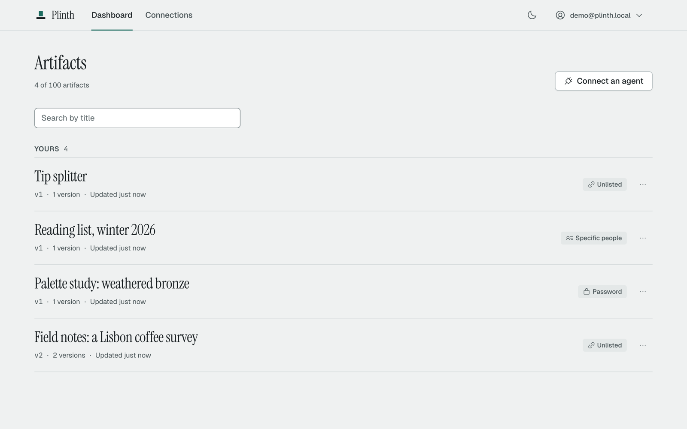
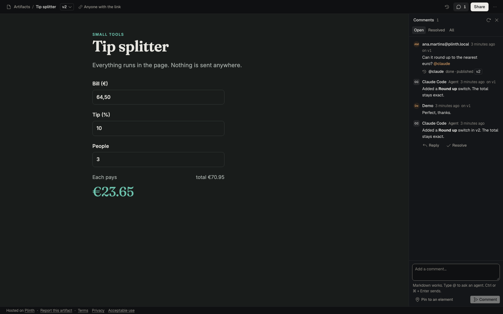

# Plinth

A neutral home for AI-made artifacts. Agents (Claude, Codex, any MCP client) publish HTML artifacts
to Plinth with one tool call. Owners decide who can view each one: public, anyone with the link, a
password, or an email allowlist. Viewers need no AI account.

Built-in artifact hosting has two limits. Artifacts are locked to the account that made them, so a
work account's artifacts are invisible from a personal one. And sharing with people outside the
same AI product is limited. Plinth keeps every artifact under one login, whichever agent made it.

- Every publish is an immutable version. Old versions keep permanent links and can be restored.
- People edit in the browser, with conflict checks instead of silent overwrites.
- A comment like "@claude make the chart bigger" queues a request for the owner's agent, which
  publishes a new version and replies in the thread.
- Each artifact is served from its own subdomain on a separate content domain, with a strict
  Content Security Policy. User HTML never runs next to login sessions.

It runs on Cloudflare (one Worker, one D1 database, one R2 bucket) and fits the free tier for a
personal instance. The same code runs the hosted instance at `plinth.aconite.io`, operated by
Aconite Software & Investments, Lda.

Works with Claude and Codex. Plinth is not made by or affiliated with Anthropic or OpenAI.

## Deploy

[](https://deploy.workers.cloudflare.com/?url=https://github.com/mr0b0t0/plinth/tree/main/apps/worker)

The button forks the repository and deploys the Worker to your Cloudflare account. You still need
a content domain, the wildcard route and the secrets: follow
[docs/deploy-checklist.md](docs/deploy-checklist.md), or use `node scripts/setup.mjs --remote`
([docs/self-hosting.md](docs/self-hosting.md)). The button has not been tried against this
repository yet.

To run an instance on your own computer instead, with the database and files on your disk and a
Cloudflare Tunnel for access, see [docs/local-hosting.md](docs/local-hosting.md).

## Quick start (local)

Requires Node 22.12+ and pnpm 10. pnpm runs Node 24.22.2 for this repo (`.npmrc`).

```sh
git clone https://github.com/mr0b0t0/plinth.git && cd plinth
pnpm install
node scripts/setup.mjs --local   # writes apps/worker/.dev.vars, migrates local D1
pnpm build                       # builds the web app the Worker serves
pnpm dev                         # http://app.localhost:8787
pnpm seed                        # in a second terminal: demo user, samples, a token
```

Open http://app.localhost:8787 and sign in as `demo@plinth.local`. Locally the sign-in code is
printed in the `wrangler dev` log. To connect an agent, open **Connections > Connect an agent**
and follow the tab for your client; it signs in with OAuth, no token needed. Claude and ChatGPT
connect from their own servers and cannot reach a local instance; use Claude Code, Codex, Cursor or
VS Code. The token `pnpm seed` prints is for scripts and CI (see [docs/mcp.md](docs/mcp.md)).

Artifacts are served from `<artifact_id>.content.localhost:8787`. Browsers resolve `*.localhost`
to your machine, so no hosts-file changes are needed.

## Screenshots

Gallery (light):



After hours (dark):



## Docs

| Document | What it covers |
| --- | --- |
| [docs/mcp.md](docs/mcp.md) | Connecting Claude, ChatGPT, Claude Code, Codex, Cursor and VS Code; tokens for scripts; every MCP tool; the mention workflow |
| [docs/self-hosting.md](docs/self-hosting.md) | Running your own instance; every setting; single-user mode |
| [docs/local-hosting.md](docs/local-hosting.md) | Running an instance on your own machine behind a Cloudflare Tunnel; data stays on your disk |
| [docs/deploy-checklist.md](docs/deploy-checklist.md) | Cloudflare resources, DNS, secrets, email, go-live steps |
| [docs/security.md](docs/security.md) | Threat model and how each boundary is enforced; reporting a vulnerability |
| [docs/openapi.json](docs/openapi.json) | REST API (`/api/v1`), OpenAPI 3.1; also served at `/openapi.json` |
| [docs/spec.md](docs/spec.md) | What Plinth does and why (the source of truth) |
| [docs/build-prompt.md](docs/build-prompt.md) | The v1 build brief |
| [CONTRIBUTING.md](CONTRIBUTING.md) | Setup, commands, conventions, adding migrations and tools |
| [AGENTS.md](AGENTS.md) | Rules for people and coding agents working in this repo |
| [DECISIONS.md](DECISIONS.md) | Choices made where the spec left room |

## Repository layout

Turborepo on a pnpm workspace.

| Path | What |
| --- | --- |
| `apps/worker` | The Cloudflare Worker: app host, content host, `/mcp`, `/api/v1` (Hono) |
| `apps/web` | React + Vite front end, served as static assets by the Worker |
| `packages/shared` | Types, zod schemas and constants used by both |
| `migrations` | D1 SQL migrations |
| `e2e` | Playwright end-to-end tests |
| `scripts` | `setup.mjs`, `seed.mjs`, `openapi.mjs` |
| `docs` | Spec, guides, OpenAPI file |

Main commands: `pnpm lint`, `pnpm typecheck`, `pnpm test`, `pnpm build`, `pnpm test:e2e`. See
[CONTRIBUTING.md](CONTRIBUTING.md).

## License

MIT. Copyright (c) 2026 Aconite Software & Investments, Lda. See [LICENSE](LICENSE).
