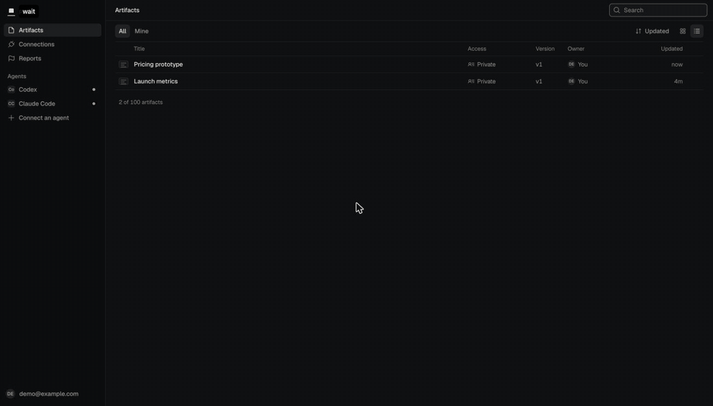

# Plinth

**Don't leave your best work in a chat window.**

The reports, dashboards and prototypes your agents make are your work. Plinth gives them a home:
send a link, choose exactly who can open it, and keep every version. The people you share with can
comment, and your agent picks up the comments and makes the change.

Works with Cursor, Codex, Claude Code and any other agent, or a plain script.



<sub>Recorded on a local instance (`npx @mr0b0t0/plinth`). Claude Code published v1, the comment
went to Codex, and Codex published v2 and replied, both through Plinth's MCP server. Nothing is
staged.</sub>

[](https://github.com/mr0b0t0/plinth/actions/workflows/ci.yml)
[](https://www.npmjs.com/package/@mr0b0t0/plinth)
[](LICENSE)

> **Beta.** Plinth is before 1.0: the MCP tools and the REST API may still change between minor
> versions, and every change is listed in the [changelog](CHANGELOG.md).

## Why Plinth

Many coding agents can write a page but have nowhere to put it, and the ones that can keep it inside
their own product, under the account and the plan that made it. Plinth is a neutral place for
pages from any of them:

- **Every agent, one place.** Claude Code, Codex, T3 Code, Cursor, VS Code, Gemini CLI, Claude,
  ChatGPT, any other MCP client and plain scripts publish to the same home, under your login, whichever
  agent did the work.
- **Private by default, shared on purpose.** Share a page with specific people, with anyone who has
  the link, or behind a password. Viewers need no AI account.
- **Versions, never overwrites.** Every publish is an immutable version with a permanent link.
  Compare any two, restore an old one, and see which agent or person made each.
- **A review loop with your agents.** Pin a comment to an element, mention `@claude` or `@codex`,
  and the agent publishes a new version and replies in the thread. Open pages update live.
- **Work on a page together, live.** On instances with live rooms on, owners and editors edit a doc
  or a sheet right on its page and see each other's changes as they type, saved as versions, and pages can
  show who else is there and share cursors and moves with `plinth.room`
  ([a whiteboard](docs/examples/whiteboard.html)).
- **Pages for clients and approvers.** People outside your team confirm their email by code, with
  no account, and sign off a proposal, answer an intake form or tick a shared checklist; the page
  shows who did what from Plinth's own records ([examples](docs/examples/)).
- **Design systems your agents build with.** Keep your tokens, components and guidelines on
  Plinth as a design system: a reference site with live previews in light and dark, which agents
  read with `get_design_system` so every page they make for you looks the same.
- **Sheets people can calculate with.** Agents publish budgets, trackers and lists as sheets:
  typed columns and Excel formulas Plinth computes, sort and filter for each viewer, CSV and .xlsx
  downloads, and `read_sheet` and `edit_sheet` so agents work with the numbers cell by cell. A CSV
  or .xlsx file publishes as a sheet too.
- **Built to host untrusted HTML.** Each artifact runs on its own subdomain of a separate content
  domain, sandboxed, under a strict Content Security Policy. Agent-written pages never run next to
  your login.
- **Yours to run.** Use the hosted instance, run it on your laptop, deploy it to your own
  Cloudflare account, or run the Docker image anywhere. MIT licensed.

## What people use it for

- **An agent with nowhere to put a page.** VS Code, Gemini CLI and most MCP clients can write HTML
  but have no built-in place to share it, and Cursor's shared canvases open only for your own Cursor
  team. Ask for a dashboard in Cursor and you get a link you can send to the people you choose, not a
  file in your repo.
- **A team on different tools.** One person works in Codex, another in Claude Code, a designer in
  Cursor. Their pages land in one place with one sharing model, and any agent can pick up a comment
  on a page another agent made (the recording above).
- **Scripts, cron jobs and CI.** A nightly job publishes its report with a token: any language,
  any model or none, over MCP or the REST API. Each run is a new version at the same link, so the
  history is the archive.
- **The agent you are building.** An app or agent on any SDK that speaks MCP gets publishing,
  sharing, comments and @mentions from one connection, with no hosting of its own to build.
- **Sharing with people outside your AI tools.** Publish a prototype for a client, add their email
  address, and they open it in any browser, comment on it and mention your agent. They need no AI
  account; nobody else can open it.
- **A design or data review.** Pin comments to the chart that's wrong; the agent fixes it and
  answers in the thread. Restore the previous version if the fix is worse.
- **Artifacts on your own domain, or on your own disk.** Deploy to your Cloudflare account and every
  page is served from `<id>.your-content-domain.com`. Or run it locally with one `npx` command:
  the database and files stay on your machine.

### From a script

Create a personal access token on the **Connections** page, then:

```sh
curl https://plinth.aconite.io/api/v1/artifacts \
  -H "Authorization: Bearer $PLINTH_TOKEN" -H "Content-Type: application/json" \
  -d '{"title": "Nightly build report", "html": "<!doctype html><title>Report</title><h1>All green</h1>"}'
```

The page is private until you share it; the response has its link. `PUT /api/v1/artifacts/{id}`
publishes the next run as a new version at the same link (add `base_version` to refuse a stale
write). Every endpoint is in [docs/openapi.json](docs/openapi.json).

### From CI

Publish a build on every run as the next version of one artifact, with a token that can only
read that artifact and publish new versions of it (Connections, **New token**, **Limit to one
artifact**):

```yaml
- uses: mr0b0t0/plinth/publish@v0.6.0
  with:
    path: dist
    token: ${{ secrets.PLINTH_TOKEN }}
    id: k3x9mq2v7d8p4t6w1n5r # your artifact's id
```

GitLab CI, cron and every input and output: [docs/ci.md](docs/ci.md).

### If you already use Claude Code artifacts

Claude Code can publish artifacts of its own, and they are the quickest way to share a page inside
a claude.ai organization. Plinth covers what they leave out:

| | Claude Code artifacts | Plinth |
| --- | --- | --- |
| Agents | Claude Code (CLI or desktop app) signed in to claude.ai, and Claude Tag | Claude Code, Codex, T3 Code, Cursor, VS Code, Gemini CLI, Claude, ChatGPT, any MCP client, plain HTTP |
| Credentials | API keys, gateway tokens, Amazon Bedrock, Google Cloud's Agent Platform and Microsoft Foundry cannot publish | Any client with a Plinth sign-in or token |
| Scripts and CI | Off by default in the Agent SDK, the GitHub Action, MCP-server contexts and `claude -p` | Scheduled and CI agents publish with a token ([docs/mcp.md](docs/mcp.md#advanced-personal-access-tokens-scripts-and-ci)) |
| Who can open a page | Only you, your organization or a shared folder (Team and Enterprise), or anyone with a public link | Listed email addresses, anyone with the link, a password, or public |
| Comments from outside | Public-link viewers cannot see or add comments | People you list as commenters comment and mention your agent, with no AI account |
| Where pages live | Anthropic-operated infrastructure | The hosted instance, your Cloudflare account, Docker, or your own disk |

<sub>The Claude Code column is from [Claude Code's artifacts
documentation](https://code.claude.com/docs/en/artifacts) as of 2026-11-14, which also lists
organizations with Zero Data Retention, HIPAA or customer-managed keys as unable to publish.</sub>

## Get started

| How | Run | Good for |
| --- | --- | --- |
| [Hosted](#hosted) | Sign in at [plinth.aconite.io](https://plinth.aconite.io) | Trying it, small teams |
| [On your computer](#on-your-computer) | `npx @mr0b0t0/plinth init` | Local agents, private work |
| [On your computer, reachable online](#on-your-computer-reachable-online) | `npx @mr0b0t0/plinth init --tunnel ...` | Sharing from your machine |
| [Your Cloudflare account](#your-cloudflare-account) | `npx @mr0b0t0/plinth deploy ...` | Your own domains, free tier |
| [Docker](#docker) | `docker run ghcr.io/mr0b0t0/plinth` | A VPS, AWS, GCP, or a laptop |

Then add the [agent plugin](#agent-plugin) so your agent knows Plinth's publishing rules.

### Hosted

Sign in at [plinth.aconite.io](https://plinth.aconite.io) with your email address, open
**Connections > Connect an agent**, and follow the tab for your client. Agents sign in with OAuth:
a browser opens on Plinth and you click **Allow**. No tokens to copy.

### On your computer

```sh
npx @mr0b0t0/plinth init --email you@example.com
npx @mr0b0t0/plinth start
```

Open `http://127.0.0.1:8788`; the sign-in code appears in the terminal. `npx @mr0b0t0/plinth
connect` prints the commands for Claude Code, Codex, Cursor and VS Code. Artifacts are served from
their own `*.localhost` origins, isolated from the app and from each other. Needs Node 22.12+ on
macOS or Linux. [docs/local-hosting.md](docs/local-hosting.md)

### On your computer, reachable online

The same instance, served on two domains of yours through a Cloudflare Tunnel, so people and
cloud-hosted agents (Claude, ChatGPT) can reach it while the data stays on your disk. Needs
`cloudflared` and two domains on Cloudflare.

```sh
export CLOUDFLARE_API_TOKEN=...   # setup only: Tunnel Edit, DNS Edit, Zone Read
export RESEND_API_KEY=...         # or SENDGRID_API_KEY
npx @mr0b0t0/plinth init --tunnel --app-host plinth.example.com \
  --content-host example-content.net --email-provider resend
npx @mr0b0t0/plinth start
```

[docs/local-hosting.md](docs/local-hosting.md)

### Your Cloudflare account

One command creates the database, the file bucket and the secrets, deploys the prebuilt Worker,
and prints how to connect your agents. It needs two domains on Cloudflare: one for the app, a
separate one for artifact content. A personal instance fits Cloudflare's free tier.

```sh
export RESEND_API_KEY=...         # or SENDGRID_API_KEY
npx @mr0b0t0/plinth deploy --app-host plinth.example.com --content-host example-content.net \
  --email-provider resend --admin-email you@example.com
```

Run it again with no flags to redeploy or upgrade.
[docs/self-hosting.md](docs/self-hosting.md#deploy-with-one-command)

### Docker

```sh
docker run -d --name plinth -e PLINTH_EMAIL=you@example.com \
  -p 127.0.0.1:8788:8788 -v plinth-data:/data ghcr.io/mr0b0t0/plinth:latest
```

That is the localhost mode; the sign-in code is in `docker logs plinth`. The image also runs behind
your own reverse proxy with your domains, or through a Cloudflare Tunnel. Data lives in the `/data`
volume. [docs/docker.md](docs/docker.md)

### Agent plugin

The Plinth plugin adds the MCP server and a skill that teaches the agent what an artifact may
contain and how to share it. It points at the hosted instance; [docs/agents.md](docs/agents.md)
shows how to point it at your own.

```sh
/plugin install plinth --marketplace mr0b0t0/plinth                              # in Claude Code
codex plugin marketplace add mr0b0t0/plinth && codex plugin add plinth@plinth   # Codex
```

[T3 Code](https://t3.codes) runs your Claude Code and Codex with their own settings, so the same
installs cover its threads.

Gemini CLI, Cursor and VS Code get the same rules as an extension, a rule file and an instructions
file ([docs/agents.md](docs/agents.md)). Those three have not been tried in each tool yet
([#8](https://github.com/mr0b0t0/plinth/issues/8)).

## How it keeps artifacts apart

Hosting HTML written by agents (and by whoever prompted them) is the main risk, so the rules are
strict and enforced on every request:

- The app and the artifacts are on different registrable domains, and each artifact has its own
  subdomain, so pages cannot read your session or each other's data.
- Artifacts render in sandboxed frames with a Content Security Policy that blocks network calls to
  other hosts.
- Access is checked by one policy module on every read and write. Tokens are stored hashed and can
  be revoked per connection.
- Comment text is untrusted input for agents: a mention is a request, never an instruction with
  the owner's authority.

[docs/security.md](docs/security.md) has the threat model. Report vulnerabilities privately
([SECURITY.md](SECURITY.md)).

## Develop

Requires Node 22.12+ and pnpm 10. pnpm runs Node 24.22.2 for this repo (`.npmrc`).

```sh
git clone https://github.com/mr0b0t0/plinth.git && cd plinth
pnpm install
node scripts/setup.mjs --local   # writes apps/worker/.dev.vars, migrates local D1
pnpm build                       # builds the web app the Worker serves
pnpm dev                         # http://app.localhost:8787
pnpm seed                        # in a second terminal: demo user, samples, a token
```

Sign in as `demo@plinth.local`; the code is printed in the `wrangler dev` log. Artifacts are served
from `<id>.content.localhost:8787`. Contributions are welcome: start with
[CONTRIBUTING.md](CONTRIBUTING.md) and the
[good first issues](https://github.com/mr0b0t0/plinth/labels/good%20first%20issue).

| Path | What |
| --- | --- |
| `apps/worker` | The Cloudflare Worker: app host, content host, `/mcp`, `/api/v1` (Hono) |
| `apps/web` | React + Vite front end, served as static assets by the Worker |
| `packages/shared` | Types, zod schemas and constants used by both |
| `packages/cli` | `@mr0b0t0/plinth`: runs a local instance or deploys to Cloudflare |
| `integrations` | The agent plugin, skill and per-client rules (generated by `pnpm integrations`) |
| `migrations` | D1 SQL migrations |
| `e2e` | Playwright end-to-end tests |
| `docs` | Spec, guides, OpenAPI file |

## Docs

| Document | What it covers |
| --- | --- |
| [docs/mcp.md](docs/mcp.md) | Connecting each client; tokens for scripts; every MCP tool; the mention workflow |
| [docs/agents.md](docs/agents.md) | The plugin and skill for Claude Code, Codex and other agents |
| [docs/ci.md](docs/ci.md) | Publishing from GitHub Actions, GitLab CI or cron with a token limited to one artifact |
| [docs/local-hosting.md](docs/local-hosting.md) | Running Plinth on your computer, localhost only or through a Cloudflare Tunnel |
| [docs/self-hosting.md](docs/self-hosting.md) | Your own Cloudflare deployment: one command or from a checkout; every setting |
| [docs/docker.md](docs/docker.md) | The Docker image: localhost, behind a reverse proxy, or through a Cloudflare Tunnel |
| [docs/deploy-checklist.md](docs/deploy-checklist.md) | Cloudflare resources, DNS, secrets, email, go-live steps |
| [docs/security.md](docs/security.md) | Threat model and how each boundary is enforced |
| [docs/openapi.json](docs/openapi.json) | REST API (`/api/v1`), OpenAPI 3.1; also served at `/openapi.json` |
| [docs/spec.md](docs/spec.md) | What Plinth does and why (the source of truth) |
| [docs/releasing.md](docs/releasing.md) | How releases are cut and published |
| [DECISIONS.md](DECISIONS.md) | Why things are the way they are |
| [CHANGELOG.md](CHANGELOG.md) | What changed in each release |

## License

MIT. Copyright (c) 2026 Aconite Software & Investments, Lda. See [LICENSE](LICENSE).

Works with Claude and Codex. Plinth is not made by or affiliated with Anthropic or OpenAI. The
hosted instance at [plinth.aconite.io](https://plinth.aconite.io) is run by Aconite Software &
Investments, Lda.
