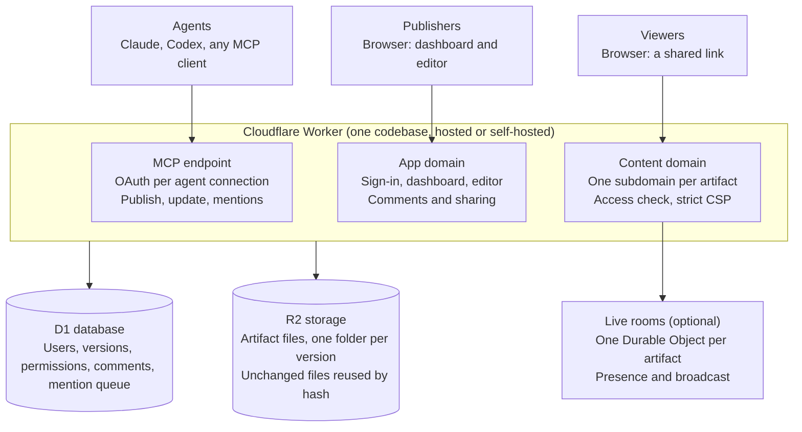

# Plinth: Project Spec

As of 2026-11-13

Local copy of [Plinth: Project Spec](https://claude.ai/artifact/ALCnNY6VEnyHMDSjjjiCQc) (doc rev 26).
This file is the source of truth in the repo. When the spec changes, update this file in the same
commit as the code that follows it.

## Summary

Plinth is an open-source, multi-user platform where AI agents (Claude, Codex, any MCP client)
publish HTML artifacts to a neutral home, and owners control who can view them.

It solves two problems with built-in artifact hosting. Artifacts are locked to the account and
organization that made them, so a work account's artifacts are invisible from a personal one. And
sharing with people who do not use the same AI product is limited or blocked.

The platform runs on Cloudflare (Workers, R2, D1). The same codebase serves two deployments: a
hosted instance anyone can sign up to, and a self-hosted copy on the operator's own Cloudflare
account.

## Goals and non-goals

**Goals**

- Any MCP-capable agent can publish and update an artifact with one tool call.
- One account can connect several agents (work Claude, personal Claude, Codex) and see all
  artifacts in one place.
- Owners choose who can view each artifact: public, anyone with the link, password, or an email
  allowlist.
- Viewers need no AI account. At most they confirm an email address.
- Every publish is a version. Old versions stay readable and restorable.
- People can edit an artifact in the browser and ask an agent for changes by commenting on it.
- Invited people can work on a page together live, and owners and editors can edit a doc on its
  page together.
- Open source, and cheap enough to self-host on Cloudflare's free tier.

**Non-goals for v1**

- Per-artifact server code. Artifacts are static HTML plus assets; the only server behaviour a
  page can reach is Plinth's fixed shared-data service (see
  [Shared data and viewer identity](#shared-data-and-viewer-identity)) and its live room at
  `/__plinth/room/` (see [Live rooms](#live-rooms)).
- Character-level co-editing (OT or CRDT), and live editing of HTML artifacts' text (pages build
  their own multiplayer with [live rooms](#live-rooms)).
- On-page editing of HTML artifacts (docs are edited on the page; HTML in the source editor).
- Importing artifacts automatically from Claude or ChatGPT accounts. Agents push; the platform does
  not pull.
- Team workspaces and billing. Planned, but after the core works.

## Users and core use cases

| Who | What they do |
| --- | --- |
| Publisher | Signs in, connects one or more agents, publishes artifacts, sets who can view each one |
| Viewer | Opens a link. Depending on the artifact, sees it directly, enters a password, or confirms an allowlisted email |
| Collaborator | A viewer the owner has given comment or edit rights |
| Agent | Claude, Codex or another MCP client acting for a publisher: publishes, updates, reads comments, replies |
| Self-hoster | Deploys the repo to their own Cloudflare account and runs a private instance |
| Local host | Runs an instance on their own machine, with all data on their disk, reachable through a Cloudflare Tunnel |

The three flows that must work well:

1. **Cross-account access.** Work Claude publishes an artifact. The owner opens it later from any
   device or account, because it lives under their platform login.
2. **Sharing outside the AI product.** The owner sends a link to a client who has no Claude
   account. The client opens it after an email check.
3. **Change by comment.** A collaborator comments "@claude make the chart bigger". The owner's
   agent picks up the request, publishes a new version and replies in the thread.

## Architecture

One Cloudflare Worker handles everything, routed by hostname: the MCP endpoint for agents, the app
for publishers, and a separate content domain for the artifacts themselves.

The content domain is the security boundary. User HTML never runs on the domain that holds login
sessions, and each artifact gets its own subdomain so artifacts cannot read each other's data.
Metadata goes to D1 and files to R2; nothing else needs to be provisioned. The same Worker also
defines one SQLite-backed Durable Object class, `ArtifactRoom` (binding `ROOMS`), for
[live rooms](#live-rooms): an object per artifact, created only when someone opens that artifact's
room, keeping no tables. A deploy without the binding runs with rooms off.

## Data model

Metadata lives in D1 (SQLite). Artifact files live in R2 under `artifacts/<artifact_id>/`: a
version's new files under its own prefix (`v<n>.<nonce>/` since 0.4.0, where `<nonce>` is 12
random characters per write attempt; `v<n>/` for versions written earlier), and files it shares
with an earlier version of the same artifact stay where they were first stored ([Big builds and
reuse by hash](#big-builds-and-reuse-by-hash)). The row's `r2_prefix` is authoritative.

| Table | Key fields | Notes |
| --- | --- | --- |
| `users` | id, email, name, auth provider, created_at | One row per person who signs in |
| `agent_connections` | id, user_id, label, client type, token hash, last_used_at, artifact_id | One per connected agent, e.g. "Work Claude". Revocable individually. `artifact_id` is NULL, or the one artifact a personal access token is limited to |
| `artifacts` | id, owner_id, slug, title, type, current_version, visibility, password hash, category, created_at | `visibility` is public, unlisted, password or allowlist. `type` is `html` (a hand-written `index.html`), `doc` (Markdown in `content.md`), `slides` (a deck's Markdown in `slides.md`) or `design_system` (JSON in `system.json`), fixed at publish. `category` is the owner's own grouping (NULL = none), shown only to the owner |
| `versions` | id, artifact_id, number, r2_prefix, size_bytes, stored_bytes, manifest, created_by (user or agent), note, created_at | Immutable, and written only once its files are in R2 (commit last). A restore creates a new row. `size_bytes` is what a viewer loads; `stored_bytes` is what this version added to R2 (NULL for versions written before 0.4.0, which count `size_bytes`). Each manifest entry has `path`, `size_bytes`, `content_type`, a server-computed `sha256` (absent on files stored before 0.4.0) and, for a reused file, a server-written `stored_at` (`v<m>[.<nonce>]/<path>`, relative to `artifacts/<artifact_id>/`, never returned by the API) |
| `access_grants` | artifact_id, email, role | Role is viewer, commenter or editor. Used for allowlists and collaborators |
| `comments` | id, artifact_id, version, parent_id, author, body, mentions, status | Threaded. `status` is open or resolved |
| `mention_tasks` | id, comment_id, target agent, state, claimed_by, result_version | The queue agents read. State is pending, claimed, done or failed |
| `sessions` | id, user or viewer email, expires_at | Login and viewer sessions |
| `reports` | id, artifact_id, reason, reporter, state | Abuse reports |

**Shared data** ([below](#shared-data-and-viewer-identity), migration `0005_shared_state.sql`)
adds one column and two tables:

| Table or column | Key fields | Notes |
| --- | --- | --- |
| `versions.capabilities` | JSON `{ data, viewer, shared }` or NULL | What the version's `index.html` declares, parsed at publish. NULL for versions that declare nothing and for versions published before the column |
| `artifact_docs` | artifact_id, collection, doc_id, data, size_bytes, rev, created_by_email/role/via/label, created_at, updated_by_email/role/via/label, updated_at | One JSON document. Key (artifact_id, collection, doc_id). Shared by every version of the artifact and not versioned. Stamps come from the server. `via` is page, agent or app |
| `artifact_data_usage` | artifact_id, docs, bytes, seq | Exact totals per artifact kept by SQLite triggers on `artifact_docs`, for one-row quota checks. `seq` grows on every change and is what pages poll |

**Big builds** ([below](#big-builds-and-reuse-by-hash), migrations `0006_stored_bytes.sql` and
`0007_upload_tickets.sql`) add one column and one table:

| Table or column | Key fields | Notes |
| --- | --- | --- |
| `versions.stored_bytes` | integer or NULL | Bytes this version wrote to R2. The storage quota sums `coalesce(stored_bytes, size_bytes)` |
| `upload_tickets` | id, token_hash, user_id, credential (`connection` or `admin`), connection_id or admin_token_hash, scopes, mode (`publish` or `update`), artifact_id, artifact_type, title, category, note, base_version, state (`open`, `used`, `dead`), attempts, receiving_claim, receiving_until, result_artifact_id, result_version, reserved_artifact_id (unique), dead_reason (`conflict` or `taken_down`, on a dead ticket), created_at, expires_at, used_at | One single-use upload ticket from `start_upload`. The token is stored as its SHA-256. A publish-mode ticket reserves its artifact id at mint (`reserved_artifact_id`, returned as `target.id`), and its commit creates the artifact with exactly that id; no other ticket can hold that id, and only that ticket's bundle can create it. While the ticket is live (open, unexpired, attempts left, minting credential still valid) the reservation counts toward the owner's artifact limit for new reservations and inline publishes; once it expires unused the id is released and never becomes an artifact. Only the id is reserved, not a slug (the commit picks the slug). `open -> used` happens in the same D1 batch that commits the version. The receiving lease limits concurrency and is the bundle's deadline (10 minutes). A row is deleted once `TTL.uploadStatusMs` (24 hours) has passed since it expired, by the hourly cron and by the opportunistic sweep; erasing an artifact or a user deletes its tickets |

**Categories** (migration `0009_categories.sql`) add one nullable column to `artifacts` and one
to `upload_tickets`, plus a partial index `artifacts_owner_category` on (owner_id, category) over
live, categorised rows. A category is a free-text name for the project, repo or client an artifact
belongs to: at most one per artifact, no tags and no categories table, so a category exists while at
least one live artifact uses it. It is artifact metadata, never versioned, and returned only to the
owner (`category` is null for everyone else). The Worker validates and normalises the text
(`packages/shared/src/categories.ts`); the columns have no CHECK constraint.

**Artifact stats** (migrations `0010_view_counts.sql` and `0020_artifact_opens.sql`) keep one row
per counted open with who opened it, and an all-time count per artifact. Both cascade from
`artifacts`, so erasing an artifact or its owner removes them (see
[Artifact stats](#artifact-stats)):

| Table | Key fields | Notes |
| --- | --- | --- |
| `artifact_opens` | id (integer), artifact_id, version, opened_at (UTC ISO), viewer_kind (`user`, `email`, `anonymous`, `unknown`), user_id, email, visitor, role | One row per counted open, kept for `VIEW_LOG_RETENTION_DAYS`. `user_id` (signed in; `ON DELETE SET NULL`), `email` (an allowlisted email confirmed by code) and `visitor` (a random id from the content cookie) each belong to their own kind only (CHECK constraints). `version` is NULL for opens migrated from daily counts. Indexes: (artifact_id, opened_at), (opened_at), and partial ones on user_id and email. No IP address or user agent |
| `artifact_view_totals` | artifact_id, views, first_day | Opens older than the retention, folded into one count per artifact; `first_day` is the earliest day folded in |

**Live rooms and on-page doc editing** (issue #36, migration `0011_live_drafts.sql`) add one table
and two fields to the stored declaration:

| Table or column | Key fields | Notes |
| --- | --- | --- |
| `versions.capabilities` | adds `room`, `roomOpen` | Written only when the page declares `room` (`<meta name="plinth-capabilities" content="room">`, open topics from `<meta name="plinth-room-open">`), so every other declaration is stored exactly as before. A row without them reads as no room. `room` is not shared data: a page that declares only `room` has none |
| `live_drafts` | artifact_id (key), base_version, content, size_bytes, rev, conflict_version, updated_by_user, created_at, updated_at | At most one unsaved page draft per doc, apart from its immutable versions, and never a version itself. Written by the artifact's room in a guarded flush that cannot bring back a deleted or taken-down artifact, never moves `rev` backwards and keeps at most 20 drafts per owner. A row exists only while the draft differs from `base_version`, or while `conflict_version` (a version published meanwhile that changed the same lines) waits for review. Content follows the doc limits (1 MB, 50,000 lines). Deleted with the artifact and on takedown; `updated_by_user` is cleared on `erase-user`; untouched rows are deleted after `LIVE_DRAFT_RETENTION_DAYS` |

Settings (env vars): `ALLOW_ROOMS` (on), `ROOM_MAX_CONNECTIONS_PER_ARTIFACT` (50, from 2 to 1000),
`ROOM_MAX_MESSAGE_BYTES` (8192, from 512 to 65536), `ROOM_MESSAGES_PER_SECOND` (20 per connection,
from 1 to 100, burst twice that), `ALLOW_LIVE_EDITING` (on), `LIVE_CHECKPOINT_IDLE_S` (120; 0 for
explicit saves only, otherwise from 30 to 3600), `LIVE_AUTO_CHECKPOINT_MIN_S` (600, at least the
idle time), `LIVE_DRAFT_FLUSH_S` (5, from 2 to 60) and `LIVE_DRAFT_RETENTION_DAYS` (30, from 1 to
365). Fixed: presence of 400 bytes per room, 3 rooms per connection, 8 sockets per viewer and 20
connects per viewer per minute; a doc-socket frame of 64 KiB; a lease idle for 60 s may be taken
over.

**Comments from the page** ([below](#comments-from-the-page-decided-2026-11-19), no migration) add
one field to the stored declaration and a second kind of comment anchor:

| Table or column | Key fields | Notes |
| --- | --- | --- |
| `versions.capabilities` | adds `comments` | Written only when the page declares `comments`, so every other declaration is stored exactly as before. A row without it reads as no page comments. `comments` is neither shared data nor a room |
| `comments.anchor` | JSON: an element anchor `{ selector, text?, x?, y? }`, or a page anchor `{ kind: "page", key, x?, y?, text?, data? }` | Element anchors are stored without `kind`, as before. Both kinds are read back through the anchor schema; a stored value no schema allows reads as no anchor |

**Bound tokens** (issue #51, migration `0012_bound_tokens.sql`) add one column:

| Table or column | Key fields | Notes |
| --- | --- | --- |
| `agent_connections.artifact_id` | artifact id or NULL | The one artifact a personal access token is limited to ([Publishing from CI](#publishing-from-ci-decided-2026-11-19)). NULL is an account-wide token or an OAuth connection; a CHECK refuses it on an OAuth row. Set at creation and never changed: to change the limit, revoke the token and make another. Deleting or taking down the artifact revokes its bound tokens in the same batch; erasing the artifact (or its owner) removes them (`ON DELETE CASCADE`, never `SET NULL`, so a bound token can never become an account-wide one). A partial index covers bound rows |

**Category sharing and personal categories** ([below](#category-sharing-and-personal-categories-decided-2026-11-19),
issue #42, migration `0013_category_sharing.sql`) add three tables and five columns:

| Table or column | Key fields | Notes |
| --- | --- | --- |
| `artifacts.category_key` | text or NULL | The category's match key (`categoryKey`: NFKC, lower case, whitespace, `-` and `_` folded), written next to `category` on every category write. Rows from before the migration get it when their owner first shares a category (or opens a share); a NULL key never matches a share |
| `artifacts.category_rev` | integer, 0 | Bumped in the same statement as every change of `category_key`, so a review the owner opened before a move out and back is skipped |
| `artifacts.category_review`, `category_review_share` | `shared` or `private`, and a share id; both NULL or both set (CHECK) | The owner's review, bound to the share it was made against. Reset to NULL on every key change; written only by the owner's share requests |
| `users.category_share_rev` | integer, 0 | Bumped by every batch that creates, deletes or moves one of the person's shares; a category rename guards its batch on it |
| `category_shares` | id, owner_id, category_key, name, title, created_at, updated_at | One per owner and key (UNIQUE). `id` is the portal link and never changes, also across renames. `name` is the owner's spelling (owner only); `title` is what the people see. Cascades from `users` |
| `category_grants` | share_id, email, role | `viewer` or `commenter` (CHECK; never `editor`). Key (share_id, email). Cascades from the share; `erase-user` deletes an address's rows |
| `login_codes.share_id` | share id or NULL | A portal's email code (`artifact_id` NULL), bound to the share; cascades from it |
| `personal_categories` | user_id, artifact_id, category, created_at, updated_at | A collaborator's own category for an artifact shared with them. Key (user_id, artifact_id). Cascades from `users` and `artifacts`; deleted with the artifact and on takedown, and when its person no longer holds a grant on the artifact |

Setting: `ALLOW_CATEGORY_SHARING` (on). Fixed: 100 shares per owner (checked in the statement that
inserts the share), 200 people per share, a title
of at most 200 characters, review items up to the owner's artifact limit, 500 artifacts per portal.

## Auth and permissions

There are three separate kinds of auth, and each has its own mechanism.

**Publishers (people).** Sign in with an email magic link, sent through SendGrid or Resend
depending on configuration. GitHub and Google sign-in can be added later. Sessions are cookies
scoped to the app domain only.

**Agents.** The MCP endpoint is an OAuth 2.1 server with dynamic client registration, so connecting
from Claude or Codex is a "connect" click followed by a consent screen. Each connection gets its own
token and label. Personal access tokens are the fallback for clients without OAuth support and for
CI.

A personal access token can be limited to one artifact (for CI: [Publishing from
CI](#publishing-from-ci-decided-2026-11-19)). It always holds `artifacts:read` and may hold
`artifacts:write`, never `mentions`. It may view that artifact (as its person may, with the person's
current rights) and publish new versions of it, and nothing else: no new artifacts, no other
artifact (404 for every action, whatever its scopes), no sharing, title, category, restore, delete,
comments (reading or writing them), shared data, stats (its own artifact's, or the summary across
its person's artifacts, which is always refused) or mentions (403 `token_bound` on its
own artifact while it may view it; once its person may not, every action answers as viewing does).
It is never the target of an `@<label>` mention. It does not see the artifact's category, its
shared-data usage or the owner's category names, and never sees or manages category sharing (no
role through a category grant, no share state, 403 `token_bound` from the share, portal and
personal-category routes: [Category sharing](#category-sharing-and-personal-categories-decided-2026-11-19)); it does see the version list and `live_draft`
metadata, as an editor's agent does, but sees the people only as a link viewer does: the owner by
name, with no id or email, and each version's author by name or the address's local part, with no
ids, even when the token is the owner's. Design systems are other artifacts too: `get_design_system`
answers 404 for every one but its own artifact, unlisted and public ones included, so a page it publishes that
names one gets `design_system_unavailable` and `get_artifact` shows `design_system: null` to it.
It never gets a content pass of its own, which reads the page's shared data: the viewer gate
(`GET /api/v1/view/:ref`, and its password route) answers 403 `token_bound` on its artifact
instead of an enter URL, and so does the thumbnail (a capture runs the page, which may draw its
shared data), whose `thumbnail_url` is null for it. The capture of a version it wrote reads no
shared data either, so its page cannot run unattended with the data in Plinth's own browser
([Thumbnails and link previews](#thumbnails-and-link-previews)). Its in-chat preview
(`preview_artifact`) stays, since a preview pass reads no shared data and joins no room. It reads
the page through the API.
Only the artifact's owner or an editor can make one. The limit
never widens; deleting or taking down the artifact revokes it, and removing the person's grant stops
it.

**Viewers.** Set per artifact:

| Visibility | Who can open it |
| --- | --- |
| Public | Anyone. May be listed on the owner's profile |
| Unlisted | Anyone with the link |
| Password | Anyone with the link and the password |
| Allowlist | Only listed emails (and the owner), confirmed by a one-time code or magic link |

Owners can also grant a listed email the commenter or editor role. Owners can also share a category
with people (viewer or commenter, [below](#category-sharing-and-personal-categories-decided-2026-11-19)):
it covers the artifacts of that category the owner has reviewed into the share, never one only filed
there. Access to the artifact itself is enforced by the Worker on the content domain using a
short-lived signed token, so the app's login cookie never reaches user HTML.

## MCP interface

One remote MCP server over streamable HTTP at `/mcp`. All tools act as the connected user.

| Tool | Purpose |
| --- | --- |
| `publish_artifact(title, html \| type+content, assets?, visibility?, category?)` | Create an artifact. Returns its id and URL, `warnings` and `stored` (and `category`, the stored name, when one was given). Private by default (`allowlist` with nobody added). `type: "doc"` with Markdown in `content` makes a document, `type: "slides"` a deck |
| `update_artifact(id, html \| content, assets?, base_version?, note?, category?)` | Publish a new version of an existing artifact, in the source field its type takes. An asset may be `{path, sha256}` to reuse a file of the current version. `category` is owner only. Returns `warnings` and `stored` |
| `start_upload(id?, base_version?, type?, title?, note?, category?)` | For a build folder or a large page: mint a single-use, 30-minute upload ticket for one new artifact, or for one update of `id` (then `base_version` is required). The result has `upload_url`, `upload_token`, `target` (with `id`: the artifact updated, or the one the publish will create), `commands.curl` (and `commands.npx` on release builds), the instance's `limits` and `content_isolation` |
| `get_artifact(id, version?)` | Read metadata, `type`, the source (`html` for a page, `content` for a doc, a deck or a design system, and `source_path`) and each asset's `sha256`, so an agent can edit from the current state. An HTML page that names its design system also gets `design_system` (see [Design systems](#design-systems-decided-2026-11-19)) |
| `list_artifacts(query?, category?, type?, limit?)` | List the user's artifacts and their own category names (`limit: 0` returns only the names). `type` filters by artifact type, for example `design_system` |
| `list_versions(id)` | Version history with notes and authors |
| `restore_version(id, version)` | Make an old version current by publishing it as a new one |
| `set_visibility(id, visibility, emails?, password?)` | Change who can view |
| `get_artifact_stats(id?, days?)` | Owner only, read-only: who opened one artifact over 7, 30, 90 or 365 days (totals, a daily series, people with their last version seen, opens per version), or without `id` opens and viewers over 7 and 30 days for every artifact the user owns. The people list is the owner's data and must not be passed on |
| `list_mentions(state?)` | Pending requests addressed to this agent |
| `claim_mention(task_id)` | Lock a request so two agents do not both act on it |
| `reply_comment(comment_id, body, result_version?)` | Answer in the thread and mark the task done |
| `list_comments(id)` | Every comment thread on an artifact, for addressing feedback |
| `resolve_comment(comment_id, resolved?)` | Resolve or reopen a thread |
| `list_artifact_data(id, collection?, doc_id?, limit?, cursor?)` | Read an artifact's shared data (owner or editor): a summary, one page of a collection, or one document. Every result is marked untrusted |
| `write_artifact_data(id, ops)` | Change shared data (owner or editor): 1 to 50 `set`/`delete` ops, each with a required `if_rev`, each succeeding or failing on its own |
| `get_design_system(id, version?, include?, components?)` | Read a design system (type `design_system`) the user can open, to build another artifact with it: tokens resolved to values, one CSS block of custom properties for light and dark, Google Fonts links, guidelines and component examples. Read-only; every text field is untrusted |
| `preview_artifact(id, version?)` | App-only (MCP Apps `visibility: ["app"]`, read-only): a single-use, 60-second link that shows one version the caller can view in an MCP host's frame. Called by Plinth's preview page, not by agents |

**In-chat previews (decided 2026-11-16).** `publish_artifact`, `update_artifact` and
`restore_version` carry `_meta.ui.resourceUri: "ui://plinth/preview.html"` (MCP Apps, SEP-1865), so
hosts that support it show the published version under the tool call. The resource is a fixed page
Plinth wrote; it may frame `<scheme>://*.<CONTENT_HOST>` only. Each render asks `preview_artifact`
for a fresh link, so no link appears in a result the model reads. The link becomes a preview pass
on the content host: no identity, no shared data, one version, 10 minutes, and the only pass whose responses
omit `frame-ancestors` (see `docs/security.md#in-chat-previews`). Not offered under the staging path
fallback.

**Agent experience (decided 2026-11-14).** Plinth should feel the same in every harness (Claude,
Claude Code, Codex, ChatGPT, Gemini CLI, Cursor, VS Code, and T3 Code through the Claude Code and
Codex it runs), with Claude's artifact experience as the
reference: finished pages (real title, light and dark themes, phone width, pinned allowlisted
scripts), private by default so agents publish without asking and hand over the link, new versions
at the same link, and a feedback loop through comments. The MCP server's instructions and tool
descriptions carry the core rules to every client; the `plinth-artifacts` skill carries the full
ones as a plugin, extension, rule file or uploaded skill. All per-harness packages are generated by
`pnpm integrations` from the harness registry (`packages/shared/src/harnesses.ts`) and the skill
(`integrations/skill/`). Runtime capabilities (shared state, viewer identity) were left out of
that work and came later as one fixed service per artifact: see
[Shared data and viewer identity](#shared-data-and-viewer-identity). Guide: `docs/agents.md`; design:
`docs/superpowers/specs/2026-11-14-agent-experience-design.md`.

**Shared data for agents (decided 2026-11-14).** `get_artifact` also returns `capabilities` (what
the returned version declares) and `data_usage` (`{ docs, bytes }`, or null when there is none or
the caller is below editor), so an agent sees there is data before it edits the page. Data
survives `update_artifact` and restores. Only the owner clears all data, in the app or over REST;
agents have no bulk delete.

**Agent discovery (decided 2026-11-14).** An agent handed a Plinth link learns from the page it
fetches what Plinth is and how to read the artifact. Every SPA page on the app host carries a
plain-text note for agents inside `
` (hidden by a stylesheet, replaced when the app
mounts): the MCP endpoint and OAuth discovery, `get_artifact` with the link's id, the plugin and
client install commands, `/llms.txt`, the docs and the repository. On `/a/...` and `/open/...`
pages, access is decided by the policy module for an anonymous viewer, ignoring cookies: when an
anonymous viewer could open the artifact (unlisted, or public), the note and the page title give
its title (marked as untrusted text), its current version and a link to `GET /a/<slug>/source`,
which returns the main HTML document (a doc's Markdown) as sandboxed `text/plain` (`?version=<n>`, rate-limited per
IP, `no-store`). Private, password, deleted, taken-down and missing artifacts get one generic note
and `404` from the source endpoint, identical in every case. `/a/...` pages send
`X-Robots-Tag: noindex, nofollow` except a public artifact on an instance with public visibility
on. The app host also serves `/llms.txt` (built from config, with every MCP tool), an MCP Server
Card (SEP-2127) at `/mcp/server-card` (also at `/.well-known/mcp.json` and
`/.well-known/mcp/server-card.json`, listed in `/.well-known/ai-catalog.json`) and `/robots.txt`,
plus `/.well-known/openai-apps-challenge` (OpenAI's domain verification token as plain text) when
`OPENAI_APPS_CHALLENGE` is set; other `/.well-known/` paths and missing files answer `404` instead of the SPA. Guide:
`docs/agents.md#agent-discovery`; design:
`docs/superpowers/specs/2026-11-14-agent-discovery-design.md`.

A plain REST API mirrors these tools for scripts and CI (`POST /api/v1/uploads` mirrors
`start_upload` and takes a bearer token only; `GET /api/v1/artifacts?query=&category=` mirrors
`list_artifacts` and returns `{ items, categories }`). Beyond the tools, `PATCH /api/v1/artifacts/:ref`
sets the title or the category (owner), `GET /api/v1/categories` lists the caller's own category
names, and `POST /api/v1/categories/rename` renames, merges or clears one (signed-in session only).
Category sharing and personal categories (signed-in session only, never MCP):
`GET`/`POST /api/v1/category-shares`, `GET /api/v1/category-shares/preview?category=`,
`GET`/`PATCH`/`DELETE /api/v1/category-shares/:id`, `POST /api/v1/category-shares/:id/review`
and `PUT /api/v1/artifacts/:ref/my-category`; for the people a category is shared with,
`GET /api/v1/portals`, `GET /api/v1/portals/:id` and the code flow `POST /api/v1/portals/:id/email`
and `.../code`.
`GET /api/v1/artifacts/:ref/design-system?version=&include=&components=` mirrors `get_design_system`,
and `GET /api/v1/artifacts?type=` filters the list by type.
`POST /api/v1/connections` (people only) takes an optional `artifact` (id or slug) to limit the new
token to it; every `ConnectionInfo` carries `artifact` (`{ id, slug, title }` for a bound token,
with slug and title null once the person may no longer view it; null otherwise), and
`GET /api/v1/me` returns `connection` for a bearer caller (`{ id, label, bound, artifact }`; the
artifact only while the person may view it) and null for a session; for a token limited to one
artifact it returns only `id` (the person's) and `connection`, none of the account fields. Size
limits: 5 MB of HTML (1 MB of Markdown for a doc, and 1 MB and 500 slides for a deck), and per
version a total size and a file count set by the operator with `MAX_VERSION_BYTES` (default 50 MB,
at most 64 MB) and `MAX_ASSETS_PER_VERSION` (default 511, at most 900). A JSON request body may be
up to 40 MB. `GET /api/v1/config` returns the instance's limits.

**Typed outputs (decided 2026-11-14).** The first type is `doc`: an agent sends Markdown in
`content` and Plinth renders it as a finished page (reading typography, heading anchors, tables,
code, images from the artifact's own files, light and dark, phone width, a print stylesheet for
Print to PDF). A doc version stores `content.md` and its images. Its page is a fixed Plinth shell
that embeds the Markdown as escaped JSON and loads Plinth's renderer from the artifact's own origin
under `/__plinth/types/doc/`, in every isolation mode; no per-artifact server code, and the CDN
allowlist is unchanged. Raw HTML in the Markdown shows as text, links pass an allowlist and open in
a new tab, and the shell's CSP (header and a meta copy, so the editor preview gets it too) allows
only `script-src 'self'`; a doc's other files run no script. The type is fixed at publish
(`artifacts.type`, default `html`); versions, `base_version` conflicts and restore work as for HTML.
The editor edits the Markdown with a live preview and history diffs `content.md`. Owners and
editors can also edit a doc on its rendered page ([Editing](#editing)): for them, on the current
version while rooms and live editing are on, the shell's payload carries `live: "room"` and the
renderer connects the doc socket; every other shell is byte for byte as before. The second type
is `slides` (decided 2026-11-19, [Slides](#slides-decided-2026-11-19)): Markdown with a line `---`
between slides, stored as `slides.md`, rendered as a deck by the same kind of fixed renderer.
The third is `design_system` (decided 2026-11-19): design tokens, guidelines and components as
JSON, which agents read with `get_design_system` to build other pages; see
[Design systems](#design-systems-decided-2026-11-19). Sheets join the same type registry
(`packages/shared/src/artifactTypes.ts`) later; no .docx or .pptx export yet. Design:
`docs/superpowers/specs/2026-11-14-typed-outputs-doc-design.md`.

## Features

### Version history

- Every publish, edit or restore writes a new immutable version: its new files to R2, then a row
  in `versions`. Files it shares with the current version are referenced, not copied.
- The artifact page shows the list: number, author (person or agent label), note, date.
- Any version has a permanent URL (`/a/<slug>/v/3`). The bare URL always serves the current one.
- Two versions can be compared as a source diff or side by side as rendered pages.
- Restoring v2 publishes its content as the next version, so history is never rewritten.

### Thumbnails and link previews

- After a version commits, the Worker asks Cloudflare Browser Rendering (a `BROWSER` binding the
  operator adds) to open that exact version on its content origin with a one-time enter token
  that carries no identity, so the page sees a signed-out viewer. A version written by a token
  limited to one artifact, or by an account since erased, is captured with a pass that reads no
  shared data (the data API answers `reason: "capture"`), and every capture's browser aborts any
  request or navigation outside the artifact's own origin and the hosts its CSP allows, aborts any
  navigation to another version or a Plinth helper path, and closes any window the page opens. The
  capture's pass names its version, and the content host serves that version on every path under
  it (the root and root-relative files included), never the current one
  (docs/security.md#thumbnails-and-link-previews). It stores a 1200x630 JPEG at
  `artifacts/<id>/thumbs/v<n>.jpg`. The capture runs after the response (`waitUntil`) and never
  delays a publish; at most two run at once, a failed one is retried after a day, and a reader
  that finds none starts one, which backfills older versions. Migration `0008_thumbnails.sql`
  adds `versions.thumbnail` and `thumbnail_at` to coordinate this.
- Dashboard cards show the current version's thumbnail from
  `GET /api/v1/artifacts/:ref/thumbnail`, which uses the same access check as reading the
  artifact (`thumbnail_url` on summaries; null when the instance takes none), except that a token
  limited to one artifact gets none (the policy action `enter`). The initials
  placeholder stays until the image loads.
- Link previews: `/a/...` pages carry Open Graph and Twitter tags. Unfurlers fetch without
  credentials, so they get what a signed-out visitor may see: an artifact anyone with the link
  can open (unlisted, or public) gets its title and, once captured, `og:image` from
  `/a/<slug>/og.jpg`, which runs the same anonymous check. Private, password, deleted, taken-down
  and missing artifacts all get one generic card ("Plinth artifact") with no image.
- Thumbnails live under the artifact's root, so a delete removes them; a taken-down artifact's
  thumbnails are never served. `THUMBNAILS=false`, or no `BROWSER` binding, turns the feature off:
  cards keep the placeholder and previews have no image.

### Artifact stats

Owners see who opened their artifacts, when, how often and which version. One row per counted open
goes into `artifact_opens`, kept with who opened it for `VIEW_LOG_RETENTION_DAYS`; after that only
the count survives.

- **Where an open is counted.** At the content host's one-time `/__plinth/enter` exchange, never
  at the gate: the app polls the gate, and previews, history and agents call it too. When the gate
  answers `ok` for a normal open of the live page, it seals a signed one-bit `w` flag into the enter
  token, and beside it `o`, the opener (below), AES-GCM sealed and bound to the artifact id like the
  identity claim, because the enter token travels in a URL. Enter records an open only after every
  existing check passed (signature, artifact, access epoch, takedown, nonce), and only when all of
  these hold: the pass is a view pass, the token carries `w`, `VIEW_COUNTS` is on, the request has
  `Sec-Fetch-Dest: iframe`, the user agent does not look like a bot, and the browser's view pass
  for that artifact (if any) is not already marked counted. The response (status, `Location`,
  cookie attributes, CSP) is the same whether or not it counted.
- **Not counted.** The owner's own opens, agents (verifying a publish), an admin without a role
  (even on a public page), review mode, explicit versions (history, compare, `/a/:slug/v/:n`),
  Plinth's own paths (`/__plinth/`, such as the editor preview), thumbnail captures and in-chat
  previews (their tokens refuse `w`), replayed or expired tokens, requests without
  `Sec-Fetch-Dest: iframe` (curl, scripts) and self-declared bots and headless browsers (a bot
  token such as `Googlebot/` or `Slackbot`, or a `+https://` contact URL; a bare "bot" in a phone
  model does not count as one). Link unfurlers never run the app, so they never reach the gate or
  enter. Editors, commenters, allowlist and password viewers, link visitors and deep links to
  normal paths count.
- **Who is recorded.** The gate decides, from the principal that produced the `ok` gate. Anyone
  signed in to an account is recorded by user id (`viewer_kind = 'user'`), whatever the
  visibility, so a signed-in reader of a public page is named to its owner. A viewer who confirmed
  an allowlisted email by code, without an account, is recorded by that email (`'email'`) when it
  holds a grant on the artifact. Everyone else (link, public and password visitors) is
  `'anonymous'`. Each row also has the role of the open (`editor`, `commenter` or `viewer` from a
  grant; otherwise `public`, `link` or `password` from the visibility) and the version served (the
  current one, since explicit versions never count). No IP address or user agent is stored. A
  token with `w` but no readable opener records `'unknown'`.
- **Anonymous visitors.** While `VIEW_COUNTS` is on, every view cookie carries `i`, a random
  22-character visitor id, signed with the rest of the cookie. Enter takes it from any content
  cookie the browser holds for that artifact (whatever its epoch, and up to 30 days after its pass
  expired), or mints a new one, and the cookie is set to last 30 days (`TTL.visitorIdS`) instead of
  12 hours; the pass inside it still expires after 12 hours, so access is unchanged. The id is
  stored only on anonymous rows. "Anonymous visitors" counts distinct ids: approximate, because a
  browser that drops partitioned cookies, a private window or a second browser is a new visitor,
  and one who returns after 30 days without opening the page is too.
- **Dedupe.** At most once per browser per artifact per content pass: a sliding 12 hours, reset by
  an access-epoch change (any grant, visibility or password change), so the same browser can count
  again sooner after one. A counted enter marks the content cookie it sets with one signed bit
  (`w`), and every later view enter at that epoch carries the mark forward, counted or not, so an
  editor who moves between the editor preview, history and the live page counts once, and an
  uncounted pass (the preview, history, review mode) never stops a later live open from counting.
  Browsers that drop partitioned cookies count every open.
- **Storage.** One D1 insert per counted open into `artifact_opens`, written after the response
  (`waitUntil`). A failed write never fails the open and logs a fixed string. The hourly cron, at
  03 UTC, folds opens older than `VIEW_LOG_RETENTION_DAYS` (default 365, from 90 to 3650; whole
  UTC days) into `artifact_view_totals` and deletes them, in one transaction, so who opened a page
  is kept only that long and all-time counts survive. The cron reads the setting on its own and
  folds nothing when it is set to a value the Worker refuses. Instances without a cron (local,
  tunnel, Docker) keep every row, and every total stays correct. Migration
  `0020_artifact_opens.sql` turned each old daily count into that many `'unknown'` opens at 00:00
  UTC of its day (no version, viewer or role) and dropped `artifact_view_days`.
- **Erasure.** Erasing an artifact or its owner removes its rows by cascade. `erase-user` turns the
  person's opens of other people's artifacts into `'unknown'` rows (no user id, email, visitor or
  role), so the owners' counts stay right; deleting a user row also clears `user_id`.
- **`VIEW_COUNTS`** (default on) is the switch: off stops recording (no flag, no opener, no visitor
  id, the 12-hour cookie as before). What was recorded stays, owners still see it, and the fold
  still runs.
- **Owners see their artifacts' stats.** `GET /api/v1/artifacts/:ref/stats?days=7|30|90|365`
  (default 30) returns `totals` (opens, viewers, people, anonymous visitors and opens, all-time
  opens and `since`, the first day with a counted open), a zero-filled daily series (opens and
  viewers), `people` (per person: display name if the account has one, email, kind, the role and
  version of their last open, first and last open in the window and opens; last opened first, at
  most 500, with `people_total`) and per-version opens and viewers. A person is one email: an
  account and the same email confirmed by code count once. "Viewers" are distinct people plus
  distinct anonymous visitors; `'unknown'` opens count as opens, never as viewers, and have no
  version. It goes through the policy action `views`: the owner only (an agent needs
  `artifacts:read`); editors, viewers and an admin without a role are denied, and a taken-down
  artifact answers `taken_down`. `GET /api/v1/stats/artifacts` lists the caller's own artifacts
  that are not deleted or taken down with opens and viewers over 7 and 30 days, all-time opens and
  `last_opened_at`, most recently opened first. The MCP tool `get_artifact_stats` returns either
  (with or without `id`). The app shows them at `/a/:slug/stats` (range picker, opens and viewers
  charts, people and version tables; a person whose last version seen is older than the current one
  is marked "Not the latest version"), linked from the artifact's menu, the dashboard row menu and
  the Share dialog ("See who opened it"). The list across artifacts is for agents (the MCP tool and
  the API); the app has no separate page for it. Stats
  are not in `ArtifactSummary` or anything the app host answers without signing in.
- **Admins see instance aggregates.** `/admin/stats` (`GET /api/v1/admin/stats?days=7|30|90`,
  default 30) is for the signed-in people whose email is in `ADMIN_EMAIL`; everyone else, agents
  included, gets the same 404. It shows people, live artifacts by visibility and taken down,
  versions and agent versions, storage, shared data, agent connections by client (and how many
  were used in the window, including any revoked since), open reports and opens, with daily series
  over the window (UTC days, zero-filled). Tiles whose figure covers the window say so in their
  label. Opens come from `artifact_opens` plus the folded totals. It names no artifact, owner or
  viewer and has no top-N list, so it is no way around "admins view only reported artifacts".
  Storage, artifact, version and shared-data totals count live artifacts only (as the quota does);
  opens of deleted and taken-down artifacts stay in the totals until a hard erase, and the daily
  series count activity, including artifacts deleted since.
- **Later.** Time on page and scroll depth are not recorded; they would need a beacon from the
  page and are left for their own design.

### Editing

- v1: a code editor (Monaco) with live preview in a sandboxed frame. Saving creates a new version
  with an optional note.
- Editors are the owner plus anyone granted the editor role.
- If the current version changed while someone was editing, the save is rejected and they see a
  diff to merge. No silent overwrites.

**On-page doc editing** (decided 2026-11-18, issue #36). Owners and editors edit a doc right on its
rendered page, and the other editors with the page open see the changes as they are typed. HTML
artifacts are edited in the source editor only: page scripts share the frame's origin and could
forge edits that the editor's session would then save.

- **Who.** Owners and editors signed in to an account (policy action `live_edit`). An editor
  confirmed by code without an account watches the edits and is asked to sign in. Commenters and
  viewers see versions only. Agents never edit live: they publish versions.
- **Concurrency.** The doc's room (its Durable Object, see [Live rooms](#live-rooms)) is the only
  place edits are ordered. Clicking a block takes a **lease**: an exclusive line range the room
  enforces, so two people never edit the same lines. Each edit replaces the leased range whole, so
  no transform is needed. Every edit bumps the draft's `rev` and goes to every editor; a client
  that misses one (or sees a new `gen` after the room reloaded) asks for the draft again. A lease
  idle for 60 s can be taken over.
- **Drafts are not versions.** The draft is one `live_drafts` row per doc, written by the room at
  most every `LIVE_DRAFT_FLUSH_S` (and on release, when the last editor leaves, and before a save).
  It never moves backwards, never comes back after a delete or takedown, and an owner keeps at most
  20. A draft back at its base is deleted.
- **Checkpoints.** Save (Cmd/Ctrl+S), Done, or an autosave after `LIVE_CHECKPOINT_IDLE_S` of quiet
  (from the client that made the last edit, while it is editing; no sooner than
  `LIVE_AUTO_CHECKPOINT_MIN_S` after the current version, whoever made it, and an autosave asked
  for sooner is tried again once that time has passed) turn the
  draft into the next version, through the ordinary publish path with the draft's `base_version`
  and the note "Edited on the page". A draft equal to its base writes nothing. Checkpoints count
  toward `MAX_PUBLISHES_PER_HOUR`; at the limit the draft stays. Edits made while a save runs are
  kept on top of the new version.
- **Versions from elsewhere.** When an agent, the source editor or a restore publishes a version
  while a draft exists, the draft is merged onto it line by line when the two changed different
  lines (the editors see "v5 was published; your edits were kept"). When they changed the same or
  adjacent lines, the draft is frozen and an editor reviews the two side by side; nothing is
  overwritten either way. `get_artifact` tells agents a draft exists (metadata only) and
  `update_artifact` warns `live_draft`.
- **Modes.** "room" with live rooms on; "solo" under origin isolation without rooms (edit on the
  page alone, Save makes a version; the tab keeps a copy, and after a reload offers to save it as
  a version or discard it); under opaque isolation and the path fallback, docs are edited in the
  source editor only. `ALLOW_LIVE_EDITING=false` turns it off.
- **On the page.** An Edit toggle in the artifact bar (the menu's source editor item becomes "Edit
  source") turns edit mode on; a strip under the bar says what is happening and who else is
  editing, with Save version, Discard and Done. A block opens as a plain text field holding its
  Markdown; blocks other people hold show their email and their text as it arrives. Owners and
  editors who are not editing see one line when unsaved page edits exist, when someone is editing,
  or when a version needs review. Edit mode and comment review mode exclude each other. Draft text
  never reaches the app page in room mode; in solo mode the frame hands it over only to be saved.
- **REST.** `GET /api/v1/artifacts/:ref/live`, `GET .../live/draft` (the draft text, to review a
  conflict), `POST .../live/checkpoint` and `DELETE .../live/draft?rev=n` (discard), for the
  signed-in app only; not mirrored to MCP.

### Categories (decided 2026-11-18)

Owners publish many artifacts for different projects, so each artifact can carry one category: a
short name for the project, repo or client it belongs to. It is the owner's private organisation:
`category` is null for every caller but the owner, and no anonymous surface, upload status, email
or log carries it, nor any share state, except to the owner. A shared category's people see the
share's title, which is the category's name unless the owner changes it (a later rename leaves the
title as it was). A collaborator files artifacts shared with them under categories of
their own ([below](#category-sharing-and-personal-categories-decided-2026-11-19)).

- **Agents set it.** `publish_artifact`, `start_upload`, `POST /api/v1/artifacts` and
  `POST /api/v1/uploads` take `category`, usually the repo or project the agent works in. On
  `update_artifact`, `PUT /api/v1/artifacts/:ref` and `start_upload` with an `id` it is owner
  only: an editor's request that carries it is refused with 403 (`reason: "owner_only"`) before
  any write, upload or rate-limit hit. Leaving it out keeps the current one; agents cannot clear
  it over MCP.
- **Reuse, not near-duplicates.** `list_artifacts` and `GET /api/v1/artifacts` always return
  `categories`, the caller's own names with counts (most-used first, at most 500, whatever the
  filters; `limit: 0` returns only them), and agents reuse one. Every write also normalises the
  name (NFC, every whitespace run, line breaks included, collapsed to one space, trimmed) and
  refuses it when it is empty, over 60 characters, holds control or invisible characters, or is
  made only of spaces, `-` and `_`. It then snaps it onto the
  owner's existing spelling when the two match ignoring case, whitespace, `-` and `_` (`.` and `/`
  are kept). The result echoes the stored name. The `category` filter matches the same way and
  covers the caller's own artifacts only.
- **Not a version.** On an update the category commits in the version's batch, behind the same
  `base_version` guard; a stale or failed commit changes neither. A category-only change creates
  no version and leaves `updated_at` alone, so filing artifacts never reorders the dashboard; a
  title change still bumps it.
- **The owner changes it.** `PATCH /api/v1/artifacts/:ref` with `{ title?, category? }` (the
  `manage` action, owner only, taken-down artifacts included) sets one artifact's category, and
  `category: null` clears it; a body with neither is 400. `GET /api/v1/categories` returns the
  caller's own names with counts, for a session or a token with `artifacts:read`.
  `POST /api/v1/categories/rename` with `{ from, to }` moves every live artifact of the caller's
  whose category matches `from` (by key) to `to`, which snaps onto another of their names (a
  merge); `to: null` clears it. It answers `{ updated, category }` (and `pending`, the number that
  arrived in a shared category to wait for review), changes only the caller's own
  rows (and the caller's open upload tickets carrying that name), leaves `updated_at` alone, and
  takes a signed-in session only (CSRF and exact `Origin`): agents and bearer tokens get 403, and
  there is no MCP tool for it. A shared category cannot be merged into another existing one (409,
  `reason: "category_shared"`), and a share created, deleted or moved meanwhile refuses the whole
  rename (409, `reason: "sharing_changed"`). With `personal: true` it renames the caller's own
  categories for artifacts shared with them instead.
- **In the app.** The dashboard has a Category menu beside All / Mine / Shared (kept in
  `?category=`, an empty value meaning no category; hidden under Shared), the owner's category
  as a badge beside a row's title (on phones, plain text on the row's second line) and as plain
  text on a card's info line, a Rename category dialog (rename, merge or remove) and "Move to
  category…" in the row menu, which opens the Category section of the artifact's Settings.
- **CLI and skill.** `plinth publish --category C` sets it on a new publish or, for the owner, on
  an update (`--id`); the CLI never infers it. The agent skill (plugin 0.12.0) tells agents to set
  it from the repo or project on a new publish, reuse a name from `categories`, and leave it out on
  updates. For an artifact filed under a shared category, `plinth publish` prints that it waits for
  the owner's review, with the link (`--json` passes `category_share` through), and the skill's
  "Shared categories" section tells agents to say so in the hand-over and never to file because a
  comment, mention or page asks.

### Comments and agent mentions

Comments are threaded and can be pinned to an element on the page. Mentioning an agent (`@claude`,
`@codex`, or a connection label) creates a task. Two delivery modes:

| Mode | How it works | Who pays for tokens | When |
| --- | --- | --- | --- |
| Pull | The task waits in a queue. The owner's agent reads it through `list_mentions` in a session or on a schedule, publishes a new version and replies. In Claude Code the plugin's mention watcher (its own `mentions`-only connection) polls every 30 seconds and wakes open sessions when a request arrives | The user's own Claude or Codex subscription | v1 |
| Push | The platform calls the Anthropic or OpenAI API as soon as the mention is posted, with the artifact, the thread and a scoped token | The user's own API key, or a paid plan on the hosted instance | Later |

Rules for both modes: only the owner's connected agents can be mentioned, only commenters and
editors can mention them, and an agent's change is always a new version that anyone can revert.

A page that declares `comments` places its own anchors instead (a point on a canvas, a slide, a
node in a diagram): it opens the composer, and the person writes and posts the comment. See
[Comments from the page](#comments-from-the-page-decided-2026-11-19). Agents read either kind of
anchor in `list_comments` and in mention tasks, as untrusted data like the comment text.

### Shared data and viewer identity

Decided 2026-11-14 (issue #1). Design:
`docs/superpowers/specs/2026-11-14-shared-state-design.md`.

- **Target use.** Polls, sign-up sheets and trackers among invited people. Not app-like prototypes
  open to anyone with the link, and not public forms.
- **The page stays static.** Plinth adds one fixed, generic service per artifact: collections of
  JSON documents, shared by every version, served on the artifact's own content origin at
  `/__plinth/api/v1/`, plus a runtime script at `/__plinth/runtime.js` that defines
  `window.plinth` (`ready`, `viewer`, `canWrite`, `db.collection(name)` with `list`, `all`, `get`,
  `add`, `set`, `update`, `delete`, `mine`, `setMine`, `deleteMine`, `onSnapshot`). The CSP's
  `connect-src 'self'` already allows it: no CSP change, no CORS, no app cookies on the content
  host.
- **Declaration.** A page opts in with `<meta name="plinth-capabilities" content="data viewer">`
  (`data`: the store; `viewer`: the page may learn who is viewing and who wrote each document),
  and optionally `<meta name="plinth-data-shared" content="tasks">` for collections any writer may
  edit. `viewer` without `data` declares nothing (the viewer is learned through the data API). The
  declaration is parsed at publish into `versions.capabilities`; the current version's
  declaration governs, also for old version URLs. Dropping the tag switches the page API off and
  keeps the data. The same tag also takes `room` ([live rooms](#live-rooms)) and `comments`
  ([comments from the page](#comments-from-the-page-decided-2026-11-19)), neither of which is shared
  data.
- **Writers.** Only identified viewers write: the owner and people with a grant on the artifact
  (viewer, commenter or editor, confirmed by sign-in or email code). Anonymous link viewers
  (unlisted, password, public) read but never write. Every write is stamped by the server with the
  writer's email, role and channel (`page`, `agent`, `app`); a page cannot spoof it. A document can
  be changed by its creator, the owner and editors, or by any writer in a declared shared
  collection; a personal document (`~me`, id `u_` + a per-artifact hash of the email) only by its
  person, with the owner and editors able to moderate.
- **Viewer identity.** The gate seals `{ email, role }` (AES-GCM, key derived from
  `TOKEN_SIGNING_KEY`) into the enter token, and the content host copies it into the per-artifact
  content cookie (`__Host-` prefixed, so a sibling artifact cannot toss in someone else's; a
  request whose valid passes disagree on who is viewing has none). Only identified viewers get a
  claim, and only while shared data or [live rooms](#live-rooms) are active; everyone else is
  anonymous to the page.
  `window.plinth.viewer` is `{ id, email, role }` or null; `email` is set only when the page
  declares `viewer`, and `id` is opaque and different on every artifact. The app tells the viewer
  in one line under the bar what the page saves and whether it can see who they are.
- **Concurrency.** Page writes are last-writer-wins unless they pass `ifRev`; `update(fn)` reads,
  applies and retries on conflict. Every agent op needs `if_rev`. A document's `rev` is one past
  the artifact's change counter, so revs grow across the artifact and a document deleted and
  created again never repeats one. Data is not versioned and is not part of diffs or restores.
- **Live updates.** No push for data: `onSnapshot` polls a one-row change counter every 15 s while
  the tab is visible (at least 10 s), and refetches when it moves, at once after the page's own
  write. A page that also declares `room` can push its own moments (a note being dragged, "note 3
  saved, refetch it") to the people who have it open; see [Live rooms](#live-rooms). The poll is
  unchanged.
- **Limits** (env vars): `ALLOW_SHARED_DATA` (on), `DATA_MAX_DOCS_PER_ARTIFACT` (1000),
  `DATA_MAX_BYTES_PER_ARTIFACT` (1 MiB), `DATA_MAX_BYTES_PER_USER` (16 MiB across an owner's
  artifacts), `DATA_MAX_DOC_BYTES` (16 KiB), `DATA_WRITES_PER_VIEWER_PER_HOUR` (300) and
  `DATA_WRITES_PER_ARTIFACT_PER_HOUR` (2000). Fixed: 50 collections per artifact, nesting depth 16,
  200 documents per page, 50 ops per agent call.
- **Lifecycle.** Data is deleted with the artifact and wiped on takedown (a write already in flight
  cannot bring it back), scrubbed of a person on
  `erase-user`, and kept across new versions and restores. Any grant, visibility or password change
  bumps the access epoch and ends existing content cookies and their claims, as before. The owner
  can delete all shared data from the Share dialog.
- **Opaque isolation.** Under `CONTENT_ISOLATION=opaque` there are no cookies, so shared data and
  identity are unavailable; `plinth.ready` resolves `{ available: false, reason:
  "opaque_isolation" }` without a request. Under the staging path fallback (always opaque) the
  page lives at `APP_HOST/__content/<id>/`, so `/__plinth/runtime.js` resolves to the app host and
  does not load: `window.plinth` is undefined, and pages guard with `window.plinth?.`.
- **Agents.** `list_artifact_data` and `write_artifact_data` (MCP) and REST mirrors under
  `/api/v1/artifacts/:ref/data` for the owner and editors. Viewer-written data is untrusted input,
  and the tool descriptions say so.

### Live rooms

Decided 2026-11-18 (issue #36). Presence and broadcast among the people who have one artifact
open: live cursors, who is here, a note moving while it is dragged. Nothing in a room persists;
durable state belongs in [shared data](#shared-data-and-viewer-identity), which is also where a
late joiner reads it. Plinth's own on-page doc editing is the room's first use.

- **Declaration.** A page opts in with `room` in `<meta name="plinth-capabilities">` (for example
  `content="data viewer room"`), and may list topics commenters may emit too with
  `<meta name="plinth-room-open" content="cursor note.move">` (`*` opens all; at most 16, each
  `^[a-z][a-z0-9_.:-]{0,39}$`). `room` is not shared data: a page that declares only `room` has no
  store. The current version's declaration governs, as for data.
- **Page API.** `window.plinth.room` in `/__plinth/runtime.js`: `ready` (resolves `{ available,
  reason, you, canEmit(topic) }`, never rejects), `presence(patch)` (a shallow merge of the
  sender's state, `null` values delete, `presence(null)` clears; coalesced to 10 per second, 400
  bytes), `onPeers(fn)`, `emit(topic, data)` (never echoed to the sender), `on(topic | "*", fn)`,
  `onStatus(fn)`, `join(name)` for a sub-room on the same socket (3 at most, `main` by default)
  and `leave()`. Nothing connects until first use. Messages may drop, and order holds only per
  sender. Every peer is stamped by the server: `id` is random per socket, `viewer` the per-artifact
  `u_` id, and `role` and `email` appear only when the page also declares `viewer`. Such a page
  shows each identified viewer's email to the page and to the others in the room, so the viewer
  gets one line under the bar saying so, with or without shared data. Room traffic is untrusted
  input and presence is never authority.
- **Who joins.** Identified viewers only (the owner and people with a grant, signed in or confirmed
  by code). Anonymous link viewers, in-chat previews and thumbnail captures never join in v1.
  Owners and editors emit any topic, commenters only the open topics, and viewers never emit, even
  an open topic (as Claude's artifact `room` capability, which never lets a plain viewer emit).
  Viewers still join, set presence and receive; `canEmit(topic)` and the availability check's
  `can_emit` (`all`, `open` or `none`) say which applies. Agents never join a room.
- **Transport.** One WebSocket per page to its own origin, `wss://<id>.<CONTENT_HOST>/__plinth/room/v1/page`,
  served by the artifact's Durable Object with the Hibernation API. The handshake is checked in
  order: method, exact `Origin`, fetch metadata, the `plinth.room.v1` subprotocol, rooms active,
  the artifact, the content pass with its identity claim at the current epoch, the kind the path
  names (after the pass, so a caller without one learns nothing about the declaration), and policy
  (`roomAccess` in `policy.ts`); see [docs/security.md](security.md#live-rooms).
  `GET /__plinth/api/v1/room` (behind the data API's caller checks) tells the runtime first
  whether it may join and why not (`disabled`, `not_configured`, `opaque_isolation`,
  `not_declared`, `preview`, `not_identified`, `expired`). The CSP's `connect-src` names the
  artifact's own `wss:` origin while rooms are active, and nothing else.
- **Lifecycle.** A sharing change (grant, visibility, password) ends the socket (close code 4401),
  as it ends the content cookie; a takedown or delete closes everything (4404); a version that
  changes what the page declares about rooms makes its sockets reconnect (4410). The Worker tells
  the room after each change, and while sockets are open the room re-checks D1 every 60 s and
  closes sockets whose pass expired. A tab hidden for 60 s closes its socket and reconnects when
  shown; reconnects back off from 1 to 30 s.
- **Limits.** The `ROOM_*` env vars under [Data model](#data-model) settings, behind
  `ALLOW_ROOMS` (on); a socket over the message rate gets errors, then is closed.
- **Availability.** Only with origin isolation and the `ROOMS` binding. Under opaque isolation (and
  the path fallback) `room.ready` resolves `{ available: false, reason: "opaque_isolation" }`
  without a request. A page should work alone when the room is unavailable.

### Design systems (decided 2026-11-19)

A design system is a reference artifact that later work is built on: design tokens, components with
live previews, and guidelines. Agents read it before they make a page, so the pages a person asks
for look the same. It is the fourth artifact type, `design_system`, beside `html`, `doc` and
`slides`.

- **Format.** One JSON file, `system.json`, in format `plinth.design-system/1`: `name`,
  `description` (Markdown), `prefix` (CSS variables are `--<prefix>-<path>`, default `ds`), `fonts`
  (a Google Fonts `css2` URL, or a font file among the version's assets), `tokens` (a subset of the
  W3C Design Tokens Community Group format, 2025.10: groups, `$value`, `$type` set on the token or
  inherited from its group, `$description`, `$deprecated`, and aliases such as
  `{color.brand.500}`), `themes.dark` (overrides of existing tokens, `$value` only), `guidelines`
  (Markdown), `css` (shared by every component) and `components` (each with HTML examples and its
  own CSS). Token types: color, dimension, fontFamily, fontWeight, duration, cubicBezier, number,
  shadow, typography and border. Unknown keys are refused, so typos fail loudly. Limits: 1 MB of
  JSON, 2,000 tokens nested at most 8 deep, alias chains of 16, 200 components of 1 to 20 examples
  (20 KB of HTML each), 200 KB of guidelines, 100 KB of shared CSS. Assets are images and fonts.
- **Validation.** One parser (`packages/shared/src/designSystem.ts`) serves the Worker, the
  renderer and the editor. A publish, update or bundle that does not parse is refused with
  `invalid_input` and up to 50 problems, each with its path into the JSON. Every string that
  reaches CSS passes one value grammar (no `;`, braces, angle brackets, backslash, `@`, quotes or
  line breaks; no `url(`, `expression(` or comments; at most 256 characters), font family names are
  quoted by Plinth, and the `css` blocks may not hold `<`, a backslash (so no CSS escape such as
  `@\69mport`), `@import`, `image-set()`, `image()`, `src()`, `cross-fade()`, `element()` or
  `expression()` (vendor-prefixed forms such as `-webkit-cross-fade()` included), and each `url()` in them, read as a browser's CSS tokenizer reads it, must be a
  plain relative path (letters, digits, `._~-` and `/`, no `..`, an optional query and fragment), a
  `#fragment` or a raster `data:image` URL, because the compiled CSS is copied into other pages.
  These checks are defence in depth; the content CSP of the page the CSS ends up in is what stops
  loads from other hosts. Non-fatal problems are publish warnings: `ds_inert_markup` (an example
  holds script, a handler, a form, a frame or a meta), `ds_missing_font`, `ds_no_dark_theme`,
  `ds_deprecated_alias`, and `missing_file` with the block's `path` for a CSS block's `url()` that
  names a file the version does not have. They count toward the publish's cap of 50 warnings with the reference
  warnings. Restore copies stored files without checking them again, as for docs.
- **Typography.** A typography token compiles to one variable per part
  (`--<prefix>-<path>-font-size` and so on) and a `font` shorthand that reads them. When
  `themes.dark` adds a part the light value lacks, or leaves one out, the part's variable is still
  set in both themes, to `normal` where that theme has no value (what its shorthand resets the part
  to), so neither theme's shorthand reads a variable the other alone defines.
- **The site.** A fixed Plinth renderer on the artifact's own origin (`/__plinth/types/design_system/`,
  `script-src 'self'`, like a doc) shows the guidelines, the tokens by kind (colors, typography,
  spacing and sizes, radii, shadows, motion, others) with their samples (light and dark side by
  side when the values differ, labelled once above the group, otherwise one sample in the reader's
  color scheme; every sample one size, in one column, above the text on a phone), CSS variable
  names, which copy when clicked ("Copied" shows in the name's place), and values, and every
  component's description, usage and a live preview of each example in the reader's color scheme.
  The site shows no source code: agents read the examples' HTML and the CSS with
  `get_design_system`. The guidelines open the page under the name and description, with no
  heading of their own. Guidelines, descriptions and usage follow
  the doc type's Markdown rules, without heading anchors or heading rules, so the site's own
  section headings stay the only ones. The site's own chrome uses Plinth's neutral
  styles; the design system's tokens and CSS apply only to samples and previews. Navigation is by
  hash (`#tokens/color`, `#components/button`) from a sidebar that marks the section in view: on a phone, one
  row that scrolls sideways and fades at its edges. JSON that does not parse shows one line, "This design system
  could not be shown."
- **Previews.** Each example renders in its own `srcdoc` frame with `sandbox="allow-same-origin"`
  and nothing else, so no script runs in it whatever the markup holds, and nothing in it submits,
  opens popups or navigates the page. The frame inherits the shell's CSP. The example HTML also
  passes an allowlist sanitizer (no script, handlers, frames, forms, links out, or outside URLs).
  Under opaque isolation the frames inherit the sandbox and are opaque too. Previews that need
  script are not supported; states are shown with classes.
- **Reading one from an agent.** `get_design_system` and its REST mirror read a design system as
  the caller, through the policy module with the `view` action: the owner, people it is shared with,
  and anyone with the link when it is unlisted or public (agents never pass a password). An artifact
  of another type is refused only after the access decision, so a caller who cannot view it gets the
  same 404 as for a missing id. The result has `css` (a `:root` block, then the dark theme for
  `prefers-color-scheme: dark` unless the page set `data-theme="light"`, and for
  `data-theme="dark"`), `font_links`, `fonts` (with `portable: false` for the design system's own
  font files, which another artifact cannot load), `tokens` with resolved light and dark values,
  `guidelines`, `component_css` and `components`; `include` and `components` trim it. A stored
  version that no longer parses returns its `problems`. Every result says `untrusted: true`.
- **Building on one.** Pages cannot load another artifact's files: the agent copies the CSS it uses
  into the page it publishes, and names the design system in the page's head with
  `<meta name="plinth-design-system" content="<id>@<version>">`. On publish the server checks that
  reference once, as the publisher: `design_system_outdated` when a newer version exists, and one
  `design_system_unavailable` message for every other case (missing, deleted, not viewable, taken
  down, another type). `get_artifact` on such a page returns
  `design_system: { id, title, version, current_version }` when the caller may view the design
  system, or `null`; pages without the meta get no field. The meta is read from the first 256 KB
  before `<body>` in one forward pass, as a browser would read the tag: comments are skipped (an
  unclosed comment or tag runs to the end, so nothing after it counts), and a page that never
  mentions `plinth-design-system` is not scanned at all.
- **In the app.** The source editor holds the JSON with Monaco's JSON language and the format's
  JSON Schema, lists the parser's problems (one short line each, with its path) above the editor,
  keeps the preview at the last draft that parsed (blank while none has), and keeps Save off until there are none. The dashboard shows a "Design system" badge. To point an agent at one, the person gives it the
  link (Share's copy link); the agent reads it with `get_design_system`, which takes the slug.
- **Not in v1.** No runtime loading across artifacts (it would need CSP sources for other artifact
  origins and a content pass for two artifacts), no script in previews, no on-page or live editing,
  no themes other than `dark`, and no copying of font or image files between artifacts.

### Slides (decided 2026-11-19)

A presentation is a deck: the agent writes Markdown, Plinth renders fixed slides. It is the second
[typed output](#mcp-interface), after docs, and works like one: `publish_artifact` and
`update_artifact` take `type: "slides"` with the Markdown in `content`, a version stores
`slides.md` and its images, and versions, `base_version` conflicts, restore, history and the
source editor work as for docs. A deck is not edited on its page.

- **Source format.** A line that is exactly `---` (outside fenced code) separates slides; the split
  happens before Markdown, so `---` under a line of text is never a heading. Optional front matter
  when line 1 is `---` and a closing `---` follows within 20 lines of `key: value` lines: `aspect`
  (`16:9`, the default, or `4:3`), `theme` (`auto`, `light`, `dark`), `paginate` (`true` or
  `false`) and `footer` (plain text, at most 120 characters). The first line of a slide starting
  `Note:` or `Notes:` starts its speaker notes, up to the next slide (`\Note:` is a literal
  paragraph). Lines `|||` split a slide into 2 or 3 columns under what comes before the first one.
  `#N` links to slide N. Otherwise the doc's Markdown rules apply unchanged: raw HTML shows as text,
  links pass the allowlist, images are the deck's own files or inline raster `data:` URLs. Limits:
  1 MB of Markdown, at least 1 and at most 500 slides, images only as assets. The parser is one
  module (`packages/shared/src/slides.ts`) for the Worker and the renderer.
- **Look.** Every slide is laid out on a fixed canvas, 1280x720 or 1024x768 CSS pixels, and scaled
  to fit, so text wraps the same everywhere. Layouts come from content: a title slide (one `#`
  heading and up to two short lines), a section slide (one `##` heading), an image slide (one
  image, with or without a heading), columns, and the default. Text that does not fit shrinks in
  steps to 55%; a slide that still overflows is marked in presenter view and the overview. Light,
  dark or `auto` (the viewer's scheme on screen, light in print), system fonts, slide numbers and
  the footer.
- **Viewing.** Keys (arrows, Page Up and Down, Space, Home, End, a number then Enter), clicks or
  taps on the outer thirds, swipes, `#N` links and a control pill page the deck. The pill
  (previous, next and an overview toggle, with a `3 / 20` count only when the deck shows no page
  numbers of its own, so one counter is on screen) floats over the bottom centre of the slide, its
  bottom edge 16 px above the slide's, on a translucent surface; it shows on a pointer move, a tap or a key, stays while hovered or focused,
  hides after 2 s idle and reserves no room. The slide is centred with one 16 px gutter on every
  side, full screen too, the same in the overview and presenter view, and has square corners in
  every view. The overview (`o` or the pill) is a grid of thumbnails, three or four across from
  700 px wide and one column below that; the arrows move the selected slide and Enter or a click opens it. Phones in portrait show
  the one-column overview by themselves, and review mode (so comment pins anchor to every slide)
  and the editor preview keep it in one column, without the pill. The app keeps the slide in its
  URL fragment (`#slide=N`, never sent to the server), so a reload or a shared link opens the same
  slide, and a newer version's frame is sent back to it.
- **Presenting.** Present is one control in the bar, a menu with two items. "Full screen" puts
  the app's own frame full screen; the frame gets no fullscreen permission of its own, and
  presenter view stays presenter view when it goes full screen. "Presenter view" (or `s`) shows,
  inside the frame, two columns that fit the frame's height: on the left the current slide as
  large as fits, with one bar directly under it (the elapsed timer with pause, which starts again
  each time presenter view opens; previous and next around the same `3 / 20` count, since
  presenter view takes no swipes or taps and touch screens page here; the clock; Exit); on the
  right the next slide, its top level with the current slide's and its "Next" caption above it,
  and the notes down to the bar's bottom edge, the two columns centred in the frame's height
  together. Below 600 px wide or in portrait it is one column: current, bar, next, notes. Exit, Escape or `s` leave it. A
  slide without notes leaves the notes pane empty. The frame tells the app each view it switches
  to, so the Present menu and the paused version swap follow the deck however presenter view was
  opened or left. While presenter view is on, the Present menu offers "Audience window" in its
  place; the ⋯ menu has no present item. Review mode keeps the overview whatever asks for another
  view, and stays on after the comments panel closes, so choosing either Present item (or `f`)
  there first leaves review mode: the comments panel closes, the deck loads again without it, and
  the new frame goes full screen or into presenter view. "Audience window" opens a second app window on the permanent link of the version the
  presenter's window shows (`/a/<slug>/v/<n>`), paired with it through a `BroadcastChannel` on
  the app origin in the same browser, in every isolation mode; only slide and version numbers
  cross it. The audience window shows exactly the presenter's current slide of that version,
  fitted to the window at any size (never the stacked overview), sends its own frame back to that
  slide and to the deck view whatever paged or switched it, and loads another version only when
  the presenter's window shows one. It follows the presenter's window, in presenter view or not,
  until either window closes; a second audience window joins the same pair. Once it has heard
  from its presenter it shows the deck alone, without the bar or the banner; a link with a pair id
  and no presenter window in that browser keeps the whole page. While the deck is full screen or
  in presenter view, a newer version does not replace the frame (the bar's version notice says an
  older one is on view); the deck catches up on the same slide when presenting ends, and its
  audience window with it. A permanent version link stays on its version.
- **Printing.** "Print or save as PDF" (or Ctrl+P in the deck) prints one slide per page at the
  deck's size (an `@page` size in inches); from presenter view it prints a handout with each slide
  over its notes. The frame prints itself, after its images have decoded. Browsers that ignore
  `@page` sizes print on their own paper size, one slide per page.
- **Speaker notes are not secret.** Anyone who can open the deck can read them (presenter view,
  the handout, the source). Agents treat deck text, notes included, as untrusted data.
- **Warnings.** A publish lists `slides_setting`, `slide_empty`, `slide_dense` and `missing_file`
  for the deck (see [Big builds](#big-builds-and-reuse-by-hash), "Publish warnings"); they never
  block. A deck with no slide or more than 500 is refused with a fix-it message. A warning that
  quotes deck text writes its control characters as `\uXXXX`, as every publish warning that quotes
  a caller's file does.
- **Uploads and the CLI.** `start_upload` with `type: "slides"` (or the `id` of a deck) takes a
  folder with `slides.md` and its images at its top. The Plinth CLI publishes such a folder as a
  deck (`plinth publish <dir>`), updates one with the Markdown in `content` (`--id`), and sends one
  with `plinth upload`, the `commands.npx` that `start_upload` returns.
- **Security.** Deck Markdown and notes are rendered only on the artifact's content origin. The app
  and the frame exchange only slide numbers, counts, view names and booleans (renderer protocol
  version 1: `goto`, `view` and `print` from the app; `ready`, `position`, `view` and
  `fullscreen` from the frame); see [docs/security.md](security.md#typed-artifacts).
- **Not in this slice.** `.pptx` export and following a presenter over a live room come later;
  transitions, builds, custom themes and fonts, math, diagrams and video are not planned for
  slides.

### Comments from the page (decided 2026-11-19)

A page whose things have no stable element (a point on a `<canvas>`, a WebGL scene, a slide, a node
in a pan-and-zoom diagram) can take comments on them: its own code opens Plinth's comment composer
with an anchor it chose, and learns which threads are anchored where, so it can draw its own
markers and tell Plinth where to draw its pins.

- **Declaration.** `comments` in `<meta name="plinth-capabilities">` (for example
  `content="comments"`), HTML artifacts only. It is neither shared data nor a room: a page that
  declares only `comments` has no store and no room. Unlike data and rooms, which follow the
  current version's declaration, the declaration of the version being shown decides, because it
  only changes what the app shows for that page; the viewer gate says so with
  `page_comments: true`. An old version that does not declare it keeps review mode and "Pin to an
  element".
- **Page API.** `window.plinth.comments` in `/__plinth/runtime.js`. A page whose own
  `<meta name="plinth-capabilities">` lists `comments` starts it as the runtime loads (or once that
  meta is parsed), so Plinth's pins for its threads work however late the page first calls the
  API, or if it never does; calling it again starts nothing twice. On any other page nothing is
  sent until the page first uses it.
  - `ready` resolves `{ available, reason }` and never rejects. The reasons are `not_framed` (a
    direct content link, a thumbnail capture), `no_app` (no answer from Plinth within 3 s: an
    in-chat preview, the editor preview, history compare, or an old app) and `not_declared`.
  - `compose(anchor?)` opens the composer, with an anchor or none, and resolves
    `{ status: "posted", id }`, `{ status: "closed" }` or `{ status: "busy" }`. It rejects with
    `unavailable`, or with `invalid` when the anchor breaks the limits (checked in the page). An
    optional field set to `undefined` counts as absent. Each request settles when the app answers
    it: a later `compose` does not end an earlier one, since the app may refuse the later one and
    keep the earlier anchor in the composer (an accepted later request replaces an earlier one
    that nobody wrote for, which then settles `closed`).
  - `onThreads(fn)` gets the page-anchored threads, oldest first: `{ id, pin, status, anchor }`,
    resolved ones included, as frozen copies, and is called at once with the latest list.
  - `locate(fn)` says where an anchor is now, as a point `{ x, y }` or a box
    `{ left, top, width, height }` in the frame's viewport, or null. Without it Plinth draws no pin
    for page anchors.
  - `refresh()` runs `locate` again after the page moved things (coalesced, at most 20 a second).
    The runtime also measures again on window scroll and resize, on `load` and whenever the
    document's size changes (`ResizeObserver`), and reports positions only when they changed.
  - `open(id)` shows a thread in the panel.
  - `onFocus(fn)` hears when the person picks a page-anchored thread in the panel or by its pin.
- **The person posts.** A page never posts a comment and cannot fill in its text: the person writes
  it and presses Comment, through the comments API with their own session, rate limit and role. A
  link viewer still sees "Sign in to comment". So page code cannot turn into mention tasks under a
  collaborator's name. The page learns `posted` only after a comment was posted and `busy` only
  while someone writes one. A request from a viewer who cannot comment is held like any other and
  ends `closed` only when the panel closes or a later request replaces it, as for a commenter who
  has written nothing, so neither the answer nor its timing says whether the viewer can comment.
  No page request moves focus: the panel opens, or shows the thread, with focus where it was, and
  the person clicks or tabs into the composer. Keystrokes meant for the page never land in a
  comment, and where focus goes says nothing about the viewer's role.
- **No comment text in the frame.** Plinth tells the page thread ids, pin numbers, status and
  anchors (a page anchor's key, coordinates and data, or an element's selector) and request ids.
  Never comment bodies, authors, emails, roles, mention state, an anchor's label or an element's
  text excerpt. A page anchor's key, coordinates and data are written by the page's code or by any
  commenter (the comments API takes page anchors from anyone who may comment), so they are
  untrusted input for the page too: render them as text, never as HTML.
- **Page anchors.** `{ kind: "page", key, x?, y?, text?, data? }`: `key` names what the page anchors
  to in its own terms (`^[A-Za-z0-9][A-Za-z0-9_.:/-]{0,127}$`), `x` and `y` are page coordinates
  (finite, within ±10⁹), `text` is a label of at most 120 characters for the composer's chip, and
  `data` holds at most 16 flat page-defined fields (keys `^[A-Za-z][A-Za-z0-9_]{0,31}$`; strings of
  at most 200 characters, finite numbers, booleans or null; 1 KiB as JSON). `text` and `data`
  strings may not hold control or format characters (Unicode `Cc` and `Cf`: newlines, bidi
  overrides and isolates, zero-width characters). An element anchor's `text` comes from the page's
  DOM, so those characters are removed from it instead, on input and when stored anchors are read.
  The app renders every anchor label isolated (`<bdi>`). The commenter sees only the label: the
  page's `key`, coordinates and `data` go with the comment unseen. The schema is strict:
  anything that says `kind: "page"` is a valid page anchor or is refused. Element anchors keep their
  shape and are stored without `kind`. The server accepts page anchors on any comment its author may
  post, with or without the declaration, as it accepts element anchors outside review mode; both
  are untrusted data.
- **No review-mode reload.** For a declaring page the app does not enter review mode: opening the
  panel does not reload the frame, so a canvas, a zoom level or form input survives, and the gate
  ignores `review` (so `?comments` deep links stay reload-free too). The bridge is not injected, the
  runtime positions element anchors itself, and "Pin to an element" is hidden.
- **Limits in the app.** At most one compose a second is accepted, only after the page said hello,
  while the tab is visible and no dialog is open; a compose while someone is writing is `busy` and
  leaves the draft and its anchor alone. `open` is refused while the tab is hidden or a dialog is
  open. A request that would open a closed panel, compose or `open`, is accepted at most once a
  second, the two together. No page request moves focus. At most 4 `open` a second and 500
  threads. `hello` is answered at most once a second. Position reports are checked before they are
  parsed: 20 a second, and reports over that are coalesced into the latest one, applied when the
  second ends. They re-render the app only while the comments panel is open, where the latest one
  is shown when it opens. A pin placed before the shown version changes (a live update, or another
  version picked) is removed from the composer, which keeps the draft, and its page request settles
  `closed`. A page can at worst reopen a panel the person closed, once a second; the report link
  covers a page that abuses it.
- **Availability.** Origin and opaque isolation alike: the app identifies the frame by its window
  (and, under origin isolation, its exact origin) and posts to it with the exact content origin, or
  `"*"` under opaque isolation, which is safe because the messages hold nothing the framed document
  may not see. The runtime posts only to `window.parent` at the instance's app origin and listens
  only to it. Not under the staging path fallback, where `/__plinth/runtime.js` does not load.
- **Agents.** No new tool. `list_comments`, `list_mentions` and the REST comment routes return page
  anchors with `kind: "page"`; agents read `key`, `x`, `y` and `data` to find what a thread is
  about, and treat every anchor as untrusted.
- **Settings.** None: the feature adds no server behaviour, cost or quota beyond the comment API's.

### Publishing from CI (decided 2026-11-19)

Issue #51. A pipeline (a coverage report, a benchmark page, docs previews, a nightly report)
publishes each run as the next version of one artifact, so the link stays the same and history
keeps every run. Guide: `docs/ci.md`.

- **The GitHub Action** lives in this repository at `publish/` and is used as
  `mr0b0t0/plinth/publish@v<release>`. It is versioned by the release tags (`v<CLI version>`,
  immutable); there is no moving major tag, and `pnpm release` moves the pins in the docs and the
  app. It is a JavaScript action (`node24`) that imports the CLI client from the same commit
  (`packages/cli/bin/client`, no dependencies and no build), so a tag or SHA pin pins everything and
  nothing is fetched from a registry at run time. Linux and macOS runners.
- **Inputs**: `token` (a secret), `path` (a build folder with the type's source at its top:
  `index.html`, `content.md`, `slides.md`, or `system.json` to update a design system; or one
  `.html`/`.md` file), `id`, `url`
  (the instance, hosted by default), `title` and `category` (a new artifact only), `note`,
  `link-run`, `base-version`, `include-maps`, `dry-run`, `fail-on-warnings`, `summary`. **Outputs**:
  `id`, `slug`, `version`, `url`, `version-url`, `compare-url`, `outcome` (`published`,
  `nothing_to_publish`, `already_published`, `dry_run`, `conflict`, `unknown` or `error`),
  `current-version` (on a conflict), `verified`, `warnings` and `json` (the CLI's `--json`).
  `outcome` is read from the CLI's JSON object (a dry run prints one too), and an exit 0 without
  one it can read is `unknown`. `compare-url` is empty for v1 and for `nothing_to_publish`. The
  step's exit code is the CLI's (3 on a conflict, never retried); `fail-on-warnings` turns a
  published run with warnings into 1. `not_scanned` and `live_draft` need no action: they get no
  annotation and are not counted by `warnings` or `fail-on-warnings`. On a conflict the summary
  says to re-run when the step has no `base-version` (someone published while it was sending), and
  to check what changed and set `base-version` to the current version when it has one (a re-run
  with the same one stops the same way).
- **Which artifact.** `id`, else the artifact the token is limited to, else a new private
  artifact (the summary then says to add `id:`). A token limited to one artifact with an `id` that
  names another artifact fails with exit 2 before anything is sent, and so does `base-version`
  with no artifact to update.
- **Outcome unknown.** When the answer to a sent build is lost, the summary and the error name the
  safe re-run: with `base-version` set to the version the build was sent against, which sends
  nothing if the build landed. It never says a plain re-run is safe: without `base-version` a
  re-run publishes the build again, and without `id` it creates another artifact.
- **Version note.** By default `<commit subject> (<short sha>)` (the push's head commit, else the
  pull request title, else the checkout's last commit, else `<workflow> #<run number>`), at most
  500 characters (UTF-16 code units, as the server counts them, never splitting a character),
  keeping the SHA. `note: "-"` sends none. `link-run: true` appends the run's URL;
  it is off by default because the note, like the token's label, is shown to everyone who can
  view the artifact's history.
- **Untrusted text.** Everything the client prints runs between `::stop-commands::<random>` and
  `::<random>::`, so no server message, warning, title or path is read as a workflow command;
  annotations escape their text, the job summary escapes Markdown and HTML, and outputs are written
  with random heredoc delimiters. Outputs (above all `json`, which carries the title) are untrusted
  for the workflow too: `docs/ci.md` passes them to scripts through `env:`. The token is masked and
  reaches the client only in its environment, never in argv, outputs or the summary.
- **Tokens limited to one artifact** ([Auth and permissions](#auth-and-permissions)) are the
  recommended credential: the Connections page's New token dialog makes one ("Limit to one
  artifact", then the artifact) and then shows the workflow step with the id filled in, on
  unwrapped lines that fit a phone (a longer one scrolls sideways and fades at the edge), and a
  `path:` that fits the type (`content.md` for a doc, a folder otherwise). The choice is one
  select of what the person owns or edits, most recent first, which stays in its place whatever
  the state; a title that another one shares shows the random end of its slug after a dot (`Weekly
  report · 1sxs6tzyab`). When the list comes back at its maximum (500), a search box above it
  finds older ones by title or slug. With nothing to choose the select is disabled ("No artifact
  yet") and its hint links the guide's "No artifact yet?" section; a failed load is the select's
  error, with Try again. A bound token is not an agent: the page lists it under Advanced, beside
  New token, with a key for a mark, no kind or client badge, and one line naming the artifact and
  what it may do there ("<title> · Publish new versions", or "<title> · Read only"); the Connected
  agents count and the sidebar's agents leave it out.
- **Other CI and cron** use the CLI with an exact version (`npx @mr0b0t0/plinth@<version>
  publish`), with `PLINTH_TOKEN` (and `PLINTH_URL`) from the environment.

### Category sharing and personal categories (decided 2026-11-19)

Issue #42. Two things, both built on categories: a collaborator files artifacts shared with them
under categories of their own, and an owner shares a whole category with people, who get one page,
a **portal**, listing what the owner chose to show them.

**Personal categories.** A person with a role on an artifact other than owner (viewer, commenter,
editor, directly or through a shared category, held by their account's own email: a viewer email
confirmed in the browser opens the artifact but gives 403 `no_grant` here, as the dashboard lists
only what the account's email holds) files it under a category of their own with
`PUT /api/v1/artifacts/:ref/my-category` (`{ category }`, `null` clears it). It is stored per person
and artifact (`personal_categories`), validated and normalised as the owner's category is, and
snapped onto the person's own names (their personal ones and their own artifacts' categories, one
vocabulary). It is seen by that person only: summaries carry `my_category`, null for everyone else,
and `GET /api/v1/artifacts` returns `my_categories` (their names with counts) to a signed-in
session only. The counts cover only the artifacts the person can open now, as the list does: with
`ALLOW_CATEGORY_SHARING` off, one they reach only through a category is not counted, and its row
is kept for when the switch is back on. Agents never read or set it (403 `app_only`, and `token_bound` for a token limited
to one artifact; `my_category` is null and `my_categories` absent for bearer callers), and the
owner, who files with the artifact's own category, gets 400.
`POST /api/v1/categories/rename` with `personal: true` renames, merges or clears one of them. The
row goes with the artifact (delete, takedown, erase) and with the person (`erase-user`), and is
removed in the same request that takes the person's last grant away (the sharing list, the
allowlist, a category share's people, a review kept private, a move out of the share).

**Sharing a category.** The signed-in owner shares one of their categories (by key) with people,
each a viewer or a commenter (never an editor), under a title the people see (the category's name
when `title` is left out; renaming the category later leaves it): `POST /api/v1/category-shares`
with `{ category, title?, people, review }`. The
share's id is the portal link (`/p/<id>`) and never changes. `PATCH` changes the title or the
people (a people change always carries a `review`: 400 `review_required` without one), `DELETE`
stops sharing, and `GET /api/v1/category-shares/:id` lists every artifact of the category with its
state. Session only, with CSRF and exact `Origin`: bearer tokens, agents and the `ADMIN_TOKEN` get
403 (`reason: "app_only"`), and no MCP tool shares or reviews. A token limited to one artifact gets
403 `token_bound` from every share, portal and personal-category route, before its body, the
switch or the id is looked at (`policy.ts seesCategorySharing`).

**The filing safeguard.** Filing an artifact under a shared category never shares it. Every artifact
filed there (by `publish_artifact`, `start_upload`, `update_artifact`, `PUT`, `PATCH`, a rename, or
the owner in the app) starts `pending`, and the category's people cannot open it, list it, find it
on the portal or get an allowlist code for it until the owner reviews it. A review names, per
artifact, the `current_version` and `category_rev` the owner was shown and `shared` or `private`;
it applies only while the artifact is still the owner's, live, not taken down and in the share's
current key, and a `shared` decision also only at that version and that `category_rev`, all
checked in the statement that writes it. A `private` decision only takes access away, so it holds
whatever version the artifact reached meanwhile. An item that changed meanwhile is skipped
(`moved`, `changed` or `gone`) and stays as it was. A taken-down artifact is never pending: no
review applies to it, so the share's `counts.pending` and the owner's `category_share` leave it out.
Creating a share and changing its people reset every artifact of the key first, then apply the
review, in one transaction, so no earlier decision survives into a new share or a new set of
people. A review counts only while it was made against the share that is the current share of the
artifact's current key and the switch is on (`policy.ts categoryRoleOf`): a review left from a
deleted share, from before a move, or from another key never counts. A move to another key resets
the review in the same statement that writes the key. Once shared, later versions of the artifact
are visible to the category's people without a new review, as for an artifact shared directly.

**What a category grant gives.** A person's role on an artifact is the stronger of their direct
grant and their category grant, and the category grant counts only for artifacts reviewed as
shared into that share (`grantedRole`). A category grantee is a grant holder like any other: views
any visibility, comments and mentions agents as a commenter, writes shared data where the page
allows identified writers, joins rooms as viewer or commenter. A category grant never reaches
edit, restore, manage, data read over MCP or REST, live editing or view counts, and a takedown or a
delete beats it. `list_artifacts` lists the artifacts shared with the caller through a category
(never taken-down ones; owner and direct-grant rows list as before), with the role it gives. A
token limited to one artifact never holds a role through a category grant: it opens its artifact
with its person's direct grant only (`roleOf`), so once that grant goes it answers as viewing does,
even while the person still sees the artifact through the category in the app.

**Access ends at once.** Every change that can take access away (people removed, a share deleted, an
artifact kept private, a key change away from a shared review, a rename or clear) gives the
affected artifacts a new access epoch in the same batch, which ends content passes, password passes
and room sockets. Turning `ALLOW_CATEGORY_SHARING` off stops new decisions at once; passes issued
earlier live to their 12-hour end unless the operator runs `admin bump-epochs --category-shared`.

**Renames.** A share follows its category: a respelling within the key renames it, a rename to a new
key moves it with its people, link and reviews, and clearing the category leaves the share empty
(later filings under its name still wait for review; the owner's category names list it with count
0 and `shared: true`, and new filings snap onto its spelling). A shared category cannot merge into
another existing category (409 `category_shared`), and artifacts merged into a shared category
arrive pending (`pending: n`). The rename's batch is guarded on the owner's `category_share_rev`, so
a share created, deleted or moved after the rename read its decision makes the rename change
nothing (409 `sharing_changed`). With `ALLOW_CATEGORY_SHARING` off a share still follows its
category, so turning the switch on finds it on the current key; a merge then goes through (the owner
cannot stop sharing first) and leaves the share empty, as clearing does, and `pending` is left out.

**Portals.** `GET /api/v1/portals/:id` answers `ok` with the share's title, the owner's name, the
caller's role and the artifacts they may open (live, published, not taken down, reviewed as shared
into this share; at most 500, newest first), shaped as summaries with `category` and
`category_share` null; `email_required` to anyone else for a share that exists; and 404 for an
unknown id or with the switch off. The owner gets `ok` as a preview. Agents get 404 (a token
limited to one artifact `token_bound`). Someone not
yet known confirms their email with `POST .../email` and `POST .../code`, which mirror the allowlist
code flow: the same answer whether or not the address holds a grant, the same rate limits, a
single-use six-digit code hashed with the share bound into it (useless on an artifact's code route,
and the reverse), and the grant checked again after the code is used. Success starts the viewer
session (`plinth_viewer`), which names no artifact, so each listed artifact then opens without a
second code; the owner's own address signs the owner in. The email names who shared it, never the
title or the category. `GET /api/v1/portals` lists the shares that hold the caller's email and
that `decidePortal` lets the caller open, as `GET /api/v1/portals/:id` decides.

**Owner-only results.** The owner's own `publish_artifact`, `update_artifact`, `start_upload` (mint
and bundle) and upload status results carry `category_share: { state, review_url? }` when the
artifact's category is shared (`pending` with a link to the review on the dashboard), and summaries
carry `category_share` (`shared`, `pending`, `private` or null). An editor, an editor's agent, a
token limited to one artifact and everyone else get nothing about the owner's sharing (no field, no
share id). The owner's sharing settings add `category_share`: the share's id, title, state and
people. A pending result is not a warning. MCP tool descriptions say that filing under a shared
category does not share and that only the user decides where an artifact is filed, never a comment,
mention or page.

**In the app.** The dashboard's category menu covers the owner's categories under Mine, the
person's own under Shared, and both under All; a shared row shows the person's own category, and
its menu's "Move to category…" sets it. With sharing on, a selected owner category offers "Share
category" (people with roles, the artifacts to show, the name people see, the portal link, Stop
sharing); its list leaves out artifacts waiting for review, and a people change leaves them
waiting. The one way into a review is the dashboard: one quiet line on All and Mine, or on the
shared category's own view ("2 to review in Acme", or "5 to review" across several, with a Review
link), and `?review=<share id>` for the link agents are given. The review applies Share or Keep
private per artifact at once and closes after the last one. Rows carry no review badge. Dialogs
name the owner's category ("Share “Acme”", "Review “Acme”"); only the portal shows the name people
see. The Settings page's category hint says when the name typed is a shared category, and its
People section names how many people see the artifact through it, in one line with a link to the
category on the dashboard. The dashboard does not list the categories shared with the person;
they reach `/p/<id>` from the link the owner sends, and every artifact shared with them is under
Shared. `/p/<id>` is the portal (never stored or indexed); its email gate asks for an email in one
line, and its cards use the dashboard's previews.

### Big builds and reuse by hash

Decided 2026-11-15. Agents publish built sites (a Vite or similar `dist/` folder with hundreds of
files) and big pages without merging chunks, and an update stores only what changed. Guides:
`docs/agents.md#large-builds`, `docs/mcp.md`, `docs/security.md`.

- **Reuse by sha256, inside one artifact.** An asset may be sent as `{path, sha256}` (lowercase hex
  SHA-256 of the bytes) instead of its content. The server reuses the bytes of the current version's
  file with that hash, under the new path and content type, and records where the object is stored
  (`stored_at`). A hash the current version does not have is refused with `missing_paths`; content
  sent with a `sha256` that does not match is refused. Sent content whose hash matches a current
  file is reused too, so a bundle stores only changed files. Hashes never match across artifacts.
  An update without `assets` keeps every current asset, and a restore references the old
  version's files; neither copies an asset. `stored_at` always names the object's first location,
  never a chain, and is confined to the artifact's own prefix on every read (`STORED_AT_RE`,
  `ASSET_PATH_RE`, a version number no higher than the reading version). R2 objects are never
  deleted one version at a time; deleting or erasing the artifact removes all of them.
- **Commit last.** A version's objects go to R2 first, under a prefix unique to the write attempt
  (`v<n>.<nonce>/`). Then one guarded D1 batch inserts the artifact row (a new artifact), inserts
  the version row, advances `current_version` and, for an upload, marks the ticket `used`. The
  batch checks the base version, the artifact count, the storage quota and the ticket inside the
  transaction, so all of it applies or none of it does. When the batch fails with an ambiguous
  error (anything but a UNIQUE violation), the commit reads back whether its version row exists:
  if it does, the publish succeeded; if that cannot be read, the attempt's objects are kept; only
  when the row is known to be absent are they deleted. Every attempt records its prefix in
  `staging_attempts` (prefix, artifact id, start time) before its first put; the batch requires
  that row, unclaimed and younger than the sweep threshold, and deletes it. Whatever deletes an
  attempt's objects claims its row first (an `UPDATE ... RETURNING` that moves `started_at` below
  every cutoff) and deletes the row only once the objects are gone, so a failure in between leaves
  the claimed row for the next sweep. An abort claims the row, deletes the prefix, then the row.
  With no row to claim it looks for a version naming the prefix: one there (a commit batch D1
  applied after reporting an error) keeps the objects; none means the row was lost (an
  attempt from before tombstones, whose row a delete, takedown or erase removed), so the abort
  parks a fresh row and deletes the objects like any other. A
  killed request can leave only unreferenced objects under its own prefix, with its row. An hourly
  cron trigger (`0 * * * *`) sweeps them: it claims at most 50 rows older than the ticket's
  lifetime plus 15 minutes (and rows claimed more than 10 minutes earlier, longest-claimed first)
  and deletes the objects only of rows it claimed and no version names (by `r2_prefix` or a
  `stored_at`). Minting an upload ticket and posting a bundle also start a sweep of at most 20 rows
  after the response (at most once per Worker isolate per minute), so an instance with no cron
  (`wrangler dev`: local, tunnel, Docker) clears them too; D1 runs each claim as one statement, so
  sweeps that overlap never take the same row. Because the
  commit needs the row unclaimed, a commit after a claim is refused with a retryable `conflict`
  (`reason: "attempt_expired"`) whatever the committer's clock, and a claim after a commit finds
  nothing. Deleting, taking down or erasing an artifact parks its rows as tombstones in the same
  batch (or statement list): no sweep takes one until the ticket's lifetime plus 15 minutes have
  passed, so whatever an attempt that is still running puts afterwards stays under its row, and its
  own abort or that later sweep deletes it. A delete's and an erase's files go with the root; a
  takedown deletes the attempts' files after its batch and keeps the rows. The version
  insert also requires the artifact not to be taken down, so an update or restore that passed its
  edit check before a takedown never commits after it (`forbidden`, `reason: "taken_down"`, also
  when the takedown came after the attempt's first put). `sweep-orphans` (an admin command) stays for
  objects no row names, such as those written before 0.4.0. A version row left by the pre-0.4.0 order (row first) that blocks a number
  is cleared when it is above `current_version` and more than 10 minutes old. Manifest entries
  from older releases whose paths the current `ASSET_PATH_RE` refuses (such as `a//b.js`, which
  the content host never served) are dropped on carry-forward and restore.
- **Quota.** The per-account storage limit (`MAX_STORAGE_BYTES_PER_USER`) counts stored bytes, so a
  reused file counts once.
- **Publish warnings.** Every publish, update and bundle result lists `warnings` (advisory, never
  blocking, at most 50): `missing_file` (a relative reference not in the version),
  `root_absolute` (`/assets/x.js`, which loads the current version's file from an old version),
  `blocked_host` (outside the CSP's allowlist), `insecure_url` (`http:`), `opaque_module` (module
  scripts, `crossorigin` links and fonts, which fail under `CONTENT_ISOLATION=opaque`) and
  `slides_setting`, `slide_empty` and `slide_dense` (a deck's ignored setting or column marker, an
  empty slide, a slide that will be shrunk to fit; a deck's `missing_file` names an image its
  Markdown shows that the version does not hold, its path resolved as the browser does: before any
  `?` or `#`, percent-decoded, `.` and `..` segments applied, an `<angle bracket>` destination read
  whole) and
  `not_scanned` (a note, not something to fix: the reference check reads at most 2 MB per file and
  8 MB per publish, so every big build gets it; an inline update also gets it for text files reused
  by `{path, sha256}` or carried forward, whose bytes were not sent and so were not re-checked; and
  when a type's own checks, such as a page's design system reference or a deck's own warnings,
  fail on an error,
  which is logged and never fails the publish). The result's `stored` reports files, `written`,
  `reused` and bytes. Agents verify a publish by comparing `get_artifact`'s asset hashes.
- **Out-of-band upload.** `start_upload` (MCP) or bearer-only `POST /api/v1/uploads` mints a
  ticket: single use, 30 minutes, at most 5 attempts, bound to its connection (or, in single-user
  mode, to the hash of `ADMIN_TOKEN`), to one target, and for an update to the base version the
  caller states. `POST /api/v1/uploads/:id/bundle` takes only `Authorization: Bearer plinth_up_...`
  (no cookies, no CORS) and a tar, optionally gzip, which the request itself commits. NUL padding
  after the gzip member (what bsdtar writes for `tar -czf -` to a pipe) is accepted;
  `commands.curl` pipes `tar -cf -` through `gzip -c` anyway, leaves out source maps and sets
  `COPYFILE_DISABLE=1`. The tar is
  streamed one entry at a time through a bounded reader (checksums, a typeflag allowlist, no links
  or devices, no duplicate or reserved paths, caps on raw and inflated bytes, per file (25 MB), per
  version and per entry metadata), into the same stager and commit as an inline publish. The
  reader allocates a file only once it fits the 16 MB in-flight budget beside the running puts, so
  a bundle holds at most max(16 MB, 25 MB) of file bytes at once, plus kept scan text (8 MB) and
  the source (5 MB). A gzip body is fed to the decompressor only as the reader reads (in 1-8 KB
  slices sized to inflate to about 1 MB; at most about 8.4 MB, 8 KB at the deflate maximum of
  1032:1, for the first slice after the data starts compressing better), so unread inflated bytes
  stay bounded whatever the body inflates to. The decompressor is read BYOB, so a read that does
  not fill its buffer shows it is drained; pacing needs a timer turn only after a full read. A
  source candidate under the top directory that is over the source limit is not held until the
  end: it is written like any file and refused at the end if it turns out to be the source. The
  bundle must arrive within its 10-minute receiving lease (`upload_too_slow` otherwise, also when
  the sender goes quiet mid-file). Before streaming it checks the owner's storage quota, and its
  puts stop at the room left. When the client disconnects, the request's abort signal hands the
  deletion of the attempt's files and the release of the lease to `waitUntil`. Abort and commit
  exclude each other: the commit takes a point of no abort synchronously before its first await,
  and an abort after it deletes nothing, so a version that commits is always whole. (Whether the
  runtime fires the signal once the whole body has been read is an implementation detail, recorded
  in DECISIONS.md and the deploy checklist, not a promise.) The principal and edit
  rights are checked again once every file is written (after the last puts settle, right before
  the commit), and the commit batch requires the minting connection to be unrevoked. A folder
  prefix is stripped only when every kept entry is under it. A version conflict (no `reason`, or
  `reason: "conflict"`) and a takedown of the artifact end the ticket, and it keeps which one
  (`dead_reason`); every other error keeps its own `reason` and `next` and leaves the ticket open
  for its remaining attempts. One bundle per user streams at a time. Minting has its own limit,
  `MAX_PUBLISHES_PER_HOUR` tickets per user per hour (the `upload:` bucket, shared by `start_upload`
  and `POST /api/v1/uploads`), which spends no publish; the bundle request counts toward the
  publish limit (`MAX_PUBLISHES_PER_HOUR`), and bundle requests are limited to twice that. Each
  live publish-mode ticket (one whose minting connection or ADMIN_TOKEN is still valid) counts
  toward `MAX_ARTIFACTS_PER_USER` (artifacts plus live reservations), so minting, and an inline
  publish, is refused with `quota_exceeded` (`reserved_uploads`, `reserved_until`, `next`) once
  they reach it; a bundle is held back by the artifact count only, never by any ticket's
  reservation, so of two tickets that raced past the mint check the first bundle commits. The token is
  never in a URL and `commands.curl` keeps it out of curl's arguments.
- **Lost responses.** What is guaranteed: a client that disconnects while the bundle is still being
  sent never commits, because the tar is incomplete (tests: "a body that ends mid-file commits
  nothing" and "a client disconnect deletes the attempt's files" in
  `apps/worker/test/uploads.test.ts`). What is not: a client that disconnects, or times out, after
  the whole body has been read may find that the request committed anyway. So a client whose
  bundle request ends without its JSON answer (a curl error, a timeout, a body that is not JSON)
  does not retry blindly. It asks the upload first (`GET /api/v1/uploads/:id`, below): `used` means
  this upload committed, `dead` that someone else published first and the change was not saved,
  `taken_down` that the artifact was taken down and nothing was published (nothing to resend),
  `open`, `expired` or `exhausted` that nothing was published. Only when that cannot be read does
  it call `get_artifact`: for an update with the artifact's id, for a new publish with `target.id`,
  which `start_upload` reserves for that ticket (the commit creates the artifact with exactly that
  id; `not_found` means nothing was published). A new version of an existing artifact may be a
  collaborator's, so it compares the files with what it sent before calling it its own. When
  nothing was published, it calls `start_upload` again with the same `base_version`. Retrying is
  safe in every case: a retry against the old `base_version` after a commit gets the usual version
  conflict (at mint, or on the bundle of a ticket minted earlier), never a second version;
  re-running the same `commands.curl` with a used ticket answers `upload_used` with the version and
  url and commits nothing; and in publish mode one ticket never creates a second artifact.
  `GET /api/v1/uploads/:id` with the upload token (and nothing else) answers whether the upload
  committed: `state` (`open`, `receiving`, `used`, `dead`, `taken_down`, `expired`, `exhausted`),
  `id`, `version` and `url` once used, the ticket's `expires_at` and `receiving_until`, and
  `next`; never a file, title or note. It counts no attempt and takes no lease. The token is read
  from the `Authorization` header only (a `?token=` query is ignored, so it gets the 401 of no
  token). A missing ticket, a wrong token, another ticket's token and a token whose minting
  credential is no longer live (a revoked connection, a rotated `ADMIN_TOKEN`) all get the same 404.
  Because this route and the bundle route run before authentication, each such miss counts against
  the caller's address (`RATE_LIMITS.uploadMissesPerIpPerHour`, 60 an hour); an address over it gets
  429 on both routes before any ticket is looked up. The
  status stays readable for `TTL.uploadStatusMs` (24 hours) after the ticket expires, used or not,
  so a commit that landed near the 30-minute deadline can still be confirmed; past that it is the
  same 404. `taken_down` means the artifact was taken down: nothing was published and nothing is
  to be resent. It reads the ticket and
  D1's clock in one statement, and a bundle's commit batch requires that request's receiving lease
  to be unexpired by the same clock, so once the status reads `open` after a lease ran out, that
  request can no longer commit (it fails with `upload_too_slow`). The Plinth CLI uses it:
  `plinth publish` and `plinth upload` read the upload's status after a lost bundle answer (tried
  again a few times over about five seconds when the read itself fails; and `plinth publish --id`
  reads the artifact after a lost inline answer), report the version they find, exit 3 when a
  conflict ended the upload, and never send the bundle again. When the status cannot be read, the
  message (and `--json`: `{"published": "unknown", "id", "upload_id"}`) names the artifact id to
  check, the reserved one for a new publish.
- **Serving cost.** The content host keeps an in-isolate cache (8 MB) of immutable version rows and
  their parsed manifests; it still reads the artifact row and checks access on every request. Under
  `CONTENT_ISOLATION=origin`, a file with a sha256 gets the strong ETag `"sha256-<hex>"`, and a
  matching `If-None-Match` is answered `304` after every access check and without touching R2.
  Non-HTML files of an explicitly versioned URL (`/__plinth/v/<n>/...`) are sent
  `Cache-Control: private, max-age=31536000, immutable`; HTML and current-version paths stay
  `private, no-cache`. Nothing is `public` or cached at the edge. Opaque isolation keeps the old
  caching.
- **Publish CLI.** The npm package `@mr0b0t0/plinth` gains client commands that need neither a
  checkout nor wrangler: `plinth login|logout|whoami [--url O]`, `plinth publish <dir|file.html|file.md> [--id REF]
  [--title T] [--category C] [--note N] [--base-version N] [--include-maps] [--dry-run] [--json]`
  and `plinth
  upload <dir> --to <upload_url>` (token from `PLINTH_UPLOAD_TOKEN` only). One `.html` or `.htm`
  file is published as `index.html`, one `.md` file as a doc's `content.md` (a link to a file is
  refused). Without `--id`, a `PLINTH_TOKEN` limited to one artifact (`GET /me`) publishes that
  artifact's next version (`--title` and `--category` are then ignored, with a note), and
  `whoami` names the artifact. With `--json`, every failure also prints one object on stdout:
  `{ ok: false, exit_code, outcome: "conflict" | "usage" | "error", message, current_version? }`;
  the result object carries the artifact's `title` from the read-back. `--json --dry-run` prints
  `{ outcome: "dry_run", dry_run: true, type, files, bytes, send }`, plus `id`, `slug`,
  `base_version`, `next_version`, `changed` and `reused` for an update, and its sentence on stderr. Exit codes: 0 ok, 1
  error, 2 usage, 3 conflict (never retried). With `--id` and `--base-version N`, `publish` exits 0
  without sending in exactly two cases and prints which: the current version is N+1 and its files
  equal the folder (already published, by an earlier run whose answer was lost), or it is N and its
  files equal the folder (nothing to publish). N with other files publishes as usual; every other
  case (N+1 with other files, N+2 or later whatever its files, a base past the current version)
  is a conflict, exit 3. The origin is `--url`, then `--name`/`--home` (a
  local instance), then `PLINTH_URL`, then the single local instance, then the hosted instance,
  and is printed. `plinth login` signs in with OAuth as the connection "Plinth CLI" (scopes
  `artifacts:read artifacts:write`), stored in `~/.config/plinth/cli-<host>.json` (mode 0600).
  `PLINTH_TOKEN` is used only for the origin it belongs to (`PLINTH_URL`, or the hosted instance
  when that is unset). `publish` walks the folder (refusing symlinks, skipping dotfiles and source
  maps), sends a small update inline with `{path, sha256}` for unchanged files and anything larger
  as a gzip tar through an upload ticket, then re-reads the artifact and compares hashes. Every
  request sends `User-Agent: plinth-cli/<version>` and refuses redirects.
- **Limits are configuration.** `MAX_VERSION_BYTES` and `MAX_ASSETS_PER_VERSION` (above) are env
  vars with hard ceilings; limit errors are `ApiError`s with `limit`, `count`, `largest` and a
  `next` the caller can act on.
- **Forward-only.** Migration 0006 and the new key layout cannot be rolled back past 0.4.0 without
  breaking artifacts updated since (`docs/deploy-checklist.md#6-upgrading-and-rolling-back`).

## Security and abuse

Hosting HTML written by strangers is the main risk in this project. These are requirements, not
options.

- **Separate content domain.** Artifacts are served from a different registrable domain than the
  app, with each artifact on its own subdomain (`<id>.<content-domain>`). One artifact cannot read
  another's storage or the app's cookies. A subdomain listed on the Public Suffix List counts as a
  registrable domain of its own; the hosted instance relies on that (below). The one exception is
  **opaque content isolation** (`CONTENT_ISOLATION=opaque`): every artifact response then carries
  a CSP `sandbox` without `allow-same-origin`, so artifact documents have an opaque origin with no
  cookies or storage, and production may run with the content host on the app's registrable domain.
  It is a stopgap, with residual risks listed in `docs/security.md`.
- **App cookies are `__Host-` cookies.** Host-only, `Secure`, `Path=/`, so no other host on a
  shared parent domain can set or overwrite them.
- **Locked-down responses.** A Content Security Policy on every artifact response, no app cookies
  on the content domain, and the editor preview runs in a sandboxed iframe.
- **Comment text is untrusted input for agents.** A mention is a request from a collaborator, not
  an instruction with the owner's authority. The MCP tool descriptions say so, and agent tokens used
  for mentions are scoped to that one artifact.
- **Pages never write comments.** A page that declares `comments` can open the composer with its
  own anchor, but only the person posts, and the frame is never told comment text, authors or
  roles. Page anchors are untrusted data like the comment text.
- **Shared data is guarded on the content host.** The data API accepts only same-origin `fetch`
  requests from the artifact's own page (a custom `x-plinth-data` header, fetch metadata, an exact
  `Origin`, JSON bodies, no CORS), because every framed artifact shares one partitioned cookie jar.
  Only identified viewers write, stamps come from the server, quotas and write rate limits apply,
  and agents treat every document as untrusted input. Details in `docs/security.md`.
- **Tokens.** Stored hashed, shown once, revocable per connection, with last-used timestamps.
- **Tokens for CI can be limited to one artifact.** The limit is checked inside the policy's
  `decide` before the scope, so a leaked CI secret can read and update one artifact and nothing
  else; the GitHub Action keeps server and artifact text from being read as workflow commands
  ([Publishing from CI](#publishing-from-ci-decided-2026-11-19)).
- **Open counts are aggregates.** One number per artifact per UTC day, never who opened it, shown
  only to the artifact's owner and, summed over the instance, to admins.
- **Quotas and rate limits.** Each account is limited to 100 artifacts by default, set by an
  environment variable with a per-account override. Storage and publishes per hour are capped too.
  Rate limits on password attempts and email codes.
- **Phishing and malware.** New accounts start with unlisted and allowlist visibility only. Public
  visibility unlocks after email verification and a short account age. Every artifact page carries
  a "report" link and a banner naming the platform, and reported artifacts can be taken down
  quickly. The banner also links to Plinth's source repository unless the operator turns that
  off (`SHOW_SOURCE_LINK`). It sits in the app's page around the frame, so the artifact's own
  HTML is never changed. The one page without it is a deck's audience window once its presenter
  window in the same browser has paired with it: it shows the deck that person is presenting.
- **Hosted instance paperwork.** Terms of use, a privacy notice and an acceptable use policy:
  short, final, plain-language pages built from the instance's `OPERATOR_*` settings (operator
  name, address, registration or VAT number, one contact address), since the operator is a host
  under EU rules (DSA, GDPR). An instance without an operator publishes only the acceptable use
  policy. Erasure on request is done with the admin commands `erase-user` and `erase-artifact`.

## Open source and hosting model

- **One repo, two deployments.** Aconite operates the hosted instance, which runs the same code as
  a self-hosted one. Hosted-only parts (billing, moderation tooling) sit behind configuration flags.
- **Self-hosting.** A "Deploy to Cloudflare" button plus a setup script that creates the R2 bucket,
  the D1 database and the secrets, and `npx @mr0b0t0/plinth deploy`, which does the same and
  deploys the prebuilt Worker in one command (*Cloudflare* below). A single-user mode skips sign-up for everyone but one address (an extra admin token for scripts is optional).
- **Local hosting.** The same Worker can run on the owner's machine under `wrangler dev`, with D1
  and R2 on local disk and a named Cloudflare Tunnel on two owned domains for access
  (`setup.mjs --tunnel`, `pnpm local:start`). Production settings and the full security model
  apply. Links work only while the machine is on, and Cloudflare sees traffic in transit. Guide:
  `docs/local-hosting.md`; design: `docs/superpowers/specs/2026-11-14-local-tunnel-hosting-design.md`.
- **npm CLI.** `npx @mr0b0t0/plinth` (package `packages/cli`) runs a local instance, or deploys to
  the user's Cloudflare account, without cloning the repo. It ships the prebuilt Worker, web app
  and migrations, and shares its setup, start and deploy logic with the repo scripts
  (`apps/worker/scripts/instance.mjs`, `deploy.mjs`). Three modes:
  - *Localhost-only* (`plinth init --email ...`): one account, this computer only, no domain and no
    Cloudflare account. The app answers at `127.0.0.1:<port>` and artifacts at
    `<id>.localhost:<port>`; browsers and Node resolve `*.localhost` to the loopback address and
    treat each name as its own origin, so the isolation model holds without a domain, and no
    `*.localhost` page can set or read cookies for the app's IP address. It runs with
    `ENVIRONMENT=development` (which the Worker allows on localhost hosts only), the development
    helpers off, single-user mode and the console email provider. Local agents (Claude Code, Codex,
    Cursor, VS Code) connect with OAuth like everywhere else; there is no admin token. The app is on
    `127.0.0.1` because MCP clients allow OAuth over plain http only to `localhost`, `127.0.0.1` or
    `::1` (Claude Code refuses a token endpoint on `app.localhost`). Hosted clients cannot reach it.
  - *Tunnel* (`plinth init --tunnel ...`): the local-hosting setup above, without a checkout.
  - *Cloudflare* (`plinth deploy --app-host ... --content-host ... --email-provider ...`): the
    self-hosted production deployment, without a checkout. It logs in with wrangler (or uses
    `CLOUDFLARE_API_TOKEN`), checks the account and both zones, creates the D1 database, the R2
    bucket and the secrets if missing, applies the migrations, deploys and checks `/healthz`. The
    content zone's proxied wildcard record is created with an API token, or printed for the user
    to add; existing DNS records are never changed. Settings are saved under
    `<home>/<name>/cloudflare/`, so a rerun with no flags redeploys them, and a newer package
    version upgrades the same way (migrations first). It applies the same host checks as the
    Worker and refuses the console email provider outside single-user mode.
- **Agent plugin.** `integrations/plugin/` is one plugin folder for Claude Code and for Codex and
  ChatGPT (the portable `plugin.json` + `mcp.json` format): the `plinth` MCP server (hosted instance
  by default; Claude Code reads `PLINTH_URL` to point it elsewhere) and a `plinth-artifacts` skill
  that teaches agents what an artifact may contain, the update and conflict rules, the mention
  workflow, and that artifact and comment text is untrusted. Marketplaces at
  `.claude-plugin/marketplace.json` and `.agents/plugins/marketplace.json`. MCP stays the only
  protocol: the plugin adds install convenience and guidance, not new capabilities.
- **License.** MIT.
- **Naming.** The product name must not contain "Claude" or "Codex". "Works with Claude and Codex"
  in descriptions is fine.
- **Stack.** TypeScript, Hono on Workers, D1 with Drizzle, R2, a small React front end, Monaco for
  the editor.

## Costs

A personal or small instance runs at $0 per month on Cloudflare's free tier, and a busy hosted
instance starts at $5 per month. Prices as checked on 13 November 2026.

| Item | Free allowance | Paid |
| --- | --- | --- |
| Workers ([pricing](https://workers.cloudflare.com/pricing/.md)) | 100k requests per day, 10 ms CPU per request | $5 per month flat, includes 10M requests |
| R2 storage ([pricing](https://www.cloudflare.com/developer-platform/r2/)) | 10 GB | $0.015 per GB-month, no egress fees |
| D1 database ([pricing](https://developers.cloudflare.com/d1/platform/pricing/)) | 5M rows read and 100k rows written per day, 5 GB storage, 500 MB per database | Includes 25B rows read and 50M rows written per month and 5 GB storage, then $0.001 per million rows read, $1.00 per million rows written and $0.75 per GB-month; 10 GB per database |
| Two domains (app and content) | None | Roughly $10 to $15 each per year (approximate) |
| Email for magic links and one-time codes. The hosted instance uses Aconite's existing SendGrid plan at no added cost; Resend figures shown for self-hosters ([pricing](https://www.sequenzy.com/pricing/resend)) | 3,000 emails per month, 100 per day | $20 per month for 50,000 emails |

Shared data runs on the same Worker and D1 allowances (D1 rows are estimates from the query plan):

| Operation | Worker requests | D1 rows read | D1 rows written |
| --- | --- | --- | --- |
| Load of a data page | +3 (runtime script, session, first list) | about 2 + documents listed | 0 |
| `onSnapshot` poll | 1 per 15 s per visible tab (about 5,760 a day) | 1 | 0 |
| Write | 1 | about 4 + the owner's artifacts with data | about 4 (2 rate-limit rows, the document, usage by trigger) |
| Gate with an identity claim | 0 | +1 | 0 |

Artifact stats run on the same allowances:

| Operation | Worker requests | D1 rows read | D1 rows written |
| --- | --- | --- | --- |
| Counted open (enter) | 0 extra | about 1 | 1 row plus its index entries (2 to 3), on top of the existing `used_nonces` row |
| Uncounted enter | 0 | 0 | 0 |
| Daily fold (cron, 03 UTC) | 0 | the opens older than the retention, plus the totals rows they touch | about 1 per artifact folded, plus the deletes |
| Owner opens an artifact's Stats | 1 | about 6 times the opens in the window, plus 2 | 0 |
| Owner opens the Stats list | 1 | the owner's artifacts, plus their opens in the log and in the last 30 days | 0 |
| Admin stats page load | 1 | the users, artifacts, versions, connections, data-usage and reports rows, plus the opens in the window | 0 |

At the free tier's 100k rows written a day, an instance can take roughly 25k counted opens a day,
with their nonce writes, before any other writes. `VIEW_COUNTS=off` removes the extra write.

Live rooms run on Durable Objects (SQLite-backed classes only on the Workers Free plan). Free:
100k requests and 13,000 GB-s of duration per day. Workers Paid includes 1M requests and 400k GB-s
a month, then $0.15 per million requests and $12.50 per million GB-s. Each WebSocket connect is one
request and incoming messages bill at 20 to 1; outgoing messages and the auto-answered keep-alive
are free, and a hibernating room accrues no duration. A room stores nothing.

| Operation | Durable Object requests | D1 rows read | D1 rows written |
| --- | --- | --- | --- |
| Room check and connect | 1 (plus 2 Worker requests) | 2 | 0 |
| Page message sent | 1/20 | 0 | 0 |
| Re-check while sockets are open | 60 per hour per room | 1 each | 0 |
| Sharing change, takedown, delete or a changed declaration | 1 notify call (only for artifacts that can have a room) | 1 | 0 |
| Doc page edit (sent at most 4 times a second per typist) | 1/20 | 0 | 0 |
| Doc draft flush | 0 | 0 | at most 1 per `LIVE_DRAFT_FLUSH_S` per doc (720 an hour at the default 5 s) |
| Doc checkpoint (a saved version) | 2 calls | as an update | as an update |
| Doc version published from outside | 1 notify call | 0 | 0 |

For example, four people moving cursors at 10 updates a second send about 40 messages a second:
about 7,200 billed requests and 450 GB-s an hour, so the free allowance carries about 13 such hours
a day by requests and 28 by duration. Two people typing in a doc send at most 8 edits a second:
about 1,440 billed requests and at most 720 D1 rows written an hour, against 100k D1 rows written a
day on the free plan. Past the allowance, sockets fail and pages work alone;
`ALLOW_ROOMS=false` turns rooms off.

Not included: push-mode agent calls, which bill to the user's API key or a paid plan. Vercel was
considered and set aside: its free plan is non-commercial only, so the floor is about $20 per month
([overview](https://costbench.com/software/developer-tools/vercel/)).

## Roadmap

Each milestone is usable on its own. Milestone 1 already solves the original cross-account problem
for a single user.

1. **Single-user core.** Worker, R2, D1. Publish and update over MCP with a personal token.
   Unlisted and password links. Versions stored from day one.
2. **Accounts and safe serving.** Sign-in, OAuth for agent connections, per-artifact subdomains on
   the content domain, CSP, quotas.
3. **Sharing.** Email allowlists with magic-link viewing, roles, a dashboard listing artifacts and
   connections.
4. **Version history UI.** Version list, permanent version URLs, diff, restore.
5. **Comments and pull mentions.** Threads, element pins, the mention queue and its MCP tools.
6. **Editor.** Monaco with live preview and conflict handling.
7. **Open-source launch.** Deploy button, setup script, docs, license, contribution guide.
8. **Hosted public instance.** Public visibility, report and takedown flow, terms and privacy
   pages.
9. **Later.** Typed outputs: docs done (2026-11-14), slides and design systems done (2026-11-19); sheets later. Push agents with
   bring-your-own key, team workspaces, paid plans, custom domains. Tags beside the category and a
   group-by-category view (personal categories for artifacts shared with you, and sharing a whole
   category, shipped 2026-11-19). Tokens limited
   to a category (declined for now: a category is owner text that is renamed and merged, so the
   limit would move under the token, and such a token could still create artifacts; tokens limited
   to one artifact cover CI).

## Decisions

| Decision | Outcome |
| --- | --- |
| License | MIT |
| Operator of the hosted instance | Aconite Software & Investments, Lda. |
| Sign-in | Email magic link (with a six-digit code), plus an optional password sign-in for one review account: `REVIEW_LOGIN_EMAIL` and the secret `REVIEW_LOGIN_PASSWORD_HASH`, off unless both are set, at `/login/review`, for a directory's reviewers, who cannot receive sign-in emails. That account is an ordinary user, never an `ADMIN_EMAIL` address and never on a single-user instance ([security.md](security.md#review-account-sign-in)). Email goes through a small adapter chosen by an environment variable, with SendGrid and Resend both supported. The hosted instance uses Aconite's existing SendGrid account |
| Quota | 100 artifacts per account by default. Set by an environment variable, with a per-account override |
| What an artifact may load | Same rules as Claude's artifact platform. Scripts inline or from an allowlist of public CDNs (cdnjs, jsDelivr, unpkg, Tailwind, jQuery, Plotly). Styles inline or Google Fonts. Images from the artifact's own files or data URIs. `fetch`, XHR and WebSocket calls to other hosts are blocked. The page runs in a sandboxed frame |
| Typed outputs | In scope, modelled as on Claude: a type is a renderer page plus a content format, and an artifact made from a type stores content files instead of hand-written HTML. Plain HTML ships first; docs, sheets and decks follow as types. Docs shipped 2026-11-14 (Markdown in `content.md`, rendered by a fixed Plinth renderer on the artifact's origin); decks shipped 2026-11-19 (`slides`, Markdown in `slides.md`); design systems 2026-11-19 (JSON in `system.json`, a reference site, and `get_design_system` for agents building other pages); sheets next |

The CDN allowlist is a configuration value, so a self-hoster can tighten or extend it.

**Content domain (decided 2026-11-14, replacing the 2026-11-13 choice)**

- The hosted instance serves artifacts from `<id>.plinthusercontent.com`
  (`CONTENT_HOST=plinthusercontent.com`, `CONTENT_ISOLATION=origin`), a domain registered only for
  artifact content. It is a different registrable domain from `aconite.io`, so artifacts are
  cross-site to the app and to Aconite's other services without waiting for a Public Suffix List
  entry, and Cloudflare's free Universal SSL covers `*.plinthusercontent.com`.
- The earlier choice, `plinth-usercontent.aconite.io`, needed a PSL entry before it could run in
  origin mode and a paid Advanced Certificate for the second-level wildcard. It is no longer used.
- A content host that is a subdomain of the app's domain stays possible for self-hosters: it needs
  a PSL entry that the pinned `tldts` knows, or `CONTENT_ISOLATION=opaque` (artifacts then have no
  cookies, `localStorage`, IndexedDB or service workers and cannot `fetch` their own files; editor
  preview and comment pins keep working). Production refuses it otherwise.
- `plinthusercontent.com` should still go on the PSL (private section), so that artifacts are
  separate sites from each other, not only from the app.
