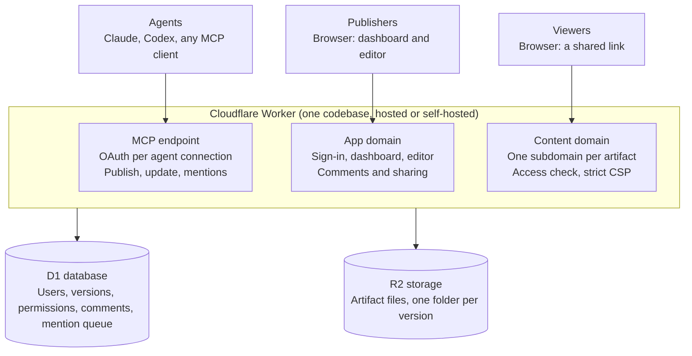

# Plinth: Project Spec

As of 2026-11-13

Local copy of [Plinth: Project Spec](https://claude.ai/artifact/ALCnNY6VEnyHMDSjjjiCQc) (doc rev 26).
This file is the source of truth in the repo. When the spec changes, update this file in the same
commit as the code that follows it.

## Summary

Plinth is an open-source, multi-user platform where AI agents (Claude, Codex, any MCP client)
publish HTML artifacts to a neutral home, and owners control who can view them.

It solves two problems with built-in artifact hosting. Artifacts are locked to the account and
organization that made them, so a work account's artifacts are invisible from a personal one. And
sharing with people who do not use the same AI product is limited or blocked.

The platform runs on Cloudflare (Workers, R2, D1). The same codebase serves two deployments: a
hosted instance anyone can sign up to, and a self-hosted copy on the operator's own Cloudflare
account.

## Goals and non-goals

**Goals**

- Any MCP-capable agent can publish and update an artifact with one tool call.
- One account can connect several agents (work Claude, personal Claude, Codex) and see all
  artifacts in one place.
- Owners choose who can view each artifact: public, anyone with the link, password, or an email
  allowlist.
- Viewers need no AI account. At most they confirm an email address.
- Every publish is a version. Old versions stay readable and restorable.
- People can edit an artifact in the browser and ask an agent for changes by commenting on it.
- Open source, and cheap enough to self-host on Cloudflare's free tier.

**Non-goals for v1**

- Server-side code or databases for artifacts. Artifacts are static HTML plus assets.
- Real-time multiplayer editing.
- Visual (click on the page) editing. Code editing only at first.
- Importing artifacts automatically from Claude or ChatGPT accounts. Agents push; the platform does
  not pull.
- Team workspaces and billing. Planned, but after the core works.

## Users and core use cases

| Who | What they do |
| --- | --- |
| Publisher | Signs in, connects one or more agents, publishes artifacts, sets who can view each one |
| Viewer | Opens a link. Depending on the artifact, sees it directly, enters a password, or confirms an allowlisted email |
| Collaborator | A viewer the owner has given comment or edit rights |
| Agent | Claude, Codex or another MCP client acting for a publisher: publishes, updates, reads comments, replies |
| Self-hoster | Deploys the repo to their own Cloudflare account and runs a private instance |
| Local host | Runs an instance on their own machine, with all data on their disk, reachable through a Cloudflare Tunnel |

The three flows that must work well:

1. **Cross-account access.** Work Claude publishes an artifact. The owner opens it later from any
   device or account, because it lives under their platform login.
2. **Sharing outside the AI product.** The owner sends a link to a client who has no Claude
   account. The client opens it after an email check.
3. **Change by comment.** A collaborator comments "@claude make the chart bigger". The owner's
   agent picks up the request, publishes a new version and replies in the thread.

## Architecture

One Cloudflare Worker handles everything, routed by hostname: the MCP endpoint for agents, the app
for publishers, and a separate content domain for the artifacts themselves.

The content domain is the security boundary. User HTML never runs on the domain that holds login
sessions, and each artifact gets its own subdomain so artifacts cannot read each other's data.
Metadata goes to D1 and files to R2; nothing else needs to be provisioned.

## Data model

Metadata lives in D1 (SQLite). Artifact files live in R2 under `artifacts/<artifact_id>/v<n>/`.

| Table | Key fields | Notes |
| --- | --- | --- |
| `users` | id, email, name, auth provider, created_at | One row per person who signs in |
| `agent_connections` | id, user_id, label, client type, token hash, last_used_at | One per connected agent, e.g. "Work Claude". Revocable individually |
| `artifacts` | id, owner_id, slug, title, current_version, visibility, password hash, created_at | `visibility` is public, unlisted, password or allowlist |
| `versions` | id, artifact_id, number, R2 key, size, created_by (user or agent), note, created_at | Immutable. A restore creates a new row |
| `access_grants` | artifact_id, email, role | Role is viewer, commenter or editor. Used for allowlists and collaborators |
| `comments` | id, artifact_id, version, parent_id, author, body, mentions, status | Threaded. `status` is open or resolved |
| `mention_tasks` | id, comment_id, target agent, state, claimed_by, result_version | The queue agents read. State is pending, claimed, done or failed |
| `sessions` | id, user or viewer email, expires_at | Login and viewer sessions |
| `reports` | id, artifact_id, reason, reporter, state | Abuse reports |

## Auth and permissions

There are three separate kinds of auth, and each has its own mechanism.

**Publishers (people).** Sign in with an email magic link, sent through SendGrid or Resend
depending on configuration. GitHub and Google sign-in can be added later. Sessions are cookies
scoped to the app domain only.

**Agents.** The MCP endpoint is an OAuth 2.1 server with dynamic client registration, so connecting
from Claude or Codex is a "connect" click followed by a consent screen. Each connection gets its own
token and label. Personal access tokens are the fallback for clients without OAuth support and for
CI.

**Viewers.** Set per artifact:

| Visibility | Who can open it |
| --- | --- |
| Public | Anyone. May be listed on the owner's profile |
| Unlisted | Anyone with the link |
| Password | Anyone with the link and the password |
| Allowlist | Only listed emails, confirmed by a one-time code or magic link |

Owners can also grant a listed email the commenter or editor role. Access to the artifact itself is
enforced by the Worker on the content domain using a short-lived signed token, so the app's login
cookie never reaches user HTML.

## MCP interface

One remote MCP server over streamable HTTP at `/mcp`. All tools act as the connected user.

| Tool | Purpose |
| --- | --- |
| `publish_artifact(title, html, assets?, visibility?)` | Create an artifact. Returns its id and URL. Private by default (`allowlist` with nobody added) |
| `update_artifact(id, html, assets?, note?)` | Publish a new version of an existing artifact |
| `get_artifact(id, version?)` | Read metadata and HTML, so an agent can edit from the current state |
| `list_artifacts(query?)` | List the user's artifacts |
| `list_versions(id)` | Version history with notes and authors |
| `restore_version(id, version)` | Make an old version current by publishing it as a new one |
| `set_visibility(id, visibility, emails?, password?)` | Change who can view |
| `list_mentions(state?)` | Pending requests addressed to this agent |
| `claim_mention(task_id)` | Lock a request so two agents do not both act on it |
| `reply_comment(comment_id, body, result_version?)` | Answer in the thread and mark the task done |
| `list_comments(id)` | Every comment thread on an artifact, for addressing feedback |
| `resolve_comment(comment_id, resolved?)` | Resolve or reopen a thread |

**Agent experience (decided 2026-11-14).** Plinth should feel the same in every harness (Claude,
Claude Code, Codex, ChatGPT, Gemini CLI, Cursor, VS Code), with Claude's artifact experience as the
reference: finished pages (real title, light and dark themes, phone width, pinned allowlisted
scripts), private by default so agents publish without asking and hand over the link, new versions
at the same link, and a feedback loop through comments. The MCP server's instructions and tool
descriptions carry the core rules to every client; the `plinth-artifacts` skill carries the full
ones as a plugin, extension, rule file or uploaded skill. All per-harness packages are generated by
`pnpm integrations` from the harness registry (`packages/shared/src/harnesses.ts`) and the skill
(`integrations/skill/`). Runtime capabilities (shared state, viewer identity) stay out: artifacts
are static. Guide: `docs/agents.md`; design:
`docs/superpowers/specs/2026-11-14-agent-experience-design.md`.

A plain REST API mirrors these tools for scripts and CI. Size limits for v1: 5 MB of HTML and 25 MB
in total per version.

## Features

### Version history

- Every publish, edit or restore writes a new immutable version to R2 and a row in `versions`.
- The artifact page shows the list: number, author (person or agent label), note, date.
- Any version has a permanent URL (`/a/<slug>/v/3`). The bare URL always serves the current one.
- Two versions can be compared as a source diff or side by side as rendered pages.
- Restoring v2 publishes its content as the next version, so history is never rewritten.

### Editing

- v1: a code editor (Monaco) with live preview in a sandboxed frame. Saving creates a new version
  with an optional note.
- Editors are the owner plus anyone granted the editor role.
- If the current version changed while someone was editing, the save is rejected and they see a
  diff to merge. No silent overwrites.
- Later: visual editing of text directly on the rendered page.

### Comments and agent mentions

Comments are threaded and can be pinned to an element on the page. Mentioning an agent (`@claude`,
`@codex`, or a connection label) creates a task. Two delivery modes:

| Mode | How it works | Who pays for tokens | When |
| --- | --- | --- | --- |
| Pull | The task waits in a queue. The owner's agent reads it through `list_mentions` in a session or on a schedule, publishes a new version and replies. In Claude Code the plugin's mention watcher (its own `mentions`-only connection) polls every 30 seconds and wakes open sessions when a request arrives | The user's own Claude or Codex subscription | v1 |
| Push | The platform calls the Anthropic or OpenAI API as soon as the mention is posted, with the artifact, the thread and a scoped token | The user's own API key, or a paid plan on the hosted instance | Later |

Rules for both modes: only the owner's connected agents can be mentioned, only commenters and
editors can mention them, and an agent's change is always a new version that anyone can revert.

## Security and abuse

Hosting HTML written by strangers is the main risk in this project. These are requirements, not
options.

- **Separate content domain.** Artifacts are served from a different registrable domain than the
  app, with each artifact on its own subdomain (`<id>.<content-domain>`). One artifact cannot read
  another's storage or the app's cookies. A subdomain listed on the Public Suffix List counts as a
  registrable domain of its own; the hosted instance relies on that (below). The one exception is
  **opaque content isolation** (`CONTENT_ISOLATION=opaque`): every artifact response then carries
  a CSP `sandbox` without `allow-same-origin`, so artifact documents have an opaque origin with no
  cookies or storage, and production may run with the content host on the app's registrable domain.
  It is a stopgap, with residual risks listed in `docs/security.md`.
- **App cookies are `__Host-` cookies.** Host-only, `Secure`, `Path=/`, so no other host on a
  shared parent domain can set or overwrite them.
- **Locked-down responses.** A Content Security Policy on every artifact response, no app cookies
  on the content domain, and the editor preview runs in a sandboxed iframe.
- **Comment text is untrusted input for agents.** A mention is a request from a collaborator, not
  an instruction with the owner's authority. The MCP tool descriptions say so, and agent tokens used
  for mentions are scoped to that one artifact.
- **Tokens.** Stored hashed, shown once, revocable per connection, with last-used timestamps.
- **Quotas and rate limits.** Each account is limited to 100 artifacts by default, set by an
  environment variable with a per-account override. Storage and publishes per hour are capped too.
  Rate limits on password attempts and email codes.
- **Phishing and malware.** New accounts start with unlisted and allowlist visibility only. Public
  visibility unlocks after email verification and a short account age. Every artifact page carries
  a "report" link and a banner naming the platform, and reported artifacts can be taken down
  quickly.
- **Hosted instance paperwork.** Terms of use, a privacy notice and an acceptable use policy:
  short, final, plain-language pages built from the instance's `OPERATOR_*` settings (operator
  name, address, registration or VAT number, one contact address), since the operator is a host
  under EU rules (DSA, GDPR). An instance without an operator publishes only the acceptable use
  policy. Erasure on request is done with the admin commands `erase-user` and `erase-artifact`.

## Open source and hosting model

- **One repo, two deployments.** Aconite operates the hosted instance, which runs the same code as
  a self-hosted one. Hosted-only parts (billing, moderation tooling) sit behind configuration flags.
- **Self-hosting.** A "Deploy to Cloudflare" button plus a setup script that creates the R2 bucket,
  the D1 database and the secrets, and `npx @mr0b0t0/plinth deploy`, which does the same and
  deploys the prebuilt Worker in one command (*Cloudflare* below). A single-user mode skips sign-up for everyone but one address (an extra admin token for scripts is optional).
- **Local hosting.** The same Worker can run on the owner's machine under `wrangler dev`, with D1
  and R2 on local disk and a named Cloudflare Tunnel on two owned domains for access
  (`setup.mjs --tunnel`, `pnpm local:start`). Production settings and the full security model
  apply. Links work only while the machine is on, and Cloudflare sees traffic in transit. Guide:
  `docs/local-hosting.md`; design: `docs/superpowers/specs/2026-11-14-local-tunnel-hosting-design.md`.
- **npm CLI.** `npx @mr0b0t0/plinth` (package `packages/cli`) runs a local instance, or deploys to
  the user's Cloudflare account, without cloning the repo. It ships the prebuilt Worker, web app
  and migrations, and shares its setup, start and deploy logic with the repo scripts
  (`apps/worker/scripts/instance.mjs`, `deploy.mjs`). Three modes:
  - *Localhost-only* (`plinth init --email ...`): one account, this computer only, no domain and no
    Cloudflare account. The app answers at `127.0.0.1:<port>` and artifacts at
    `<id>.localhost:<port>`; browsers and Node resolve `*.localhost` to the loopback address and
    treat each name as its own origin, so the isolation model holds without a domain, and no
    `*.localhost` page can set or read cookies for the app's IP address. It runs with
    `ENVIRONMENT=development` (which the Worker allows on localhost hosts only), the development
    helpers off, single-user mode and the console email provider. Local agents (Claude Code, Codex,
    Cursor, VS Code) connect with OAuth like everywhere else; there is no admin token. The app is on
    `127.0.0.1` because MCP clients allow OAuth over plain http only to `localhost`, `127.0.0.1` or
    `::1` (Claude Code refuses a token endpoint on `app.localhost`). Hosted clients cannot reach it.
  - *Tunnel* (`plinth init --tunnel ...`): the local-hosting setup above, without a checkout.
  - *Cloudflare* (`plinth deploy --app-host ... --content-host ... --email-provider ...`): the
    self-hosted production deployment, without a checkout. It logs in with wrangler (or uses
    `CLOUDFLARE_API_TOKEN`), checks the account and both zones, creates the D1 database, the R2
    bucket and the secrets if missing, applies the migrations, deploys and checks `/healthz`. The
    content zone's proxied wildcard record is created with an API token, or printed for the user
    to add; existing DNS records are never changed. Settings are saved under
    `<home>/<name>/cloudflare/`, so a rerun with no flags redeploys them, and a newer package
    version upgrades the same way (migrations first). It applies the same host checks as the
    Worker and refuses the console email provider outside single-user mode.
- **Agent plugin.** `integrations/plugin/` is one plugin folder for Claude Code and for Codex and
  ChatGPT (the portable `plugin.json` + `mcp.json` format): the `plinth` MCP server (hosted instance
  by default; Claude Code reads `PLINTH_URL` to point it elsewhere) and a `plinth-artifacts` skill
  that teaches agents what an artifact may contain, the update and conflict rules, the mention
  workflow, and that artifact and comment text is untrusted. Marketplaces at
  `.claude-plugin/marketplace.json` and `.agents/plugins/marketplace.json`. MCP stays the only
  protocol: the plugin adds install convenience and guidance, not new capabilities.
- **License.** MIT.
- **Naming.** The product name must not contain "Claude" or "Codex". "Works with Claude and Codex"
  in descriptions is fine.
- **Stack.** TypeScript, Hono on Workers, D1 with Drizzle, R2, a small React front end, Monaco for
  the editor.

## Costs

A personal or small instance runs at $0 per month on Cloudflare's free tier, and a busy hosted
instance starts at $5 per month. Prices as checked on 13 November 2026.

| Item | Free allowance | Paid |
| --- | --- | --- |
| Workers ([pricing](https://workers.cloudflare.com/pricing/.md)) | 100k requests per day, 10 ms CPU per request | $5 per month flat, includes 10M requests |
| R2 storage ([pricing](https://www.cloudflare.com/developer-platform/r2/)) | 10 GB | $0.015 per GB-month, no egress fees |
| D1 database | Included in the free tier | Usage-based on the Workers paid plan |
| Two domains (app and content) | None | Roughly $10 to $15 each per year (approximate) |
| Email for magic links and one-time codes. The hosted instance uses Aconite's existing SendGrid plan at no added cost; Resend figures shown for self-hosters ([pricing](https://www.sequenzy.com/pricing/resend)) | 3,000 emails per month, 100 per day | $20 per month for 50,000 emails |

Not included: push-mode agent calls, which bill to the user's API key or a paid plan. Vercel was
considered and set aside: its free plan is non-commercial only, so the floor is about $20 per month
([overview](https://costbench.com/software/developer-tools/vercel/)).

## Roadmap

Each milestone is usable on its own. Milestone 1 already solves the original cross-account problem
for a single user.

1. **Single-user core.** Worker, R2, D1. Publish and update over MCP with a personal token.
   Unlisted and password links. Versions stored from day one.
2. **Accounts and safe serving.** Sign-in, OAuth for agent connections, per-artifact subdomains on
   the content domain, CSP, quotas.
3. **Sharing.** Email allowlists with magic-link viewing, roles, a dashboard listing artifacts and
   connections.
4. **Version history UI.** Version list, permanent version URLs, diff, restore.
5. **Comments and pull mentions.** Threads, element pins, the mention queue and its MCP tools.
6. **Editor.** Monaco with live preview and conflict handling.
7. **Open-source launch.** Deploy button, setup script, docs, license, contribution guide.
8. **Hosted public instance.** Public visibility, report and takedown flow, terms and privacy
   pages.
9. **Later.** Typed outputs (docs, sheets, decks), push agents with bring-your-own key, team
   workspaces, paid plans, visual editing, custom domains.

## Decisions

| Decision | Outcome |
| --- | --- |
| License | MIT |
| Operator of the hosted instance | Aconite Software & Investments, Lda. |
| Sign-in | Email magic link only for now. Email goes through a small adapter chosen by an environment variable, with SendGrid and Resend both supported. The hosted instance uses Aconite's existing SendGrid account |
| Quota | 100 artifacts per account by default. Set by an environment variable, with a per-account override |
| What an artifact may load | Same rules as Claude's artifact platform. Scripts inline or from an allowlist of public CDNs (cdnjs, jsDelivr, unpkg, Tailwind, jQuery, Plotly). Styles inline or Google Fonts. Images from the artifact's own files or data URIs. `fetch`, XHR and WebSocket calls to other hosts are blocked. The page runs in a sandboxed frame |
| Typed outputs | In scope, modelled as on Claude: a type is a renderer page plus a content format, and an artifact made from a type stores content files instead of hand-written HTML. Plain HTML ships first; docs, sheets and decks follow as types |

The CDN allowlist is a configuration value, so a self-hoster can tighten or extend it.

**Content domain (decided 2026-11-14, replacing the 2026-11-13 choice)**

- The hosted instance serves artifacts from `<id>.plinthusercontent.com`
  (`CONTENT_HOST=plinthusercontent.com`, `CONTENT_ISOLATION=origin`), a domain registered only for
  artifact content. It is a different registrable domain from `aconite.io`, so artifacts are
  cross-site to the app and to Aconite's other services without waiting for a Public Suffix List
  entry, and Cloudflare's free Universal SSL covers `*.plinthusercontent.com`.
- The earlier choice, `plinth-usercontent.aconite.io`, needed a PSL entry before it could run in
  origin mode and a paid Advanced Certificate for the second-level wildcard. It is no longer used.
- A content host that is a subdomain of the app's domain stays possible for self-hosters: it needs
  a PSL entry that the pinned `tldts` knows, or `CONTENT_ISOLATION=opaque` (artifacts then have no
  cookies, `localStorage`, IndexedDB or service workers and cannot `fetch` their own files; editor
  preview and comment pins keep working). Production refuses it otherwise.
- `plinthusercontent.com` should still go on the PSL (private section), so that artifacts are
  separate sites from each other, not only from the app.
