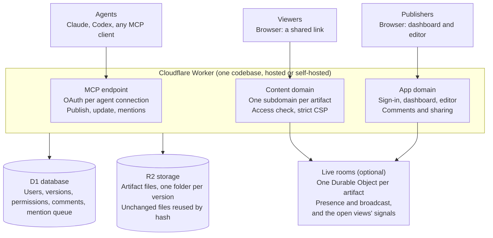

# Plinth: Project Spec

As of 2026-11-13

Local copy of [Plinth: Project Spec](https://claude.ai/artifact/ALCnNY6VEnyHMDSjjjiCQc) (doc rev 26).
This file is the source of truth in the repo. When the spec changes, update this file in the same
commit as the code that follows it.

## Summary

Plinth is an open-source, multi-user platform where AI agents (Claude, Codex, any MCP client)
publish HTML artifacts to a neutral home, and owners control who can view them.

It solves two problems with built-in artifact hosting. Artifacts are locked to the account and
organization that made them, so a work account's artifacts are invisible from a personal one. And
sharing with people who do not use the same AI product is limited or blocked.

The platform runs on Cloudflare (Workers, R2, D1). The same codebase serves two deployments: a
hosted instance anyone can sign up to, and a self-hosted copy on the operator's own Cloudflare
account.

## Goals and non-goals

**Goals**

- Any MCP-capable agent can publish and update an artifact with one tool call.
- One account can connect several agents (work Claude, personal Claude, Codex) and see all
  artifacts in one place.
- Owners choose who can view each artifact: public, anyone with the link, password, or an email
  allowlist.
- Viewers need no AI account. At most they confirm an email address.
- Every publish is a version. Old versions stay readable and restorable.
- People can edit an artifact in the browser and ask an agent for changes by commenting on it.
- Invited people can work on a page together live, and owners and editors can edit a doc or a
  sheet on its page together.
- Open source, and cheap enough to self-host on Cloudflare's free tier.

**Non-goals for v1**

- Per-artifact server code. Artifacts are static HTML plus assets; the only server behaviour a
  page can reach is Plinth's fixed shared-data service (see
  [Shared data and viewer identity](#shared-data-and-viewer-identity)) and its live room at
  `/__plinth/room/` (see [Live rooms](#live-rooms)).
- Character-level co-editing (OT or CRDT), and live editing of HTML artifacts' text (pages build
  their own multiplayer with [live rooms](#live-rooms)).
- On-page editing of HTML artifacts (docs, decks and sheets are edited on the page; HTML in the
  source editor).
- Importing artifacts automatically from Claude or ChatGPT accounts. Agents push; the platform does
  not pull.
- Team workspaces and billing. Planned, but after the core works.

## Users and core use cases

| Who | What they do |
| --- | --- |
| Publisher | Signs in, connects one or more agents, publishes artifacts, sets who can view each one |
| Viewer | Opens a link. Depending on the artifact, sees it directly, enters a password, or confirms an allowlisted email |
| Collaborator | A viewer the owner has given comment or edit rights |
| Agent | Claude, Codex or another MCP client acting for a publisher: publishes, updates, reads comments, replies |
| Self-hoster | Deploys the repo to their own Cloudflare account and runs a private instance |
| Local host | Runs an instance on their own machine, with all data on their disk, reachable through a Cloudflare Tunnel |

The three flows that must work well:

1. **Cross-account access.** Work Claude publishes an artifact. The owner opens it later from any
   device or account, because it lives under their platform login.
2. **Sharing outside the AI product.** The owner sends a link to a client who has no Claude
   account. The client opens it after an email check.
3. **Change by comment.** A collaborator comments "@claude make the chart bigger". The owner's
   agent picks up the request, publishes a new version and replies in the thread.

## Architecture

One Cloudflare Worker handles everything, routed by hostname: the MCP endpoint for agents, the app
for publishers, and a separate content domain for the artifacts themselves.

The content domain is the security boundary. User HTML never runs on the domain that holds login
sessions, and each artifact gets its own subdomain so artifacts cannot read each other's data.
Metadata goes to D1 and files to R2; nothing else needs to be provisioned. The same Worker also
defines one SQLite-backed Durable Object class, `ArtifactRoom` (binding `ROOMS`), for
[live rooms](#live-rooms): an object per artifact, created only when someone opens that artifact's
room, keeping no tables. A deploy without the binding runs with rooms off. The same object also
holds the artifact's open views' watch sockets ([live views](#live-views-decided-2026-11-19)), so
while live views are on it is created when someone opens the artifact at all.

## Data model

Metadata lives in D1 (SQLite). Artifact files live in R2 under `artifacts/<artifact_id>/`: a
version's new files under its own prefix (`v<n>.<nonce>/` since 0.4.0, where `<nonce>` is 12
random characters per write attempt; `v<n>/` for versions written earlier), and files it shares
with an earlier version of the same artifact stay where they were first stored ([Big builds and
reuse by hash](#big-builds-and-reuse-by-hash)). The row's `r2_prefix` is authoritative.

| Table | Key fields | Notes |
| --- | --- | --- |
| `users` | id, email, name, auth provider, created_at | One row per person who signs in |
| `agent_connections` | id, user_id, label, client type, token hash, last_used_at, artifact_id | One per connected agent, e.g. "Work Claude". Revocable individually. `artifact_id` is NULL, or the one artifact a personal access token is limited to |
| `artifacts` | id, owner_id, slug, title, type, current_version, visibility, password hash, category, created_at | `visibility` is public, unlisted, password or allowlist. `type` is `html` (a hand-written `index.html`), `doc` (Markdown in `content.md`), `slides` (a deck's Markdown in `slides.md`), `design_system` (JSON in `system.json`), `design` (artboards in `design.html`), `sheet` (JSON lines in `sheet.jsonl`, no assets) or `whiteboard` (settings in `board.json`; its blocks and arrows are shared data), fixed at publish. `category` is the owner's own grouping (NULL = none), shown only to the owner |
| `versions` | id, artifact_id, number, r2_prefix, size_bytes, stored_bytes, manifest, created_by (user or agent), note, created_at | Immutable, and written only once its files are in R2 (commit last). A restore creates a new row. `size_bytes` is what a viewer loads; `stored_bytes` is what this version added to R2 (NULL for versions written before 0.4.0, which count `size_bytes`). Each manifest entry has `path`, `size_bytes`, `content_type`, a server-computed `sha256` (absent on files stored before 0.4.0) and, for a reused file, a server-written `stored_at` (`v<m>[.<nonce>]/<path>`, relative to `artifacts/<artifact_id>/`, never returned by the API) |
| `access_grants` | artifact_id, email, role | Role is viewer, commenter or editor. Used for allowlists and collaborators |
| `comments` | id, artifact_id, version, parent_id, author, body, mentions, status | Threaded. `status` is open or resolved |
| `mention_tasks` | id, comment_id, target agent, state, claimed_by, result_version | The queue agents read. State is pending, claimed, done or failed |
| `sessions` | id, user or viewer email, expires_at | Login sessions (signing in, and a viewing code confirmed at an allowlist gate or a portal), and viewer sessions where the confirmed address may not sign in (single-user mode) |
| `reports` | id, artifact_id, reason, reporter, state | Abuse reports |

**Shared data** ([below](#shared-data-and-viewer-identity), migration `0005_shared_state.sql`)
adds one column and two tables:

| Table or column | Key fields | Notes |
| --- | --- | --- |
| `versions.capabilities` | JSON `{ data, viewer, shared }` or NULL | What the version's `index.html` declares, parsed at publish. NULL for versions that declare nothing and for versions published before the column |
| `artifact_docs` | artifact_id, collection, doc_id, data, size_bytes, rev, created_by_email/role/via/label, created_at, updated_by_email/role/via/label, updated_at | One JSON document. Key (artifact_id, collection, doc_id). Shared by every version of the artifact and not versioned. Stamps come from the server. `via` is page, agent or app |
| `artifact_data_usage` | artifact_id, docs, bytes, seq | Exact totals per artifact kept by SQLite triggers on `artifact_docs`, for one-row quota checks. `seq` grows on every change and is what pages poll |

**Big builds** ([below](#big-builds-and-reuse-by-hash), migrations `0006_stored_bytes.sql` and
`0007_upload_tickets.sql`) add one column and one table:

| Table or column | Key fields | Notes |
| --- | --- | --- |
| `versions.stored_bytes` | integer or NULL | Bytes this version wrote to R2. The storage quota sums `coalesce(stored_bytes, size_bytes)` |
| `upload_tickets` | id, token_hash, user_id, credential (`connection` or `admin`), connection_id or admin_token_hash, scopes, mode (`publish` or `update`), artifact_id, artifact_type, title, category, note, base_version, state (`open`, `used`, `dead`), attempts, receiving_claim, receiving_until, result_artifact_id, result_version, reserved_artifact_id (unique), dead_reason (`conflict` or `taken_down`, on a dead ticket), created_at, expires_at, used_at | One single-use upload ticket from `start_upload`. The token is stored as its SHA-256. A publish-mode ticket reserves its artifact id at mint (`reserved_artifact_id`, returned as `target.id`), and its commit creates the artifact with exactly that id; no other ticket can hold that id, and only that ticket's bundle can create it. While the ticket is live (open, unexpired, attempts left, minting credential still valid) the reservation counts toward the owner's artifact limit for new reservations and inline publishes; once it expires unused the id is released and never becomes an artifact. Only the id is reserved, not a slug (the commit picks the slug). `open -> used` happens in the same D1 batch that commits the version. The receiving lease limits concurrency and is the bundle's deadline (10 minutes). A row is deleted once `TTL.uploadStatusMs` (24 hours) has passed since it expired, by the hourly cron and by the opportunistic sweep; erasing an artifact or a user deletes its tickets |

**Categories** (migration `0009_categories.sql`) add one nullable column to `artifacts` and one
to `upload_tickets`, plus a partial index `artifacts_owner_category` on (owner_id, category) over
live, categorised rows. A category is a free-text name for the project, repo or client an artifact
belongs to: at most one per artifact, no tags and no categories table, so a category exists while at
least one live artifact uses it. It is artifact metadata, never versioned, and returned only to the
owner (`category` is null for everyone else). The Worker validates and normalises the text
(`packages/shared/src/categories.ts`); the columns have no CHECK constraint.

**Artifact stats** (migrations `0010_view_counts.sql` and `0020_artifact_opens.sql`) keep one row
per counted open with who opened it, and an all-time count per artifact. Both cascade from
`artifacts`, so erasing an artifact or its owner removes them (see
[Artifact stats](#artifact-stats)):

| Table | Key fields | Notes |
| --- | --- | --- |
| `artifact_opens` | id (integer), artifact_id, version, opened_at (UTC ISO), viewer_kind (`user`, `email`, `anonymous`, `unknown`), user_id, email, visitor, role | One row per counted open, kept for `VIEW_LOG_RETENTION_DAYS`. `user_id` (signed in; `ON DELETE SET NULL`), `email` (an allowlisted email confirmed by code) and `visitor` (a random id from the content cookie) each belong to their own kind only (CHECK constraints). `version` is NULL for opens migrated from daily counts. Indexes: (artifact_id, opened_at), (opened_at), and partial ones on user_id and email. No IP address or user agent |
| `artifact_view_totals` | artifact_id, views, first_day | Opens older than the retention, folded into one count per artifact; `first_day` is the earliest day folded in |

**Live rooms and on-page doc editing** (issue #36, migration `0011_live_drafts.sql`) add one table
and two fields to the stored declaration:

| Table or column | Key fields | Notes |
| --- | --- | --- |
| `versions.capabilities` | adds `room`, `roomOpen` | Written only when the page declares `room` (`<meta name="plinth-capabilities" content="room">`, open topics from `<meta name="plinth-room-open">`), so every other declaration is stored exactly as before. A row without them reads as no room. `room` is not shared data: a page that declares only `room` has none |
| `live_drafts` | artifact_id (key), base_version, content, size_bytes, rev, conflict_version, updated_by_user, created_at, updated_at | At most one unsaved page draft per doc, apart from its immutable versions, and never a version itself. Written by the artifact's room in a guarded flush that cannot bring back a deleted or taken-down artifact, never moves `rev` backwards and keeps at most 20 drafts per owner. A row exists only while the draft differs from `base_version`, or while `conflict_version` (a version published meanwhile that changed the same lines) waits for review. Content follows the doc limits (1 MB, 50,000 lines), or a sheet's (1 MB, 10,000 rows) for a sheet ([Live sheets](#live-sheets-decided-2026-11-19)). Deleted with the artifact and on takedown; `updated_by_user` is cleared on `erase-user`; untouched rows are deleted after `LIVE_DRAFT_RETENTION_DAYS` |

Settings (env vars): `ALLOW_ROOMS` (on), `ROOM_MAX_CONNECTIONS_PER_ARTIFACT` (50, from 2 to 1000),
`ROOM_MAX_MESSAGE_BYTES` (8192, from 512 to 65536), `ROOM_MESSAGES_PER_SECOND` (20 per connection,
from 1 to 100, burst twice that), `ALLOW_LIVE_EDITING` (on), `LIVE_CHECKPOINT_IDLE_S` (120; 0 for
explicit saves only, otherwise from 30 to 3600), `LIVE_AUTO_CHECKPOINT_MIN_S` (600, at least the
idle time), `LIVE_DRAFT_FLUSH_S` (5, from 2 to 60) and `LIVE_DRAFT_RETENTION_DAYS` (30, from 1 to
365). Fixed: presence of 400 bytes per room, 3 rooms per connection, 8 sockets per viewer and 20
connects per viewer per minute; a doc-socket frame of 64 KiB; a lease idle for 60 s may be taken
over.

**Comments from the page** ([below](#comments-from-the-page-decided-2026-11-19), no migration) add
one field to the stored declaration and a second kind of comment anchor:

| Table or column | Key fields | Notes |
| --- | --- | --- |
| `versions.capabilities` | adds `comments` | Written only when the page declares `comments`, so every other declaration is stored exactly as before. A row without it reads as no page comments. `comments` is neither shared data nor a room |
| `comments.anchor` | JSON: an element anchor `{ selector, text?, x?, y? }`, or a page anchor `{ kind: "page", key, x?, y?, text?, data? }` | Element anchors are stored without `kind`, as before. Both kinds are read back through the anchor schema; a stored value no schema allows reads as no anchor |

**Bound tokens** (issue #51, migration `0012_bound_tokens.sql`) add one column:

| Table or column | Key fields | Notes |
| --- | --- | --- |
| `agent_connections.artifact_id` | artifact id or NULL | The one artifact a personal access token is limited to ([Publishing from CI](#publishing-from-ci-decided-2026-11-19)). NULL is an account-wide token or an OAuth connection; a CHECK refuses it on an OAuth row. Set at creation and never changed: to change the limit, revoke the token and make another. Deleting or taking down the artifact revokes its bound tokens in the same batch; erasing the artifact (or its owner) removes them (`ON DELETE CASCADE`, never `SET NULL`, so a bound token can never become an account-wide one). A partial index covers bound rows |

**Live views** ([below](#live-views-decided-2026-11-19), no migration) store nothing and add two
settings: `ALLOW_LIVE_VIEWS` (on) and `LIVE_VIEW_MAX_SOCKETS_PER_ARTIFACT` (1000, from 10 to
10000, half for the people an artifact is shared with and half for everyone else). Fixed: 32
watch sockets per client and 60 connects per client per minute on one artifact, a socket lifetime
of 12 hours less up to 5 minutes at random (the content pass's, or less when the session or
password pass it was opened with ends sooner), a spread of 2 ms per socket the cap allows (at most
10 s, 2 s at the default), at most one data signal per spread, a first reconnect within 10 s,
backstop polls every 60 s (the page's data) and 5 minutes (the app's gate), and a tab hidden for
60 s closes its socket.

**Category sharing and personal categories** ([below](#category-sharing-and-personal-categories-decided-2026-11-19),
issue #42, migration `0013_category_sharing.sql`) add three tables and five columns:

| Table or column | Key fields | Notes |
| --- | --- | --- |
| `artifacts.category_key` | text or NULL | The category's match key (`categoryKey`: NFKC, lower case, whitespace, `-` and `_` folded), written next to `category` on every category write. Rows from before the migration get it when their owner first shares a category (or opens a share); a NULL key never matches a share |
| `artifacts.category_rev` | integer, 0 | Bumped in the same statement as every change of `category_key`, so a review the owner opened before a move out and back is skipped |
| `artifacts.category_review`, `category_review_share` | `shared` or `private`, and a share id; both NULL or both set (CHECK) | The owner's review, bound to the share it was made against. Reset to NULL on every key change; written only by the owner's share requests |
| `users.category_share_rev` | integer, 0 | Bumped by every batch that creates, deletes or moves one of the person's shares; a category rename guards its batch on it |
| `category_shares` | id, owner_id, category_key, name, title, created_at, updated_at | One per owner and key (UNIQUE). `id` is the portal link and never changes, also across renames. `name` is the owner's spelling (owner only); `title` is what the people see. Cascades from `users` |
| `category_grants` | share_id, email, role | `viewer` or `commenter` (CHECK; never `editor`). Key (share_id, email). Cascades from the share; `erase-user` deletes an address's rows |
| `login_codes.share_id` | share id or NULL | A portal's email code (`artifact_id` NULL), bound to the share; cascades from it |
| `personal_categories` | user_id, artifact_id, category, created_at, updated_at | A collaborator's own category for an artifact shared with them. Key (user_id, artifact_id). Cascades from `users` and `artifacts`; deleted with the artifact and on takedown, and when its person no longer holds a grant on the artifact |

Setting: `ALLOW_CATEGORY_SHARING` (on). Fixed: 100 shares per owner (checked in the statement that
inserts the share), 200 people per share, a title
of at most 200 characters, review items up to the owner's artifact limit, 500 artifacts per portal.

**Whiteboards** ([below](#whiteboards-decided-2026-11-19), no migration) keep their board in the
existing shared-data tables (collections `blocks` and `arrows`) and add one field to the stored
declaration:

| Table or column | Key fields | Notes |
| --- | --- | --- |
| `versions.capabilities` | adds `writers` (`commenter` or `editor`) | Set by the server for a whiteboard's versions only, from the board's `edit` setting; never read from a page, so no HTML declaration can carry it and every other declaration is stored exactly as before. Read back through one function (`versionCapabilities`), which keeps only `commenter` or `editor`. On any type whose capabilities its page does not declare, a missing or unknown value counts as `editor` (a board's default), never as "any viewer" |

Fixed: board.json of at most 512 KiB on input; a starting board of at most 500 blocks and arrows;
block positions within ±1,000,000, sizes 24 to 4,000, text up to 2,000 characters, arrow labels up
to 120. No new setting: a whiteboard needs `ALLOW_SHARED_DATA` and origin isolation, and its board
counts toward the `DATA_*` limits like any page's shared data.

**Keeping state across versions** ([below](#live-views-decided-2026-11-19), no migration) adds one
field to the stored declaration, `versions.capabilities.hold`, written only when the page declares
`hold` (a row without it reads as no hold), and no setting: it follows `ALLOW_LIVE_VIEWS`. Fixed:
1 s for a page's runtime to answer, 800 ms for its `onVersion` handlers, 5 s for the doc renderer
to show a version in place, 16 KiB of carried state, read within 30 s. Carried state lives in the
viewer's browser (the content origin's `sessionStorage`), not in D1.

**Following the presenter** ([Slides](#slides-decided-2026-11-19), no migration) stores nothing
and adds one setting, `ALLOW_SLIDES_FOLLOW` (on), in effect only where live rooms are. Fixed: a
slides-socket frame of 128 bytes; 4 of the room's `ROOM_MAX_CONNECTIONS_PER_ARTIFACT` slots (at
most half of them) kept for presenters, so a slides socket that watches is refused once the room
holds the rest; a leader's `goto` at most every 100 ms (every second after the room said
`rate_limited`). The room's other caps (8 sockets per viewer, 20 connects per viewer per minute,
the message rate) apply unchanged.

**Design export** ([Designs](#designs-decided-2026-11-19), no migration) stores nothing: every
file is rendered on request and never kept. It adds four settings: `DESIGN_EXPORT` (on, in effect
only with a `BROWSER` binding), `DESIGN_EXPORTS_PER_HOUR` (30 per person, from 1 to 1000),
`DESIGN_EXPORTS_PER_ARTIFACT_PER_HOUR` (20 per design for everyone but its owner and editors, from
1 to 10000) and `DESIGN_EXPORTS_PER_INSTANCE_PER_HOUR` (120 for the whole instance, from 1 to
100000), each counted in `rate_limits` like every other limit. Fixed: PNG at 1x or 2x, at most
4,000,000 device pixels;
files of at most 24 MB (`DESIGN_EXPORT.maxBytes`, 413 `payload_too_large` past it); 25 seconds per
render, of which at most 10 waiting for the boards to load; two exports at once per instance, each
holding a lease row in `rate_limits` that names no person until its browser closes.

## Auth and permissions

There are three separate kinds of auth, and each has its own mechanism.

**Publishers (people).** Sign in with an email magic link, sent through SendGrid or Resend
depending on configuration. GitHub and Google sign-in can be added later. Sessions are cookies
scoped to the app domain only.

**Agents.** The MCP endpoint is an OAuth 2.1 server with dynamic client registration, so connecting
from Claude or Codex is a "connect" click followed by a consent screen. Each connection gets its own
token and label. Personal access tokens are the fallback for clients without OAuth support and for
CI.

A personal access token can be limited to one artifact (for CI: [Publishing from
CI](#publishing-from-ci-decided-2026-11-19)). It always holds `artifacts:read` and may hold
`artifacts:write`, never `mentions`. It may view that artifact (as its person may, with the person's
current rights) and publish new versions of it, and nothing else: no new artifacts, no other
artifact (404 for every action, whatever its scopes), no sharing, title, category, restore (nor an
old version's files under a new source, `files_from_version`), delete,
comments (reading or writing them), shared data, the people list, stats (its own artifact's, or
the summary across its person's artifacts, which is always refused) or mentions (403 `token_bound` on its
own artifact while it may view it; once its person may not, every action answers as viewing does).
It is never the target of an `@<label>` mention. It does not see the artifact's category, its
shared-data usage or the owner's category names, and never sees or manages category sharing (no
role through a category grant, no share state, 403 `token_bound` from the share, portal and
personal-category routes: [Category sharing](#category-sharing-and-personal-categories-decided-2026-11-19)); it does see the version list and `live_draft`
metadata, as an editor's agent does, but sees the people only as a link viewer does: the owner by
name, with no id or email, and each version's author by name or the address's local part, with no
ids, even when the token is the owner's. Design systems are other artifacts too: `get_design_system`
answers 404 for every one but its own artifact, unlisted and public ones included, so a page it publishes that
names one gets `design_system_unavailable` and `get_artifact` shows `design_system: null` to it.
It never gets a content pass of its own, which reads the page's shared data: the viewer gate
(`GET /api/v1/view/:ref`, and its password route) answers 403 `token_bound` on its artifact
instead of an enter URL, and so does the thumbnail (a capture runs the page, which may draw its
shared data), whose `thumbnail_url` is null for it, and so do a design's PNG and PDF export and
its options ([Designs](#designs-decided-2026-11-19)), which run the page in the same capture. The capture of a version it wrote reads no
shared data either, so its page cannot run unattended with the data in Plinth's own browser
([Thumbnails and link previews](#thumbnails-and-link-previews)). Its in-chat preview
(`preview_artifact`) stays, since a preview pass reads no shared data and joins no room. It reads
the page through the API.
Only the artifact's owner or an editor can make one. The limit
never widens; deleting or taking down the artifact revokes it, and removing the person's grant stops
it.

**Viewers.** Set per artifact:

| Visibility | Who can open it |
| --- | --- |
| Public | Anyone. May be listed on the owner's profile |
| Unlisted | Anyone with the link |
| Password | Anyone with the link and the password |
| Allowlist | Only listed emails (and the owner), confirmed by a one-time code or magic link |

Confirming the code at an allowlist gate (or on a portal) signs the person in to the app with that
address, exactly as the sign-in code does and as the owner's own address already did: a normal
user session, with the account created on first use ([Invitees get an
account](#invitees-get-an-account-decided-2026-11-19)). Only where the instance does not let the
address sign in (single-user mode, for any address but the admin's) does the code start a viewer
session (`plinth_viewer`) instead, which opens what is shared with that email and nothing else.

Owners can also grant a listed email the commenter or editor role. Owners can also share a category
with people (viewer or commenter, [below](#category-sharing-and-personal-categories-decided-2026-11-19)):
it covers the artifacts of that category the owner has reviewed into the share, never one only filed
there. Access to the artifact itself is enforced by the Worker on the content domain using a
short-lived signed token, so the app's login cookie never reaches user HTML.

## MCP interface

One remote MCP server over streamable HTTP at `/mcp`. All tools act as the connected user.

| Tool | Purpose |
| --- | --- |
| `publish_artifact(title, html \| type+content, assets?, visibility?, category?)` | Create an artifact. Returns its id and URL, `warnings` and `stored` (and `category`, the stored name, when one was given). Private by default (`allowlist` with nobody added). `type: "doc"` with Markdown in `content` makes a document, `type: "slides"` a deck, `type: "design"` artboards on a canvas, `type: "sheet"` with JSON lines (or `content_format` `csv` or `xlsx`) a sheet, `type: "whiteboard"` a board people edit together (its starting blocks and arrows go into shared data, and `board` counts what was written) |
| `update_artifact(id, html \| content, content_format?, assets?, base_version?, note?, category?)` | Publish a new version of an existing artifact, in the source field its type takes (a sheet may send CSV or an .xlsx with `content_format`). An asset may be `{path, sha256}` to reuse a file of the current version. `category` is owner only. Returns `warnings` and `stored` |
| `start_upload(id?, base_version?, type?, title?, note?, category?)` | For a build folder or a large page: mint a single-use, 30-minute upload ticket for one new artifact, or for one update of `id` (then `base_version` is required). The result has `upload_url`, `upload_token`, `target` (with `id`: the artifact updated, or the one the publish will create), `commands.curl` (and `commands.npx` on release builds), the instance's `limits` and `content_isolation` |
| `get_artifact(id, version?)` | Read metadata, `type`, the source (`html` for a page, `content` for a doc, a deck, a design system or a design, and `source_path`) and each asset's `sha256`, so an agent can edit from the current state. An HTML page that names its design system also gets `design_system` (see [Design systems](#design-systems-decided-2026-11-19)) |
| `list_artifacts(query?, category?, type?, limit?)` | List the user's artifacts and their own category names (`limit: 0` returns only the names). `type` filters by artifact type, for example `design_system` |
| `list_versions(id)` | Version history with notes and authors |
| `restore_version(id, version)` | Make an old version current by publishing it as a new one |
| `set_visibility(id, visibility, emails?, password?, notify?)` | Change who can view. `notify: true` emails the people `emails` adds ([Invitation emails](#invitation-emails-decided-2026-11-19)) |
| `get_artifact_stats(id?, days?)` | Owner only, read-only: who opened one artifact over 7, 30, 90 or 365 days (totals, a daily series, people with their last version seen, opens per version), or without `id` opens and viewers over 7 and 30 days for every artifact the user owns. The people list is the owner's data and must not be passed on |
| `list_mentions(state?)` | Pending requests addressed to this agent (from `@mentions` and Ask an agent) |
| `claim_mention(task_id)` | Lock a request so two agents do not both act on it |
| `reply_comment(comment_id, body, result_version?)` | Answer in the thread and mark the task done |
| `list_comments(id)` | Every comment thread on an artifact, for addressing feedback |
| `resolve_comment(comment_id, resolved?)` | Resolve or reopen a thread |
| `list_artifact_data(id, collection?, doc_id?, limit?, cursor?)` | Read an artifact's shared data (owner or editor): a summary, one page of a collection, or one document. Every result is marked untrusted |
| `write_artifact_data(id, ops)` | Change shared data (owner or editor): 1 to 50 `set`/`delete` ops, each with a required `if_rev`, each succeeding or failing on its own |
| `get_design_system(id, version?, include?, components?)` | Read a design system (type `design_system`) the user can open, to build another artifact with it: tokens resolved to values, one CSS block of custom properties for light and dark, Google Fonts links, guidelines and component examples. Read-only; every text field is untrusted |
| `read_sheet(id, version?, range?, values?, limit_cells?)` | Read a sheet's columns and the cells of an A1 range, formulas with their computed values (within `SHEET_EVAL_BUDGET`). Read-only, the `view` action; cell text is untrusted |
| `edit_sheet(id, base_version, ops, note?)` | Change a sheet's cells, rows and columns (owner or editor): the ops apply to `base_version` and publish one new version, or nothing. See [Sheets](#sheets-decided-2026-11-19) |
| `preview_artifact(id, version?)` | App-only (MCP Apps `visibility: ["app"]`, read-only): a single-use, 60-second link that shows one version the caller can view in an MCP host's frame. Called by Plinth's preview page, not by agents |

**In-chat previews (decided 2026-11-16).** `publish_artifact`, `update_artifact` and
`restore_version` carry `_meta.ui.resourceUri: "ui://plinth/preview.html"` (MCP Apps, SEP-1865), so
hosts that support it show the published version under the tool call. The resource is a fixed page
Plinth wrote; it may frame `<scheme>://*.<CONTENT_HOST>` only. Each render asks `preview_artifact`
for a fresh link, so no link appears in a result the model reads. The link becomes a preview pass
on the content host: no identity, no shared data, one version, 10 minutes, and the only pass whose responses
omit `frame-ancestors` (see `docs/security.md#in-chat-previews`). Not offered under the staging path
fallback.

**Agent experience (decided 2026-11-14).** Plinth should feel the same in every harness (Claude,
Claude Code, Codex, ChatGPT, Gemini CLI, Cursor, VS Code, and T3 Code through the Claude Code and
Codex it runs), with Claude's artifact experience as the
reference: finished pages (real title, light and dark themes, phone width, pinned allowlisted
scripts), private by default so agents publish without asking and hand over the link, new versions
at the same link, and a feedback loop through comments. The MCP server's instructions and tool
descriptions carry the core rules to every client; the `plinth-artifacts` skill carries the full
ones as a plugin, extension, rule file or uploaded skill. All per-harness packages are generated by
`pnpm integrations` from the harness registry (`packages/shared/src/harnesses.ts`) and the skill
(`integrations/skill/`). Runtime capabilities (shared state, viewer identity) were left out of
that work and came later as one fixed service per artifact: see
[Shared data and viewer identity](#shared-data-and-viewer-identity). Guide: `docs/agents.md`; design:
`docs/superpowers/specs/2026-11-14-agent-experience-design.md`.

**Shared data for agents (decided 2026-11-14).** `get_artifact` also returns `capabilities` (what
the returned version declares) and `data_usage` (`{ docs, bytes }`, or null when there is none or
the caller is below editor), so an agent sees there is data before it edits the page. Data
survives `update_artifact` and restores. Only the owner clears all data, in the app or over REST;
agents have no bulk delete.

**Agent discovery (decided 2026-11-14).** An agent handed a Plinth link learns from the page it
fetches what Plinth is and how to read the artifact. Every SPA page on the app host carries a
plain-text note for agents inside `
` (hidden by a stylesheet, replaced when the app
mounts): the MCP endpoint and OAuth discovery, `get_artifact` with the link's id, the plugin and
client install commands, `/llms.txt`, the docs and the repository. On `/a/...` and `/open/...`
pages, access is decided by the policy module for an anonymous viewer, ignoring cookies: when an
anonymous viewer could open the artifact (unlisted, or public), the note and the page title give
its title (marked as untrusted text), its current version and a link to `GET /a/<slug>/source`,
which returns the main HTML document (a doc's Markdown) as sandboxed `text/plain` (`?version=<n>`, rate-limited per
IP, `no-store`). Private, password, deleted, taken-down and missing artifacts get one generic note
and `404` from the source endpoint, identical in every case. `/a/...` pages send
`X-Robots-Tag: noindex, nofollow` except a public artifact on an instance with public visibility
on. The app host also serves `/llms.txt` (built from config, with every MCP tool), an MCP Server
Card (SEP-2127) at `/mcp/server-card` (also at `/.well-known/mcp.json` and
`/.well-known/mcp/server-card.json`, listed in `/.well-known/ai-catalog.json`) and `/robots.txt`,
plus `/.well-known/openai-apps-challenge` (OpenAI's domain verification token as plain text) when
`OPENAI_APPS_CHALLENGE` is set; other `/.well-known/` paths and missing files answer `404` instead of the SPA. Guide:
`docs/agents.md#agent-discovery`; design:
`docs/superpowers/specs/2026-11-14-agent-discovery-design.md`.

A plain REST API mirrors these tools for scripts and CI (`POST /api/v1/uploads` mirrors
`start_upload` and takes a bearer token only; `GET /api/v1/artifacts?query=&category=` mirrors
`list_artifacts` and returns `{ items, categories }`). Beyond the tools, `PATCH /api/v1/artifacts/:ref`
sets the title or the category (owner), `GET /api/v1/categories` lists the caller's own category
names, and `POST /api/v1/categories/rename` renames, merges or clears one (signed-in session only).
Category sharing and personal categories (signed-in session only, never MCP):
`GET`/`POST /api/v1/category-shares`, `GET /api/v1/category-shares/preview?category=`,
`GET`/`PATCH`/`DELETE /api/v1/category-shares/:id`, `POST /api/v1/category-shares/:id/review`
and `PUT /api/v1/artifacts/:ref/my-category`; for the people a category is shared with,
`GET /api/v1/portals`, `GET /api/v1/portals/:id` and the code flow `POST /api/v1/portals/:id/email`
and `.../code`.
`GET /api/v1/artifacts/:ref/design-system?version=&include=&components=` mirrors `get_design_system`,
and `GET /api/v1/artifacts?type=` filters the list by type.
`GET /api/v1/artifacts/:ref/sheet?version=&range=&values=&limit_cells=` mirrors `read_sheet`, and
`POST /api/v1/artifacts/:ref/sheet/edits` (`{ base_version, ops, note? }`) mirrors `edit_sheet`.
`POST /api/v1/connections` (people only) takes an optional `artifact` (id or slug) to limit the new
token to it; every `ConnectionInfo` carries `artifact` (`{ id, slug, title }` for a bound token,
with slug and title null once the person may no longer view it; null otherwise), and
`GET /api/v1/me` returns `connection` for a bearer caller (`{ id, label, bound, artifact }`; the
artifact only while the person may view it) and null for a session; for a token limited to one
artifact it returns only `id` (the person's) and `connection`, none of the account fields. Size
limits: 5 MB of HTML (1 MB of Markdown for a doc, 1 MB and 500 slides for a deck, 2 MB and 60
artboards for a design, and 1 MB, 10,000 rows and 100 columns for a sheet), and per
version a total size and a file count set by the operator with `MAX_VERSION_BYTES` (default 50 MB,
at most 64 MB) and `MAX_ASSETS_PER_VERSION` (default 511, at most 900). A JSON request body may be
up to 40 MB. `GET /api/v1/config` returns the instance's limits, and `artifact_types` (each type and whether this instance publishes it now).

**Typed outputs (decided 2026-11-14).** The first type is `doc`: an agent sends Markdown in
`content` and Plinth renders it as a finished page (reading typography, heading anchors, tables,
code, images from the artifact's own files, light and dark, phone width, a print stylesheet for
Print to PDF). A doc version stores `content.md` and its images. Its page is a fixed Plinth shell
that embeds the Markdown as escaped JSON and loads Plinth's renderer from the artifact's own origin
under `/__plinth/types/doc/`, in every isolation mode; no per-artifact server code, and the CDN
allowlist is unchanged. Raw HTML in the Markdown shows as text, links pass an allowlist and open in
a new tab, and the shell's CSP (header and a meta copy, so the editor preview gets it too) allows
only `script-src 'self'`; a doc's other files run no script. The type is fixed at publish
(`artifacts.type`, default `html`); versions, `base_version` conflicts and restore work as for HTML.
The source editor edits the Markdown with a live preview (on the page, people edit a doc as
formatted text and never see Markdown), and Compare lists what changed between two
versions block by block, in words. Owners and
editors can also edit a doc on its rendered page ([Editing](#editing)): for them, on the current
version while rooms and live editing are on, the shell's payload carries `live: "room"` and the
renderer connects the doc socket; every other shell is byte for byte as before. The second type
is `slides` (decided 2026-11-19, [Slides](#slides-decided-2026-11-19)): Markdown with a line `---`
between slides, stored as `slides.md`, rendered as a deck by the same kind of fixed renderer.
The third is `design_system` (decided 2026-11-19): design tokens, guidelines and components as
JSON, which agents read with `get_design_system` to build other pages; see
[Design systems](#design-systems-decided-2026-11-19). The fourth is `design` (decided 2026-11-19,
[Designs](#designs-decided-2026-11-19)): artboards on a canvas in `design.html`, each rendered alone
at its size in a nested frame with an opaque origin. The fifth is `sheet` (decided 2026-11-19):
a table as JSON lines in `sheet.jsonl`, rendered as a spreadsheet with formulas computed by
Plinth's own engine, CSV and .xlsx downloads built in the frame, and `read_sheet` and `edit_sheet`
for agents; see [Sheets](#sheets-decided-2026-11-19). The sixth is `whiteboard` (decided
2026-11-19, [Whiteboards](#whiteboards-decided-2026-11-19)): a board of notes, shapes and arrows
whose blocks live in shared data, while its versions hold only the board's settings
(`board.json`); its renderer loads the page runtime, and its capabilities are fixed by the server.
Every type is a row of one registry
(`packages/shared/src/artifactTypes.ts`). A deck downloads as an editable `.pptx`, built in the
viewer's browser ([Slides](#slides-decided-2026-11-19)); there is no `.docx` export. Design:
`docs/superpowers/specs/2026-11-14-typed-outputs-doc-design.md`.

## Features

### Version history

- Every publish, edit or restore writes a new immutable version: its new files to R2, then a row
  in `versions`. Files it shares with the current version are referenced, not copied.
- The artifact page shows the list: number, author (person or agent label), note, date.
- Any version has a permanent URL (`/a/<slug>/v/3`). The bare URL always serves the current one.
- Two versions can be compared side by side as rendered pages, with a plain-language list of what
  changed ([Comparing versions](#comparing-versions-decided-2026-11-19)).
- Restoring v2 publishes its content as the next version, so history is never rewritten.
- Open views follow new versions: see [Live views](#live-views-decided-2026-11-19). A doc
  updates in place and a page with the runtime keeps its state; a page that declares `hold` waits
  while the viewer is using it.

### Thumbnails and link previews

- After a version commits, the Worker asks Cloudflare Browser Rendering (a `BROWSER` binding the
  operator adds) to open that exact version on its content origin with a one-time enter token
  that carries no identity, so the page sees a signed-out viewer. A version written by a token
  limited to one artifact, or by an account since erased, is captured with a pass that reads no
  shared data (the data API answers `reason: "capture"`), and every capture's browser aborts any
  request or navigation outside the artifact's own origin and the hosts its CSP allows, aborts any
  navigation to another version or a Plinth helper path, and closes any window the page opens. The
  capture's pass names its version, and the content host serves that version on every path under
  it (the root and root-relative files included), never the current one
  (docs/security.md#thumbnails-and-link-previews). It stores a 1200x630 JPEG at
  `artifacts/<id>/thumbs/v<n>.jpg`. The capture runs after the response (`waitUntil`) and never
  delays a publish; at most two run at once, a failed one is retried after a day, and a reader
  that finds none starts one, which backfills older versions. Migration `0008_thumbnails.sql`
  adds `versions.thumbnail` and `thumbnail_at` to coordinate this.
- Dashboard cards show the current version's thumbnail from
  `GET /api/v1/artifacts/:ref/thumbnail`, which uses the same access check as reading the
  artifact (`thumbnail_url` on summaries; null when the instance takes none), except that a token
  limited to one artifact gets none (the policy action `enter`). The initials
  placeholder stays until the image loads.
- Link previews: `/a/...` pages carry Open Graph and Twitter tags. Unfurlers fetch without
  credentials, so they get what a signed-out visitor may see: an artifact anyone with the link
  can open (unlisted, or public) gets its title and, once captured, `og:image` from
  `/a/<slug>/og.jpg`, which runs the same anonymous check. Private, password, deleted, taken-down
  and missing artifacts all get one generic card ("Plinth artifact") with no image.
- Thumbnails live under the artifact's root, so a delete removes them; a taken-down artifact's
  thumbnails are never served. `THUMBNAILS=false`, or no `BROWSER` binding, turns the feature off:
  cards keep the placeholder and previews have no image.

### Artifact stats

Owners see who opened their artifacts, when, how often and which version. One row per counted open
goes into `artifact_opens`, kept with who opened it for `VIEW_LOG_RETENTION_DAYS`; after that only
the count survives.

- **Where an open is counted.** At the content host's one-time `/__plinth/enter` exchange, never
  at the gate: the app polls the gate, and previews, history and agents call it too. When the gate
  answers `ok` for a normal open of the live page, it seals a signed one-bit `w` flag into the enter
  token, and beside it `o`, the opener (below), AES-GCM sealed and bound to the artifact id like the
  identity claim, because the enter token travels in a URL. Enter records an open only after every
  existing check passed (signature, artifact, access epoch, takedown, nonce), and only when all of
  these hold: the pass is a view pass, the token carries `w`, `VIEW_COUNTS` is on, the request has
  `Sec-Fetch-Dest: iframe`, the user agent does not look like a bot, and the browser's view pass
  for that artifact (if any) is not already marked counted. The response (status, `Location`,
  cookie attributes, CSP) is the same whether or not it counted.
- **Not counted.** The owner's own opens, agents (verifying a publish), an admin without a role
  (even on a public page), review mode, explicit versions (history, compare, `/a/:slug/v/:n`),
  Plinth's own paths (`/__plinth/`, such as the editor preview), thumbnail captures and in-chat
  previews (their tokens refuse `w`), replayed or expired tokens, requests without
  `Sec-Fetch-Dest: iframe` (curl, scripts) and self-declared bots and headless browsers (a bot
  token such as `Googlebot/` or `Slackbot`, or a `+https://` contact URL; a bare "bot" in a phone
  model does not count as one). Link unfurlers never run the app, so they never reach the gate or
  enter. Editors, commenters, allowlist and password viewers, link visitors and deep links to
  normal paths count.
- **Who is recorded.** The gate decides, from the principal that produced the `ok` gate. Anyone
  signed in to an account is recorded by user id (`viewer_kind = 'user'`), whatever the
  visibility, so a signed-in reader of a public page is named to its owner, and so is someone
  signed in by confirming an allowlisted email's code. A viewer session (that code confirmed where
  the address may not sign in, as in single-user mode) is recorded by its email (`'email'`) when it
  holds a grant on the artifact. Everyone else (link, public and password visitors) is
  `'anonymous'`. Each row also has the role of the open (`editor`, `commenter` or `viewer` from a
  grant; otherwise `public`, `link` or `password` from the visibility) and the version served (the
  current one, since explicit versions never count). No IP address or user agent is stored. A
  token with `w` but no readable opener records `'unknown'`.
- **Anonymous visitors.** While `VIEW_COUNTS` is on, every view cookie carries `i`, a random
  22-character visitor id, signed with the rest of the cookie. Enter takes it from any content
  cookie the browser holds for that artifact (whatever its epoch, and up to 30 days after its pass
  expired), or mints a new one, and the cookie is set to last 30 days (`TTL.visitorIdS`) instead of
  12 hours; the pass inside it still expires after 12 hours, so access is unchanged. The id is
  stored only on anonymous rows. "Anonymous visitors" counts distinct ids: approximate, because a
  browser that drops partitioned cookies, a private window or a second browser is a new visitor,
  and one who returns after 30 days without opening the page is too.
- **Dedupe.** At most once per browser per artifact per content pass: a sliding 12 hours, reset by
  an access-epoch change (any grant, visibility or password change), so the same browser can count
  again sooner after one. A counted enter marks the content cookie it sets with one signed bit
  (`w`), and every later view enter at that epoch carries the mark forward, counted or not, so an
  editor who moves between the editor preview, history and the live page counts once, and an
  uncounted pass (the preview, history, review mode) never stops a later live open from counting.
  Browsers that drop partitioned cookies count every open.
- **Storage.** One D1 insert per counted open into `artifact_opens`, written after the response
  (`waitUntil`). A failed write never fails the open and logs a fixed string. The hourly cron, at
  03 UTC, folds opens older than `VIEW_LOG_RETENTION_DAYS` (default 365, from 90 to 3650; whole
  UTC days) into `artifact_view_totals` and deletes them, in one transaction, so who opened a page
  is kept only that long and all-time counts survive. The cron reads the setting on its own and
  folds nothing when it is set to a value the Worker refuses. Instances without a cron (local,
  tunnel, Docker) keep every row, and every total stays correct. Migration
  `0020_artifact_opens.sql` turned each old daily count into that many `'unknown'` opens at 00:00
  UTC of its day (no version, viewer or role) and dropped `artifact_view_days`.
- **Erasure.** Erasing an artifact or its owner removes its rows by cascade. `erase-user` turns the
  person's opens of other people's artifacts into `'unknown'` rows (no user id, email, visitor or
  role), so the owners' counts stay right; deleting a user row also clears `user_id`.
- **`VIEW_COUNTS`** (default on) is the switch: off stops recording (no flag, no opener, no visitor
  id, the 12-hour cookie as before). What was recorded stays, owners still see it, and the fold
  still runs.
- **Owners see their artifacts' stats.** `GET /api/v1/artifacts/:ref/stats?days=7|30|90|365`
  (default 30) returns `totals` (opens, viewers, people, anonymous visitors and opens, all-time
  opens and `since`, the first day with a counted open), a zero-filled daily series (opens and
  viewers), `people` (per person: display name if the account has one, email, kind, the role and
  version of their last open, first and last open in the window and opens; last opened first, at
  most 500, with `people_total`) and per-version opens and viewers. A person is one email: an
  account and the same email confirmed by code count once. "Viewers" are distinct people plus
  distinct anonymous visitors; `'unknown'` opens count as opens, never as viewers, and have no
  version. It goes through the policy action `views`: the owner only (an agent needs
  `artifacts:read`); editors, viewers and an admin without a role are denied, and a taken-down
  artifact answers `taken_down`. `GET /api/v1/stats/artifacts` lists the caller's own artifacts
  that are not deleted or taken down with opens and viewers over 7 and 30 days, all-time opens and
  `last_opened_at`, most recently opened first. The MCP tool `get_artifact_stats` returns either
  (with or without `id`). The app shows them at `/a/:slug/stats` (range picker, opens and viewers
  charts, people and version tables; a person whose last version seen is older than the current one
  is marked "Not the latest version"), linked from the artifact's menu, the dashboard row menu and
  the Share dialog ("See who opened it"). The list across artifacts is for agents (the MCP tool and
  the API); the app has no separate page for it. Stats
  are not in `ArtifactSummary` or anything the app host answers without signing in.
- **Admins see instance aggregates.** `/admin/stats` (`GET /api/v1/admin/stats?days=7|30|90`,
  default 30) is for the signed-in people whose email is in `ADMIN_EMAIL`; everyone else, agents
  included, gets the same 404. It shows people, live artifacts by visibility and taken down,
  versions and agent versions, storage, shared data, agent connections by client (and how many
  were used in the window, including any revoked since), open reports and opens, with daily series
  over the window (UTC days, zero-filled). Tiles whose figure covers the window say so in their
  label. Opens come from `artifact_opens` plus the folded totals. It names no artifact, owner or
  viewer and has no top-N list, so it is no way around "admins view only reported artifacts".
  Storage, artifact, version and shared-data totals count live artifacts only (as the quota does);
  opens of deleted and taken-down artifacts stay in the totals until a hard erase, and the daily
  series count activity, including artifacts deleted since.
- **Later.** Time on page and scroll depth are not recorded; they would need a beacon from the
  page and are left for their own design.

### Editing

- v1: a code editor (Monaco) with live preview in a sandboxed frame. Saving creates a new version
  with an optional note.
- Editors are the owner plus anyone granted the editor role.
- If the current version changed while someone was editing, the save is rejected and they see a
  diff to merge. No silent overwrites.
- The source editor stays for the types that have one until each type's editing on the page
  covers what it does. Where a doc can be edited on its page, the page is its one way in and the
  viewer offers no source editor item; where it cannot (opaque isolation, the path fallback,
  `ALLOW_LIVE_EDITING=false`), the menu's "Edit" opens the source editor. Sheets, designs and
  whiteboards have no source editor.

**Editing on the page** (decided 2026-11-18, issue #36; the whole-draft review, the frame key and
the draft's files decided 2026-11-19). Owners and editors edit a doc or a sheet right on its
rendered page, and the other editors with the page open see the changes as they are typed. The
registry says which types are edited this way (`edit: "live"`: docs, decks and sheets); HTML
pages and design systems are edited in the source editor only and designs by agents only (`edit:
"ask"`), because an HTML page's own scripts share the frame's origin and could forge edits that
the editor's session would then save; a whiteboard is always live on its page through shared data (`edit:
"board"`), and its settings are an app dialog. Every inline editing control and every rendering of
draft or version content runs in Plinth's own renderer on the artifact's content origin; the app
page shows the strip and makes the REST calls, and renders no content.

- **Who.** Owners and editors signed in to an account (policy action `live_edit`). Confirming the
  code at the gate signs an editor in, so they edit like any signed-in editor. Only an editor with
  a viewer session (confirmed by code where the address may not sign in, as in single-user mode,
  or in a session started before codes signed people in) watches the edits and is asked to sign in
  (`account_required`). Commenters and viewers see versions only. Agents never edit live: they
  publish versions.
- **Concurrency.** The artifact's room (its Durable Object, see [Live rooms](#live-rooms)) is the
  only place edits are ordered. Clicking a block takes a **lease**: an exclusive line range the
  room enforces, so two people never edit the same lines. Each edit replaces the leased range
  whole, so no transform is needed. Every edit bumps the draft's `rev` and goes to every editor; a
  client that misses one (or sees a new `gen` after the room reloaded) asks for the draft again. A
  lease idle for 60 s can be taken over; an edit, or a `keep` frame from its holder (a doc or deck
  block holding typing it cannot write yet), starts that minute again.
- **Per-type rules.** The room checks every edit with the type's rules
  (`packages/shared/src/liveTypes.ts`), and the renderer checks the same rules before it sends, so
  a refused edit means someone else changed the lines first or the edit was forged; the renderer
  then puts the block back as the room has it, keeps it open and says why. The rules hold every
  check the type's publish hook makes on the source alone, so a draft can always be published: a
  doc never starts like a whole HTML document (`<html` or `<!doctype html` first, which the stager
  refuses), a sheet keeps the rules of [Live sheets](#live-sheets-decided-2026-11-19), and a deck
  keeps its structure ([Decks on the page](#decks-on-the-page-decided-2026-11-21)). To keep
  that rule out of people's way, the doc editor writes a `<` at the start of any top-level block
  it writes as `\<`, which renders as `<`, so any block a person wrote can become the first one.
  When a Delete or a Move would leave a block an agent wrote first while it starts like an HTML
  document, the same edit writes that block again with its `<` escaped. Only emptying the first
  block by typing, above such a block, is still refused, with the reason.
- **Drafts are not versions.** The draft is one `live_drafts` row per artifact, written by the room
  at most every `LIVE_DRAFT_FLUSH_S` (and on release, when the last editor leaves, and before a
  save). It never moves backwards, never comes back after a delete or takedown, and an owner keeps
  at most 20. A draft back at its base is deleted, once no save of an earlier draft is still
  running (until then its row stays, so a room woken meanwhile reloads that base rather than the
  save's version).
- **The draft's files are its base version's.** A person's page edit never adds, removes or
  replaces a file (images are agent-only), so a draft is its text plus the files of the version it
  is based on. Every page Publish stages exactly that: the text, and every file of the draft's base
  version carried by reference (`files_from_version`), never the current version's files. For an
  ordinary Publish the base is the current version, so nothing changes. In edit mode a doc draws
  its images from the base version's files (`/__plinth/v/<base>/`), so the page never shows a file
  the draft would not publish.
- **Publishing.** Publish (Cmd/Ctrl+S, in the app or in the frame), leaving edit mode (the Edit
  toggle, or Done at phone width), or an autosave after `LIVE_CHECKPOINT_IDLE_S` of quiet (from the client that made the last edit,
  while it is editing; no sooner than `LIVE_AUTO_CHECKPOINT_MIN_S` after the current version,
  whoever made it, and an autosave asked for sooner is tried again once that time has passed) turn
  the draft into the next version, through the ordinary publish path with the draft's
  `base_version` and its files, and the note "Edited on the page". A draft equal to its base writes
  nothing. Checkpoints count toward `MAX_PUBLISHES_PER_HOUR`; at the limit the draft stays. Edits
  made while a save runs are kept on top of the new version. A draft that cannot be a version yet
  (a type's `unpublishable` rule: only a deck that shows no slide) is never checkpointed (409
  `live_unpublishable`), and Publish is off, with the reason in its tooltip.
- **Versions from elsewhere.** When an agent, the source editor, the CLI, REST or a restore
  publishes a version vN while a draft exists:
  - a draft with no changes moves to vN;
  - a **doc's** draft is merged onto vN line by line when the two changed different lines and the
    result fits the doc's rules (the editors see "v5 was published; your changes were kept"), as
    #49 decided; otherwise it is frozen for review;
  - a **sheet's** or a **deck's** draft is never merged. A version's content is its source and its files together.
    When vN's content equals the draft's base (it changed only the title, or restored the same
    content), the base moves under the draft's lines as they are, which also unfreezes a draft
    frozen against an older version; when it equals the draft, the draft ends; anything else
    freezes it.

  A frozen draft takes no edits (leases end; edits and structural changes are refused), idle
  autosave and leaving edit mode do not publish it, and the strip says "v6 was published while you edited"
  (for several versions since the draft's base: "v6 to v7 were published while you edited"; at
  phone width "v6 published", so the strip stays one line), with "Review changes" in place of
  Publish, and the ⋯ menu offers no Discard (the review holds both choices). While editing, the
  strip carries
  every newer version's news, so the app shows no "Updated to vN" toast.
  Nothing is overwritten either way. `get_artifact` tells agents a draft exists (metadata only),
  and `update_artifact` and `edit_sheet` warn `live_draft`.
- **The whole-draft review.** "Review changes" opens the review inside the frame; while it is
  open the strip shows its status only (no "Review changes" and no Done), and the review has no
  heading of its own, since the strip already says what happened. It shows "Your changes" and "v6"
  side by side (one at a time, with a "Your changes" and "v6" switch, at phone width), each drawn
  read-only by the type's own renderer against the files it would publish: your changes against
  the base version's files, vN against vN's. Each side grows with its content up to a maximum
  height and scrolls beyond it; one wider than its pane fades at the edge it scrolls to. Each side
  starts with its plain-language change list since the draft's base, from the History's
  describers ([Comparing versions](#comparing-versions-decided-2026-11-19)), one line per change:
  a short label ("Paragraph changed", with its place in front only when two would read the same;
  a sheet's cell as its column and row, "Qty, row 3"), then a value that changed whole as
  "18 → 24" (a sheet's in its column's format, as the grid shows it: "€89.00 → €95.00"), a longer
  text as only the words that changed (removed ones struck through, added ones tinted, none of the
  words both sides share, "…" between two changes), and nothing more when the excerpts do not
  reach the change. vN's side also names each file it added, removed
  or replaced, at most 50 of each kind, then "and N more files"; page changes never change files,
  so their side lists none. Pressing an item brings both sides to the place it names. Each side
  marks what changed since the base in the drawing itself, the same way in both themes (a bronze
  tint and a bar at the left edge): a doc's changed blocks (a list's or a table's changed items),
  with a short bar where blocks were removed, and a sheet's changed cells, by their entered value
  or formula. Each side opens scrolled to its first change when that is out of view (at phone
  width, when the switch first shows it); a sheet's changed column starts right after the row
  numbers, never beside a cut-off sliver of another. The versions reviewed are every version since the draft's base; the strip and
  the version note name the whole range ("v6 to v7"), and the newer side is the newest version.
  While a version waits for review, the version in the artifact bar is the draft's base.
  The review looks like the app around it (ink primary, bronze for the live state, the app's
  compact buttons) and has no explanatory paragraphs: exactly two choices, and Back:
  - **Publish your changes**: the room's own frozen draft, byte for byte, becomes the next version on top
    of vN, with the files of the draft's base version, and the note "Edited on the page. Replaces
    the changes in v6." (or "… in v6 to v7."). vN stays in History and can be restored.
  - **Discard your changes** asks first, in the app's own confirmation over the dimmed page, as
    the ⋯ menu's Discard does ("Discard unpublished changes?", "The page goes back to v6 for
    everyone editing it." or, solo, "The page goes back to v6.", Cancel and "Discard changes"),
    then returns the page to vN for everyone. The frame only asks: its choice reaches the app as
    before, and the app discards only on confirm; Cancel answers the frame `failed`, so the review
    stays open with focus on its Discard.
  - **Back** (or Esc), the review's one way out, closes it; the draft stays frozen and kept.

  Both choices, every Publish and the ⋯ menu's "Discard unpublished changes" take the room's
  checkpoint lock, so a frozen draft resolves exactly once and never on top of the other choice. A
  choice is checked against the version and the draft revision it was reviewed for, in this order,
  before anything else: another save or choice holds the lock (busy: the buttons go off with
  "Another editor is choosing right now"); the draft is no longer frozen because another editor's
  choice resolved it (409 `live_resolved`); a newer version froze it (409 `live_conflict`, and the
  review opens again on the whole range); the draft moved on (409 `live_moved`). A save that
  finishes after its 30 s lock ran out is finished onto the draft only when the draft's lines were
  not replaced since its snapshot (the draft's epoch); otherwise its version is handled as any
  version published meanwhile, so a late save never lands under a discarded draft. When a choice
  resolves the draft, the room tells every editor (`reset` with `published` or `discarded`), and
  every other open review closes with what happened ("Another editor published these changes as
  v7."). A review also closes, with what really happened, whenever the draft is unfrozen another
  way: a newer version that undid the one reviewed ("v7 undid the changes of v6. Your changes are
  kept."), a doc version that merged cleanly, or a version equal to the draft.
- **Modes.** "room" with live rooms on; "solo" under origin isolation without rooms (edit on the
  page alone; Publish makes a version over `PUT` with the shown version as `base_version` and its
  files as `files_from_version`; the tab keeps a copy, and after a reload offers to publish it or
  discard it; a Publish refused because a newer version is current opens the same review, the app
  naming the version and its file changes from the two versions' file lists, and Publish your
  changes sends the frame's own copy; for the copy kept from before a reload, which the frame never
  held, the app sends that copy with the review, and Publish your changes and Discard your changes
  act on it); under opaque
  isolation and the path fallback there is no editing on the page: docs are edited in the source
  editor only, and a sheet has no Edit (agents change it). `ALLOW_LIVE_EDITING=false` turns it
  off. `GET /api/v1/config` says which applies (`inline_editing`: `room`, `solo` or null).
- **On the page.** An Edit toggle in the artifact bar, the one way in (no source editor item
  beside it), turns edit mode on; a strip under the bar says what is happening ("Draft saved",
  "Saving draft…", "Publishing…", "Published as v7", "Editing v5"), how many others are editing
  (who and where, "row 12", a structural place, never content, in its tooltip and its accessible
  name), and Publish (a text button), shown once there is something to publish; when the changes
  cannot be published yet it stays, off, with the reason in its tooltip. The strip has no menu of
  its own and no second way out: the Edit toggle turns edit mode off, and only at phone width,
  where the toggle folds into the ⋯ menu as "Edit on the page", does the strip add Done. Every
  status has a short form at phone width ("Merged with v5", "Not connected", "Kept in this tab",
  "v6 published"), so the strip stays one line. "Discard unpublished changes" is in the artifact's
  ⋯ menu while editing with changes and nothing to review, behind the same confirmation. A doc's
  block opens as formatted text, never as Markdown, in the page's own type, size and line height,
  so editing looks like the page
  ([Docs as formatted text](#docs-as-formatted-text-decided-2026-11-19)), and so does a slide's text
  ([Decks on the page](#decks-on-the-page-decided-2026-11-21)); blocks other people hold
  show their email and their text as it arrives. There is no "+" between blocks: "Insert below" in
  a block's menu, or Enter, adds one. Esc at the
  top level of edit mode moves focus to the strip. Owners and editors who are not editing see one
  line when unpublished changes exist ("Unpublished changes · Ana, 3 h ago": a first name, with
  the email on hover), when someone is editing ("Ana is editing"), or when a version needs review;
  it looks like the strip (a bronze rule, a pencil, one line) and has no buttons, because editing
  starts only from the Edit toggle, the strip holds Publish and Review changes, and the ⋯ menu
  Discard. Only the solo copy a tab kept from before a reload, which no frame holds, gets Publish
  and Discard on that line.
  Edit mode and comment review mode exclude each other. While the review is open, app
  notifications keep clear of its choices, and no notification ever covers a dialog's controls.
- **The frame key.** For an owner or editor who may edit on the page, the app opens each frame
  load at its enter URL with a fresh 32-byte random key in the fragment (`#plinth-k=…`). The
  fragment is never sent to a server, survives the enter redirect and appears in no `Referer`; the
  renderer reads it once at boot, removes it from the address before it renders, and sends it with
  every editing message. The app drops any editing message that does not carry the key of the
  frame it holds, so a document the frame navigated to cannot drive editing.
- **What crosses the frame boundary.** In room mode no draft or version text reaches the app page:
  the frame reads the base version and vN from its own origin (`/__plinth/v/<n>/`) and the draft
  from the room. In solo mode the frame hands the app its copy only to publish it, as a string the
  app never renders. The app tells the frame which version and files to review (solo only), with
  the copy the tab kept from before a reload when that is what is reviewed (the frame's own text,
  handed back to the same frame origin, which checks it with the type's rules), and what came of a
  choice (`reviewed`: busy, resolved, conflict, failed or done).
- **REST.** `GET /api/v1/artifacts/:ref/live`, `POST .../live/checkpoint` (with
  `conflict_version` for Publish your changes; no draft text is accepted) and `DELETE
  .../live/draft?rev=n` (discard; with `&conflict_version=n` for Discard your changes), for the signed-in
  app only; not mirrored to MCP. No route returns draft text. The 409 reasons are `live_conflict`,
  `live_rebased`, `live_busy`, `live_resolved`, `live_moved` and `live_unpublishable`. `PUT
  /api/v1/artifacts/:ref` takes `files_from_version` (that version's files instead of the current
  version's; refused with `assets`, 404 for a version that does not exist or is newer than the
  current one), from the signed-in app only: a token limited to one artifact gets 403
  `token_bound` and any other bearer token 403 `app_only`, since an old version's files under a
  new source would let a token do part of a restore. MCP's `update_artifact` does not list it, so
  agents keep the carry rule.
- **Ask an agent where editing is off.** Owners and editors of a doc, a deck or a sheet on an instance
  where editing on the page is off (`ALLOW_LIVE_EDITING=false`, or opaque isolation and the path
  fallback) see Ask an agent in the Edit slot, with the reason; HTML pages and designs always do,
  and design systems do until they are edited on the page. While editing, Ask an agent
  opens a dialog that leaves edit mode and the draft as they are. See
  [Ask an agent](#ask-an-agent-decided-2026-11-19).

### Categories (decided 2026-11-18)

Owners publish many artifacts for different projects, so each artifact can carry one category: a
short name for the project, repo or client it belongs to. It is the owner's private organisation:
`category` is null for every caller but the owner, and no anonymous surface, upload status, email
or log carries it, nor any share state, except to the owner. A shared category's people see the
share's title, which is the category's name unless the owner changes it (a later rename leaves the
title as it was). A collaborator files artifacts shared with them under categories of
their own ([below](#category-sharing-and-personal-categories-decided-2026-11-19)).

- **Agents set it.** `publish_artifact`, `start_upload`, `POST /api/v1/artifacts` and
  `POST /api/v1/uploads` take `category`, usually the repo or project the agent works in. On
  `update_artifact`, `PUT /api/v1/artifacts/:ref` and `start_upload` with an `id` it is owner
  only: an editor's request that carries it is refused with 403 (`reason: "owner_only"`) before
  any write, upload or rate-limit hit. Leaving it out keeps the current one; agents cannot clear
  it over MCP.
- **Reuse, not near-duplicates.** `list_artifacts` and `GET /api/v1/artifacts` always return
  `categories`, the caller's own names with counts (most-used first, at most 500, whatever the
  filters; `limit: 0` returns only them), and agents reuse one. Every write also normalises the
  name (NFC, every whitespace run, line breaks included, collapsed to one space, trimmed) and
  refuses it when it is empty, over 60 characters, holds control or invisible characters, or is
  made only of spaces, `-` and `_`. It then snaps it onto the
  owner's existing spelling when the two match ignoring case, whitespace, `-` and `_` (`.` and `/`
  are kept). The result echoes the stored name. The `category` filter matches the same way and
  covers the caller's own artifacts only.
- **Not a version.** On an update the category commits in the version's batch, behind the same
  `base_version` guard; a stale or failed commit changes neither. A category-only change creates
  no version and leaves `updated_at` alone, so filing artifacts never reorders the dashboard; a
  title change still bumps it.
- **The owner changes it.** `PATCH /api/v1/artifacts/:ref` with `{ title?, category? }` (the
  `manage` action, owner only, taken-down artifacts included) sets one artifact's category, and
  `category: null` clears it; a body with neither is 400. `GET /api/v1/categories` returns the
  caller's own names with counts, for a session or a token with `artifacts:read`.
  `POST /api/v1/categories/rename` with `{ from, to }` moves every live artifact of the caller's
  whose category matches `from` (by key) to `to`, which snaps onto another of their names (a
  merge); `to: null` clears it. It answers `{ updated, category }` (and `pending`, the number that
  arrived in a shared category to wait for review), changes only the caller's own
  rows (and the caller's open upload tickets carrying that name), leaves `updated_at` alone, and
  takes a signed-in session only (CSRF and exact `Origin`): agents and bearer tokens get 403, and
  there is no MCP tool for it. A shared category cannot be merged into another existing one (409,
  `reason: "category_shared"`), and a share created, deleted or moved meanwhile refuses the whole
  rename (409, `reason: "sharing_changed"`). With `personal: true` it renames the caller's own
  categories for artifacts shared with them instead.
- **In the app.** The dashboard has a Category menu beside All / Mine / Shared (kept in
  `?category=`, an empty value meaning no category; hidden under Shared), the owner's category
  as a badge beside a row's title (on phones, plain text on the row's second line) and as plain
  text on a card's info line, a Rename category dialog (rename, merge or remove) and "Move to
  category…" in the row menu, which opens the Category section of the artifact's Settings.
- **CLI and skill.** `plinth publish --category C` sets it on a new publish or, for the owner, on
  an update (`--id`); the CLI never infers it. The agent skill (plugin 0.12.0) tells agents to set
  it from the repo or project on a new publish, reuse a name from `categories`, and leave it out on
  updates. For an artifact filed under a shared category, `plinth publish` prints that it waits for
  the owner's review, with the link (`--json` passes `category_share` through), and the skill's
  "Shared categories" section tells agents to say so in the hand-over and never to file because a
  comment, mention or page asks.

### Comments and agent mentions

Comments are threaded and can be pinned to an element on the page. Mentioning an agent (`@claude`,
`@codex`, or a connection label) creates a task. Two delivery modes:

| Mode | How it works | Who pays for tokens | When |
| --- | --- | --- | --- |
| Pull | The task waits in a queue. The owner's agent reads it through `list_mentions` in a session or on a schedule, publishes a new version and replies. In Claude Code the plugin's mention watcher (its own `mentions`-only connection) polls every 30 seconds and wakes open sessions when a request arrives | The user's own Claude or Codex subscription | v1 |
| Push | The platform calls the Anthropic or OpenAI API as soon as the mention is posted, with the artifact, the thread and a scoped token | The user's own API key, or a paid plan on the hosted instance | Later |

Rules for both modes: only the owner's connected agents can be mentioned, only commenters and
editors can mention them, and an agent's change is always a new version that anyone can revert.

A page that declares `comments` places its own anchors instead (a point on a canvas, a slide, a
node in a diagram): it opens the composer, and the person writes and posts the comment. See
[Comments from the page](#comments-from-the-page-decided-2026-11-19). Agents read either kind of
anchor in `list_comments` and in mention tasks, as untrusted data like the comment text.

**Ask an agent** ([below](#ask-an-agent-decided-2026-11-19)) posts an ordinary comment whose target
travels in a structured field, never as `@name` text: `request_to` on `POST
/api/v1/artifacts/:ref/comments` is one of the client types (`claude`, `codex` or `other`), accepted
on a root comment only (400 `invalid_input`, reason `reply`, on a reply). It makes one task for the
owner's connections of that client type, target label `@claude`, `@codex` or `@agent:other` (`other`
covers every client that is not Claude or Codex, which no `@name` reaches; the `:` keeps it apart
from `@agent`, a mention of a connection labelled "Agent"), unless the body already
names that type. It is refused with 400 `invalid_input`, reason `no_agent`, and nothing is written,
when the owner has no connection of that type that can take mentions (not revoked, not limited to
one artifact, with the `mentions` scope); that check, and the mention right's (403 otherwise),
come before the comment rate limit, so a refused request does not count against it. An agent's
`request_to`, like its `@mentions`, creates no task.

### Shared data and viewer identity

Decided 2026-11-14 (issue #1). Design:
`docs/superpowers/specs/2026-11-14-shared-state-design.md`.

- **Target use.** Polls, sign-up sheets and trackers among invited people. Not app-like prototypes
  open to anyone with the link, and not public forms.
- **The page stays static.** Plinth adds one fixed, generic service per artifact: collections of
  JSON documents, shared by every version, served on the artifact's own content origin at
  `/__plinth/api/v1/`, plus a runtime script at `/__plinth/runtime.js` that defines
  `window.plinth` (`ready`, `viewer`, `canWrite`, `db.collection(name)` with `list`, `all`, `get`,
  `add`, `set`, `update`, `delete`, `mine`, `setMine`, `deleteMine`, `onSnapshot`). The CSP's
  `connect-src 'self'` already allows it: no CSP change, no CORS, no app cookies on the content
  host.
- **Declaration.** A page opts in with `<meta name="plinth-capabilities" content="data viewer">`
  (`data`: the store; `viewer`: the page may learn who is viewing and who wrote each document),
  and optionally `<meta name="plinth-data-shared" content="tasks">` for collections any writer may
  edit. `viewer` without `data` declares nothing (the viewer is learned through the data API). The
  declaration is parsed at publish into `versions.capabilities`; the current version's
  declaration governs, also for old version URLs. Dropping the tag switches the page API off and
  keeps the data. The same tag also takes `room` ([live rooms](#live-rooms)) and `comments`
  ([comments from the page](#comments-from-the-page-decided-2026-11-19)), neither of which is shared
  data.
- **Writers.** Only identified viewers write: the owner and people with a grant on the artifact
  (viewer, commenter or editor, confirmed by sign-in or email code). Anonymous link viewers
  (unlisted, password, public) read but never write. Every write is stamped by the server with the
  writer's email, role and channel (`page`, `agent`, `app`); a page cannot spoof it. A document can
  be changed by its creator, the owner and editors, or by any writer in a declared shared
  collection; a personal document (`~me`, id `u_` + a per-artifact hash of the email) only by its
  person, with the owner and editors able to moderate.
- **The write floor.** Who may write from the page is `policy.ts pageWriteFloor`: on an HTML page,
  any identified viewer, as above; on a [whiteboard](#whiteboards-decided-2026-11-19), the role its
  version's `writers` names (commenters, or editors only), and commenter when that is missing or
  unknown, so a viewer never writes a board from its page. It is read from the current version on
  every request, so a settings version that raises it refuses the next write at once. A
  whiteboard's documents are also checked against the board's shapes on every channel (page,
  agents, app): only `blocks` and `arrows`, no personal documents.
- **Viewer identity.** The gate seals `{ email, role }` (AES-GCM, key derived from
  `TOKEN_SIGNING_KEY`) into the enter token, and the content host copies it into the per-artifact
  content cookie (`__Host-` prefixed, so a sibling artifact cannot toss in someone else's; a
  request whose valid passes disagree on who is viewing has none). Only identified viewers get a
  claim, and only while shared data or [live rooms](#live-rooms) are active; everyone else is
  anonymous to the page.
  `window.plinth.viewer` is `{ id, email, role }` or null; `email` is set only when the page
  declares `viewer`, and `id` is opaque and different on every artifact. The app tells the viewer
  in one line under the bar what the page saves and whether it can see who they are.
- **Concurrency.** Page writes are last-writer-wins unless they pass `ifRev`; `update(fn)` reads,
  applies and retries on conflict. Every agent op needs `if_rev`. A document's `rev` is one past
  the artifact's change counter, so revs grow across the artifact and a document deleted and
  created again never repeats one. Data is not versioned and is not part of diffs or restores.
- **Live updates.** `onSnapshot` reads a one-row change counter and refetches when it moves, at
  once after the page's own write. While [live views](#live-views-decided-2026-11-19) are on, the
  app that frames the page tells it within about a second that the data changed, and the counter
  is polled only every 60 s as a backstop; otherwise it is polled every 15 s while the tab is
  visible (at least 10 s, `intervalMs`). A page that also declares `room` can push its own moments
  (a note being dragged, "note 3 saved, refetch it") to the people who have it open; see
  [Live rooms](#live-rooms).
- **Limits** (env vars): `ALLOW_SHARED_DATA` (on), `DATA_MAX_DOCS_PER_ARTIFACT` (1000),
  `DATA_MAX_BYTES_PER_ARTIFACT` (1 MiB), `DATA_MAX_BYTES_PER_USER` (16 MiB across an owner's
  artifacts), `DATA_MAX_DOC_BYTES` (16 KiB), `DATA_WRITES_PER_VIEWER_PER_HOUR` (300) and
  `DATA_WRITES_PER_ARTIFACT_PER_HOUR` (2000). Fixed: 50 collections per artifact, nesting depth 16,
  200 documents per page, 50 ops per agent call.
- **Lifecycle.** Data is deleted with the artifact and wiped on takedown (a write already in flight
  cannot bring it back), scrubbed of a person on
  `erase-user`, and kept across new versions and restores. Any grant, visibility or password change
  bumps the access epoch and ends existing content cookies and their claims, as before. The owner
  can delete all shared data from the Share dialog.
- **Opaque isolation.** Under `CONTENT_ISOLATION=opaque` there are no cookies, so shared data and
  identity are unavailable; `plinth.ready` resolves `{ available: false, reason:
  "opaque_isolation" }` without a request. Under the staging path fallback (always opaque) the
  page lives at `APP_HOST/__content/<id>/`, so `/__plinth/runtime.js` resolves to the app host and
  does not load: `window.plinth` is undefined, and pages guard with `window.plinth?.`.
- **Agents.** `list_artifact_data` and `write_artifact_data` (MCP) and REST mirrors under
  `/api/v1/artifacts/:ref/data` for the owner and editors. Viewer-written data is untrusted input,
  and the tool descriptions say so.

### Live rooms

Decided 2026-11-18 (issue #36). Presence and broadcast among the people who have one artifact
open: live cursors, who is here, a note moving while it is dragged. Nothing in a room persists;
durable state belongs in [shared data](#shared-data-and-viewer-identity), which is also where a
late joiner reads it. Plinth's own on-page editing of docs, decks and sheets is the room's first
use.

- **Declaration.** A page opts in with `room` in `<meta name="plinth-capabilities">` (for example
  `content="data viewer room"`), and may list topics commenters may emit too with
  `<meta name="plinth-room-open" content="cursor note.move">` (`*` opens all; at most 16, each
  `^[a-z][a-z0-9_.:-]{0,39}$`). `room` is not shared data: a page that declares only `room` has no
  store. The current version's declaration governs, as for data. A
  [whiteboard](#whiteboards-decided-2026-11-19) has a page room without declaring one: the server
  fixes its capabilities, with the board's topics open to commenters only while its `edit` setting
  is `commenters`. The open topics compared between versions are the effective ones, so a settings
  version that changes who may edit reconnects the board's sockets (4410) as it commits.
- **Page API.** `window.plinth.room` in `/__plinth/runtime.js`: `ready` (resolves `{ available,
  reason, you, canEmit(topic) }`, never rejects), `presence(patch)` (a shallow merge of the
  sender's state, `null` values delete, `presence(null)` clears; coalesced to 10 per second, 400
  bytes), `onPeers(fn)`, `emit(topic, data)` (never echoed to the sender), `on(topic | "*", fn)`,
  `onStatus(fn)`, `join(name)` for a sub-room on the same socket (3 at most, `main` by default)
  and `leave()`. Nothing connects until first use. Messages may drop, and order holds only per
  sender. Every peer is stamped by the server: `id` is random per socket, `viewer` the per-artifact
  `u_` id, and `role` and `email` appear only when the page also declares `viewer`. Such a page
  shows each identified viewer's email to the page and to the others in the room, so the viewer
  gets one line under the bar saying so, with or without shared data. Room traffic is untrusted
  input and presence is never authority.
- **Who joins.** Identified viewers only (the owner and people with a grant, signed in or confirmed
  by code). Anonymous link viewers, in-chat previews and thumbnail captures never join in v1.
  Owners and editors emit any topic, commenters only the open topics, and viewers never emit, even
  an open topic (as Claude's artifact `room` capability, which never lets a plain viewer emit).
  Viewers still join, set presence and receive; `canEmit(topic)` and the availability check's
  `can_emit` (`all`, `open` or `none`) say which applies. Agents never join a room.
- **Transport.** One WebSocket per page to its own origin, `wss://<id>.<CONTENT_HOST>/__plinth/room/v1/page`,
  served by the artifact's Durable Object with the Hibernation API. Plinth's own renderers use
  `/__plinth/room/v1/doc` (on-page editing of docs, decks and sheets) and `/__plinth/room/v1/slides`
  (following the presenter in a deck) the same way. The handshake is checked in order: method,
  exact `Origin`, fetch metadata, the `plinth.room.v1` subprotocol, rooms active, the artifact, the
  content pass with its identity claim at the current epoch, the kind the path
  names (after the pass, so a caller without one learns nothing about the declaration), and policy
  (`roomAccess` in `policy.ts`); see [docs/security.md](security.md#live-rooms).
  `GET /__plinth/api/v1/room` (behind the data API's caller checks) tells the runtime first
  whether it may join and why not (`disabled`, `not_configured`, `opaque_isolation`,
  `not_declared`, `preview`, `not_identified`, `expired`). The CSP's `connect-src` names the
  artifact's own `wss:` origin while rooms are active, and nothing else.
- **Lifecycle.** A sharing change (grant, visibility, password) ends the socket (close code 4401),
  as it ends the content cookie; a takedown or delete closes everything (4404); a version that
  changes what the page declares about rooms makes its sockets reconnect (4410). The Worker tells
  the room after each change, and while sockets are open the room re-checks D1 every 60 s and
  closes sockets whose pass expired. A tab hidden for 60 s closes its socket and reconnects when
  shown; reconnects back off from 1 to 30 s.
- **Limits.** The `ROOM_*` env vars under [Data model](#data-model) settings, behind
  `ALLOW_ROOMS` (on); a socket over the message rate gets errors, then is closed.
- **Availability.** Only with origin isolation and the `ROOMS` binding. Under opaque isolation (and
  the path fallback) `room.ready` resolves `{ available: false, reason: "opaque_isolation" }`
  without a request. A page should work alone when the room is unavailable.
- **Watch sockets are not members.** The [live views](#live-views-decided-2026-11-19) sockets of an
  artifact's open views share its object, but join no room, never appear among peers and never
  count toward `ROOM_MAX_CONNECTIONS_PER_ARTIFACT`.
- **The slides channel (decided 2026-11-19).** A deck's room carries only slide numbers: every
  identified viewer may join (`/__plinth/room/v1/slides`, behind `ALLOW_SLIDES_FOLLOW`), owners and
  editors present, and everyone else (commenters, viewers) follows and may send nothing but the
  keep-alive. It has no declaration (the slides type has it), shows nobody's email, name or role
  to anyone, and counts toward the room's caps like any other room socket. See
  [Slides](#slides-decided-2026-11-19), "Following the presenter".

### Design systems (decided 2026-11-19)

A design system is a reference artifact that later work is built on: design tokens, components with
live previews, and guidelines. Agents read it before they make a page, so the pages a person asks
for look the same. It is the fourth artifact type, `design_system`, beside `html`, `doc` and
`slides`.

- **Format.** One JSON file, `system.json`, in format `plinth.design-system/1`: `name`,
  `description` (Markdown), `prefix` (CSS variables are `--<prefix>-<path>`, default `ds`), `fonts`
  (a Google Fonts `css2` URL, or a font file among the version's assets), `tokens` (a subset of the
  W3C Design Tokens Community Group format, 2025.10: groups, `$value`, `$type` set on the token or
  inherited from its group, `$description`, `$deprecated`, and aliases such as
  `{color.brand.500}`), `themes.dark` (overrides of existing tokens, `$value` only), `guidelines`
  (Markdown), `css` (shared by every component) and `components` (each with HTML examples and its
  own CSS). Token types: color, dimension, fontFamily, fontWeight, duration, cubicBezier, number,
  shadow, typography and border. Unknown keys are refused, so typos fail loudly. Limits: 1 MB of
  JSON, 2,000 tokens nested at most 8 deep, alias chains of 16, 200 components of 1 to 20 examples
  (20 KB of HTML each), 200 KB of guidelines, 100 KB of shared CSS. Assets are images and fonts.
- **Validation.** One parser (`packages/shared/src/designSystem.ts`) serves the Worker, the
  renderer and the editor. A publish, update or bundle that does not parse is refused with
  `invalid_input` and up to 50 problems, each with its path into the JSON. Every string that
  reaches CSS passes one value grammar (no `;`, braces, angle brackets, backslash, `@`, quotes or
  line breaks; no `url(`, `expression(` or comments; at most 256 characters), font family names are
  quoted by Plinth, and the `css` blocks may not hold `<`, a backslash (so no CSS escape such as
  `@\69mport`), `@import`, `image-set()`, `image()`, `src()`, `cross-fade()`, `element()` or
  `expression()` (vendor-prefixed forms such as `-webkit-cross-fade()` included), and each `url()` in them, read as a browser's CSS tokenizer reads it, must be a
  plain relative path (letters, digits, `._~-` and `/`, no `..`, an optional query and fragment), a
  `#fragment` or a raster `data:image` URL, because the compiled CSS is copied into other pages.
  These checks are defence in depth; the content CSP of the page the CSS ends up in is what stops
  loads from other hosts. Non-fatal problems are publish warnings: `ds_inert_markup` (an example
  holds script, a handler, a form, a frame or a meta), `ds_missing_font`, `ds_no_dark_theme`,
  `ds_deprecated_alias`, and `missing_file` with the block's `path` for a CSS block's `url()` that
  names a file the version does not have. They count toward the publish's cap of 50 warnings with the reference
  warnings. Restore copies stored files without checking them again, as for docs.
- **Typography.** A typography token compiles to one variable per part
  (`--<prefix>-<path>-font-size` and so on) and a `font` shorthand that reads them. When
  `themes.dark` adds a part the light value lacks, or leaves one out, the part's variable is still
  set in both themes, to `normal` where that theme has no value (what its shorthand resets the part
  to), so neither theme's shorthand reads a variable the other alone defines.
- **The site.** A fixed Plinth renderer on the artifact's own origin (`/__plinth/types/design_system/`,
  `script-src 'self'`, like a doc) shows the guidelines, the tokens by kind (colors, typography,
  spacing and sizes, radii, shadows, motion, others) with their samples (light and dark side by
  side when the values differ, labelled once above the group, otherwise one sample in the reader's
  color scheme; every sample one size, in one column, above the text on a phone), CSS variable
  names, which copy when clicked ("Copied" shows in the name's place), and values, and every
  component's description, usage and a live preview of each example in the reader's color scheme.
  The site shows no source code: agents read the examples' HTML and the CSS with
  `get_design_system`. The guidelines open the page under the name and description, with no
  heading of their own. Guidelines, descriptions and usage follow
  the doc type's Markdown rules, without heading anchors or heading rules, so the site's own
  section headings stay the only ones. The site's own chrome uses Plinth's neutral
  styles; the design system's tokens and CSS apply only to samples and previews. Navigation is by
  hash (`#tokens/color`, `#components/button`) from a sidebar that marks the section in view: on a phone, one
  row that scrolls sideways and fades at its edges. JSON that does not parse shows one line, "This design system
  could not be shown."
- **Previews.** Each example renders in its own `srcdoc` frame with `sandbox="allow-same-origin"`
  and nothing else, so no script runs in it whatever the markup holds, and nothing in it submits,
  opens popups or navigates the page. The frame inherits the shell's CSP. The example HTML also
  passes an allowlist sanitizer (no script, handlers, frames, forms, links out, or outside URLs).
  Under opaque isolation the frames inherit the sandbox and are opaque too. Previews that need
  script are not supported; states are shown with classes.
- **Reading one from an agent.** `get_design_system` and its REST mirror read a design system as
  the caller, through the policy module with the `view` action: the owner, people it is shared with,
  and anyone with the link when it is unlisted or public (agents never pass a password). An artifact
  of another type is refused only after the access decision, so a caller who cannot view it gets the
  same 404 as for a missing id. The result has `css` (a `:root` block, then the dark theme for
  `prefers-color-scheme: dark` unless the page set `data-theme="light"`, and for
  `data-theme="dark"`), `font_links`, `fonts` (with `portable: false` for the design system's own
  font files, which another artifact cannot load), `tokens` with resolved light and dark values,
  `guidelines`, `component_css` and `components`; `include` and `components` trim it. A stored
  version that no longer parses returns its `problems`. Every result says `untrusted: true`.
- **Building on one.** Pages cannot load another artifact's files: the agent copies the CSS it uses
  into the page it publishes, and names the design system in the page's head with
  `<meta name="plinth-design-system" content="<id>@<version>">`. On publish the server checks that
  reference once, as the publisher: `design_system_outdated` when a newer version exists, and one
  `design_system_unavailable` message for every other case (missing, deleted, not viewable, taken
  down, another type). `get_artifact` on such a page returns
  `design_system: { id, title, version, current_version }` when the caller may view the design
  system, or `null`; pages without the meta get no field. The meta is read from the first 256 KB
  before `<body>` in one forward pass, as a browser would read the tag: comments are skipped (an
  unclosed comment or tag runs to the end, so nothing after it counts), and a page that never
  mentions `plinth-design-system` is not scanned at all.
- **In the app.** The source editor holds the JSON with Monaco's JSON language and the format's
  JSON Schema, lists the parser's problems (one short line each, with its path) above the editor,
  keeps the preview at the last draft that parsed (blank while none has), and keeps Save off until there are none. The dashboard shows a "Design system" badge. To point an agent at one, the person gives it the
  link (Share's copy link); the agent reads it with `get_design_system`, which takes the slug.
- **Uploads and the CLI.** `start_upload` with `type: "design_system"` (or the `id` of a design
  system) takes a folder with `system.json` and its images and fonts at its top. The Plinth CLI
  publishes such a folder as a design system (`plinth publish <dir>`), updates one with the JSON in
  `content` (`--id`), sends one with `plinth upload`, and checks `system.json` against the fixed
  1 MB limit before sending. A folder with `index.html` at its top is a page, whatever else it holds.
- **Not in v1.** No runtime loading across artifacts (it would need CSP sources for other artifact
  origins and a content pass for two artifacts), no script in previews, no on-page or live editing,
  no themes other than `dark`, and no copying of font or image files between artifacts.

### Slides (decided 2026-11-19)

A presentation is a deck: the agent writes Markdown, Plinth renders fixed slides. It is the second
[typed output](#mcp-interface), after docs, and works like one: `publish_artifact` and
`update_artifact` take `type: "slides"` with the Markdown in `content`, a version stores
`slides.md` and its images, and versions, `base_version` conflicts, restore, history and the
source editor work as for docs. Owners and editors edit a deck's text, speaker notes and settings
on its page ([Decks on the page](#decks-on-the-page-decided-2026-11-21)).

- **Source format.** A line that is exactly `---` (outside fenced code) separates slides; the split
  happens before Markdown, so `---` under a line of text is never a heading. Optional front matter
  when line 1 is `---` and a closing `---` follows within 20 lines of `key: value` lines: `aspect`
  (`16:9`, the default, or `4:3`), `theme` (`auto`, `light`, `dark`), `paginate` (`true` or
  `false`) and `footer` (plain text, at most 120 characters). The first line of a slide starting
  `Note:` or `Notes:` starts its speaker notes, up to the next slide (`\Note:` is a literal
  paragraph). Lines `|||` split a slide into 2 or 3 columns under what comes before the first one.
  `#N` links to slide N. Otherwise the doc's Markdown rules apply unchanged: raw HTML shows as text,
  links pass the allowlist, images are the deck's own files or inline raster `data:` URLs. Limits:
  1 MB of Markdown, at least 1 and at most 500 slides, images only as assets. The parser is one
  module (`packages/shared/src/slides.ts`) for the Worker and the renderer.
- **Look.** Every slide is laid out on a fixed canvas, 1280x720 or 1024x768 CSS pixels, and scaled
  to fit, so text wraps the same everywhere. Layouts come from content: a title slide (one `#`
  heading and up to two short lines), a section slide (one `##` heading), an image slide (one
  image, with or without a heading), columns, and the default. Text that does not fit shrinks in
  steps to 55%; a slide that still overflows is marked in presenter view and the overview. Light,
  dark or `auto` (the viewer's scheme on screen, light in print), system fonts, slide numbers and
  the footer.
- **Viewing.** Keys (arrows, Page Up and Down, Space, Home, End, a number then Enter), clicks or
  taps on the outer thirds, swipes, `#N` links and a control pill page the deck. The pill
  (previous, next and an overview toggle, with a `3 / 20` count only when the deck shows no page
  numbers of its own, so one counter is on screen) floats over the bottom centre of the slide, its
  bottom edge 16 px above the slide's, on a translucent surface; it shows on a pointer move, a tap or a key, stays while hovered or focused,
  hides after 2 s idle and reserves no room. The slide is centred with one 16 px gutter on every
  side, full screen too, the same in the overview and presenter view, and has square corners in
  every view. The overview (`o` or the pill) is a grid of thumbnails, three or four across from
  700 px wide and one column below that; the arrows move the selected slide and Enter or a click opens it. Phones in portrait show
  the one-column overview by themselves, and review mode (so comment pins anchor to every slide)
  and the editor preview keep it in one column, without the pill. The app keeps the slide in its
  URL fragment (`#slide=N`, never sent to the server), so a reload or a shared link opens the same
  slide, and a newer version's frame is sent back to it.
- **Presenting.** Present is one control in the bar, a menu with two items. "Full screen" puts
  the app's own frame full screen; the frame gets no fullscreen permission of its own, and
  presenter view stays presenter view when it goes full screen. "Presenter view" (or `s`) shows,
  inside the frame, two columns that fit the frame's height: on the left the current slide as
  large as fits, with one bar directly under it (the elapsed timer with pause, which starts again
  each time presenter view opens; previous and next around the same `3 / 20` count, since
  presenter view takes no swipes or taps and touch screens page here; the clock; Exit); on the
  right the next slide, its top level with the current slide's and its "Next" caption above it,
  and the notes down to the bar's bottom edge, the two columns centred in the frame's height
  together. Below 600 px wide or in portrait it is one column: current, bar, next, notes. Exit, Escape or `s` leave it. A
  slide without notes leaves the notes pane empty. The frame tells the app each view it switches
  to, so the Present menu and the paused version swap follow the deck however presenter view was
  opened or left. While presenter view is on, the Present menu offers "Audience window" in its
  place; the ⋯ menu has no present item. Review mode keeps the overview whatever asks for another
  view, and stays on after the comments panel closes, so choosing either Present item (or `f`)
  there first leaves review mode: the comments panel closes, the deck loads again without it, and
  the new frame goes full screen or into presenter view. "Audience window" opens a second app window on the permanent link of the version the
  presenter's window shows (`/a/<slug>/v/<n>`), paired with it through a `BroadcastChannel` on
  the app origin in the same browser, in every isolation mode; only slide and version numbers
  cross it. The audience window shows exactly the presenter's current slide of that version,
  fitted to the window at any size (never the stacked overview), sends its own frame back to that
  slide and to the deck view whatever paged or switched it, and loads another version only when
  the presenter's window shows one. It follows the presenter's window, in presenter view or not,
  until either window closes; a second audience window joins the same pair. Once it has heard
  from its presenter it shows the deck alone, without the bar or the banner; a link with a pair id
  and no presenter window in that browser keeps the whole page. While the deck is full screen or
  in presenter view, a newer version does not replace the frame (the bar's version notice says an
  older one is on view); the deck catches up on the same slide when presenting ends, and its
  audience window with it. A permanent version link stays on its version.
- **Printing.** "Print or save as PDF" (or Ctrl+P in the deck) prints one slide per page at the
  deck's size (an `@page` size in inches); from presenter view it prints a handout with each slide
  over its notes. The frame prints itself, after its images have decoded. Browsers that ignore
  `@page` sizes print on their own paper size, one slide per page.
- **Download as .pptx (decided 2026-11-19).** "Download .pptx" in the ⋯ menu saves the deck as an
  editable PowerPoint file, which Keynote and Google Slides open too. The frame builds it in the
  viewer's browser from the slides as they are rendered, so the file matches the screen: one slide
  per slide at 13.333x7.5 in (16:9) or 10.667x8 in (4:3), each heading, paragraph, list (with its
  levels), code block, quote and table as editable text in a box where the screen shows it, at
  the size the slide was fitted to, in the colours of the theme on screen (`auto` follows the
  viewer's scheme), with Arial and Courier New; web and mail links, `#N` links to slides, the
  footer and the slide numbers (each on one line, as on screen), the images and the speaker
  notes. The writer (PptxGenJS 4.0.1, about
  370 kB) is a second renderer file, `/__plinth/types/slides/slides-pptx.js`, which the deck
  loads from its own origin only when someone downloads, so a first view never fetches it. Images
  are the deck's own files, read by the frame from its own origin, at most four at a time, with
  SVG, WebP and AVIF drawn to PNG (an image the browser cannot draw is left out and counted);
  under opaque isolation and the path fallback the frame cannot read its own files, so
  file images are left out (inline `data:` images stay) and the app says so, counting each image
  file once however many slides use it. Code blocks keep their blank lines, and characters an
  XML file cannot hold (control characters other than tab and line breaks, such as a pasted
  terminal colour code) are left out of the text, the notes and the title, so PowerPoint opens the
  file without repairing it. Lines are spaced in exact points, the line height on screen, so each
  box holds its text at the height measured on screen. A table right under text keeps the gap
  the screen shows (PowerPoint draws a line's text lower in it than a browser does, so the table
  moves down by half that line's leading), and its cells keep the screen's top and bottom
  padding. The browser saves the file from the frame
  and shows its own download; the app adds a toast only when images were left out or the file
  could not be made, and the frame shows no notice of its own. While the file is being made the
  menu item reads "Making the .pptx…" and is disabled. Asking again while a file is being made makes no second
  one: that one answers the newer request. If the deck's frame is replaced while it makes
  the file (a newer version, review mode), the app stops waiting at once and says to download
  again if no file was saved. Nothing is sent to the server, and the file holds only
  what the viewer can already read, notes included. There is no switch: it is part of the deck
  type, and costs the instance nothing.
- **Following the presenter (decided 2026-11-19).** Where live rooms run (origin isolation,
  `ALLOW_ROOMS`, the `ROOMS` binding) and `ALLOW_SLIDES_FOLLOW` is on (the default), an owner or
  editor can lead the deck: **Lead viewers**, in the deck's controls and in presenter view (where,
  at phone width, it takes the wall clock's place and paging moves to a second row), sends each
  slide they show to the identified viewers who have the deck open (the owner and people it is
  shared with, signed in or confirmed by code), whose decks follow it, with "Following" at the end
  of the deck's controls. Paging by hand pauses following ("Back to slide 7" in its place returns
  to it), and someone who opens the deck mid-talk lands on the presenter's slide. While on, the
  toggle shows how many other people have the deck open ("3 following": people, not tabs), or
  "Leading" while nobody does. The toggle and the follower's status keep one width across their
  labels, so the arrows beside them never move. The last presenter
  to turn it on leads; an earlier one stops leading and follows.
  Turning it off, or the leader closing the deck, ends it for everyone. Followers send nothing,
  and no one learns who else is watching or who leads, only the slide. It runs entirely in the
  deck's frame over the room's `slides` channel ([Live rooms](#live-rooms)), and the slide in each
  viewer's URL fragment follows as for any paging. The app is involved for a presenter's
  audience window: it tells that window's frame it is paired (`paired`), and the frame closes its
  socket and shows no note or toggle, since its presenter window moves it. It also keeps a lead
  across a new frame: the deck's frame says whether the person leads (`leading { on }`), and when
  the app replaces the frame (a newer version, a sharing change, review mode ending, all outside
  full screen and presenter view) it asks the new one to lead again (`lead`, after the slide), so
  the audience keeps following; it is remembered for the open page only. While a deck follows,
  the presenter's slide wins over a `goto` from the app. A slide the presenter moves to before the
  room confirms the lead is sent once it does. The lead is kept for one deck: the page showing
  another artifact forgets it. A presenter whose connection drops keeps leading when it
  reconnects: the room may still list its old socket as the leader, and the deck knows that socket
  was its own, so it takes over at once instead of giving the lead up, and followers carry on (had
  the room already seen the old socket go, they get `stopped` and follow again as soon as the
  presenter is back). Paging faster than
  the room's message rate (a held arrow key) never leaves followers behind: the deck sends the
  slide on screen at most every 100 ms, always ending on the last one, and if the room still
  drops a frame (`rate_limited`, an instance with a low `ROOM_MESSAGES_PER_SECOND`) it sends what
  the room may have missed a second later and then at most once a second. Watchers can never fill
  the deck's room: 4 slots of `ROOM_MAX_CONNECTIONS_PER_ARTIFACT` (at most half) are kept for
  owners and editors. Anonymous link viewers, in-chat previews,
  thumbnail captures, review mode, the editor preview and a permanent version link never follow
  or lead, and under opaque isolation and the path fallback nothing connects. A sharing change
  closes every socket on the deck (followers see "Your access changed. Reload the page.", as on
  other pages), as does a takedown or delete; a follower's tab hidden for 60 s disconnects (or,
  between reconnects, stops retrying) and catches up when shown, while a leader's stays
  connected. Nothing is stored: the presenter's slide lives only in the room's memory of the
  presenter's socket.
- **Speaker notes are not secret.** Anyone who can open the deck can read them (presenter view,
  the handout, the `.pptx`, the source). Agents treat deck text, notes included, as untrusted
  data.
- **Warnings.** A publish lists `slides_setting`, `slide_empty`, `slide_dense` and `missing_file`
  for the deck (see [Big builds](#big-builds-and-reuse-by-hash), "Publish warnings"); they never
  block. A deck with no slide or more than 500 is refused with a fix-it message. A warning that
  quotes deck text writes its control characters as `\uXXXX`, as every publish warning that quotes
  a caller's file does.
- **Uploads and the CLI.** `start_upload` with `type: "slides"` (or the `id` of a deck) takes a
  folder with `slides.md` and its images at its top. The Plinth CLI publishes such a folder as a
  deck (`plinth publish <dir>`), updates one with the Markdown in `content` (`--id`), and sends one
  with `plinth upload`, the `commands.npx` that `start_upload` returns.
- **Security.** Deck Markdown and notes are rendered only on the artifact's content origin. The app
  and the frame exchange only slide numbers, counts, view names, booleans and the app's own nonce
  (renderer protocol version 1: `goto`, `view`, `print`, `export { format, nonce }`, `paired`,
  `lead` and `presenting { on }` from the app; `ready`, `position`, `view`, `fullscreen`,
  `leading { on }` and `exported { nonce, ok, images_skipped, opaque }` from the frame); see
  [docs/security.md](security.md#typed-artifacts).
- **Not in this slice.** Anonymous link viewers following a presenter (rooms admit identified
  viewers only); transitions, builds, custom themes and fonts, math, diagrams and video are not
  planned for slides, and a `.pptx` is never imported.

### Comments from the page (decided 2026-11-19)

A page whose things have no stable element (a point on a `<canvas>`, a WebGL scene, a slide, a node
in a pan-and-zoom diagram) can take comments on them: its own code opens Plinth's comment composer
with an anchor it chose, and learns which threads are anchored where, so it can draw its own
markers and tell Plinth where to draw its pins.

- **Declaration.** `comments` in `<meta name="plinth-capabilities">` (for example
  `content="comments"`), HTML artifacts only. It is neither shared data nor a room: a page that
  declares only `comments` has no store and no room. Unlike data and rooms, which follow the
  current version's declaration, the declaration of the version being shown decides, because it
  only changes what the app shows for that page; the viewer gate says so with
  `page_comments: true`. An old version that does not declare it keeps review mode and "Pin to an
  element".
- **Page API.** `window.plinth.comments` in `/__plinth/runtime.js`. A page whose own
  `<meta name="plinth-capabilities">` lists `comments` starts it as the runtime loads (or once that
  meta is parsed), so Plinth's pins for its threads work however late the page first calls the
  API, or if it never does; calling it again starts nothing twice. On any other page nothing is
  sent until the page first uses it.
  - `ready` resolves `{ available, reason }` and never rejects. The reasons are `not_framed` (a
    direct content link, a thumbnail capture), `no_app` (no answer from Plinth within 3 s: an
    in-chat preview, the editor preview, history compare, or an old app) and `not_declared`.
  - `compose(anchor?)` opens the composer, with an anchor or none, and resolves
    `{ status: "posted", id }`, `{ status: "closed" }` or `{ status: "busy" }`. It rejects with
    `unavailable`, or with `invalid` when the anchor breaks the limits (checked in the page). An
    optional field set to `undefined` counts as absent. Each request settles when the app answers
    it: a later `compose` does not end an earlier one, since the app may refuse the later one and
    keep the earlier anchor in the composer (an accepted later request replaces an earlier one
    that nobody wrote for, which then settles `closed`).
  - `onThreads(fn)` gets the page-anchored threads, oldest first: `{ id, pin, status, anchor }`,
    resolved ones included, as frozen copies, and is called at once with the latest list.
  - `locate(fn)` says where an anchor is now, as a point `{ x, y }` or a box
    `{ left, top, width, height }` in the frame's viewport, or null. Without it Plinth draws no pin
    for page anchors.
  - `refresh()` runs `locate` again after the page moved things (coalesced, at most 20 a second).
    The runtime also measures again on window scroll and resize, on `load` and whenever the
    document's size changes (`ResizeObserver`), and reports positions only when they changed.
  - `open(id)` shows a thread in the panel.
  - `onFocus(fn)` hears when the person picks a page-anchored thread in the panel or by its pin.
- **The person posts.** A page never posts a comment and cannot fill in its text: the person writes
  it and presses Comment, through the comments API with their own session, rate limit and role. A
  link viewer still sees "Sign in to comment". So page code cannot turn into mention tasks under a
  collaborator's name. The page learns `posted` only after a comment was posted and `busy` only
  while someone writes one. A request from a viewer who cannot comment is held like any other and
  ends `closed` only when the panel closes or a later request replaces it, as for a commenter who
  has written nothing, so neither the answer nor its timing says whether the viewer can comment.
  No page request moves focus: the panel opens, or shows the thread, with focus where it was, and
  the person clicks or tabs into the composer. Keystrokes meant for the page never land in a
  comment, and where focus goes says nothing about the viewer's role.
- **No comment text in the frame.** Plinth tells the page thread ids, pin numbers, status and
  anchors (a page anchor's key, coordinates and data, or an element's selector) and request ids.
  Never comment bodies, authors, emails, roles, mention state, an anchor's label or an element's
  text excerpt. A page anchor's key, coordinates and data are written by the page's code or by any
  commenter (the comments API takes page anchors from anyone who may comment), so they are
  untrusted input for the page too: render them as text, never as HTML.
- **Page anchors.** `{ kind: "page", key, x?, y?, text?, data? }`: `key` names what the page anchors
  to in its own terms (`^[A-Za-z0-9][A-Za-z0-9_.:/-]{0,127}$`), `x` and `y` are page coordinates
  (finite, within ±10⁹), `text` is a label of at most 120 characters for the composer's chip, and
  `data` holds at most 16 flat page-defined fields (keys `^[A-Za-z][A-Za-z0-9_]{0,31}$`; strings of
  at most 200 characters, finite numbers, booleans or null; 1 KiB as JSON). `text` and `data`
  strings may not hold control or format characters (Unicode `Cc` and `Cf`: newlines, bidi
  overrides and isolates, zero-width characters). An element anchor's `text` comes from the page's
  DOM, so those characters are removed from it instead, on input and when stored anchors are read.
  The app renders every anchor label isolated (`<bdi>`). The commenter sees only the label: the
  page's `key`, coordinates and `data` go with the comment unseen. The schema is strict:
  anything that says `kind: "page"` is a valid page anchor or is refused. Element anchors keep their
  shape and are stored without `kind`. The server accepts page anchors on any comment its author may
  post, with or without the declaration, as it accepts element anchors outside review mode; both
  are untrusted data.
- **No review-mode reload.** For a declaring page the app does not enter review mode: opening the
  panel does not reload the frame, so a canvas, a zoom level or form input survives, and the gate
  ignores `review` (so `?comments` deep links stay reload-free too). The bridge is not injected, the
  runtime positions element anchors itself, and "Pin to an element" is hidden.
- **Limits in the app.** At most one compose a second is accepted, only after the page said hello,
  while the tab is visible and no dialog is open; a compose while someone is writing is `busy` and
  leaves the draft and its anchor alone. `open` is refused while the tab is hidden or a dialog is
  open. A request that would open a closed panel, compose or `open`, is accepted at most once a
  second, the two together. No page request moves focus. At most 4 `open` a second and 500
  threads. `hello` is answered at most once a second. Position reports are checked before they are
  parsed: 20 a second, and reports over that are coalesced into the latest one, applied when the
  second ends. They re-render the app only while the comments panel is open, where the latest one
  is shown when it opens. A pin placed before the shown version changes (a live update, or another
  version picked) is removed from the composer, which keeps the draft, and its page request settles
  `closed`. A page can at worst reopen a panel the person closed, once a second; the report link
  covers a page that abuses it.
- **Availability.** Origin and opaque isolation alike: the app identifies the frame by its window
  (and, under origin isolation, its exact origin) and posts to it with the exact content origin, or
  `"*"` under opaque isolation, which is safe because the messages hold nothing the framed document
  may not see. The runtime posts only to `window.parent` at the instance's app origin and listens
  only to it. Not under the staging path fallback, where `/__plinth/runtime.js` does not load.
- **Agents.** No new tool. `list_comments`, `list_mentions` and the REST comment routes return page
  anchors with `kind: "page"`; agents read `key`, `x`, `y` and `data` to find what a thread is
  about, and treat every anchor as untrusted.
- **Settings.** None: the feature adds no server behaviour, cost or quota beyond the comment API's.
### Who is viewing: names and the people list (decided 2026-11-19)

A page that may see who is viewing also sees each person's display name, and a page whose owner
and editors need to see who has access can list them. The access list is never a visit log and
never a directory.

- **Display names.** `users.name` is the person's display name, set in the app ("Your name…" in
  the account menu) or with `PATCH /api/v1/me`. On write it is stored NFC with whitespace runs
  collapsed and trimmed, at most 100 characters, with no `@`, no character whose compatibility
  (NFKC) form is `@` (U+FE6B, U+FF20, which render as one), no control, format (bidi,
  zero-width) or separator characters, and at least one letter, number, symbol or punctuation mark
  that is not blank (the Hangul fillers U+115F, U+1160, U+3164, U+FFA0 and blank Braille U+2800 do
  not count, nor do combining marks alone); an empty name clears it. A refusal says why in one
  sentence, the same in the app and in the API's error message. Pages, rooms, agents and the app
  get it cleaned on every read (refused characters and every form of `@` dropped, at most 64 code
  points, `null` when nothing visible is left): document authors, room peers, comment and mention
  authors, the owner's name on summaries and the gate, version labels and stats. So names stored
  before these rules comply too. People with a viewer session (confirmed by code where they may
  not sign in) have no name, and an account a code created has none until its person sets one. A
  name is display text, never authority: `role` stays
  server-derived beside it.
- **Read live, never sealed.** The name is read from `users` by the identity email (the owner's
  own, or the one holding the grant) whenever a response needs it. It is not in the content pass or
  stored with shared data, so a rename shows on the next read (in a room, on the next connect) and
  `erase-user` removes it everywhere.
- **Where a page sees it.** Exactly where it sees an email, under the same rule (`viewer` declared,
  reader identified): `plinth.viewer` is `{ id, email, name, role }`; document authors
  (`createdBy`, `updatedBy`) are `{ email, name, role, via }`; room peers, event senders and
  `room.ready.you` carry `name` beside `email`. Link viewers, previews and captures see none.
- **People list.** `people` in `<meta name="plinth-capabilities">` (`content="data viewer
  people"`) lets the owner and editors list everyone the artifact is shared with: the owner, then
  every grant by email, each with its `u_` id, email, name and role. With `ALLOW_CATEGORY_SHARING`
  on, "every grant" includes the people the artifact reaches through its shared category
  ([below](#category-sharing-and-personal-categories-decided-2026-11-19)): a grant on the current
  share of the owner's category key counts exactly when `policy.ts categoryRoleOf` lets it (the
  owner reviewed this artifact as `shared` into that very share, the share is the owner's own, and
  never above commenter), so a pending or private artifact, or one filed elsewhere, lists none of
  them. Each person appears once, at the stronger of a direct grant and a category grant. With the
  switch off the list is the direct grants alone. The owner, at most 200 direct grants and one
  share's 200 people make the longest list 401 entries; `limit` keeps its bounds, so `total` says
  when there are more than one page shows. It counts only with `data` and
  `viewer` and declares nothing on its own; it is stored in `versions.capabilities` only when
  declared, so every other declaration is stored as before. The list is offered only while every
  version the content host serves (1 to the current one) was written by a person or their
  account-wide agent: once a token limited to one artifact (a CI token) has published a version, or
  a version's writer's account is gone, the artifact lists nobody to anyone, the owner included
  (`policy.ts peopleListOffered`, by the writer facts thumbnails use). Every version counts, not
  only the current one, because each is served at `/__plinth/v/<n>/` on the same origin under the
  same pass, and nothing on a request says which version's code made it.
  `GET /__plinth/api/v1/people?q=&limit=` returns `{ people, total }` (`limit` 1 to 201, all by
  default; `total` counts every match before `limit`; `q`, at most 100 characters, keeps people
  whose name or email contains every term) and `GET /__plinth/api/v1/people/<u_id>` one person, or
  404 when the id is nobody with access now. Each entry has `you` on the reader's own row. The
  runtime adds `plinth.canListPeople` (from the session's `can_list_people`) and
  `plinth.people.list({ q, limit })` (an array that also carries `total`) and
  `plinth.people.get(id)`. Commenters, viewers, link
  viewers, previews and captures are refused (`forbidden`, or `unavailable` with `not_identified`,
  `not_declared`, `preview`, `disabled` or `opaque_isolation`); reads are limited to 600 per hour
  per reader per artifact. The routes are entries of the shared-data route table, so the data API's
  ten checks run first (see [docs/security.md](security.md#the-people-list)). Search runs only over
  that one list: nothing takes an arbitrary email or name and says whether it has an account.
- **Names on the access list.** The owner types every grant's address and its holder is not told,
  so an access list (the people list for the page, agents and REST, and the owner's sharing
  settings) shows a grant holder's name, a category grant's holder included, only once that person
  has taken part in the artifact:
  written a comment, a shared-data entry or a version of it, each of which already shows their name
  to the people who can read the list. The owner's name and the reader's own row are always shown.
  Until then the entry has `name: null`, exactly like an address with no account, and `q` does not
  match the name, so adding addresses never tells the owner which have an account or what they are
  called (`policy.ts accessListShowsName`).
- **Telling the viewer.** With the gate's `people` block (`name`, `list`), the line under the bar
  says in two sentences who the page sees, what it saves and who sees what: "This page sees you as
  {name} ({email}) and saves what you enter. People with access see entries and who wrote them; the
  owner and editors see who has access." The email stands alone without a name, the list clause is
  there only on a page that declares `people` (shown to every identified viewer, since their
  address is on the list), and a live room says it "shows it to the other people who have it
  open". Without the block the line reads as before.
- **In the app.** Once a name is set, the account chip at the foot of the sidebar shows it, and
  the account menu's "Signed in as" header keeps the email. Since anyone may choose any name, the
  owner's own comments and versions carry a quiet "Owner" mark (in a comment's header, beside a
  version's author in History, "(owner)" in the version picker), from `is_owner`, which the server
  derives from ids (`author.is_owner` on comments and versions, in REST and MCP alike), never from
  the name: someone who names themself after the owner visibly lacks it. An agent's comment or
  version keeps its "Agent" mark instead.
- **Agents and REST.** No new MCP tool. Document authors gain `name` for owners' and editors'
  agents on any page, beside the `viewer_id` that already tells whose a `u_` document is (only its
  person can create it). The access list reaches agents only where the page offers it: when the
  current version declares `data viewer people` and shared data is on (`policy.ts
  peopleListOffered`, the same answer the page route and the notice use), `list_artifact_data`
  without a collection also returns `people` (`{ viewer_id, email, name, role }`, the same list),
  and `GET /api/v1/artifacts/:ref/people?q=&limit=` mirrors it with `total` (policy action
  `people`: owners and editors, `artifacts:read`; 403 `feature_disabled` with the reason
  otherwise, or `forbidden` on an artifact one of whose versions a token limited to one artifact
  wrote, as the page route answers; the page route's 600 reads per hour per reader per artifact, counted together). Without the
  declaration only the owner sees the access list, in the sharing settings, as before; the owner's
  `GET /api/v1/artifacts/:ref/sharing` gains `name` on each grant under the rule above. Names are
  untrusted for agents and the tool descriptions say so.
- **Availability.** With shared data: under opaque isolation, or with `ALLOW_SHARED_DATA` off, the
  people routes refuse and the session reports `can_list_people: false`. Names follow identity
  claims (`ALLOW_SHARED_DATA` or `ALLOW_ROOMS`). There is no switch of its own: the list is opt-in
  per page and shown only to the people who already run the page.

### Publishing from CI (decided 2026-11-19)

Issue #51. A pipeline (a coverage report, a benchmark page, docs previews, a nightly report)
publishes each run as the next version of one artifact, so the link stays the same and history
keeps every run. Guide: `docs/ci.md`.

- **The GitHub Action** lives in this repository at `publish/` and is used as
  `mr0b0t0/plinth/publish@v<release>`. It is versioned by the release tags (`v<CLI version>`,
  immutable); there is no moving major tag, and `pnpm release` moves the pins in the docs and the
  app. It is a JavaScript action (`node24`) that imports the CLI client from the same commit
  (`packages/cli/bin/client`, no dependencies and no build), so a tag or SHA pin pins everything and
  nothing is fetched from a registry at run time. Linux and macOS runners.
- **Inputs**: `token` (a secret), `path` (a build folder with the type's source at its top:
  `index.html`, `content.md`, `slides.md`, or `system.json` to update a design system; or one
  `.html`/`.md` file), `id`, `url`
  (the instance, hosted by default), `title` and `category` (a new artifact only), `note`,
  `link-run`, `base-version`, `include-maps`, `dry-run`, `fail-on-warnings`, `summary`. **Outputs**:
  `id`, `slug`, `version`, `url`, `version-url`, `compare-url`, `outcome` (`published`,
  `nothing_to_publish`, `already_published`, `dry_run`, `conflict`, `unknown` or `error`),
  `current-version` (on a conflict), `verified`, `warnings` and `json` (the CLI's `--json`).
  `outcome` is read from the CLI's JSON object (a dry run prints one too), and an exit 0 without
  one it can read is `unknown`. `compare-url` is empty for v1 and for `nothing_to_publish`. The
  step's exit code is the CLI's (3 on a conflict, never retried); `fail-on-warnings` turns a
  published run with warnings into 1. `not_scanned` and `live_draft` need no action: they get no
  annotation and are not counted by `warnings` or `fail-on-warnings`. On a conflict the summary
  says to re-run when the step has no `base-version` (someone published while it was sending), and
  to check what changed and set `base-version` to the current version when it has one (a re-run
  with the same one stops the same way).
- **Which artifact.** `id`, else the artifact the token is limited to, else a new private
  artifact (the summary then says to add `id:`). A token limited to one artifact with an `id` that
  names another artifact fails with exit 2 before anything is sent, and so does `base-version`
  with no artifact to update.
- **Outcome unknown.** When the answer to a sent build is lost, the summary and the error name the
  safe re-run: with `base-version` set to the version the build was sent against, which sends
  nothing if the build landed. It never says a plain re-run is safe: without `base-version` a
  re-run publishes the build again, and without `id` it creates another artifact.
- **Version note.** By default `<commit subject> (<short sha>)` (the push's head commit, else the
  pull request title, else the checkout's last commit, else `<workflow> #<run number>`), at most
  500 characters (UTF-16 code units, as the server counts them, never splitting a character),
  keeping the SHA. `note: "-"` sends none. `link-run: true` appends the run's URL;
  it is off by default because the note, like the token's label, is shown to everyone who can
  view the artifact's history.
- **Untrusted text.** Everything the client prints runs between `::stop-commands::<random>` and
  `::<random>::`, so no server message, warning, title or path is read as a workflow command;
  annotations escape their text, the job summary escapes Markdown and HTML, and outputs are written
  with random heredoc delimiters. Outputs (above all `json`, which carries the title) are untrusted
  for the workflow too: `docs/ci.md` passes them to scripts through `env:`. The token is masked and
  reaches the client only in its environment, never in argv, outputs or the summary.
- **Tokens limited to one artifact** ([Auth and permissions](#auth-and-permissions)) are the
  recommended credential: the Connections page's New token dialog makes one ("Limit to one
  artifact", then the artifact) and then shows the workflow step with the id filled in, on
  unwrapped lines that fit a phone (a longer one scrolls sideways and fades at the edge), and a
  `path:` that fits the type (`content.md` for a doc, a folder otherwise). The choice is one
  select of what the person owns or edits, most recent first, which stays in its place whatever
  the state; a title that another one shares shows the random end of its slug after a dot (`Weekly
  report · 1sxs6tzyab`). When the list comes back at its maximum (500), a search box above it
  finds older ones by title or slug. With nothing to choose the select is disabled ("No artifact
  yet") and its hint links the guide's "No artifact yet?" section; a failed load is the select's
  error, with Try again. A bound token is not an agent: the page lists it under Advanced, beside
  New token, with a key for a mark, no kind or client badge, and one line naming the artifact and
  what it may do there ("<title> · Publish new versions", or "<title> · Read only"); the Connected
  agents count and the sidebar's agents leave it out.
- **Other CI and cron** use the CLI with an exact version (`npx @mr0b0t0/plinth@<version>
  publish`), with `PLINTH_TOKEN` (and `PLINTH_URL`) from the environment.

### Live views (decided 2026-11-19)

An open artifact page picks up a newly published version by itself within seconds, and a page that
keeps [shared data](#shared-data-and-viewer-identity) learns that it changed without waiting for
its poll. Plinth pushes signals, never content: the page still loads every version and every
document through the gate and the shared-data API, with all of their checks.

- **Who.** Anyone who can open the artifact (the owner, people it is shared with, and anonymous
  viewers of an unlisted, password or public link), never agents. A watch socket joins no
  [room](#live-rooms), sees no peers and carries no identity, so it shows nobody to anybody; it
  tells a viewer only what the gate and the change counter already tell them, sooner.
- **Transport.** The app page, never the artifact, opens one receive-only WebSocket on the app host,
  `wss://<APP_HOST>/api/v1/view/<artifact id>/watch`, with the app's own cookies, when its gate
  says `watch: true`. The handshake is checked in order: method and upgrade, `Origin` exactly the
  app's origin (absent and `null` refused, so no artifact can open one), same-origin fetch
  metadata when sent, the `plinth.view.v1` subprotocol, no bearer token, live views active, the
  artifact by id, the gate's view decision (any refusal is one identical 404), and policy
  (`liveViewAccess` in `policy.ts`); see [docs/security.md](security.md#live-views). The socket is
  served by the artifact's `ArtifactRoom` with the Hibernation API. The app's CSP `connect-src`
  names its own `wss:` origin and nothing else.
- **Signals.** JSON frames the room builds from integers: `welcome` (the current version),
  `version` (a version was published: by an agent, the
  source editor, a restore or an on-page checkpoint), `data` (the page's shared data changed:
  a write from the page, an agent or the app, or the owner's "Delete all shared data"; at most one
  per `spread_ms` per artifact: a write in a quiet window sends it at once, and the writes after
  it share one frame at the window's end, so the last write is always followed by one) and
  `access` (sent just before a sharing change closes the socket). The client
  sends only the text `ping`. Each signal carries `spread_ms`, which depends only on the
  instance's cap, never on the audience: 2 ms per socket an artifact may hold, at most 10 s (2 s
  at the default). Each open view waits a random time up to it before it acts, so at most about
  500 follow-up requests a second reach one artifact at the default cap (cap ÷ spread, 1000 at the
  top bound), however fast its data is written, and no frame says anything about who else has the
  artifact open.
- **What the page does.** On `version` the app re-reads its own gate at once and shows the new
  version as it did after a poll ("Updated to vN"; a pinned `/v/n` link only learns the number).
  One such notice shows at a time: a newer version's replaces the last, so versions published in
  a row never stack. While someone edits on the page, or the frame is held (a doc or sheet edited
  on its page, a deck presented), no notice shows: the version picker takes the new number, and
  the edit strip says what happened.
  On `data` it posts `{ source: "plinth-view", v: 1, type: "data" }` to the frame at its exact
  content origin, and `/__plinth/runtime.js` re-reads the change counter and refetches what
  `onSnapshot` watches when it moved. The app also says whether signals are pushed (`type:
  "push"`), and while they are the runtime polls only every 60 s. Both messages are hints: page
  script can forge them on its own window, and the worst a forged one does is make the page
  re-read its own data or change its own poll.
- **Data signals** need an HTML page whose current version declares `data`, with shared data active
  (origin isolation): the handshake grants the right, a version that drops `data` takes it away,
  and the app reconnects when a newer gate shows data the socket lacked. Under opaque isolation
  nothing is posted to frames.
- **Lifecycle.** A sharing change closes watch sockets (4401, reason `access_changed`), each first
  sent an `access` frame with the same `spread_ms`, and every page waits a random time up to it,
  then re-reads its gate and reconnects. A sharing change ends every content pass of the
  artifact, so the page shows a gate that now asks for an email or a password, or refuses, and
  otherwise loads a fresh frame, as for a new version. While a deck is presented or a doc or a
  sheet is edited on its page the frame stays, as it does for a new version, and is renewed once
  that ends. A takedown or delete closes them (4404). A socket also closes at the content pass's lifetime, less
  a random time up to 5 minutes so that sockets opened together do not all close together, or
  earlier when the app session, viewer session or password pass it was opened with expires (4401,
  reason `expired`), and the page reconnects after a random time up to 10 s, which decides again.
  While
  sockets are open the room re-checks D1 every 60 s: it closes what a lost call left open, sends a
  `version` whose notify was lost, and takes the data right away when the current version no
  longer declares `data`. A tab hidden for 60 s closes its socket and reconnects when shown.
- **Fallback.** Without the socket (live views off, no `ROOMS` binding, refused, full, dropped, or no
  WebSocket in the browser) the app polls its gate every 15 s and the runtime polls the change
  counter every 15 s, as before. While the socket is open the app still reads its gate every
  5 minutes as a backstop. A refused or full socket is tried again after 5 minutes. A dropped one
  (a lost network, or a Worker deploy, which closes every socket on the instance at once) first
  reconnects after a random time up to 10 s, so the views do not all come back in the same
  second, then after 1, 2, 5, 10 and 30 s while it keeps failing.
- **Limits.** `ALLOW_LIVE_VIEWS` (on) and `LIVE_VIEW_MAX_SOCKETS_PER_ARTIFACT` (1000, from 10 to
  10000), counted apart from room sockets so viewers never crowd out a room, and split into two
  pools of half each that never affect each other: one for the owner and the people the artifact
  is shared with, one for everyone else the gate lets in. Someone the artifact is not shared with
  can fill only the second, so a full pool never tells them whether the owner or a collaborator
  has it open. Over a cap the socket is closed with 4409 and the page polls. Fixed: 32 sockets and
  60 connects a minute per client (an account, a confirmed email, or for anonymous viewers one
  network, an IPv4 address or an IPv6 /64, kept only as an HMAC).
- **Availability.** Needs only `ALLOW_LIVE_VIEWS` and the `ROOMS` binding, not `ALLOW_ROOMS` and not
  origin isolation: versions are pushed under opaque isolation and the path fallback too. Data
  signals also need shared data. Without the binding live views are off, never a configuration
  error.

**Keeping state across versions.** When a newer version reaches an open view (pushed or polled),
the app applies it so the reader keeps their place where it can:

- **Docs update in place** (origin isolation, outside review mode, and not while the frame follows a
  live-editing room or holds page edits). The app posts `{ type: "version", n, nonce }` to the doc
  renderer at the exact content origin; the renderer fetches `/__plinth/v/<n>/content.md` from its
  own origin with the content pass it already holds, renders it exactly as at boot (Markdown, then
  the sanitizer), keeps the block that was at the top of the viewport where it was (found again by
  its nearest heading, or by its block index when that heading is gone), and answers `{ type:
  "shown", n, nonce, ok }`. Its images load from that version's own path (`chart.png` becomes
  `/__plinth/v/<n>/chart.png`), in view and in a later Edit, because a browser reuses an image it
  already loaded in a document for the same URL without asking again: a new version that changes
  an image under the same name shows the new image next to the new text. The source keeps the
  author's paths. On `ok` the frame and its enter URL stay; nothing reloads, and solo
  editing afterwards starts from the version on screen. On a refusal (anything being edited, a room
  client attached, a failed or refused fetch; the renderer checks again once the text has arrived,
  so an editor opened meanwhile is kept) or no answer in 5 s, a fresh frame loads, unless the doc is
  by then edited on its page, which keeps its frame as below. Under opaque isolation and the path
  fallback docs always load a fresh frame.
- **Pages that load `/__plinth/runtime.js`** keep their scroll position, their place inside the
  artifact (sub-page, query and hash) and any state they hand over, with no declaration. The runtime
  says `hello` to the app when framed; before the swap the app posts `{ type: "update", from, to,
  nonce, force }` at the exact content origin, the runtime calls the page's `plinth.onVersion`
  handlers (800 ms for all of them), writes one record (`from`, `to`, the time, scroll, path, and
  the page's `{ state }` when its JSON is at most 16 KiB) to its own origin's `sessionStorage` and
  answers `update:ok` with its path, without the hash. The app re-reads its gate with that path as
  `next` and `carried=1` (the server passes it through `safeNext`) and loads the new version there;
  when the new version has no file at that path (a `pushState` route, a page renamed or removed), the
  gate lands it on the root instead of the content host's "Not found". The hash never
  goes into a request URL: it stays in the record, and the new version's runtime puts it back with
  `history.replaceState` when it landed on the same path with no hash of its own. The new version's
  runtime reads and removes the record at start, before the page's own scripts after the runtime
  tag, exposes it once as `plinth.carried` (`{ from, to, state }`, or null), ignores one older than
  30 s or one its frame was not loaded for: the app names each viewer frame for the version it
  shows (`plinth-v5`, the page's `window.name`), and a frame named for a version takes a record
  only when that version is its `to`, so a record the app did not act on (a hold, a kept frame, a
  failed gate read) is never read by a reload or a sub-page of the old frame. A frame without such
  a name (an app tab opened before frames were named, or a page that renamed its own window) takes
  the record as before. The runtime restores the scroll position after `load` when it landed on the same path. A handler that returns `false` asks to hold:
  the app keeps the page and shows the Update notice (below), and Update posts `force: true`, which
  records the state anyway. No answer in 1 s: the app decides as for a page without the runtime.
  Opaque isolation has no runtime handshake.
- **The hold rule, per artifact.** A page that declares `hold` (`<meta name="plinth-capabilities"
  content="hold">`, HTML only; the gate says `hold: true`) is not replaced while the viewer is using
  it, with or without the runtime: when the new version arrives with focus inside its frame (also
  after the viewer switched to another window or app without clicking elsewhere on the page), or
  focus moves there while the runtime answers, only the count of versions moves on and the page
  raises a "v5 is available" toast with Update, in the slot of the "Updated to vN" toast and never
  beside it, so the frame does not move; dismissed, the bar's "v4 of 5" still says it. The runtime
  is asked only when the viewer chooses Update. Update reads a fresh gate and loads it (with the runtime's carry, when the page has the runtime), with no
  "Updated to vN" toast after it: one notice per update. A
  version that arrives while focus is elsewhere replaces the page as before. `hold` is not shared
  data and not a room, works under every isolation mode, and is stored only when declared. **Every
  other page is replaced at once, as before** (the 2026-11-14 "follows new versions live"
  behaviour): the hold rule is opt-in.
- **What crosses.** App to frame: version numbers and the app's own nonces. Frame to app: `hello`, a
  nonce, `ok` or a hold, and one path that is checked (one leading `/`, at most 2,048 characters, no
  backslash or control character, never `/__plinth/`, its hash dropped) and only becomes the gate's
  `next`. The app accepts these only from the frame it holds at its exact content origin. Page state
  stays in the content origin's `sessionStorage`: one tab, one artifact, never the app, another
  artifact or another viewer. No script is injected into artifact HTML.
- **Off.** With `ALLOW_LIVE_VIEWS=false` (the app config says `live_views: false`) and the gate
  without `hold`, every update replaces the frame, as before. Permanent version links, a deck being
  presented and a doc edited on its page keep their frame as before.

### Designs (decided 2026-11-19)

A visual composition at fixed sizes is a design: artboards on a canvas (app screens, landing page
mockups, posters, social posts, ads and banners, business cards, variants side by side). It is the
fifth artifact type, `design`. `publish_artifact`, `update_artifact` and `start_upload` take
`type: "design"` with the source in `content`; a version stores `design.html` and its assets, and
versions, `base_version` conflicts, restore, history, comments, thumbnails and in-chat previews
work as for every type. People see a design, never its source: the app has no editor for it (no
Edit in any menu; its editor address opens the design), and Compare shows two versions as rendered
pages with a list of what changed, as for every type
([Comparing versions](#comparing-versions-decided-2026-11-19)). Agents change it, and each change
is a new version, which owners and editors can revert by restoring an older one.

- **Source format.** One HTML file: shared `<head>` tags (fonts, Tailwind, a stylesheet) first,
  then artboards. Each artboard starts with a whole line
  `<!-- artboard id="home" name="Home" size="iphone" section="Mobile" -->` and its HTML fragment is
  every line up to the next marker. Attributes are `name` (required, up to 80 characters), `id`
  (`a-z`, `0-9` and `-`, up to 40; derived from the name when absent), a size (`size="<preset>"`,
  `size="<w>x<h>"`, or `width` and `height`, 16 to 4096 CSS px a side), `background` (a hex color,
  `transparent` or a color name; white by default) and `section` (a section's boards stay
  together on one row when they fit). Presets cover phones and desktops, social posts, IAB ads,
  print sizes at 96 px per inch and slides (`packages/shared/src/design.ts`, `DESIGN_PRESETS`).
  At most 60 artboards and 2 MB. A source that is a whole HTML document, has no artboard or has a
  bad marker is refused with a fix-it message for the first problem and every problem with its
  line in `details.issues`. The title is the shared section's `<title>`, else the first board's
  name. One parser for the Worker and the renderer.
- **Assets.** Images (png, jpg, gif, webp, avif, svg), CSS, JS and mp4 or webm video, referenced by
  relative path. Font files and data files (JSON, text) are refused with what to do instead
  (Google Fonts or a `data:` URL in `@font-face`; data inline in a `` as it is, which would end the block and run the rest of the
  file as markup in the page), and keeps the real project path in the local record. A reference warning on a project file comes from its contents: the
  agent never reads or adds another file to fix it, and adds `.txt` instead. This is agent-side;
  the server serves and checks a `files/` path as it does any other.
- **The local record.** Agents keep the user's choices in `.plinth-files.json` at the project root
  (`PROJECT_FILES_RECORD`): `{"plinth_project_files": 1, "artifacts": [{instance, artifact_id,
  files: [{project, asset}]}]}`, written only when the user chooses or confirms files in the
  session. It is never published and, by default, never committed (the agent adds it to
  `.git/info/exclude`). It is sensitive, because its artifact ids open unlisted artifacts and its
  instance URLs can name private hosts: bundles and the CLI skip it as a dotfile, agents never copy
  its ids anywhere on Plinth, and `sensitive_file` flags it, with its own message, when an agent
  sends it inline.
- **What the server enforces.** Who can mention and read, the version trail, the dot-segment skip
  for bundles, and the advisory `sensitive_file` warning (see "Sensitive file names" under
  [Big builds](#big-builds-and-reuse-by-hash)). Which local files an agent reads is agent-side:
  the server sees bytes, not where they were read ([docs/security.md](security.md#project-files)).
  The MCP tool descriptions, the server instructions, the plinth-artifacts skill and the mention
  watcher's announcement say so, each sentence only on the tools where it applies, since a client
  may load only the tool descriptions it picks or drop the instructions: the recipe on
  `publish_artifact`, `update_artifact` and `start_upload`; the sentence that nothing on Plinth
  chooses local files in the instructions and on the tools that return artifact files, versions,
  comments, mentions or shared data (`get_artifact`, `list_versions`, `list_comments`,
  `list_mentions`, `claim_mention`, `list_artifact_data`); and `sensitive_file` in the
  instructions.

### Pages for people outside the team, and several agents on one artifact (decided 2026-11-19)

No new server behaviour: patterns, example pages and the mention handle in the app, on top of
[shared data](#shared-data-and-viewer-identity) and
[comments and agent mentions](#comments-and-agent-mentions). Guides:
`docs/examples/README.md` and `docs/agents.md` ("Pages for people outside the team", "Several
agents on one artifact").

- **Examples.** `docs/examples/` holds finished pages for invited people, including people outside
  the owner's team who confirm their email by code: an approval sign-off
  (`approval-signoff.html`), a client intake form (`intake-form.html`) and a client checklist
  (`client-checklist.html`), all `data viewer` (the checklist adds shared `ticks` and `notes`),
  plus a whiteboard (with a room) and a canvas that takes comments. They keep what only the owner's
  side decides in the HTML (the subject and its revision, the required approvals, the questions,
  the items, "closed"), which changes only by a new version, and what participants contribute in
  shared data (personal `signoffs` and `intake` documents, `ticks` and `notes` keyed by item id),
  whose server stamps say who wrote it. The pages count only what the stamps vouch for: only
  personal sign-offs count, one per person; a sign-off someone else changed or an agent wrote, and
  a team item ticked by anyone but the owner or an editor, are shown and not counted; a link
  viewer, who gets no stamps, is told that only invited people can see the result. A deleted entry
  leaves no mark, since shared data keeps no history. The server's write rules are unchanged; the
  pages decide only what to count. A
  sign-off is a record of who clicked and when, not an electronic signature. Intake is one page
  per client, because everyone who can open a page reads all of its data.
- **The example contract.** Every file in `docs/examples/` publishes without warnings, renders in
  light and dark and at 360 px without a horizontal scroll, renders stored values as text, makes no
  request to another host, never posts a form natively, still renders when the runtime does not
  load, and sets `body[data-ready="1"]` once settled. An end-to-end test checks each file.
- **Mentions with several agents.** `@claude` and `@codex` make one task that every live
  connection of the owner with that client type lists; the first `claim_mention` wins. `@<handle>`
  reaches the owner's live connection, not limited to one artifact and holding the `mentions`
  scope, whose label normalises to that handle (`mentionHandle`: lowercase, spaces to `-`, other
  characters dropped; the oldest such connection on a tie; `claude` and `codex` always mean the client types). Comments written by an
  agent never create tasks, so agents do not hand work to each other: a person mentions the next
  one. Collaborators' own agents act with their own role and are never mention targets. Every
  version, comment and data write names the connection that made it.
- **The handle in the app.** The rename, new-token and consent dialogs show the handle of the
  name being typed in its hint, one sentence that also names `@claude` or `@codex` for a
  connection of that client type ("Mention as `@laptop` or `@claude`."); the Client field adds
  none. When no mention can reach the name (an older live connection that holds `mentions` has
  the same handle, the handle is `claude` or `codex` on a connection of another client type, or
  the handle does not start and end with a Latin letter or digit: letters of other scripts are
  dropped from it and a mention drops a final dot), that warning ("Cannot be mentioned: start and
  end the name with a Latin letter or digit." for the last case) replaces the hint, in the warning colour, and the
  Connections page shows it as one line on the connection's row. A row that mentions reach shows
  no handle. A token without the `mentions` scope or limited to one artifact gets neither; its
  permissions and artifact already say it answers no mentions. Only the owner sees these pages,
  and only their own labels; the comment composer's suggestions for collaborators stay `@claude`
  and `@codex`.

### Live sheets (decided 2026-11-19)

Owners and editors edit a sheet right on its page, live with each other, exactly as they edit a doc
([Editing](#editing)): the same Edit toggle, strip, Publish and Discard, the same
checkpoints, autosave and modes ("room" with live rooms, "solo" under origin
isolation without rooms, none under opaque isolation or the path fallback), the same policy action
`live_edit`, the same `ALLOW_LIVE_EDITING` switch and the same `LIVE_*` settings. Nothing new is
stored and no setting is added: the draft is a `live_drafts` row like a doc's, and the room's draft
channel (`/__plinth/room/v1/doc`) serves every type whose registry row has `edit: "live"`. One
thing differs: unlike a doc's, a sheet's draft is never merged with a version published meanwhile,
and the whole-draft review is the only way on (below).

- **A row is a line.** The draft is the sheet's canonical JSON lines (see
  [Sheets](#sheets-decided-2026-11-19)): line 1 is the header (row 1), and row *r* is line *r*. A
  lease on a row is a lease on its line, so two people never edit the same row, and typing sends
  the whole row line again at most every 250 ms. The header's line is leased to rename a column or
  change its type, format, thousands separators, width or options, and to freeze columns.
- **What the room accepts.** Every line an edit puts in must be a valid row of the sheet in its one
  canonical spelling, or, on line 1, a header with the same number of columns; a changed header is
  checked against every row, so a type the cells do not fit is refused. Nothing goes above the
  header, and the sheet limits hold (1 MB, 10,000 rows, 32 KiB a row, 50,000 formulas). A text edit
  changes the number of lines only by appending rows at the end (a paste past the last row): a row
  in the middle moves only through `struct` (below), which rewrites the formula references the
  move shifts, so no text edit can shift rows under another row's formula. A refused edit is not
  applied and its sender gets `invalid` (or `too_large`). So the draft is always a valid sheet, and
  a checkpoint stores it byte for byte.
- **Rows and columns.** Inserting, deleting and moving rows and inserting and deleting columns is
  one more frame, `struct`, with the op as `edit_sheet` would take it (`insert_rows`,
  `delete_rows`, `insert_columns`, `delete_columns`) or `move_rows` `{from, count, to}` (rows
  `from` to `from + count - 1` taken out and put back so that the first of them is row `to`), and
  no text. The room applies it only from a writer, at the draft's current `rev`, while nobody else
  holds a lease (`struct_denied` `held`, `stale`, `frozen` or `watch` otherwise) and only when the
  result is a valid sheet; the sender's own lease ends first. Every socket then applies the same op
  to the same lines with the same pure function (`applySheetStruct`), which moves formula
  references as `edit_sheet` does. A move is a cut and an insert: a reference into the moved rows
  follows them, every other reference shifts as for a delete of the moved rows followed by an
  insert where they land, and a range is the span of rows it covers. A range that holds every row
  the move reorders stays as it is. Otherwise the move is read both ways (the rows moved, or the
  rows they pass moved the other way, which gives the same order): in each reading a range inside
  the moved rows follows them and any other shrinks or grows as that delete and insert would, and
  the range takes the reading that drops the fewest of its rows plus takes in the fewest others
  (on a tie the shorter, then the one higher up). So one new order of the rows gives one result,
  and a total moved next to its own range (row 5's `=SUM(B2:B4)` up one) adds the rows above it
  (`=SUM(B2:B3)`), never itself. Nothing becomes `#REF!`. `move_rows` is the page's own op:
  `edit_sheet` does not take it, and an agent moves rows by deleting and inserting them.
- **Versions from elsewhere.** A sheet's draft is never merged with a version published meanwhile
  (an agent's `edit_sheet` or `update_artifact`, the CLI, REST, a restore or any other way).
  Rows and formulas refer to each other by position, and a line merge cannot tell a row edited in
  place from one deleted and another inserted, so it could put a value or a formula reference where
  neither side wrote it. When such a version vN lands, the room freezes the draft and the editors
  see the whole-draft review ([Editing](#editing)): the draft and vN as read-only grids side by
  side, with what each changed since the draft's base ("B7: 12 → 14", "Row 10 added (Pears)"), and
  exactly two choices, Publish your changes (the room's own draft as vN+1, on top of vN, which
  stays in the history) or Discard your changes (back to vN for everyone, after the app's
  confirmation). The changed cells are marked in both grids. The two cases that need no review are a version whose sheet and files equal the
  draft's base (it changed only the title, or restored the same content), which moves the base
  under the draft's lines as they are, and a version equal to the draft, which ends it. Both
  choices, and the ⋯ menu's Discard, run under the room's checkpoint lock against the version and
  revision reviewed, so exactly one of them takes effect. A save that finishes after its lock ran
  out, onto a draft that a discard or reset replaced meanwhile, is handled as any version published
  meanwhile instead of becoming the base under the replaced draft. Otherwise the room still knows
  that save's version as its own (by its content) until it finishes, so the draft moves onto it
  with the edits made during the save, and it is never frozen against it, also when a later save
  took the lock and gave up, or the room left memory while the save ran (it keeps each save in
  progress, by hash and never its text, in its own storage); a finish never puts the saved
  snapshot back over edits made after it, for docs too. People editing the same draft together
  through the room are not affected.
  `edit_sheet` and `update_artifact` warn `live_draft`, and `get_artifact` reports the draft's
  metadata to owners' and editors' agents.
- **On the page.** In edit mode Enter, F2, a double-click or typing opens the selected cell as a
  field (a list for a select column, a date picker for a date column, a text field otherwise or for
  a formula); Enter, Tab and the up and down arrows commit and move; Escape puts the row back as it
  was. Enter, Space or a double-click toggles a checkbox, Delete clears a cell, and pasting
  tab-separated text writes the rows it covers, adding rows past the end, up to what one edit frame
  carries (64 KiB; a larger paste is refused with a note before anything changes). F2 in a column name
  renames it. Numbers are typed in the viewer's locale, with its decimal separator; a percent column
  takes 12.5 for 12.5%. Two menus in the bar, beside the filter, act on the selected cell, and
  they are the one way in to rows and columns: Row (insert above, insert below, move row up, move
  row down, delete) and Column (insert left, insert right, delete, "Freeze up to this column",
  "Unfreeze columns", and the column's settings, in a popover under the column's name that Escape
  or Cancel closes). A freeze item shows only where it does something: "Freeze up to this column"
  up to the fifth column and not when the columns are frozen up to that one already, "Unfreeze
  columns" while some are frozen, and neither for frozen columns that this frame lets scroll with
  the rest (less than twice as wide as the row numbers and those columns together, a phone
  mostly). A menu near the right edge of the page opens leftwards as far as it needs to stay in
  view. Alt+Shift+Up and Alt+Shift+Down move the selected row too, and a move is
  announced ("Row 4 moved to row 3") once the room says it applied it, with its row selected where
  it went; rows move in the sheet's own order, so not while a sort is on (the Row menu's moves are
  then unavailable, and the keys say "Turn the sort off first"). While a filter hides rows, a row
  moves past the hidden ones to the next row shown, so it trades places with the row the person
  sees beside it, and the hidden rows in between keep their order after it; the first row shown
  does not move up, nor the last one down. Freezing keeps up to five
  columns in view. The column settings set the name, type, number format, currency, decimals,
  thousands separators (on unless turned off) and a select column's options, as a list: rename one
  in place, move it up or down (its arrows show on hover or focus, and cannot be pressed while
  hidden), remove it with ×, or type one
  in "New option" and press Enter to add it (text left there is added on Apply too; at most 100,
  of at most 100 characters each). An option a cell holds cannot be removed (the settings name the
  cell); renaming one that cells hold renames it in those cells too, in one change of the whole
  sheet under a lease on every line, up to what one edit frame carries. A width (40 to 800 pixels)
  changes by dragging the header's edge, or with Alt+Left and Alt+Right on the header in steps of
  8 pixels, sent once the keys rest (and still sent when edit mode ends first). Each of these is a
  lease on the header's line (freezing moves no rows, so it is not a `struct`). A value the room
  would refuse stays in its field with the reason. A lease or `struct` the room refuses as `stale`
  (someone else's change came first) is asked for again on the same row or column where it is now,
  found by the row's line or the column's definition under the same columns, and dropped with "The
  sheet changed meanwhile" when it is gone; a write is made from the row as it is when the lease is
  granted. The column settings find their column by its definition apart from its width, so a
  width changed while they are open (dragged, set with the keys or by someone else) is no
  conflict: Apply keeps that width. They follow their column the same way through any change while
  they are open, so a column inserted or deleted before it changes the letter they name and the
  cells they check for options in use. When the column itself is deleted or changed by someone
  else, they stay open with what was typed and say so, and Apply is refused. They close only once
  the change is sent; a change refused when its lease is granted leaves them open, and Cancel drops
  a change still waiting for its lease.
  When a freeze or a takeover closes an open cell, the notice quotes what was typed there and not
  yet applied, so it can be typed again: one line, at most 40 characters of it, all of it on hover.
  A double-click outside an open cell never selects words in the grid.
  Rows other people hold are tinted, with no badge (the holder's name on the row number on hover
  and for screen readers), and their typing arrives as it is typed. Opening a
  held row does nothing on screen and tells a screen reader who holds it; a notice with Take over
  shows only when the holder has gone idle. Sort and filter stay the viewer's own while editing;
  downloads give what the page shows.
- **At phone width** (a frame 640 pixels wide or less) an open cell's field is docked at the
  bottom of the page under the cell's address and the column's name ("B6 · Owner"), with one
  button, a check named "Save cell" (Enter saves too; pressing it leaves the focus in the field, so
  a value it cannot save stays there with the reason), and the field stays in place, focused,
  while the grid is built again around it; the formula bar is hidden while it is open,
  and the page keeps the cell, ringed, in view above it. The column settings are a sheet across the
  bottom there, titled with the column ("Column C"), with Cancel and Apply pinned under fields that
  scroll. A cell that is focused or opened is scrolled clear of the sticky header rows and sideways
  clear of the frozen columns, its start first when it is wider than the space beside them.
- **Keyboard and screen readers.** The cells are a grid (`role="grid"` with `aria-rowcount`,
  `aria-colcount`, row and column indexes, and `aria-readonly` outside edit mode) with one tab
  stop, the selected cell (a header's stop is its sort button). The arrows, Home and End move among
  the rows shown, the header included, and Ctrl+Home and Ctrl+End to the first and the last cell.
  The cells of a row someone else holds name the holder in their accessible description. When
  someone else's change redraws the grid (new columns, a width, a row count), the focus stays where
  it was: in the column settings or an open cell's field with its selection, in the filter with
  its text, or on the selected cell when a cell had it. It never moves onto a cell from anywhere
  else, since a key typed in a selected cell starts editing it.
- **One way in.** The Edit toggle (at phone width, "Edit on the page" in the ⋯ menu) is the only
  way a person edits a sheet: a sheet has no source editor, so the menu has no source item beside
  it. Where on-page editing is not available (opaque isolation, the path fallback,
  `ALLOW_LIVE_EDITING=false`), a sheet has no Edit at all, and agents change it.
- **Live views.** A sheet edited on its page keeps its frame as a doc does
  ([Live views](#live-views-decided-2026-11-19)).

### Comparing versions (decided 2026-11-19)

History's Compare page says what changed between two versions in plain language and shows both
versions rendered. It shows no source code, following the maintainer's decision of 2026-11-19 that
people work with artifacts as they look, not as their source. Agents, MCP, REST and the CLI still
read and write source, and `GET /a/<slug>/source` (plain text for agents and crawlers, linked only
from discovery tags) stays.

- **The page.** `/a/:slug/compare?from=&to=` shows the From and To pickers, then the list of
  changes with no heading of its own (the pickers say which versions; "Changes" names the region
  for screen readers), its rows as wide as the frames below, then the two versions side by side,
  each in its own sandboxed frame on the content host through a fresh viewer gate (as before). At phone width the frames show one at a
  time, with a Before and After switch. There is no source view: a link that still carries
  `view=source` or `view=rendered` lands on the same page.
- **The list.** It is worked out in the browser, from the two version details Compare already
  fetches (`GET /api/v1/artifacts/:ref/versions/:n`), by pure, zod-free describers in
  `packages/shared/src/changes/` (one per type, keyed by the registry, so a new type must add one).
  Each item has a kind (added, removed, changed, moved), where it is ("Under “Pricing”", "After
  “Plot 4”", "Slide 3", "Row 7, “Qty”", "Board “Home”", or nothing when the sentence says it all),
  a short sentence, and the visible text or value before and after. An item with only one side
  shows that text alone, green when added and red when removed, with no Before or After label.
  Within a changed region, headings, paragraphs and other blocks, list items, HTML and board
  text, slides and boards are paired by the content words they share, never by their place
  alone. Content words are lowercased (after NFKC), made of letters and digits, three characters
  or longer, and not one of 50 common English function words ("the", "this", "with"); text in a
  script written without spaces gives its pairs of characters, and two texts with no content
  words compare all their words. Two blocks are alike by the Jaccard overlap of those words (a
  slide by its title and text, a board by its name and text); the region's old and new blocks are
  aligned in order so that the summed likeness is highest, a pair counting only at 0.3 or more,
  and blocks with the same content count as fully alike. A matched pair is a change, an old block
  left over is removed and a new one added: a paragraph inserted next to an edited one reads as
  added, and an edit that keeps no content word reads as removed and added. A block moved on a
  page or in a doc, unchanged, is removed at its old place and added at its new one (neither
  lists moves); a slide or a board moved is listed once as moved. Text with no words at
  all ("★★★", an emoji) pairs with nothing; only two slides, or two boards, with no words at all
  (a slide of only an image) may pair, at 0.3 and below any pair that shares a word. A region of
  more than 40,000 old×new blocks, or one whose cells and word comparisons pass what is left of
  the 4,000,000 that one change list shares among all its regions, matches equal blocks only and
  lists the rest as removed or added. A sheet pairs rows in order, preferring one whose
  first cell is the same, so a row added above another reads as added. The region's items are
  then listed in the order a person reads the new version (slides included). An item in a region the diff gave up on (below) whose
  two sides are the same is left out, so only what changed is listed. A slide whose own region has
  one of its title on the other side changed in place: two same-titled slides edited where they
  are are not listed as trading places. Bidirectional controls (U+202A to U+202E, U+2066 to
  U+2069, LRM, RLM and ALM) are dropped from every string of an item, so a version's text cannot
  reorder how the list reads. The app holds the two source texts
  only as the describers' input and renders only their output, as text nodes. Working it out on the Worker was rejected: a diff of two 1 MB versions can
  pass the free plan's CPU time per request, and the app has the versions already.

| Type | What the list names |
| --- | --- |
| `doc` | Blocks located by the nearest heading above (a heading after the one before it at its own level, "After “Plot 4”", and under one of a higher level): headings added, removed, renamed or moved to another level; paragraphs, lists, quotes, code blocks and tables added, removed or changed, with excerpts of their text (Markdown syntax stripped; a whole list's items set apart with " · "); a changed list's items added, removed or changed one at a time ("List item changed"), never the list as one sentence; formatting-only changes; images added or removed (by alt text or file name) or described differently; link targets |
| `slides` | Deck settings (aspect, theme, slide numbers, footer); slides added, removed and moved ("Slide 4 moved to 2"); per slide its title, text, columns, images and speaker notes |
| `sheet` | Columns added, removed, renamed, or with another type, number format, choices or width; frozen columns; rows added or removed (counted, labelled by their first cell); cells changed ("B7 changed", 12 → 14); a formula cell whose calculation changed ("C7 calculation changed"), with both results when both versions evaluate within 1,000,000 steps. A total that only recomputed is left out: its formula is the same, or, when rows or columns were added or removed, it differs only in the cells it refers to (`=SUM(C2:C5)` to `=SUM(C2:C6)` with a row added) |
| `design_system` | Name, description, prefix, fonts; tokens added, removed and changed, light and dark ("color.brand.500 changed", #3B5BDB → #2F4AC0), their descriptions and deprecation; guidelines (as a doc); shared styles; components added, removed, renamed, their status, description and usage, and "examples or styles changed" (never the code) |
| `design` | Shared styles or fonts; boards added, removed, renamed, resized, moved, their background and section; per board its visible text, images and styles |
| `html` | The page title; visible text located by the nearest heading (a heading after one of its own level, as in a doc); links, images and forms added or removed (counted); styles and scripts changed (never quoted); "Layout or formatting changed" when none of these changed but the markup did (a class, an attribute such as `hidden` or an image's size, bold or italics, a video, frame or SVG shape, spacing in preformatted text) |
| `whiteboard` | A version holds only the board's settings (its blocks and arrows are shared data, not versioned), so the list names the settings that changed in the Board settings dialog's words: "Background: Dots → Grid", "Who can change the board: Editors only → Commenters and editors". A value outside its list reads as its default, as the board renders it; any other setting that changed is one item, "Other board settings changed", without its name or value; the format version is not a setting. History still offers "Restore settings" for a board's versions |

- **HTML without a DOM.** HTML pages and design boards are read by a string scanner that finds text
  runs, tag names and a few attributes (link targets, image sources, stylesheets, scripts). It
  never builds a document (no DOM, no `DOMParser`), skips comments, scripts, styles and templates,
  decodes character references once, and is linear in its input. Two HTML pages look the same to a
  person when their markup differs only in how it is written: comments, whitespace between tags or
  folded inside text (not in `pre`, `listing`, `textarea` or `xmp`), the case of tag and attribute
  names, attribute order and quotes, spacing in a class list, and how characters are encoded.
- **Files.** Every type lists its files added, removed and replaced as rows at the end of the same
  list ("File “img/map.png” added", its size beside it), with no part or badge of their own. Two files at
  one path are the same when their `sha256` match, or, when either side was stored before hashes
  were kept, when their sizes match. At most 50 files of each kind are listed, within 12 KB as
  JSON, then "and N more files", so the same summary fits one socket frame when the page's editors
  review a draft.
- **Limits.** At most 200 items and 160 characters an excerpt or value. A diff stops looking for
  the smallest set of edits past 4,000 edits or 400 ms, or sooner when the list's one deadline
  of 1,500 ms is nearer: a version of many changed lists or boards runs one diff for each, and
  all of them share that deadline. Past it, or once the list holds 200 items, the describers start
  no more lists, boards or regions (nor the next list inside a region) and the list says it was
  cut; they stop only after the first change is found, so a cut list is never empty. A diff that
  stops anchors the region on the blocks
  found exactly once in each version, keeping the longest run of them in the same order as
  unchanged (one level of a patience diff, O(n log n)), so a block added or removed does not shift
  every later pair; what lies between two anchors is aligned as above, the unchanged items left
  out. The list
  says when it was cut, and the two rendered versions below it always show everything. A version
  the type's checks refuse is not described in detail ("One of the two versions cannot be read in
  detail"); two texts that differ in nothing a person sees say "Nothing visible changed, only how
  the content is stored".
- **No setting.** Compare is the same on every instance and in both isolation modes; it adds no
  route, no table and no env var.

### Ask an agent (decided 2026-11-19)

People change an HTML page or a design by asking an agent, not by editing its code: the person
points at an element (or a design's board) or describes the change, and the request goes to the
owner's connected agent as an ordinary mention, through the comments and mentions system. No code is
shown. A request is untrusted input for the agent: a collaborator's request, with no owner
authority, whoever sends it (only `comment_author_role` says the owner did).

- **Who.** Everyone the `mention` action allows: the owner, editors and commenters, those confirmed
  by code included. Never viewers, never agents. It is offered only when the owner has an agent
  that can take the request (the gate's `ask.targets` is not empty).
- **Where.** The registry says how people change each type (`edit`): `"ask"` (HTML pages and
  designs, and decks and design systems until they are edited on the page), `"live"` (docs and
  sheets) or `"board"` (whiteboards).
  - For an `"ask"` type, and for a live type whose editing on the page is off here, owners and
    editors get Ask an agent in the bar's Edit slot; its description gives the reason when editing
    is off ("Editing on the page is turned off on this Plinth instance." or "Editing on the page
    isn't available with this instance's content isolation.").
  - Everywhere else it may be used, it is an item in the artifact's ⋯ menu: commenters on every
    type, everyone at phone width, and owners and editors of a live type whose editing is on.
  - It has no other entry point: the dashboard card's menu does not offer it (its "Edit" still
    opens the source editor for owners and editors).
- **Not editing: the comments panel in request mode.** Ask an agent opens the comments panel (one
  reload into review mode, as when comments open, which the pick needs; nothing is unpublished
  then). With no thread to show, the panel is only the request form under the title "Ask an
  agent" and its close button: no filter, count, refresh or empty state, and at phone width the
  sheet is as tall as the form. With threads, they show above it as usual. The composer has no
  title of its own (it is named "Ask an agent" for assistive technology) and has the description
  ("Describe the change…") and one row under it: the agent choice on the left, then "Point at
  something" (an icon button with that tooltip: the review-mode pick, an element on an HTML page,
  a board on a design) and Send on the right. While picking it shows one line, "Pick an element",
  and Cancel (Esc also cancels); at phone width that bar sits under the artifact, not over it,
  so nothing on the page is left half-covered. The place picked shows as a "Pointing at “…”" chip
  whose button drops it. It posts a comment with `request_to` against the version on view; a
  notification then says "Request sent to Claude", as from the Ask dialog, and a panel opened for
  the request closes (one that was already open stays, with a plain composer). It has no close
  button of its own: request mode lasts as long as the panel it opened, and once the panel
  closes, sent or not, the Comments toggle opens a plain composer again.
- **In edit mode: the Ask dialog.** A modal dialog in the app that changes nothing in the frame: no
  review mode, no reload, the comments panel stays closed, and the frame keeps edit mode and its
  draft. It opens from the ⋯ item, or from an `ask` message a renderer posts, which opens it about
  a place: the frame's key and a page anchor (`{ kind: "page", key, text }`, a structural name such
  as `block-3` or `block-3:image`, whose `text`, when there is one, is shown as text in the
  "Pointing at “…”" chip; for an anchor without text, such as a doc's divider, the chip names the
  kind of block the message gives in `what`, one of a fixed list, such as "Pointing at the list",
  which is never posted); a renderer releases its own lease before it asks. The doc renderer sends
  `ask` with block anchors, and the slides renderer with slide anchors (`slide-3:image-1`,
  `slide-3:block-2`, `slide-3:notes`, with structural words such as "Slide 3, image 1"); other
  types don't yet. While the app is in edit mode, an `ask`
  without the frame's key is dropped like any other editing message; only outside edit mode does a
  keyless `ask` open the comments panel in request mode. Either way it is a hint the app may
  refuse, under the rules for a page's own compose ([comments from the
  page](#comments-from-the-page-decided-2026-11-19)): it is accepted only while the tab is visible and no dialog is
  open, and one that would open the closed panel or the Ask dialog at most once a second
  (`PAGE_COMMENT_LIMITS.reopenMinIntervalMs`, shared with the page's compose and open). It has the composer's
  "Pointing at “…”" chip when the renderer named a place (dropping it makes the request about the
  whole page), the description, the agent choice as in the composer, and "Publish my changes
  first"; the footer holds only Cancel and Send. "Publish my changes first" is off by default and
  shown only when there are unpublished changes ("Otherwise the agent works from v5.", plus, in room mode while others edit,
  "This also publishes the others' changes."). With it on, the request is posted after the strip's
  Publish succeeds, against the version it made; if that Publish does not succeed (a conflict, busy, a draft that
  cannot be a version yet, a lost session) nothing is posted, the dialog says why in the strip's
  words and offers "Post without publishing" or Cancel. That Publish is the strip's own, on the
  same code path, telling its refusal to the dialog instead of as a toast: a lost session reads the
  gate again and a conflict opens the review, as Publish does. Otherwise the request is posted against the
  version being edited. After posting, a notification says "Request sent to Claude". At phone
  width the dialog is a sheet flush with the bottom edge. The agent's
  answer is a version like any other, handled by the draft's rules.
- **The agent choice.** The gate's `ask` part (`ask: { targets }`), present for everyone who may
  mention, lists the distinct client types of the owner's connections that can take mentions (not
  revoked, not limited to one artifact, with the `mentions` scope), in `claude`, `codex`, `other`
  order. Labels and ids never leave the owner. With one target there is no choice and the button
  names it ("Send to Claude"). With more, the choice is labelled "Ask" (in the composer, on the
  row with the point button and Send; in the Ask dialog, under the description): two agents are a
  segmented control ("Ask Claude | Codex") whose chosen agent is marked as plainly in dark mode as
  in light, three a select ("Claude", "Codex" and "The owner's other
  agent"; the owner: "My other agent"). With no target Ask an agent is not
  offered. A connection revoked between the gate and the post gives `no_agent`: the composer reads
  the targets again and says "That agent was disconnected. Pick another, or post as a comment.";
  with none left, its button posts a plain comment ("Post as a comment").
- **Editing off.** The gate's `live_off: { reason }` part (`disabled` or `isolation`) is present
  exactly where `live` would be (an owner or editor of a live type on the current version, signed
  in or confirmed by code) when editing on the page is off, so a gate never has both.
- **`?edit`.** Where this person cannot edit on the page, `?edit` is dropped from the address and
  the page opens as usual, with no notice: the bar already offers Ask an agent, with the reason in
  its description when editing is off. For an editor confirmed by code it focuses "Sign in to
  edit".
- **Agents.** `list_mentions` and `claim_mention` are unchanged: they match the task's client type
  against the connection's, so ChatGPT, Cursor and Gemini connections (`other`) receive these
  requests too. The thread shows the task's state and links the version a done request made.
- **Opaque isolation.** No editing message is exchanged with a frame whose origin is `"null"`: the
  Edit slot shows Ask an agent for every live type, with the reason, and requests go through the
  comments panel. Nothing changes on the content host or in the frames' sandbox.
- **No setting.** Ask an agent adds no env var, table or route: it is a field on the comment route
  and two gate parts.

### New and Import (decided 2026-11-19)

People start documents and sheets in the app, and bring in spreadsheets they already have. HTML
pages and designs come only from agents.

- **New.** The dashboard's **New** button (in the top bar; while there is nothing yet, in the empty
  state beside "Connect an agent") opens a menu built from the type registry's `create` rows:
  "Document", "Slide deck" and "Sheet", then "Import a spreadsheet…", and nothing else. Which of the two places
  it takes is known once the artifact list has loaded, so New appears only then and never moves
  from one to the other. The blank items are
  offered only where editing on the page works here (`inline_editing` in `GET /api/v1/config` is not
  null) and for types the instance publishes now (`artifact_types`); Import is offered wherever
  sheets are. With neither, there is no New button at all. Only types edited on the page have a
  `create` row (docs, decks and sheets).
- **A blank artifact is a placeholder v1.** New publishes the type's `create` row with the signed-in
  session over `POST /api/v1/artifacts`, the route agents use: a doc titled "Untitled document"
  whose Markdown is `# Untitled document`, a deck titled "Untitled deck" whose one slide is
  `# Untitled deck`, or a sheet titled "Untitled sheet" with three text
  columns, "Column 1" to "Column 3", and 20 empty rows. v1 has the note "Created in the app", and
  the first Publish on the page makes v2. A version is never empty and an artifact always has a
  current version, so the starter content is v1. It is private, like every publish, and counts
  toward `MAX_PUBLISHES_PER_HOUR`, the artifact quota and the storage quota. A token limited to one
  artifact cannot create one (`mayCreateArtifacts`), as everywhere.
- **Import.** A file picker for `.xlsx`, `.csv` and `.tsv`, at most 2 MB (the same picker as
  Replace's). The app sends the file as
  it is: CSV and TSV as text and an .xlsx as base64, with `content_format` `csv` or `xlsx`, the file
  name without its extension as the title, and the note "Imported from <file name>". The file name
  in the note, and wherever the app shows it, drops control characters (C0 and C1) and bidi marks,
  embeddings, overrides and isolates (U+061C, U+200E, U+200F, U+202A to U+202E, U+2066 to U+2069).
  A CSV or TSV is read as UTF-8 (UTF-16 when it starts with that byte order mark); bytes that are
  not UTF-8 are read as Windows-1252, which Excel on Windows saves a "CSV" in, so "Café" stays
  "Café" and is never U+FFFD, and the person is told. The Worker
  converts and checks it exactly as it does for agents (see Imports under
  [Sheets](#sheets-decided-2026-11-19)), and its answer is the one that counts. The sheet then
  opens in edit mode where editing on the page works, and on its page otherwise.
- **What an import leaves out is said.** Before sending, the app runs the same shared importer on
  the file, loaded only once a file is picked, for its warnings alone: `other_sheets` (an .xlsx
  has more sheets than the first, which is the one imported; up to 20 names and the count),
  `formulas_as_values` (data cells whose formula is outside the function list, names another sheet
  or is a shared formula, kept as their cached values), `headers_truncated` (column names cut to
  100 characters), and the app's own `not_utf8`. Each is one plain sentence: "Only the first sheet
  is used; “Q3” and “Notes” are left out." (three names at most, then "and N more"), "3 formulas
  become plain values.", "1 column name is cut to 100 characters.", "The file is not UTF-8, so it
  is read as Windows-1252. Check accented letters." Import says them in one warning toast,
  "Imported <file name>", once the sheet is open; Replace lists them under its confirmation. They
  add no button and never block: a file the check cannot read is sent as it is, and the Worker's
  refusal is shown.
- **A refusal** of Import is a dialog titled "Could not import <file name>" with the plain cause as
  its one line and the cells it names ("B7: …") under it, then Cancel and "Choose another file…".
  The cause is never code: the Worker's sentence without its "The xlsx file could not be imported:"
  lead and without a closing parenthetical of parser detail ("This is not an .xlsx file."). Agents
  get the whole sentence.
- **`?edit` starts editing.** On the artifact page, `?edit` for an owner or editor who may edit
  there (the gate's `live`, without `sign_in`) is dropped from the address and the page opens in
  edit mode. The app focuses the frame and posts `edit { on: true, focus: "first" }` (again on the
  frame's load, until the frame reports that it is editing). Once the draft is drawn, the doc
  renderer opens the first block for typing, a heading in its heading's type and with its text
  selected, so the first keystroke replaces "Untitled document", and the sheet renderer focuses
  cell A2 (A1 when there are no rows). When someone else holds that block,
  or the person cannot write, it only takes the focus and nothing is asked of the room. Every
  other case of `?edit` is described under [Ask an agent](#ask-an-agent-decided-2026-11-19).
- **Replace with a file.** A sheet's ⋯ menu has "Replace with a file…" for owners and editors on
  the current version. It is the one way in the app to bring a file into an existing sheet. It opens
  the file picker at once, takes the same files and limits as Import, and confirms the chosen file
  first ("sales.xlsx becomes v6. v5 stays in history.", with what the import leaves out listed
  under it), then sends `PUT /api/v1/artifacts/:ref` with `content_format`, `content`,
  `base_version` (the version on screen) and the note "Replaced from <file name>". The new version
  keeps the link, the sharing and the comments, and the page says "Replaced with <file name>". When
  a newer version was published since, the save is refused (409) and the dialog asks again against
  it ("Ana published v6 meanwhile. Replace it with sales.xlsx?", with the same Replace button), or
  the person cancels. A file chosen after that is confirmed against the newer version. A file the
  Worker refuses is shown as Import shows a refusal, titled "Could not use <file name>".
  While the sheet has unpublished changes on its page or someone is editing it there, the item is
  hidden, and the dialog checks the same again when Replace is pressed ("Publish or discard changes
  first"). A draft someone starts after that press is never overwritten: one with changes is frozen
  for review against the new version, as for any version published meanwhile ("Versions from
  elsewhere" under Sheets), and one without moves to it. A person without an account (an editor
  confirmed by code) gets the dialog's "Sign in to replace this sheet." without a picker, since
  publishing a version needs an account, and the dialog says the same if the save is refused for
  that reason. After a replace the page shows the new version: on a permanent version link
  (`/a/<slug>/v/<n>`, where the item is offered while n is the current version) it moves to the
  artifact's own link, since reloading the pinned one would show the old version again.
- **Where editing on the page is off** (`ALLOW_LIVE_EDITING=false`, opaque isolation, the path
  fallback): New offers only Import, and an imported sheet opens on its page. Import and "Replace
  with a file…" are ordinary app requests and work in every isolation mode.
- **REST.** `POST /api/v1/artifacts` takes `note`, v1's version note (at most 500 characters,
  trimmed; empty for none). MCP's `publish_artifact` does not list it. New and Import add no
  route, table, env var or MCP tool.

### Docs as formatted text (decided 2026-11-19)

People edit a doc on its page as formatted text: no person sees Markdown or any source. A doc is
still Markdown in `content.md`, which agents read and write as before; the page turns what people
do into Markdown. Everything runs in the doc renderer on the artifact's content origin, through
the same leases, room, drafts and Publish as [Editing](#editing).

- **The model.** A click or Enter on a block takes its lease and draws it again as editable text,
  in a small closed model (`packages/shared/src/markdownSerialize.ts`): headings (level, and `#`
  or underlined style), paragraphs, quotes, bulleted lists (marker, tight or loose), numbered lists
  (start number and `.` or `)`), GitHub tables (each column's alignment), fenced code (fence and
  info string), indented code, dividers and images. Inline text carries bold, italic, inline code,
  links and strikethrough. Anything else inline (an image in text, a reference link, an autolink)
  is kept as written and cannot be changed in place. A bare URL a person types stays text and
  becomes a link when the block renders.
- **Reading the page back.** After every input the renderer reads the edited DOM against an
  allowlist (bold, italic, code, strikethrough, line breaks, text, and the links and kept parts it
  drew itself); anything else counts as its text, so nothing a browser inserts becomes markup.
  Paste is plain text only.
- **Writing it back.** The serializer writes the model as CommonMark with GitHub tables,
  strikethrough and bare-URL links (the doc's dialect, html off): emphasis as `*…*`, escapes
  wherever text would start syntax, a `<` at the start of any top-level block as `\<`, lists from
  their own start number, and code fences lengthened when the code holds one. Reference
  definitions that follow a block stay byte for byte after it. Only the leased block's lines are
  ever replaced, so a block nobody edited keeps its bytes.
- **The fidelity check.** A block is editable in place only when its model, written back,
  renders exactly as the original (the same markdown-it tokens with the page's own instance and
  the doc's reference definitions) and reads back into the same model, and the block defines no
  references itself. A block that fails (a code block in a list item, a quote in a list item, a
  definition inside a quote) is shown read-only. Selected, it is drawn like an open block, with
  "Ask an agent" (its description says the block can't be edited here) and the block menu at its
  corner, where an open block has its menu; the menu's Move and Delete move or remove its lines
  byte for byte.
- **Verify after each edit.** Before it sends, the renderer reads its own Markdown back; a
  formatting command whose result CommonMark cannot express is undone, with "That formatting can't
  be kept here.", and nothing is sent. A mark next to punctuation that would not open or close as
  written ("*重要，*的") is written with the character outside it, or white space inside it, as a
  numeric character reference ("*重要，*&#x7684;"), which renders the same. Typing that still
  cannot be written stays in the block as typed (the keystroke is not undone): the page says
  "This text can't be saved as typed. Change it to continue.", the block stays open (Esc, Tab, a
  click elsewhere and Done keep it), the frame reports unsent changes and `unsavable`, and every
  way to publish (the strip, Cmd/Ctrl+S in the frame or the app, Done, Ask's "Publish my changes
  first", autosave) waits until the text changes; the page asks before it is left, and in solo mode
  the tab's kept copy has the text without its formatting. In a room the holder sends `keep` every
  20 s (`LIMITS.liveLeaseKeepS`) while connected, so the lease is not taken over as idle; a holder
  that sends neither edits nor `keep` for 60 s still can be. If edit mode ends anyway, the block is
  taken over or the draft changes under it, its text is written without its formatting rather than
  lost: in place of the block, or, when someone else took the block, as a new block below it; when
  there is no lease to write it with (not connected, or a review waits), it is written once there
  is.
- **Nothing typed is lost.** Typing the draft does not hold yet (above) is kept in a rescue store
  until the room acknowledges a write of it (without that acknowledgement it is written again,
  a copy at worst; a discard clears the store; in solo mode items go into the tab's text, which
  the app keeps before it lets them go): the frame posts it to the app, which keeps it in its own storage
  and offers it to the frame again after a reload. A write of it that a review refuses goes in once
  the review ends; one whose place someone else holds, or that keeps meeting changed lines, goes
  in as a new block at the nearest free place (else after the last block), three places at most;
  one that still cannot be written stays kept, counts as unsent changes (the page asks before it
  is left, and a hidden tab keeps its socket), and the page says "What you typed couldn't be added
  to the doc yet. It is kept here." with **Copy**, or, for text the app's store could not take (over
  20 items or 256 KiB), "… It's kept on this page until you reload. Copy it to be safe." The app's
  store only merges what the frame reports (items in, ids out), so nothing leaves it unnamed. A room's refusal never resets a block holding
  such typing.
- **Opening a block for editing again.** A block saved with such a character reference opens for
  editing as any other: the fidelity check tries the same written form.
- **Formatting and the block menu.** A format bar (bold, italic, code, strikethrough, link), shown
  only while text that takes marks is selected, next to the selection (below it on touch screens,
  where the browser's own selection menu is above), and the shortcuts Cmd/Ctrl+B, I, E (code), K (a
  link, checked by the same rule as the page's links and stored as the page's parser writes the
  address, percent-encoded with the host in punycode) and Shift+X (strikethrough). Enter ends a
  block (a new item in a list, a new paragraph in a quote), Shift+Enter is a line break, Tab and
  Shift+Tab indent and outdent list items (three levels at most) and move between table cells,
  and Esc gives the block back. The link field opens in the format bar's place, under the text it
  links, and offers "Remove link" only on a link. The rest of the time an open block shows only its menu button, "⋯", at
  its corner. Each block's menu has five items: "Turn into" (paragraph, heading 1 to 3, bulleted or numbered
  list, quote, code block), "Insert below" (the same kinds, "Divider", "Table", which asks for a
  size, and "Image", which asks an agent), "Move up", "Move down" and "Delete". "Turn into",
  "Insert below" and "Table" open in place of the menu, with a way back (ArrowLeft or Esc). There
  is no "+" between blocks: "Insert below" and Enter (at the end of a block, or at the start of one
  for a paragraph above it) are the ways to add one. A move
  takes one lease over both blocks and swaps their lines. A new list never joins
  the list next to it. A Move or a Delete never runs the blocks around it together: a blank line
  goes wherever a block would touch the next one, a moved list that would sit next to a list of
  its own marker takes another marker, and so does the list after a deleted block, written again
  in the same lease. One that would still join blocks (two numbered lists around it that use both
  `.` and `)`, or an indented block that would continue the list above) is not made, and the page
  says why. The same holds for "Turn into" and "Insert below": a new block that would join a block
  next to it or take one in (a numbered list between lists that use both `.` and `)`, or a list
  right above an indented block) is not made, the block stays as it was, and the page says why. A block op the doc has no room for, or that cannot be sent, says so and changes
  nothing. A block op or a block to open whose lease request is cut off by a dropped connection is
  not made either, the page says "Not connected. Try again in a moment.", and nothing else waits
  for it; typing that waits for a lease (a block taken again after a reconnect, or typing kept
  from a closed block) is asked for again once the draft is back. So does an Enter or typing that cannot be sent; after an Enter the block stays open
  with what was typed, still waiting to be sent. A block whose text is cleared where its empty
  lines would run the blocks around it together is removed at once, by the same one edit as
  "Delete" (the list after it takes another marker), under one lease over its lines and the lines
  that edit writes again. The doc then has what the page shows at every moment, so a Publish,
  Done or an autosave made while the block is still open never has the old text. The block stays
  open, empty, where it was, and what is typed in it becomes a new block there. When the removal
  is refused (someone holds the lines next to it, the page is not connected, or the doc cannot
  take it), the block stays open with its last text, which is what the doc has, and the page says
  so: "Couldn't remove this block now. Try again.", or why the doc cannot take it. Nothing typed
  in the block while its removal is on its way is lost: it goes into the doc once the removal is
  in, also when the block is closed first (Esc, Tab, a click on another block or Done), in which
  case the page reports unsent changes until it is; it takes the block's place when the removal is
  refused or lost with a reconnect; and an open block keeps it on screen through a reconnect, as
  any block does. When even that cannot be written, the page says "What you typed in the block you
  closed couldn't be added. Type it again." A new block
  not typed into yet has no lines in the doc: its menu's "Insert below" puts the block where the
  new one is, "Move up" and "Move down" are off, and "Delete" gives it up, leaving the doc as it
  was.
- **Images are agent-only.** An image block's menu has "Alt text" in place of "Turn into", which
  opens the alt text field at the block's corner (Enter or Esc closes it); the image itself, and
  adding one, are left to agents through Ask an agent, whose page anchor names the place
  (`block-3`, or `block-3:image`, never a block number the person would have to count) with the
  block's first words, or an image's alt text, as its text, so the Ask dialog's "Pointing at" chip
  reads as the block does, a list's items with " · " between them ("Pointing at “Maria: launch post
  and pricing page · Ana…”"). The frame posts those
  words only when a block of the published version has the same words, so no draft text reaches
  the app; otherwise, and for a block with no text, the chip names the kind of block ("Pointing at
  the list", "Pointing at the image"). An open image block has its
  own "Ask an agent" for its image at its corner, beside the menu, as a read-only block has, and
  its "Insert below" has no "Image" (it would ask the same).
- **An empty doc** shows "Write something", which starts a new paragraph.
- **Opening a block moves nothing and hides next to nothing.** An open block keeps its place and
  the page's look: its tint and bronze edge are drawn outside the layout, and its corner (the menu,
  and Ask an agent where it has one) is a small bar on the block's top right edge, over the gap
  between blocks, or on its bottom edge when the block opens too near the top of the frame. An
  image's alt text field hangs from the same edge over the image. The format bar and the link
  field show only for selected text; the link field opens under that text, inside the block's
  column, so it covers neither the text nor a heading above it, and at phone width it docks in the
  block under its text, with the block's usual gap below it. The block menu opens below its button, above it when there is no room
  below, or moved up as far as it must, so every item ("Table" and "Image" at the end of "Insert
  below" too) shows without scrolling the frame. Opening a block, its link field or its alt text field scrolls
  the page by the least that shows the block and the field. A selected read-only block and a block
  someone else holds are drawn the same way; in a table the cells keep the page's background and
  stripes, so only the frame around it is tinted. Hovering a block gives it a fainter tint of the
  same colour, only on devices that hover, so a tap leaves none. Heading anchors ("#") are hidden
  while editing. The block menu opened with a pointer shows no focus ring until a key is pressed
  in it; opened from the keyboard, it does.
- **Security.** Nothing new reaches the content host or the app: the room accepts any doc lines as
  before and checks the doc's rules, the sanitizer runs on every rendered block and every kept part,
  and the editor builds its DOM with `createElement` and `textContent` only. The serializer only
  changes which Markdown a person's typing produces.

### Decks on the page (decided 2026-11-21)

People edit a deck's slide text, speaker notes and settings on its page, through the same leases,
room, drafts, Publish and whole-draft review as [Editing](#editing), with no Markdown shown. A deck
is still Markdown in `slides.md`, which agents read and write as before. Adding, moving and
deleting slides, and a slide's columns, stay with agents for now.

- **Edit mode draws every raw slide**, one at a time and scaled to fit above its notes panel: every
  run of lines between separators, the empty ones at the deck's start and end included (labelled
  "Empty: not shown until it has content"), which presenting and the view leave out. Any empty
  slide shows "Click to add a title", which starts a heading there. Each text element (a heading, a
  paragraph, a list, a table, a quote or a code block of the slide's head or a column) is a focus
  stop named by its place and role ("Slide 3, heading 1, editable"), never its text; a click or
  Enter leases the lines of that block and opens it as formatted text, as in
  [Docs as formatted text](#docs-as-formatted-text-decided-2026-11-19) (the same model, format
  bar, shortcuts, fidelity check and verify step). Enter at the end of a heading or paragraph opens
  a new paragraph below it; Enter inside one sends the text before and after the caret as two
  blocks in one edit, so the text after the caret is in the draft at once. The block closes then
  and there (its lease is let go and its editor is gone, so no key typed before the room answers
  can reach it), and the second block opens on its own lines once the room has let the lease go
  after taking the edit. A closed or split block whose last edit the room refused (the deck was
  full, the typing came too fast) is never taken as written: what it sent is written again in its
  place, both halves together, and the place closes again; refused a second time, or when the deck
  cannot take it, it stays on the page with Copy and is tried again after a reconnect.
  The slide fits again as text changes. Presenting, full screen and
  following the presenter wait until editing ends (Present is not offered while editing; Done
  publishes first), and the deck counts raw slides meanwhile, so it neither follows nor leads.
  Print and Download .pptx wait too: the ⋯ menu leaves them out while editing, and the frame
  neither prints nor makes a file from edit mode's slides. A block open when the connection drops,
  or when the room merges a version into the draft, is taken again once the draft (after a merge,
  the merged draft) is back, where the draft holds a text the room may have of it as whole blocks
  nearest to where it was (two slides may share a title; of two texts found there, the longer),
  and what was typed since is sent there unless the room's block already reads exactly so. After a drop that
  is the text sent last (it may have arrived without its answer), the text the room acknowledged
  or the text it last saved (the room restarted meanwhile); after a merge, the acknowledged text.
  An empty one (an insert point, or a block emptied) is found by the lines around it, and an
  insert point nothing was typed in closes. A place clicked whose lines move
  before the room reads its lease is looked for again the same way (an insert point by the lines
  before and at it), at most three times, and nothing opens on lines that no longer hold what was
  clicked.
- **Nothing typed is lost**, by the doc editor's rules
  ([Docs as formatted text](#docs-as-formatted-text-decided-2026-11-19)). Typing a slide block or
  the notes cannot write as typed stays as typed, the place stays open, the frame reports unsent
  changes and `unsavable`, and every way to publish (the strip, Cmd/Ctrl+S in the frame or the app,
  Done, Ask's "Publish my changes first", autosave) waits until it changes; in solo mode the tab's
  kept copy has it without its formatting, and in a room the holder sends `keep` every 20 s while
  connected. If edit mode ends anyway, it is written without its formatting. Typing the room does
  not have yet when the lease ends (in the debounce, not writable as typed, or not sent because the
  deck is at its size limit, the block is too long or the socket is down) is kept: taken over,
  it goes in as a new block below the block (kept notes, after the slide's notes once nobody holds
  them); closed by a review or a reset, in its place again once the review ends; a block taken
  again after a reconnect whose place someone else holds, or whose text is gone, goes in as a new
  block at the nearest block end nobody's lease touches, three places at most. A room's refusal
  never replaces it with the room's text. What no place takes stays on the page ("What you typed
  couldn't be added to the deck yet. It is kept here.", with **Copy**), counts as unsent changes
  (the page asks before it is left, and a hidden tab keeps its socket), and is tried again after a
  reconnect; a discard drops it. A block closed, or split by Enter, whose last edit had no answer
  when its lease went, or whose typing since its last edit was never sent, is written again (both
  halves of a split together) and closed. Kept text is
  in the app's rescue store too, as a doc's is, each item saying whether it was typed on a slide
  or in the speaker notes, the slide it was on and that slide's first line of text: after a reload
  it is written back into the same part (a slide's as a new block near where it was on that slide,
  notes after that slide's notes, never on a slide), or kept with **Copy** when that part is gone.
  In solo mode the frame's text is the whole draft and no room makes space later, so typing the
  deck at its size limit cannot take counts as `unsavable` too: its block stays open as typed
  (Escape, focus leaving and a click elsewhere leave it open, and the frame says "The deck is at
  its size limit, so this text isn't in it. Shorten it to continue."), Publish, Cmd/Ctrl+S, Done
  and Ask's "Publish my changes first" wait, the page asks before it is left, and the tab's kept
  copy has the typing in its place. If edit mode ends anyway it is kept on the page with **Copy**,
  still `unsavable`, and editing again opens it as a block of its own. Alone, the room's frame
  limit does not apply to a block: only the deck's size limit does.
- **Outside edit mode** a deck's frame in room mode shows the draft's visible slides as they
  change, as a doc's frame shows its draft (the published deck while the draft shows none). While
  the deck is presented (full screen, which the app tells the frame with `presenting { on }`;
  presenter view; an audience window) and while a presenter leads the room (this one, or one it
  follows), it shows the deck as last published instead: its own version, or the room's draft
  while the room says it holds no edits since its base version (after a page Publish). That deck
  is fixed when presenting or the lead begins, so a co-editor's typing never reaches a presented
  screen, a version published meanwhile waits until it ends, and the leader and every follower
  count the same slides.
- **Writing it back without changing the deck's structure.** The slides serializer
  (`packages/shared/src/slidesSerialize.ts`, on the doc's) escapes what a deck would read as
  structure, part by part as the deck reads it: in a head or a column a line `---` (a heading's
  underline is written `----`), a line starting `Note:` or `Notes:` (written `\Note:`, which the
  deck reads back as `Note:`) and a line `|||`; in the notes part only `---`; and in the raw slide
  right after a bare opening `---` (a deck whose line 0 is `---` without front matter), a line that
  would read as a `key: value` setting has its first colon escaped (`Date\: 3 March`, which renders
  as `Date: 3 March`), so the slide can never become front matter.
- **The structure rule.** The room checks every text edit of a deck, and the renderer the same
  before it sends (`liveTypes.ts`, `deckLayout` in `slides.ts`, which `parseDeck` reads every deck
  through): (1) the edited range lies inside one part of one raw slide (its head, one column, or
  its notes part), never in the front matter; (2) the removed and inserted lines have the same
  structural kinds in order, read in the same part and fence state (none in a head or column; the
  notes marker first when an edit starts on it); (3) the fence state after the edit is the one it
  found; (4) where the front matter ends is unchanged; (5) `deckKeeps` holds on the whole result:
  every line outside the edit keeps its kind, and the front matter is byte for byte as it was. No
  inserted line may hold a carriage return, and a deck's lines are read with CRLF as LF, as
  `parseDeck` does. The HTML-document rule applies as for docs. An edit that breaks any of these
  is refused (`invalid`), and the page puts the block back and says "That change would change the
  deck's layout, so it wasn't kept." A block holding typing it cannot write as typed keeps it as
  typed, and typing kept from a lease that ended (below) is kept on the page instead.
- **Emptying a block.** Deleting all of a block's text removes its lines. Where that would run two
  text lines together, or bring a `---` to line 0 (which would turn the next slide's
  `key: value` lines into settings), one blank line takes its place. A deck that opens with a bare
  `---` first loses it (the op `trim_start`, which only drops empty slides presenting never shows),
  because blank lines under it would read as empty front matter. A slide that loses its last block
  stays, as an empty slide. A draft that shows no slide cannot be published (`unpublishable`
  `"empty"`): Publish is off with "Write something on a slide to publish", autosave skips it,
  and Done leaves edit mode with the draft kept.
- **Speaker notes** are one part, its marker line included, edited in the panel under the slide
  ("Notes for slide 3"): one lease from the marker to the slide's last line of text. The serializer
  keeps the marker word (`Note` or `Notes`) and its form, the first line on the marker line
  (`Note: Welcome everyone.`) or the marker alone (it is alone when the first line starts with
  white space or opens fenced code). "Add speaker notes" and "Remove speaker notes" are struct ops
  (`add_notes`, `remove_notes`).
- **Deck settings** (aspect, theme, page numbers, footer) are a popover the ⋯ menu's "Deck
  settings…" opens while editing, never a lease on the front matter. Apply sends the struct op
  `set_deck`, which writes the front matter canonically, with only the keys that differ from the
  defaults (`aspect: 16:9`, `theme: auto`, `paginate: true`, no footer) and the footer as plain
  text of at most 120 characters on one line; it creates the front matter at line 0 when the deck
  has none and removes it when nothing is left in it. Lines of keys the reader does not know are
  kept, after the known ones.
- **Struct ops** (`packages/shared/src/slidesStruct.ts`: `add_notes`, `remove_notes`, `set_deck`,
  `trim_start`) are pure and applied by the room and every renderer to the same lines, at the
  draft's current `rev`. Each ends with the line-0 step (unless the deck starts with the front
  matter it had, or that `set_deck` just wrote, it removes `---` lines from line 0 while there is
  one), so no op leaves a bare `---` at line 0. Each is checked by its postcondition before it is
  taken: `deckKeeps` with the op's line map (only `set_deck` may change the front matter), the raw
  slide count it should give, every slide it does not name byte for byte at its new place, and the
  deck's rules. Each lists every range it removes or rewrites and every point it inserts at (line
  0 too when the deck has front matter), and is refused (`held`) while another editor's lease
  overlaps one: a removed range `[c, d)` overlaps a line lease that shares a line and an insert
  point at q when c ≤ q ≤ d; an insertion point p overlaps a line lease `[a, b)` when a < p < b
  and an insert point at exactly p. So a person can add notes to one slide while another types on
  another, and every lease elsewhere moves with the op's line map.
- **Images are agent-only.** Selecting an image offers "Replace or add images: Ask an agent" and
  "Delete"; a block the formatted editor cannot show faithfully offers "Ask an agent to change
  this", and notes that cannot "Ask an agent to change these notes". Their `ask` anchors are
  structural (`slide-3:image-1`, `slide-3:block-2`, `slide-3:notes`, numbered as the deck shows its
  slides) with structural words ("Slide 3, image 1"), never the deck's text. Images are drawn from
  the draft's base version's files.
- **A version published meanwhile** is never merged into a deck draft: the draft freezes, unless
  that version changed nothing the draft holds or is the draft, and the whole-draft review shows
  both decks as slides, side by side (one at a time at phone width), each with its own version's
  images, the slides that changed marked, and the two change lists. "Publish your changes"
  publishes the draft deck as it is with its base's files; an empty draft deck cannot be (its
  Publish is off, with the reason).
- **Security.** The structure rule and the struct ops' postconditions run in the room on every
  edit and op, whatever a client sends, so no text edit can split a slide, swallow a separator in
  an unclosed fence, drop a notes marker or turn slide text into settings. Everything the editor
  draws goes through the unchanged sanitizer, or is made with `createElement` and `textContent`.

### Big builds and reuse by hash

Decided 2026-11-15. Agents publish built sites (a Vite or similar `dist/` folder with hundreds of
files) and big pages without merging chunks, and an update stores only what changed. Guides:
`docs/agents.md#large-builds`, `docs/mcp.md`, `docs/security.md`.

- **Reuse by sha256, inside one artifact.** An asset may be sent as `{path, sha256}` (lowercase hex
  SHA-256 of the bytes) instead of its content. The server reuses the bytes of the current version's
  file with that hash, under the new path and content type, and records where the object is stored
  (`stored_at`). A hash the current version does not have is refused with `missing_paths`; content
  sent with a `sha256` that does not match is refused. Sent content whose hash matches a current
  file is reused too, so a bundle stores only changed files. Hashes never match across artifacts.
  An update without `assets` keeps every current asset, and a restore references the old
  version's files; neither copies an asset. `stored_at` always names the object's first location,
  never a chain, and is confined to the artifact's own prefix on every read (`STORED_AT_RE`,
  `ASSET_PATH_RE`, a version number no higher than the reading version). R2 objects are never
  deleted one version at a time; deleting or erasing the artifact removes all of them.
- **Commit last.** A version's objects go to R2 first, under a prefix unique to the write attempt
  (`v<n>.<nonce>/`). Then one guarded D1 batch inserts the artifact row (a new artifact), inserts
  the version row, advances `current_version` and, for an upload, marks the ticket `used`. The
  batch checks the base version, the artifact count, the storage quota and the ticket inside the
  transaction, so all of it applies or none of it does. When the batch fails with an ambiguous
  error (anything but a UNIQUE violation), the commit reads back whether its version row exists:
  if it does, the publish succeeded; if that cannot be read, the attempt's objects are kept; only
  when the row is known to be absent are they deleted. Every attempt records its prefix in
  `staging_attempts` (prefix, artifact id, start time) before its first put; the batch requires
  that row, unclaimed and younger than the sweep threshold, and deletes it. Whatever deletes an
  attempt's objects claims its row first (an `UPDATE ... RETURNING` that moves `started_at` below
  every cutoff) and deletes the row only once the objects are gone, so a failure in between leaves
  the claimed row for the next sweep. An abort claims the row, deletes the prefix, then the row.
  With no row to claim it looks for a version naming the prefix: one there (a commit batch D1
  applied after reporting an error) keeps the objects; none means the row was lost (an
  attempt from before tombstones, whose row a delete, takedown or erase removed), so the abort
  parks a fresh row and deletes the objects like any other. A
  killed request can leave only unreferenced objects under its own prefix, with its row. An hourly
  cron trigger (`0 * * * *`) sweeps them: it claims at most 50 rows older than the ticket's
  lifetime plus 15 minutes (and rows claimed more than 10 minutes earlier, longest-claimed first)
  and deletes the objects only of rows it claimed and no version names (by `r2_prefix` or a
  `stored_at`). Minting an upload ticket and posting a bundle also start a sweep of at most 20 rows
  after the response (at most once per Worker isolate per minute), so an instance with no cron
  (`wrangler dev`: local, tunnel, Docker) clears them too; D1 runs each claim as one statement, so
  sweeps that overlap never take the same row. Because the
  commit needs the row unclaimed, a commit after a claim is refused with a retryable `conflict`
  (`reason: "attempt_expired"`) whatever the committer's clock, and a claim after a commit finds
  nothing. Deleting, taking down or erasing an artifact parks its rows as tombstones in the same
  batch (or statement list): no sweep takes one until the ticket's lifetime plus 15 minutes have
  passed, so whatever an attempt that is still running puts afterwards stays under its row, and its
  own abort or that later sweep deletes it. A delete's and an erase's files go with the root; a
  takedown deletes the attempts' files after its batch and keeps the rows. The version
  insert also requires the artifact not to be taken down, so an update or restore that passed its
  edit check before a takedown never commits after it (`forbidden`, `reason: "taken_down"`, also
  when the takedown came after the attempt's first put). `sweep-orphans` (an admin command) stays for
  objects no row names, such as those written before 0.4.0. A version row left by the pre-0.4.0 order (row first) that blocks a number
  is cleared when it is above `current_version` and more than 10 minutes old. Manifest entries
  from older releases whose paths the current `ASSET_PATH_RE` refuses (such as `a//b.js`, which
  the content host never served) are dropped on carry-forward and restore.
- **Quota.** The per-account storage limit (`MAX_STORAGE_BYTES_PER_USER`) counts stored bytes, so a
  reused file counts once.
- **Publish warnings.** Every publish, update and bundle result lists `warnings` (advisory, never
  blocking, at most 50): `missing_file` (a relative reference not in the version),
  `root_absolute` (`/assets/x.js`, which loads the current version's file from an old version;
  never for Plinth's own `/__plinth/` paths, such as the runtime script),
  `blocked_host` (outside the CSP's allowlist), `insecure_url` (`http:`), `opaque_module` (module
  scripts, `crossorigin` links and fonts, which fail under `CONTENT_ISOLATION=opaque`; in a
  design's artboards, on every instance, only those that load the design's own files) and
  `slides_setting`, `slide_empty` and `slide_dense` (a deck's ignored setting or column marker, an
  empty slide, a slide that will be shrunk to fit; a deck's `missing_file` names an image its
  Markdown shows that the version does not hold, its path resolved as the browser does: before any
  `?` or `#`, percent-decoded, `.` and `..` segments applied, an `<angle bracket>` destination read
  whole) and
  `not_scanned` (a note, not something to fix: the reference check reads at most 2 MB per file and
  8 MB per publish, so every big build gets it; an inline update also gets it for text files reused
  by `{path, sha256}` or carried forward, whose bytes were not sent and so were not re-checked; and
  when a type's own checks, such as a page's design system reference or a deck's own warnings,
  fail on an error,
  which is logged and never fails the publish). The result's `stored` reports files, `written`,
  `reused` and bytes. Agents verify a publish by comparing `get_artifact`'s asset hashes.
- **Sensitive file names.** `sensitive_file` flags a path whose bytes this request sent and whose
  name usually holds secrets (`.env`, `.envrc`, `*.pem`, `*.p8`, `id_rsa`, `credentials.json`,
  `*.tfvars`, `.kube/`, `.docker/config.json`…; the full list is `SENSITIVE_PATH_RULES` in
  `packages/shared`) or is the local
  `.plinth-files.json` record, whose artifact ids open unlisted artifacts. It checks names, never
  content, over MCP, REST, inline and bundle alike, and it never blocks a publish. It comes before
  every other warning, so the cap never hides it. Paths that are carried forward, reused by
  `{path, sha256}` or restored are not reported
  ([Project files for a page](#project-files-for-a-page-decided-2026-11-19)).
- **Out-of-band upload.** `start_upload` (MCP) or bearer-only `POST /api/v1/uploads` mints a
  ticket: single use, 30 minutes, at most 5 attempts, bound to its connection (or, in single-user
  mode, to the hash of `ADMIN_TOKEN`), to one target, and for an update to the base version the
  caller states. `POST /api/v1/uploads/:id/bundle` takes only `Authorization: Bearer plinth_up_...`
  (no cookies, no CORS) and a tar, optionally gzip, which the request itself commits. NUL padding
  after the gzip member (what bsdtar writes for `tar -czf -` to a pipe) is accepted;
  `commands.curl` pipes `tar -cf -` through `gzip -c` anyway, leaves out source maps and sets
  `COPYFILE_DISABLE=1`. The tar is
  streamed one entry at a time through a bounded reader (checksums, a typeflag allowlist, no links
  or devices, no duplicate or reserved paths, caps on raw and inflated bytes, per file (25 MB), per
  version and per entry metadata), into the same stager and commit as an inline publish. The
  reader allocates a file only once it fits the 16 MB in-flight budget beside the running puts, so
  a bundle holds at most max(16 MB, 25 MB) of file bytes at once, plus kept scan text (8 MB) and
  the source (5 MB). A gzip body is fed to the decompressor only as the reader reads (in 1-8 KB
  slices sized to inflate to about 1 MB; at most about 8.4 MB, 8 KB at the deflate maximum of
  1032:1, for the first slice after the data starts compressing better), so unread inflated bytes
  stay bounded whatever the body inflates to. The decompressor is read BYOB, so a read that does
  not fill its buffer shows it is drained; pacing needs a timer turn only after a full read. A
  source candidate under the top directory that is over the source limit is not held until the
  end: it is written like any file and refused at the end if it turns out to be the source. The
  bundle must arrive within its 10-minute receiving lease (`upload_too_slow` otherwise, also when
  the sender goes quiet mid-file). Before streaming it checks the owner's storage quota, and its
  puts stop at the room left. When the client disconnects, the request's abort signal hands the
  deletion of the attempt's files and the release of the lease to `waitUntil`. Abort and commit
  exclude each other: the commit takes a point of no abort synchronously before its first await,
  and an abort after it deletes nothing, so a version that commits is always whole. (Whether the
  runtime fires the signal once the whole body has been read is an implementation detail, recorded
  in DECISIONS.md and the deploy checklist, not a promise.) The principal and edit
  rights are checked again once every file is written (after the last puts settle, right before
  the commit), and the commit batch requires the minting connection to be unrevoked. A folder
  prefix is stripped only when every kept entry is under it. A version conflict (no `reason`, or
  `reason: "conflict"`) and a takedown of the artifact end the ticket, and it keeps which one
  (`dead_reason`); every other error keeps its own `reason` and `next` and leaves the ticket open
  for its remaining attempts. One bundle per user streams at a time. Minting has its own limit,
  `MAX_PUBLISHES_PER_HOUR` tickets per user per hour (the `upload:` bucket, shared by `start_upload`
  and `POST /api/v1/uploads`), which spends no publish; the bundle request counts toward the
  publish limit (`MAX_PUBLISHES_PER_HOUR`), and bundle requests are limited to twice that. Each
  live publish-mode ticket (one whose minting connection or ADMIN_TOKEN is still valid) counts
  toward `MAX_ARTIFACTS_PER_USER` (artifacts plus live reservations), so minting, and an inline
  publish, is refused with `quota_exceeded` (`reserved_uploads`, `reserved_until`, `next`) once
  they reach it; a bundle is held back by the artifact count only, never by any ticket's
  reservation, so of two tickets that raced past the mint check the first bundle commits. The token is
  never in a URL and `commands.curl` keeps it out of curl's arguments.
- **Lost responses.** What is guaranteed: a client that disconnects while the bundle is still being
  sent never commits, because the tar is incomplete (tests: "a body that ends mid-file commits
  nothing" and "a client disconnect deletes the attempt's files" in
  `apps/worker/test/uploads.test.ts`). What is not: a client that disconnects, or times out, after
  the whole body has been read may find that the request committed anyway. So a client whose
  bundle request ends without its JSON answer (a curl error, a timeout, a body that is not JSON)
  does not retry blindly. It asks the upload first (`GET /api/v1/uploads/:id`, below): `used` means
  this upload committed, `dead` that someone else published first and the change was not saved,
  `taken_down` that the artifact was taken down and nothing was published (nothing to resend),
  `open`, `expired` or `exhausted` that nothing was published. Only when that cannot be read does
  it call `get_artifact`: for an update with the artifact's id, for a new publish with `target.id`,
  which `start_upload` reserves for that ticket (the commit creates the artifact with exactly that
  id; `not_found` means nothing was published). A new version of an existing artifact may be a
  collaborator's, so it compares the files with what it sent before calling it its own. When
  nothing was published, it calls `start_upload` again with the same `base_version`. Retrying is
  safe in every case: a retry against the old `base_version` after a commit gets the usual version
  conflict (at mint, or on the bundle of a ticket minted earlier), never a second version;
  re-running the same `commands.curl` with a used ticket answers `upload_used` with the version and
  url and commits nothing; and in publish mode one ticket never creates a second artifact.
  `GET /api/v1/uploads/:id` with the upload token (and nothing else) answers whether the upload
  committed: `state` (`open`, `receiving`, `used`, `dead`, `taken_down`, `expired`, `exhausted`),
  `id`, `version` and `url` once used, the ticket's `expires_at` and `receiving_until`, and
  `next`; never a file, title or note. It counts no attempt and takes no lease. The token is read
  from the `Authorization` header only (a `?token=` query is ignored, so it gets the 401 of no
  token). A missing ticket, a wrong token, another ticket's token and a token whose minting
  credential is no longer live (a revoked connection, a rotated `ADMIN_TOKEN`) all get the same 404.
  Because this route and the bundle route run before authentication, each such miss counts against
  the caller's address (`RATE_LIMITS.uploadMissesPerIpPerHour`, 60 an hour); an address over it gets
  429 on both routes before any ticket is looked up. The
  status stays readable for `TTL.uploadStatusMs` (24 hours) after the ticket expires, used or not,
  so a commit that landed near the 30-minute deadline can still be confirmed; past that it is the
  same 404. `taken_down` means the artifact was taken down: nothing was published and nothing is
  to be resent. It reads the ticket and
  D1's clock in one statement, and a bundle's commit batch requires that request's receiving lease
  to be unexpired by the same clock, so once the status reads `open` after a lease ran out, that
  request can no longer commit (it fails with `upload_too_slow`). The Plinth CLI uses it:
  `plinth publish` and `plinth upload` read the upload's status after a lost bundle answer (tried
  again a few times over about five seconds when the read itself fails; and `plinth publish --id`
  reads the artifact after a lost inline answer), report the version they find, exit 3 when a
  conflict ended the upload, and never send the bundle again. When the status cannot be read, the
  message (and `--json`: `{"published": "unknown", "id", "upload_id"}`) names the artifact id to
  check, the reserved one for a new publish.
- **Serving cost.** The content host keeps an in-isolate cache (8 MB) of immutable version rows and
  their parsed manifests; it still reads the artifact row and checks access on every request. Under
  `CONTENT_ISOLATION=origin`, a file with a sha256 gets the strong ETag `"sha256-<hex>"`, and a
  matching `If-None-Match` is answered `304` after every access check and without touching R2.
  Non-HTML files of an explicitly versioned URL (`/__plinth/v/<n>/...`) are sent
  `Cache-Control: private, max-age=31536000, immutable`; HTML and current-version paths stay
  `private, no-cache`. Nothing is `public` or cached at the edge. Opaque isolation keeps the old
  caching.
- **Publish CLI.** The npm package `@mr0b0t0/plinth` gains client commands that need neither a
  checkout nor wrangler: `plinth login|logout|whoami [--url O]`, `plinth publish <dir|file.html|file.md> [--id REF]
  [--title T] [--category C] [--note N] [--base-version N] [--include-maps] [--dry-run] [--json]`
  and `plinth
  upload <dir> --to <upload_url>` (token from `PLINTH_UPLOAD_TOKEN` only). One `.html` or `.htm`
  file is published as `index.html`, one `.md` file as a doc's `content.md` (a link to a file is
  refused). Without `--id`, a `PLINTH_TOKEN` limited to one artifact (`GET /me`) publishes that
  artifact's next version (`--title` and `--category` are then ignored, with a note), and
  `whoami` names the artifact. With `--json`, every failure also prints one object on stdout:
  `{ ok: false, exit_code, outcome: "conflict" | "usage" | "error", message, current_version? }`;
  the result object carries the artifact's `title` from the read-back. `--json --dry-run` prints
  `{ outcome: "dry_run", dry_run: true, type, files, bytes, send }`, plus `id`, `slug`,
  `base_version`, `next_version`, `changed` and `reused` for an update, and its sentence on stderr. Exit codes: 0 ok, 1
  error, 2 usage, 3 conflict (never retried). With `--id` and `--base-version N`, `publish` exits 0
  without sending in exactly two cases and prints which: the current version is N+1 and its files
  equal the folder (already published, by an earlier run whose answer was lost), or it is N and its
  files equal the folder (nothing to publish). N with other files publishes as usual; every other
  case (N+1 with other files, N+2 or later whatever its files, a base past the current version)
  is a conflict, exit 3. The origin is `--url`, then `--name`/`--home` (a
  local instance), then `PLINTH_URL`, then the single local instance, then the hosted instance,
  and is printed. `plinth login` signs in with OAuth as the connection "Plinth CLI" (scopes
  `artifacts:read artifacts:write`), stored in `~/.config/plinth/cli-<host>.json` (mode 0600).
  `PLINTH_TOKEN` is used only for the origin it belongs to (`PLINTH_URL`, or the hosted instance
  when that is unset). `publish` walks the folder (refusing symlinks, skipping dotfiles and source
  maps), sends a small update inline with `{path, sha256}` for unchanged files and anything larger
  as a gzip tar through an upload ticket, then re-reads the artifact and compares hashes. Every
  request sends `User-Agent: plinth-cli/<version>` and refuses redirects.
- **Limits are configuration.** `MAX_VERSION_BYTES` and `MAX_ASSETS_PER_VERSION` (above) are env
  vars with hard ceilings; limit errors are `ApiError`s with `limit`, `count`, `largest` and a
  `next` the caller can act on.
- **Forward-only.** Migration 0006 and the new key layout cannot be rolled back past 0.4.0 without
  breaking artifacts updated since (`docs/deploy-checklist.md#6-upgrading-and-rolling-back`).

## Security and abuse

Hosting HTML written by strangers is the main risk in this project. These are requirements, not
options.

- **Separate content domain.** Artifacts are served from a different registrable domain than the
  app, with each artifact on its own subdomain (`<id>.<content-domain>`). One artifact cannot read
  another's storage or the app's cookies. A subdomain listed on the Public Suffix List counts as a
  registrable domain of its own; the hosted instance relies on that (below). The one exception is
  **opaque content isolation** (`CONTENT_ISOLATION=opaque`): every artifact response then carries
  a CSP `sandbox` without `allow-same-origin`, so artifact documents have an opaque origin with no
  cookies or storage, and production may run with the content host on the app's registrable domain.
  It is a stopgap, with residual risks listed in `docs/security.md`.
- **App cookies are `__Host-` cookies.** Host-only, `Secure`, `Path=/`, so no other host on a
  shared parent domain can set or overwrite them.
- **Locked-down responses.** A Content Security Policy on every artifact response, no app cookies
  on the content domain, and the editor preview runs in a sandboxed iframe.
- **Comment text is untrusted input for agents.** A mention is a request from a collaborator, not
  an instruction with the owner's authority. The MCP tool descriptions say so, and agent tokens used
  for mentions are scoped to that one artifact.
- **Pages never write comments.** A page that declares `comments` can open the composer with its
  own anchor, but only the person posts, and the frame is never told comment text, authors or
  roles. Page anchors are untrusted data like the comment text.
- **Shared data is guarded on the content host.** The data API accepts only same-origin `fetch`
  requests from the artifact's own page (a custom `x-plinth-data` header, fetch metadata, an exact
  `Origin`, JSON bodies, no CORS), because every framed artifact shares one partitioned cookie jar.
  Only identified viewers write, stamps come from the server, quotas and write rate limits apply,
  and agents treat every document as untrusted input. Details in `docs/security.md`.
- **Names are display text; the people list is the access list.** Display names have no `@` (nor
  the small and fullwidth forms that render as one) and no control or invisible characters, must
  show something, and never stand for a role: the app marks the owner's comments and versions from
  ids. A page sees them only where it sees an email. Only the owner and editors
  (and their agents) list who has access, on a page that declares `people`, and every identified
  viewer is told; there is no visit log and no directory search. An access list names a grant
  holder only once they have taken part in the artifact, so the addresses an owner adds never
  reveal which have an account.
- **Tokens.** Stored hashed, shown once, revocable per connection, with last-used timestamps.
- **Tokens for CI can be limited to one artifact.** The limit is checked inside the policy's
  `decide` before the scope, so a leaked CI secret can read and update one artifact and nothing
  else; the GitHub Action keeps server and artifact text from being read as workflow commands
  ([Publishing from CI](#publishing-from-ci-decided-2026-11-19)).
- **Live views carry only signals.** The watch socket is on the app host and refuses any `Origin`
  but the app's, a missing one and `null`, so no artifact can open it; it refuses bearer tokens,
  takes the gate's view decision, and carries version numbers and change signals made by the
  server, never content or anything a page wrote. The app posts its two hints to a frame only at
  its exact content origin ([Live views](#live-views-decided-2026-11-19)).
- **Nothing on Plinth chooses the user's local files.** Project files reach a page only as copies
  the user chose in the session; a mention from any role never makes the owner's agent read one,
  and `sensitive_file` flags secret-looking names among the files a request sent
  ([Project files for a page](#project-files-for-a-page-decided-2026-11-19)).
- **A new version keeps state only inside its own origin.** A doc shown in place fetches its
  Markdown from its own origin with the pass it holds and renders it through the same sanitizer;
  state a page hands to its next version stays in that content origin's `sessionStorage`. The
  frame tells the app only `hello`, a hold, a nonce and one checked path, which becomes the gate's
  `next`; the app accepts these only from the frame it holds at its exact content origin, and posts
  version numbers and nonces only there ([Live views](#live-views-decided-2026-11-19)).
- **Design exports are downloads that run nothing.** The PNG or PDF comes from Plinth's own
  browser, which opens the version as a thumbnail capture does: a one-time capture pass that
  carries no identity, is bound to that version and is never returned or logged, with every
  request held to the capture's scope. It is served from the app host as an attachment with
  `Content-Security-Policy: sandbox; default-src 'none'`, `nosniff`, CORP `same-origin` and
  `Cache-Control: private, no-store`, only to people who may view the artifact (never to a token
  limited to one artifact), within hourly limits per person, per design and for the instance
  ([Designs](#designs-decided-2026-11-19)).
- **Open counts are aggregates.** One number per artifact per UTC day, never who opened it, shown
  only to the artifact's owner and, summed over the instance, to admins.
- **Invitation emails are bounded.** Plinth emails someone only when the owner (or the owner's
  agent, told by the user) adds them with `notify`, from a verified owner, once per artifact and
  address a day, within daily caps per owner, per owner and recipient, and per recipient. The email has the artifact's link, a
  link to turn these emails off (`/invitation-emails`, after signing in as that address) and no
  secret, and its untrusted title and name are cleaned, defanged and escaped
  ([Invitation emails](#invitation-emails-decided-2026-11-19)).
- **Quotas and rate limits.** Each account is limited to 100 artifacts by default, set by an
  environment variable with a per-account override. Storage and publishes per hour are capped too.
  Rate limits on password attempts and email codes.
- **Phishing and malware.** New accounts start with unlisted and allowlist visibility only. Public
  visibility unlocks after email verification and a short account age. Every artifact page carries
  a "report" link and a banner naming the platform, and reported artifacts can be taken down
  quickly. The banner also links to Plinth's source repository unless the operator turns that
  off (`SHOW_SOURCE_LINK`). It sits in the app's page around the frame, so the artifact's own
  HTML is never changed. The one page without it is a deck's audience window once its presenter
  window in the same browser has paired with it: it shows the deck that person is presenting.
- **Hosted instance paperwork.** Terms of use, a privacy notice and an acceptable use policy:
  short, final, plain-language pages built from the instance's `OPERATOR_*` settings (operator
  name, address, registration or VAT number, one contact address), since the operator is a host
  under EU rules (DSA, GDPR). An instance without an operator publishes only the acceptable use
  policy. Erasure on request is done with the admin commands `erase-user` and `erase-artifact`.

## Open source and hosting model

- **One repo, two deployments.** Aconite operates the hosted instance, which runs the same code as
  a self-hosted one. Hosted-only parts (billing, moderation tooling) sit behind configuration flags.
- **Self-hosting.** A "Deploy to Cloudflare" button plus a setup script that creates the R2 bucket,
  the D1 database and the secrets, and `npx @mr0b0t0/plinth deploy`, which does the same and
  deploys the prebuilt Worker in one command (*Cloudflare* below). A single-user mode skips sign-up for everyone but one address (an extra admin token for scripts is optional).
- **Local hosting.** The same Worker can run on the owner's machine under `wrangler dev`, with D1
  and R2 on local disk and a named Cloudflare Tunnel on two owned domains for access
  (`setup.mjs --tunnel`, `pnpm local:start`). Production settings and the full security model
  apply. Links work only while the machine is on, and Cloudflare sees traffic in transit. Guide:
  `docs/local-hosting.md`; design: `docs/superpowers/specs/2026-11-14-local-tunnel-hosting-design.md`.
- **npm CLI.** `npx @mr0b0t0/plinth` (package `packages/cli`) runs a local instance, or deploys to
  the user's Cloudflare account, without cloning the repo. It ships the prebuilt Worker, web app
  and migrations, and shares its setup, start and deploy logic with the repo scripts
  (`apps/worker/scripts/instance.mjs`, `deploy.mjs`). Three modes:
  - *Localhost-only* (`plinth init --email ...`): one account, this computer only, no domain and no
    Cloudflare account. The app answers at `127.0.0.1:<port>` and artifacts at
    `<id>.localhost:<port>`; browsers and Node resolve `*.localhost` to the loopback address and
    treat each name as its own origin, so the isolation model holds without a domain, and no
    `*.localhost` page can set or read cookies for the app's IP address. It runs with
    `ENVIRONMENT=development` (which the Worker allows on localhost hosts only), the development
    helpers off, single-user mode and the console email provider. Local agents (Claude Code, Codex,
    Cursor, VS Code) connect with OAuth like everywhere else; there is no admin token. The app is on
    `127.0.0.1` because MCP clients allow OAuth over plain http only to `localhost`, `127.0.0.1` or
    `::1` (Claude Code refuses a token endpoint on `app.localhost`). Hosted clients cannot reach it.
  - *Tunnel* (`plinth init --tunnel ...`): the local-hosting setup above, without a checkout.
  - *Cloudflare* (`plinth deploy --app-host ... --content-host ... --email-provider ...`): the
    self-hosted production deployment, without a checkout. It logs in with wrangler (or uses
    `CLOUDFLARE_API_TOKEN`), checks the account and both zones, creates the D1 database, the R2
    bucket and the secrets if missing, applies the migrations, deploys and checks `/healthz`. The
    content zone's proxied wildcard record is created with an API token, or printed for the user
    to add; existing DNS records are never changed. Settings are saved under
    `<home>/<name>/cloudflare/`, so a rerun with no flags redeploys them, and a newer package
    version upgrades the same way (migrations first). It applies the same host checks as the
    Worker and refuses the console email provider outside single-user mode.
- **Agent plugin.** `integrations/plugin/` is one plugin folder for Claude Code and for Codex and
  ChatGPT (the portable `plugin.json` + `mcp.json` format): the `plinth` MCP server (hosted instance
  by default; Claude Code reads `PLINTH_URL` to point it elsewhere) and a `plinth-artifacts` skill
  that teaches agents what an artifact may contain, the update and conflict rules, the mention
  workflow, and that artifact and comment text is untrusted. Marketplaces at
  `.claude-plugin/marketplace.json` and `.agents/plugins/marketplace.json`. MCP stays the only
  protocol: the plugin adds install convenience and guidance, not new capabilities.
- **License.** MIT.
- **Naming.** The product name must not contain "Claude" or "Codex". "Works with Claude and Codex"
  in descriptions is fine.
- **Stack.** TypeScript, Hono on Workers, D1 with Drizzle, R2, a small React front end, Monaco for
  the editor.

## Costs

A personal or small instance runs at $0 per month on Cloudflare's free tier, and a busy hosted
instance starts at $5 per month. Prices as checked on 13 November 2026.

| Item | Free allowance | Paid |
| --- | --- | --- |
| Workers ([pricing](https://workers.cloudflare.com/pricing/.md)) | 100k requests per day, 10 ms CPU per request | $5 per month flat, includes 10M requests |
| R2 storage ([pricing](https://www.cloudflare.com/developer-platform/r2/)) | 10 GB | $0.015 per GB-month, no egress fees |
| D1 database ([pricing](https://developers.cloudflare.com/d1/platform/pricing/)) | 5M rows read and 100k rows written per day, 5 GB storage, 500 MB per database | Includes 25B rows read and 50M rows written per month and 5 GB storage, then $0.001 per million rows read, $1.00 per million rows written and $0.75 per GB-month; 10 GB per database |
| Two domains (app and content) | None | Roughly $10 to $15 each per year (approximate) |
| Email for magic links and one-time codes. The hosted instance uses Aconite's existing SendGrid plan at no added cost; Resend figures shown for self-hosters ([pricing](https://www.sequenzy.com/pricing/resend)) | 3,000 emails per month, 100 per day | $20 per month for 50,000 emails |

Shared data runs on the same Worker and D1 allowances (D1 rows are estimates from the query plan):

| Operation | Worker requests | D1 rows read | D1 rows written |
| --- | --- | --- | --- |
| Load of a data page | +3 (runtime script, session, first list) | about 2 + documents listed | 0 |
| `onSnapshot` poll | 1 per 15 s per visible tab (about 5,760 a day) | 1 | 0 |
| Write | 1 | about 4 + the owner's artifacts with data | about 4 (2 rate-limit rows, the document, usage by trigger) |
| Gate with an identity claim | 0 | +1 | 0 |

Artifact stats run on the same allowances:

| Operation | Worker requests | D1 rows read | D1 rows written |
| --- | --- | --- | --- |
| Counted open (enter) | 0 extra | about 1 | 1 row plus its index entries (2 to 3), on top of the existing `used_nonces` row |
| Uncounted enter | 0 | 0 | 0 |
| Daily fold (cron, 03 UTC) | 0 | the opens older than the retention, plus the totals rows they touch | about 1 per artifact folded, plus the deletes |
| Owner opens an artifact's Stats | 1 | about 6 times the opens in the window, plus 2 | 0 |
| Owner opens the Stats list | 1 | the owner's artifacts, plus their opens in the log and in the last 30 days | 0 |
| Admin stats page load | 1 | the users, artifacts, versions, connections, data-usage and reports rows, plus the opens in the window | 0 |

At the free tier's 100k rows written a day, an instance can take roughly 25k counted opens a day,
with their nonce writes, before any other writes. `VIEW_COUNTS=off` removes the extra write.

Live rooms run on Durable Objects (SQLite-backed classes only on the Workers Free plan). Free:
100k requests and 13,000 GB-s of duration per day. Workers Paid includes 1M requests and 400k GB-s
a month, then $0.15 per million requests and $12.50 per million GB-s. Each WebSocket connect is one
request and incoming messages bill at 20 to 1; outgoing messages and the auto-answered keep-alive
are free, and a hibernating room accrues no duration. A room stores almost nothing: its alarm and,
for a doc, deck or sheet edited on its page, one small record of the saves in progress (never their
text).

| Operation | Durable Object requests | D1 rows read | D1 rows written |
| --- | --- | --- | --- |
| Room check and connect | 1 (plus 2 Worker requests) | 2 | 0 |
| Page message sent | 1/20 | 0 | 0 |
| Re-check while sockets are open | 60 per hour per room | 1 each | 0 |
| Sharing change, takedown, delete or a changed declaration | 1 notify call (only for artifacts that can have a room) | 1 | 0 |
| Doc page edit (sent at most 4 times a second per typist) | 1/20 | 0 | 0 |
| A leading presenter's slide change (the followers' copies are outgoing, so free) | 1/20 | 0 | 0 |
| Doc draft flush | 0 | 0 | at most 1 per `LIVE_DRAFT_FLUSH_S` per doc (720 an hour at the default 5 s) |
| Doc checkpoint (a saved version) | 2 calls | as an update | as an update |
| Doc version published from outside | 1 notify call | 0 | 0 |

For example, four people moving cursors at 10 updates a second send about 40 messages a second:
about 7,200 billed requests and 450 GB-s an hour, so the free allowance carries about 13 such hours
a day by requests and 28 by duration. Two people typing in a doc send at most 8 edits a second:
about 1,440 billed requests and at most 720 D1 rows written an hour, against 100k D1 rows written a
day on the free plan. Past the allowance, sockets fail and pages work alone;
`ALLOW_ROOMS=false` turns rooms off.

Live views run on the same Durable Object allowance:

| Operation | Durable Object requests | D1 rows read | D1 rows written |
| --- | --- | --- | --- |
| Watch connect (one per open view, again after 12 hours or a hidden tab) | 1 (plus 1 Worker request) | about 3 (session, artifact and grant, declaration) | 0 |
| Version published | 1 notify call (every artifact while live views are on) | 0 | 0 |
| Shared-data write | 1 notify call | 0 | 0 |
| Sharing change, takedown or delete | 1 notify call (every artifact while live views are on) | 1 | 0 |
| Re-check while sockets are open | 60 per hour per artifact | 1 each | 0 |

Hibernated watch sockets accrue no duration and their keep-alive is answered without waking the
object. An idle open view goes from 4 gate reads and 4 change-counter reads a minute to about
none. On the Workers Free plan a busy instance may prefer `ALLOW_LIVE_VIEWS=false`, which keeps
the polls and calls no object for artifacts without a room.
Keeping state across versions costs nothing on the server: a doc shown in place reads one file
(`/__plinth/v/<n>/content.md`) instead of loading a new frame, and a page that lands on its
sub-page costs one more gate read.

Sheets run on the same Worker allowances:

| Operation | Worker requests | Worker CPU | D1 rows |
| --- | --- | --- | --- |
| Publish or update a sheet | as any update | linear in its size: one `JSON.parse` per row and one parse per formula, never an evaluation (a 1 MB sheet takes tens of milliseconds) | as an update |
| CSV or .xlsx import | as the publish | linear in the file (an .xlsx decompresses at most 24 MB of XML, about 2 MB at a time; memory stays near the parts' text and the cells a 1 MB sheet can hold) | as the publish |
| `read_sheet` | 1 | at most `SHEET_EVAL_BUDGET` formula steps (200,000 by default, a few milliseconds; text read costs a step per 32 characters, so long text does not make a step dearer) | as `get_artifact` |
| `edit_sheet` | 1 | the ops (inserts and deletes rewrite at most 4 MB of formula text per call, a few hundred milliseconds at worst), then a publish's validation | as an update |
| Viewing and downloads | as any typed page | none: the browser computes and builds the files | none |

On the free plan's 10 ms of CPU per request, the largest sheets may need a lower
`SHEET_EVAL_BUDGET`, and an operator on Workers Paid can raise it to 20,000,000.

Not included: push-mode agent calls, which bill to the user's API key or a paid plan. Vercel was
considered and set aside: its free plan is non-commercial only, so the floor is about $20 per month
([overview](https://costbench.com/software/developer-tools/vercel/)).

## Roadmap

Each milestone is usable on its own. Milestone 1 already solves the original cross-account problem
for a single user.

1. **Single-user core.** Worker, R2, D1. Publish and update over MCP with a personal token.
   Unlisted and password links. Versions stored from day one.
2. **Accounts and safe serving.** Sign-in, OAuth for agent connections, per-artifact subdomains on
   the content domain, CSP, quotas.
3. **Sharing.** Email allowlists with magic-link viewing, roles, a dashboard listing artifacts and
   connections.
4. **Version history UI.** Version list, permanent version URLs, compare, restore.
5. **Comments and pull mentions.** Threads, element pins, the mention queue and its MCP tools.
6. **Editor.** Monaco with live preview and conflict handling.
7. **Open-source launch.** Deploy button, setup script, docs, license, contribution guide.
8. **Hosted public instance.** Public visibility, report and takedown flow, terms and privacy
   pages.
9. **Later.** Typed outputs: docs done (2026-11-14), slides, design systems, designs (with PNG and PDF export through Browser Rendering), sheets and whiteboards done (2026-11-19); editing a sheet on its page with other editors done (2026-11-19). Push agents with
   bring-your-own key, team workspaces, paid plans, custom domains. Tags beside the category and a
   group-by-category view (personal categories for artifacts shared with you, and sharing a whole
   category, shipped 2026-11-19). Tokens limited
   to a category (declined for now: a category is owner text that is renamed and merged, so the
   limit would move under the token, and such a token could still create artifacts; tokens limited
   to one artifact cover CI).

## Decisions

| Decision | Outcome |
| --- | --- |
| License | MIT |
| Operator of the hosted instance | Aconite Software & Investments, Lda. |
| Sign-in | Email magic link (with a six-digit code), plus an optional password sign-in for one review account: `REVIEW_LOGIN_EMAIL` and the secret `REVIEW_LOGIN_PASSWORD_HASH`, off unless both are set, at `/login/review`, for a directory's reviewers, who cannot receive sign-in emails. That account is an ordinary user, never an `ADMIN_EMAIL` address and never on a single-user instance ([security.md](security.md#review-account-sign-in)). Email goes through a small adapter chosen by an environment variable, with SendGrid and Resend both supported. The hosted instance uses Aconite's existing SendGrid account |
| Quota | 100 artifacts per account by default. Set by an environment variable, with a per-account override |
| What an artifact may load | Same rules as Claude's artifact platform. Scripts inline or from an allowlist of public CDNs (cdnjs, jsDelivr, unpkg, Tailwind, jQuery, Plotly). Styles inline or Google Fonts. Images from the artifact's own files or data URIs. `fetch`, XHR and WebSocket calls to other hosts are blocked. The page runs in a sandboxed frame |
| Typed outputs | In scope, modelled as on Claude: a type is a renderer page plus a content format, and an artifact made from a type stores content files instead of hand-written HTML. Plain HTML ships first; docs, sheets and decks follow as types. Docs shipped 2026-11-14 (Markdown in `content.md`, rendered by a fixed Plinth renderer on the artifact's origin); decks shipped 2026-11-19 (`slides`, Markdown in `slides.md`); design systems 2026-11-19 (JSON in `system.json`, a reference site, and `get_design_system` for agents building other pages); designs 2026-11-19 (artboards in `design.html` on a canvas, each in a nested opaque frame; PNG and PDF export rendered by Browser Rendering where the instance has it); sheets 2026-11-19 (JSON lines in `sheet.jsonl`, Plinth's own formula engine, CSV and .xlsx downloads and imports, `read_sheet` and `edit_sheet`); whiteboards 2026-11-19 (settings in `board.json`, the board itself in shared data, capabilities fixed by the server with a write floor that fails closed) |

The CDN allowlist is a configuration value, so a self-hoster can tighten or extend it.

**Content domain (decided 2026-11-14, replacing the 2026-11-13 choice)**

- The hosted instance serves artifacts from `<id>.plinthusercontent.com`
  (`CONTENT_HOST=plinthusercontent.com`, `CONTENT_ISOLATION=origin`), a domain registered only for
  artifact content. It is a different registrable domain from `aconite.io`, so artifacts are
  cross-site to the app and to Aconite's other services without waiting for a Public Suffix List
  entry, and Cloudflare's free Universal SSL covers `*.plinthusercontent.com`.
- The earlier choice, `plinth-usercontent.aconite.io`, needed a PSL entry before it could run in
  origin mode and a paid Advanced Certificate for the second-level wildcard. It is no longer used.
- A content host that is a subdomain of the app's domain stays possible for self-hosters: it needs
  a PSL entry that the pinned `tldts` knows, or `CONTENT_ISOLATION=opaque` (artifacts then have no
  cookies, `localStorage`, IndexedDB or service workers and cannot `fetch` their own files; editor
  preview and comment pins keep working). Production refuses it otherwise.
- `plinthusercontent.com` should still go on the PSL (private section), so that artifacts are
  separate sites from each other, not only from the app.
