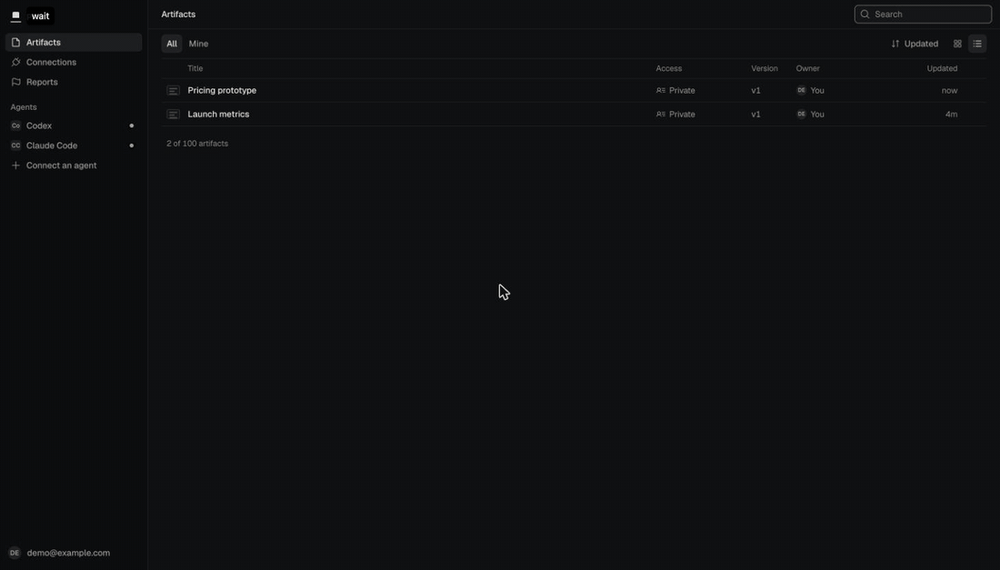

# @mr0b0t0/plinth

Run [Plinth](https://github.com/mr0b0t0/plinth) on your own computer or on your own Cloudflare
account. Plinth is a home for the HTML your AI agents make (reports, dashboards, prototypes):
Claude Code, Codex and any MCP client publish to it, every change is a version you can go back to,
and you decide who can view each page.



- **Private by default.** Share with specific people, a link or a password. Viewers need no AI
  account.
- **Every agent in one place**, under your login, with a history of who made each version.
- **Comments that reach your agents.** Mention `@claude` or `@codex`; the agent publishes a new
  version and replies.
- **Each artifact isolated** on its own origin, sandboxed, with a strict Content Security Policy.

Needs Node 22.12+ on macOS or Linux. Prefer containers? The same Worker ships as the Docker image
`ghcr.io/mr0b0t0/plinth`
([guide](https://github.com/mr0b0t0/plinth/blob/main/docs/docker.md)).

## Localhost only (no domain, no account)

```sh
npx @mr0b0t0/plinth init --email you@example.com
npx @mr0b0t0/plinth start
```

Open `http://127.0.0.1:8788` and sign in with the code printed in the terminal. Then connect
your agents:

```sh
npx @mr0b0t0/plinth connect
```

It prints the commands for Claude Code, Codex, Cursor and VS Code. For Claude Code it lists the
Plinth plugin first (the server plus the skill with Plinth's rules), then the bare server, which
gives the tools only; use one or the other. They sign in with OAuth: a browser opens on Plinth and
you click **Allow**. Artifacts are served from their own `*.localhost`
origins, isolated from the app and from each other. Claude and ChatGPT on the web can't reach a
local-only instance.

## Reachable from the internet

With two domains on Cloudflare and `cloudflared` installed:

```sh
export CLOUDFLARE_API_TOKEN=...   # setup only: Tunnel Edit, DNS Edit, Zone Read
export RESEND_API_KEY=...         # or SENDGRID_API_KEY
npx @mr0b0t0/plinth init --tunnel --app-host plinth.example.com \
  --content-host example-content.net --email-provider resend
npx @mr0b0t0/plinth start
```

The full guide, including running at login, backups and the security model:
[docs/local-hosting.md](https://github.com/mr0b0t0/plinth/blob/main/docs/local-hosting.md).

## Deploy to your Cloudflare account

Plinth runs as one Cloudflare Worker with a D1 database and an R2 bucket; a personal instance fits
the free plan. You need two domains on the Cloudflare account: one for the app, and a separate
registrable domain that serves only artifacts, each from its own subdomain.

```sh
export RESEND_API_KEY=...         # or SENDGRID_API_KEY: sign-in email
npx @mr0b0t0/plinth deploy --app-host plinth.example.com --content-host example-content.net \
  --email-provider resend --admin-email you@example.com
```

`deploy` logs in with wrangler (it opens `wrangler login` in a terminal the first time), creates
the database and the bucket, generates the secrets and stores them in the Worker, applies the
database migrations, deploys, and checks that the app answers. It then prints how to connect your
agents. It uses the Worker that ships in this package, so no checkout and no build are needed.

- **DNS.** Artifact pages need a proxied wildcard record in the content zone: `A`, name `*`,
  `192.0.2.0`, proxied. With `CLOUDFLARE_API_TOKEN` set (permissions: Workers Scripts, D1,
  Workers R2 Storage, Workers Routes and DNS Edit, Zone Read), `deploy` adds it when it is missing;
  with the wrangler login it prints the record for you to add. It never changes existing records.
  The app host gets its DNS record and certificate from Cloudflare as a Workers custom domain.
- **Account.** If your login can reach several Cloudflare accounts, choose one with
  `CLOUDFLARE_ACCOUNT_ID`.
- **One person.** `--single-user` limits sign-in to `--admin-email`, and also prints an
  `ADMIN_TOKEN` once, for scripts. With it, `--email-provider console` writes sign-in codes to the
  Worker log instead of sending mail.
- **Others signing up.** Name the operator first, so the instance publishes terms and a privacy
  notice: `--operator-name`, `--operator-email`, and in the EU `--operator-address` and
  `--operator-registration`.
- **Updating.** Settings are saved in `~/.plinth/<name>/cloudflare/`. Run
  `npx @mr0b0t0/plinth deploy` again with no flags to redeploy them, and
  `npx @mr0b0t0/plinth@latest deploy` to upgrade: it applies the new version's migrations, then
  deploys its Worker. Flags on a later run change the saved settings, and an empty value
  (`--operator-address ""`) clears an optional one. Other Worker settings, such as
  `MAX_ARTIFACTS_PER_USER`, go under `vars` in `deploy.json` there.

`--dry-run` prints every command and the generated config without contacting Cloudflare.
Everything else, from the content domain to email and the Public Suffix List, is in
[docs/self-hosting.md](https://github.com/mr0b0t0/plinth/blob/main/docs/self-hosting.md).

## Publish a build

The `plinth` command also publishes to any Plinth instance, the hosted one included: a built site
(Vite, Next export, anything with `index.html` at the top of its folder) or a folder of files.

```sh
npx @mr0b0t0/plinth login                 # once: approve "Plinth CLI" in the browser
npx @mr0b0t0/plinth publish dist          # a new private artifact; prints its link
npx @mr0b0t0/plinth publish dist --id my-report-k3x9   # the next version of that artifact
```

- **What is sent.** Every file under the folder, as one compressed upload. Dotfiles are left out,
  and so are source maps (`*.map`) unless you add `--include-maps`. Symbolic links are refused:
  copy the files the page needs into the folder instead. Paths may use letters, digits, `.`, `_`,
  `-` and `/`; the command suggests a new name for any other.
- **Limits.** It checks the instance's limits (from `/api/v1/config`) before sending anything:
  files per version, the size of one file and of the whole version.
- **Updates.** With `--id`, only the files that changed are stored; the others are reused from
  the current version. When the changed files fit in one request (about 24 MB) only they are
  sent; otherwise the whole folder goes as one compressed upload and the server reuses the
  unchanged files by hash. If someone else published a version since the one you read, the command stops
  with exit code 3 and changes nothing; `--base-version N` states the version you started from.
- **Checks.** It reads the new version back and compares every file's SHA-256 with the folder,
  then prints the link, how many files were written and reused, and any warnings (for example a
  file the page refers to that is not in the folder). `--json` prints `id`, `slug`, `version`,
  `url`, `content_url`, `stored`, `warnings` and `verified` for scripts and agents.
- **A lost answer.** If the connection drops, or a proxy answers instead of Plinth, after the
  whole folder was sent, the command does not send it again: it asks the upload (or, for an inline
  update, reads the artifact, and again a moment later) whether it was published, and prints that
  version (`--json` adds `"recovered": true`), exits 3 when someone else published in between, or
  says nothing was published. When it cannot tell (the upload's status or the artifact cannot be
  read after a few tries, or the server is still working on the upload after 30 seconds), it
  exits 1 naming the artifact id and the upload id to check (`--json` prints
  `{"published": "unknown", "id", "upload_id"}`, with `base_version` added for an update and no
  `upload_id` for an inline one); for a new artifact that id is the one the upload reserved, and
  `not_found` means nothing was published. For an update it names the rerun to use: the same
  command with `--base-version N`, which sends nothing and exits 0 when the current version
  already matches the folder, and exits 3 when someone else published first. A connection lost while
  the folder was still being sent never publishes.
- **Build settings.** Use relative URLs (Vite: `base: './'`).

Which instance: `--url`, else the instance `--name` and `--home` pick, else `PLINTH_URL`, else
your local instance when there is one, else the hosted one. The address used is printed first. For
scripts, `PLINTH_TOKEN` takes a personal access token instead of `login`; it is sent only to the
instance in `PLINTH_URL` (or the hosted one when that is unset) and never saved. With it set, a
`--url`, `--name` or `--home` for another instance stops with exit code 2, and a local instance
picked without a flag is used without it.

Agents that have only their MCP connection call `start_upload` and run the command it returns;
`plinth upload <dir> --to <upload_url>` is that step, with the upload token in
`PLINTH_UPLOAD_TOKEN` (never on the command line).

## Commands

| Command | Does |
| --- | --- |
| `plinth init` | Create or update an instance (localhost only, or `--tunnel`) |
| `plinth start` | Run it; applies new migrations first; Ctrl-C stops it |
| `plinth status` | Address, account, data folder, and whether it is running |
| `plinth connect` | How to connect agents |
| `plinth deploy` | Deploy to your Cloudflare account, or redeploy and upgrade with the saved settings |

Client commands (they work with any instance, need no Cloudflare account and no wrangler):

| Command | Does |
| --- | --- |
| `plinth login` | Sign in to an instance in the browser (`--no-browser` prints the address) |
| `plinth logout` | Revoke and forget that sign-in |
| `plinth whoami` | The account you are signed in as, and on which instance |
| `plinth publish <dir>` | Publish a build folder; `--id`, `--title`, `--note`, `--base-version`, `--include-maps`, `--dry-run`, `--json` |
| `plinth upload <dir> --to <upload_url>` | Send a folder with a `start_upload` ticket (token in `PLINTH_UPLOAD_TOKEN`) |

Exit codes: 0 done, 1 error, 2 wrong usage, 3 the artifact changed since the version you read.
Sign-ins are kept in `~/.config/plinth/cli-<host>.json` (readable only by you), and each shows on
the instance's Connections page as "Plinth CLI".

Every command but `upload` takes `--name` (default `plinth`) and `--home` (default `~/.plinth`,
or `PLINTH_HOME`). `status` and `connect` use the local instance of that name, or the Cloudflare
deployment with `--cloudflare` (also when there is no local one). To upgrade, run a newer version
of this package.

The Plinth plugin for Claude Code and Codex adds a skill that teaches agents what an artifact may
contain: [docs/agents.md](https://github.com/mr0b0t0/plinth/blob/main/docs/agents.md).

MIT licensed.
